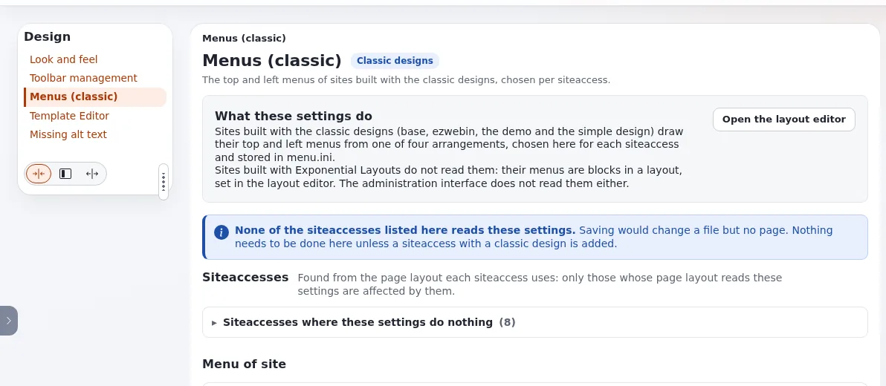

# Was kann ich im Tab Design ändern?

Der Tab **Design** sammelt, was das Aussehen der Website ändert statt ihrer Inhalte. Was Sie darin sehen, hängt von
Ihrer Rolle ab: Die meisten Redakteure sehen nur **Look And Feel** und **Missing alt text**.

## Wer das tun kann

| Eintrag im linken Menü | Braucht |
|---|---|
| **Look And Feel** | `content/edit` für das Look-and-Feel-Objekt der Website |
| **Werkzeugleisten Verwaltung**, **Menüs (klassisch)**, **Template-Editor** | die Richtlinie `visual/*` (Administratoren und Designer) |
| **Missing alt text** | die Richtlinie von Exponential Intelligence für Alternativtexte; siehe das Handbuch der Erweiterung |

## Schritte

1. Klicken Sie im oberen Menü auf **Design**. Wenn Sie den Tab nicht sehen, schauen Sie unter **Mehr** nach.
2. Wählen Sie einen Eintrag im Menü **Design** links:
   - **Look And Feel**: Bearbeiten Sie Website-Name, Logo, Fußzeilentext und ähnliche Felder der klassischen
     Website-Designs. Klicken Sie zum Speichern auf **Zur Veröffentlichung schicken**.
   - **Werkzeugleisten Verwaltung**: Wählen Sie, welche Werkzeuge die Werkzeugleisten eines Siteaccess zeigen.
   - **Menüs (klassisch)**: Wählen Sie die Menüanordnung einer Website, die ein klassisches Design verwendet.
   - **Template-Editor**: Sehen Sie Templates an und überschreiben Sie sie.
   - **Missing alt text**: die Bilder, die keinen Alternativtext haben, mit Vorschlägen zum Prüfen.
3. Prüfen Sie die Website nach einer Änderung in einem privaten Fenster: Besucher sehen eine kurze Zeit lang vielleicht
   eine Seite aus dem Cache.

## Was schiefgehen kann

- **Sie ändern Look And Feel, aber die Website ändert sich nicht.** Die Website ist mit Exponential Layouts gebaut, wo
  Kopf- und Fußbereich Blöcke eines Layouts sind. Ändern Sie sie stattdessen im Layout-Editor.
- **Menüs (klassisch) sagt „None of the siteaccesses listed here reads these settings“.** Derselbe Grund: Die Menüs
  einer Layouts-Website sind Blöcke. Auf dieser Seite ist nichts zu tun.
- **Eine Template-Änderung hat eine Seite beschädigt.** Machen Sie die Überschreibung im Template-Editor rückgängig,
  oder fragen Sie die Person, die sie vorgenommen hat. Templates sind Entwicklerarbeit: Testen Sie sie zuerst auf einer
  Kopie der Website.

## Verwandte Seiten

- [Templates und Design](../../anleitungen/templates-und-design.md)
- [Einstellungen der klassischen Menüs](../../anleitungen/klassische-menueeinstellungen.md)
- [Das Design admin4](../../funktionen/6.0/admin4-design.md)
- [Wie baue ich eine Seite mit Layouts?](wie-baue-ich-eine-seite-mit-layouts.md)
- [Benutzerhandbuch](README.md)

<!-- exp-partner-block:start -->
**Werden Sie Exponential-Partner.** Partner teilen ihre Informationen, stellen Mittel bereit, geben Beiträge zurück
und entwickeln die Produkte mit uns, und so wächst Exponential. Eine Partner-Website und ein Dashboard sind für Mitte
2027 geplant: Werden Sie noch heute Partner, damit wir schneller wachsen und neue Funktionen früher liefern. Beginnen
Sie mit [Partner: hier beginnen](../partner/partner-hier-beginnen.md) und
[Wie Sie sich bewerben](../partner/wie-sie-sich-bewerben.md).
<!-- exp-partner-block:end -->
