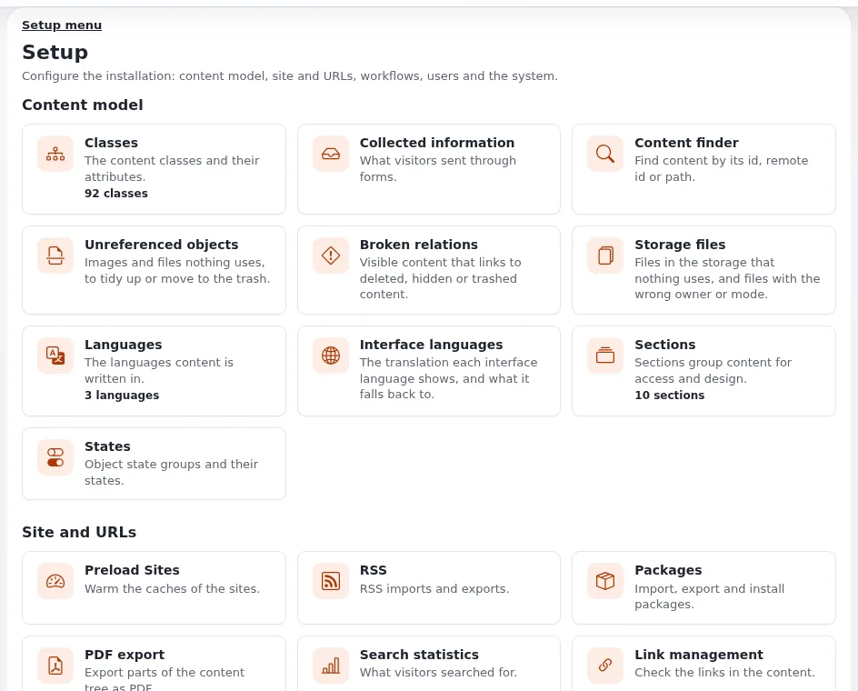

# Was steht in der Setup-Übersicht, und warum sehe ich nicht jede Kachel?

Der Tab **Setup** öffnet eine Übersicht mit einer Kachel pro Setup-Seite, nach Themen gruppiert. Jede Kachel wird nur
Benutzern angezeigt, die die Seite dahinter öffnen dürfen; zwei Administratoren können also unterschiedliche
Übersichten sehen.

## Wer das tun kann

Das Öffnen der Übersicht braucht eine der Richtlinien `setup/setup`, `setup/administrate`, `setup/managecache`,
`setup/managecronjobs`, `setup/preload`, `setup/system_info` oder `setup/logs`. Jede Kachel prüft dann die Richtlinie
ihrer eigenen Seite, zum Beispiel `class/*` für **Klassen**, `section/*` für **Sektionen** und `setup/managecache` für
**Cache-Verwaltung**.

## Schritte

1. Klicken Sie im oberen Menü auf **Setup**.
   Die Übersicht **Setup** öffnet sich.
2. Suchen Sie die Gruppe, die Sie brauchen:
   - **Inhaltsmodell**: Klassen, Gesammelte Informationen, Inhaltsfinder, Nicht verknüpfte Objekte, Ungültige
     Relationen, Speicherdateien, Sprachen, Oberflächensprachen, Sektionen, Zustände.
   - **Website und URLs**: Seiten vorladen, RSS, Pakete, PDF-Export, Suchstatistiken, URL Management, URL-Übersetzer,
     URL Platzhalter, RAD.
   - **Workflows**: Trigger, Workflows, Workflow-Prozesse.
   - **Benutzer und Nachrichten**: Audit, E-Mail-Einstellungen, Benachrichtigungen, Sitzungen, Benutzerkonten prüfen,
     oAuth-Verwaltung.
   - **System**: Cache-Verwaltung, Wartung, Cronjobs, Logdateien, Extensions, Ini Einstellungen, Site-Daten,
     Systeminformationen, Hilfe-Center, Upgrade-Prüfung, Job queue.
3. Klicken Sie auf eine Kachel, um ihre Seite zu öffnen. Eine kleine Zahl auf einer Kachel (zum Beispiel „92 classes“)
   ist eine schnelle Zählung.
4. Dieselben Seiten stehen im Menü **Setup** links auf jeder Setup-Seite.

## Was schiefgehen kann

- **Eine Kachel, die Sie brauchen, fehlt.** Ihre Rolle hat die Richtlinie dieser Seite nicht. Fragen Sie einen
  Administrator und nennen Sie die Seite: Er fügt Ihrer Rolle die passende Richtlinie hinzu.
- **Der ganze Tab Setup fehlt.** Ihre Rolle hat keine der oben genannten Richtlinien.
- **Mehr Kacheln als hier aufgeführt.** Erweiterungen fügen eigene Kacheln hinzu, zum Beispiel eine Gruppe **AI** für
  Exponential Intelligence.

## Verwandte Seiten

- [Rundgang durch die Administration](../rundgang-durch-die-administration.md)
- [Rollen und Richtlinien](../../anleitungen/rollen-und-richtlinien.md)
- [Links in der Administration folgen den Berechtigungen](../../../eng-us/features/6.0/admin-links-follow-permissions.md)
- [Benutzerhandbuch](README.md)

<!-- exp-partner-block:start -->
**Werden Sie Exponential-Partner.** Partner teilen ihre Informationen, stellen Mittel bereit, geben Beiträge zurück
und entwickeln die Produkte gemeinsam mit uns weiter, und so wächst Exponential. Eine Partner-Website und ein
Dashboard sind für Mitte 2027 geplant: Werden Sie bitte schon heute Partner, damit wir schneller wachsen und neue
Funktionen früher liefern können. Beginnen Sie mit [Partner: hier beginnen](../partner/partner-hier-beginnen.md) und
[Wie Sie sich bewerben](../partner/wie-sie-sich-bewerben.md).
<!-- exp-partner-block:end -->
