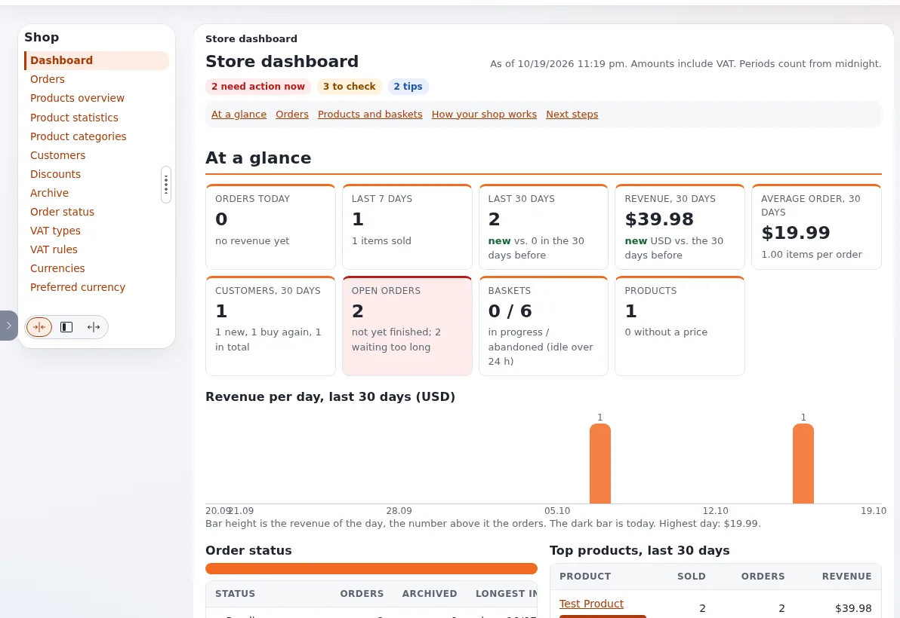

# Was zeigt der Tab Shop?

Der Tab **Shop** öffnet das Shop-Dashboard: wie es dem Shop geht, welche Bestellungen Sie brauchen und wie der
Bestellablauf in dieser Installation eingerichtet ist. In älteren Releases hieß der Tab Web-Shop.

## Wer das tun kann

Benutzer, deren Rolle die Richtlinie `shop/administrate` hat. Ohne sie wird der Tab **Shop** gar nicht angezeigt.

## Schritte

1. Klicken Sie im oberen Menü auf **Shop**.
   Das **Shop-Dashboard** öffnet sich.
2. Lesen Sie **Auf einen Blick**: Bestellungen heute, in 7 und in 30 Tagen, Umsatz und durchschnittliche Bestellung pro
   Währung, Kunden, offene Bestellungen und Warenkörbe.
3. Sehen Sie unter **Bestellungen** nach den wartenden Bestellungen, die am längsten wartenden zuerst. Klicken Sie auf
   eine Bestellung, um sie zu öffnen.
4. Lesen Sie **So funktioniert Ihr Shop**: die Schritte des Bestellablaufs, wie diese Installation eingerichtet ist,
   jeweils mit der Seite oder Einstellung, die ihn ändert.
5. Arbeiten Sie **Nächste Schritte** ab: Vorschläge, die aus Ihren Daten ermittelt wurden, die dringendsten
   zuerst.
6. Verwenden Sie das Menü **Shop** links für die Listen hinter den Zahlen: **Bestellungen**, **Produkt Übersicht**,
   **Produkt-Statistiken**, **Kunden**, **Ermäßigung**, **Archiv**, **Bestellstatus**, **USt-Typen**, **USt-Regeln**
   und **Währungen**.

## Was schiefgehen kann

- **Der Tab Shop fehlt.** Ihrer Rolle fehlt `shop/administrate`, oder der Tab wurde in den Menüeinstellungen dieses
  Siteaccess weggelassen. Fragen Sie einen Administrator.
- **Alle Zahlen sind null.** Der Shop hatte noch keine Bestellungen. Das Dashboard zählt nur die Bestellungen der
  Datenbank dieser Installation.
- **Eine Zahl weicht vom Bericht Ihres Zahlungsanbieters ab.** Das Dashboard zählt Bestellungen, keine Zahlungen.
  Erstattungen und Stornierungen, die nur beim Anbieter vorgenommen wurden, kennt Exponential erst, wenn der Status der
  Bestellung geändert wird.

## Verwandte Seiten

- [Shop-Dashboard und Bestellstatus](../../funktionen/6.0/shop-dashboard.md)
- [Bestellungen im Alltag](../kunden/handel/bestellungen-im-alltag.md)
- [Die tägliche Routine im Shop](../kunden/handel/taegliche-shop-routine.md)
- [Berichte des Shops](../kunden/handel/shop-berichte.md)
- [Benutzerhandbuch](README.md)

<!-- exp-partner-block:start -->
**Werden Sie Exponential-Partner.** Partner teilen ihre Informationen, stellen Mittel bereit, geben Beiträge zurück
und entwickeln die Produkte mit uns, und so wächst Exponential. Eine Partner-Website und ein Dashboard sind für Mitte
2027 geplant: Werden Sie noch heute Partner, damit wir schneller wachsen und neue Funktionen früher liefern. Beginnen
Sie mit [Partner: hier beginnen](../partner/partner-hier-beginnen.md) und
[Wie Sie sich bewerben](../partner/wie-sie-sich-bewerben.md).
<!-- exp-partner-block:end -->
