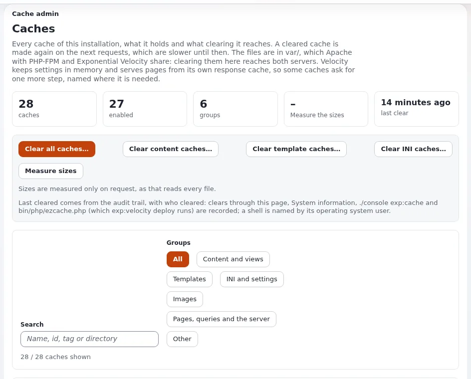

# Welchen Cache leere ich, und wie?

Caches machen Seiten schnell. Exponential erneuert sie, wenn Inhalte veröffentlicht werden; das Leeren von Hand ist
also die Ausnahme. Leeren Sie den kleinsten Cache, der das Problem löst.

## Wer das tun kann

Benutzer, deren Rolle `setup/managecache` hat.

## Schritte

1. Wählen Sie den Cache danach, was Sie geändert haben:

   | Was sich geändert hat | Leeren |
   |---|---|
   | Eine Seite zeigt nach dem Veröffentlichen alte Inhalte | **Inhalt** (Cache der Inhaltsansichten) |
   | Ein Template (`.tpl`) oder eine Design-Datei | **Template**-Caches |
   | Eine Einstellung (`.ini`-Datei) | **INI**-Caches |
   | Sie wissen es nicht, oder mehreres davon | **Alle Caches** |

2. Für ein schnelles Leeren verwenden Sie **Cache leeren** in der rechten Werkzeugleiste: Wählen Sie den Cache in der
   Liste und klicken Sie auf **Leeren**.
3. Für mehr Auswahl öffnen Sie **Setup** > **Cache-Verwaltung**.
   Die Seite **Caches** gruppiert sie: **Inhalte und Ansichten**, **Templates**, **INI und Einstellungen**, **Bilder**,
   **Seiten, Abfragen und der Server**, **Sonstige**.
4. Klicken Sie auf **Cache des Inhalts leeren**, **Template-Cache leeren**, **INI-Caches leeren** oder auf die
   Schaltfläche eines einzelnen Caches. **Den kompletten Cache leeren** leert alles.
5. Laden Sie die Seite zur Kontrolle in einem privaten Fenster neu.

## Was schiefgehen kann

- **Die Website ist nach „Den kompletten Cache leeren“ eine Weile langsam.** Jede Seite wird bei ihrem ersten Aufruf neu
  gebaut. Leeren Sie alles nur, wenn es nötig ist, und nicht zur Hauptzeit.
- **Die Seite ist nach dem Leeren immer noch alt.** Ein Cache außerhalb von Exponential hält sie: der Browser, ein Proxy
  oder CDN oder der Antwortcache des Webservers. Laden Sie mit gedrückter Umschalttaste neu, oder fragen Sie den Hoster.
- **Eine Änderung der Einstellungen wirkt nicht.** INI-Änderungen auf dem Server brauchen zusätzlich ein Neuladen des
  PHP des Webservers. Fragen Sie die Person, die das Deployment macht.

## Verwandte Seiten

- [Caches](../../anleitungen/caches.md)
- [Geschwindigkeit und Caching](../kunden/gesund-halten/geschwindigkeit-und-caching.md)
- [Caches nach einer Änderung](../../../eng-us/help/build-two-ways/caches-after-a-change.md)
- [Benutzerhandbuch](README.md)

<!-- exp-partner-block:start -->
**Werden Sie Exponential-Partner.** Partner teilen ihre Informationen, stellen Mittel bereit, geben Beiträge zurück
und entwickeln die Produkte mit uns, und so wächst Exponential. Eine Partner-Website und ein Dashboard sind für Mitte
2027 geplant: Werden Sie noch heute Partner, damit wir schneller wachsen und neue Funktionen früher liefern. Beginnen
Sie mit [Partner: hier beginnen](../partner/partner-hier-beginnen.md) und
[Wie Sie sich bewerben](../partner/wie-sie-sich-bewerben.md).
<!-- exp-partner-block:end -->
