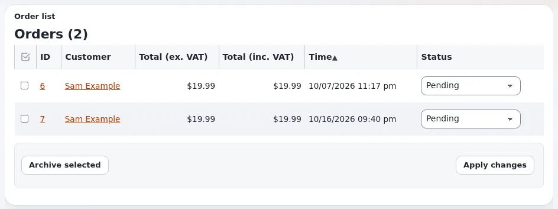

# Wie ändere ich den Status einer Bestellung?

Wählen Sie in der Bestellliste den neuen Status und wenden Sie ihn an. Jede Änderung bleibt im Statusverlauf der
Bestellung erhalten.

## Wer das tun kann

Benutzer, deren Rolle `shop/administrate` hat, um die Bestellliste zu sehen, und `shop/setstatus`, um einen Status zu
ändern. Die Richtlinie `shop/setstatus` kann auf bestimmte Status beschränkt werden, sodass zum Beispiel ein Packer nur
**Ausgeliefert** setzen darf.

## Schritte

1. Klicken Sie auf **Shop** und dann im linken Menü auf **Bestellungen**.
   Die Liste zeigt **ID**, **Kunde**, **Insgesamt (ohne USt)**, **Insgesamt (mit USt)**, **Zeit** und **Status**.
2. Klicken Sie auf eine Spaltenüberschrift, um danach zu sortieren, zum Beispiel auf **Zeit**, um die ältesten
   Bestellungen zuerst zu sehen.
3. Klicken Sie auf die **ID** der Bestellung, um die Produkte, die Adressen und den Statusverlauf zu prüfen, und gehen
   Sie dann zurück zur Liste.
4. Wählen Sie in der Spalte **Status** der Bestellung den neuen Status.
5. Klicken Sie auf **Änderungen anwenden**.
   Die Liste zeigt den neuen Status. Wenn der Shop für diesen Status eine Mail verschickt, geht sie jetzt hinaus.

## Was schiefgehen kann

- **Das Statusmenü ist ausgegraut oder fehlt.** Ihre Rolle darf Bestellungen sehen, aber diesen Status nicht setzen.
  Bitten Sie einen Administrator um `shop/setstatus`.
- **Sie haben mehrere Menüs geändert, aber nur manche wurden gespeichert.** Klicken Sie auf **Änderungen anwenden**,
  bevor Sie die Seite verlassen oder zu einer anderen Seite der Liste wechseln.
- **Den Status, den Sie brauchen, gibt es nicht.** Ein Administrator fügt ihn unter **Shop** > **Bestellstatus**
  hinzu. Status mit einer Kennung unter 1000 gehören zu Exponential und können nicht entfernt werden.

## Verwandte Seiten

- [Bestellstatus](../kunden/handel/bestellstatus.md)
- [Bestellungen im Alltag](../kunden/handel/bestellungen-im-alltag.md)
- [Die Bestellliste nach jeder Spalte sortieren](../../../eng-us/features/6.0/order-list-sorting.md)
- [Wie archiviere ich abgeschlossene Bestellungen?](wie-archiviere-ich-abgeschlossene-bestellungen.md)
- [Benutzerhandbuch](README.md)

<!-- exp-partner-block:start -->
**Werden Sie Exponential-Partner.** Partner teilen ihre Informationen, stellen Mittel bereit, geben Beiträge zurück
und entwickeln die Produkte mit uns, und so wächst Exponential. Eine Partner-Website und ein Dashboard sind für Mitte
2027 geplant: Werden Sie noch heute Partner, damit wir schneller wachsen und neue Funktionen früher liefern. Beginnen
Sie mit [Partner: hier beginnen](../partner/partner-hier-beginnen.md) und
[Wie Sie sich bewerben](../partner/wie-sie-sich-bewerben.md).
<!-- exp-partner-block:end -->
