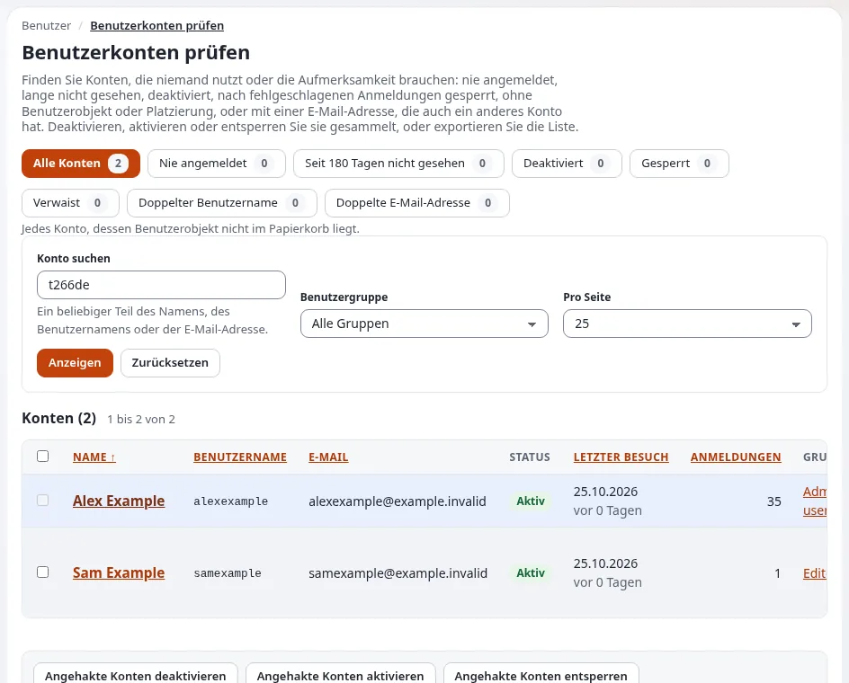

# Wie deaktiviere oder entsperre ich ein Benutzerkonto?

Ein deaktiviertes Konto kann sich nicht anmelden, behält aber seine Inhalte und seinen Verlauf. Ein gesperrtes Konto
hatte zu viele fehlgeschlagene Anmeldungen und wird von einem Administrator entsperrt.

## Wer das tun kann

Benutzer, deren Rolle `user/hygiene` hat (die Seite **Benutzerkonten prüfen**), oder die den Benutzer bearbeiten dürfen
(die Kontoeinstellungen eines Benutzers). Der anonyme Benutzer, das Administratorkonto und Ihr eigenes Konto werden dort
nie geändert.

## Schritte

1. Öffnen Sie **Setup** > **Benutzerkonten prüfen**.
   Die Seite listet jedes Konto mit seinem Zustand (**Aktiv**, **Deaktiviert**, **Gesperrt**, **Nicht aktiviert**) und
   dem letzten Besuch.
2. Suchen Sie die Konten unter **Liste eingrenzen**: nach Name, Login oder E-Mail-Adresse, nach Gruppe oder nach Zustand
   wie **Nie angemeldet**. Klicken Sie auf **Anzeigen**.
3. Markieren Sie die Konten.
4. Klicken Sie auf **Angehakte Konten deaktivieren**, **Angehakte Konten aktivieren** oder **Angehakte Konten
   entsperren** und bestätigen Sie.
5. Für einen einzelnen Benutzer öffnen Sie seine Seite und klicken Sie auf **Benutzerkonten-Einstellungen
   konfigurieren**: Entfernen oder setzen Sie das Häkchen bei **Benutzerkonto aktivieren**, und klicken Sie für die
   fehlgeschlagenen Anmeldungen auf **Zurücksetzen**.

## Was schiefgehen kann

- **Der Benutzer ist nach dem Deaktivieren noch angemeldet.** Offene Sitzungen enden bei ihrer nächsten Anfrage. Um sie
  sofort zu beenden, verwenden Sie **Setup** > **Sitzungen**.
- **Entsperrt, aber bald wieder gesperrt.** Jemand versucht es immer wieder mit einem falschen Passwort, vielleicht ein
  altes Skript oder ein Angriff. Sehen Sie sich die Anmeldeereignisse im Prüfprotokoll an.
- **Sie möchten eine Person entfernen, die gegangen ist.** Deaktivieren Sie zuerst; entfernen Sie das Konto erst, wenn
  ihre Inhalte einen neuen Eigentümer haben.

## Verwandte Seiten

- [Benutzerkonten prüfen](../../funktionen/6.0/benutzerpflege.md)
- [Wenn Mitarbeiter ausscheiden](../kunden/alltag/ausscheiden-von-mitarbeitenden.md)
- [Das Administratorpasswort ändern](../administratorpasswort-aendern.md)
- [Sitzungen](../../anleitungen/sitzungen.md)
- [Mitglieder verwalten](../mitglieder-verwalten.md), für Redakteure
- [Das Benutzer-Auditprotokoll](../das-benutzer-auditprotokoll.md)
- [Benutzerhandbuch](README.md)

<!-- exp-partner-block:start -->
**Werden Sie Exponential-Partner.** Partner teilen ihre Informationen, stellen Mittel bereit, geben Beiträge zurück
und entwickeln die Produkte mit uns, und so wächst Exponential. Eine Partner-Website und ein Dashboard sind für Mitte
2027 geplant: Werden Sie noch heute Partner, damit wir schneller wachsen und neue Funktionen früher liefern. Beginnen
Sie mit [Partner: hier beginnen](../partner/partner-hier-beginnen.md) und
[Wie Sie sich bewerben](../partner/wie-sie-sich-bewerben.md).
<!-- exp-partner-block:end -->
