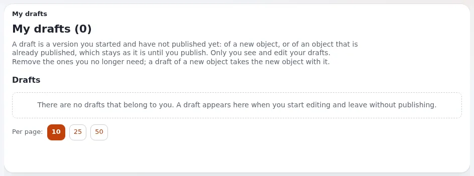

# Wie finde und beende ich meine Entwürfe?

Ein Entwurf ist eine Version, die Sie gespeichert, aber nicht veröffentlicht haben. **Meine Entwürfe** listet alle
Ihre Entwürfe auf, damit nichts verloren geht, was Sie begonnen haben.

## Wer das tun kann

Jeder Benutzer, der Inhalte bearbeiten kann. Sie sehen nur Ihre eigenen Entwürfe.

## Schritte

1. Öffnen Sie im oberen Menü **Dashboard** und wählen Sie **Meine Entwürfe**, oder verwenden Sie den Block **Meine
   Entwürfe** im Dashboard.
   Die Seite **Meine Entwürfe** öffnet sich.
2. Um einen Entwurf zu finden, geben Sie unter **Einen Entwurf finden** einen Teil seines Namens ein, oder grenzen Sie
   die Liste nach **Klasse**, **Sprache**, **Ort** oder **Nicht geändert seit** ein, und klicken Sie dann auf
   **Suchen**.
3. Klicken Sie neben dem Entwurf auf **Bearbeiten**.
   Das Bearbeitungsformular öffnet sich mit Ihren gespeicherten Änderungen.
4. Stellen Sie den Text fertig und klicken Sie auf **Zur Veröffentlichung schicken**.
   Der Entwurf wird zur veröffentlichten Version und verschwindet aus der Liste.
5. Um Entwürfe zu verwerfen, markieren Sie sie und klicken Sie auf **Ausgewählte entfernen**. **Alte Entwürfe
   entfernen** entfernt jeden Entwurf, der älter ist als das Alter, das Sie wählen.

## Was schiefgehen kann

- **„Remove for good“ entfernt mehr, als Sie wollten.** Ein entfernter Entwurf lässt sich nicht wiederherstellen. Ein
  Entwurf eines Objekts, das nie veröffentlicht wurde, entfernt auch dieses neue Objekt. Prüfen Sie die Liste, bevor
  Sie bestätigen.
- **Jemand anderes hat das Objekt seit Ihrem Entwurf geändert.** Beim Veröffentlichen meldet Exponential, dass es eine
  neuere Version gibt. Vergleichen Sie die Versionen vor dem Veröffentlichen, sonst überschreiben Sie die Änderung der
  anderen Person.
- **Ein Entwurf fehlt.** Er wurde veröffentlicht, entfernt, oder er gehört einem anderen Benutzer. Entwürfe anderer
  Benutzer werden nicht angezeigt.

## Verwandte Seiten

- [Entwürfe und wartende Elemente](../../anleitungen/entwuerfe-und-ausstehende-objekte.md)
- [Entwürfe, Versionen und Rückgängigmachen](../kunden/alltag/entwuerfe-versionen-und-rueckgaengig.md)
- [Veröffentlichen und Versionen](../veroeffentlichen-und-versionen.md)
- [Benutzerhandbuch](README.md)

<!-- exp-partner-block:start -->
**Werden Sie Exponential-Partner.** Partner teilen ihre Informationen, stellen Mittel bereit, geben Beiträge zurück
und entwickeln die Produkte mit uns, und so wächst Exponential. Eine Partner-Website und ein Dashboard sind für Mitte
2027 geplant: Werden Sie noch heute Partner, damit wir schneller wachsen und neue Funktionen früher liefern. Beginnen
Sie mit [Partner: hier beginnen](../partner/partner-hier-beginnen.md) und
[Wie Sie sich bewerben](../partner/wie-sie-sich-bewerben.md).
<!-- exp-partner-block:end -->
