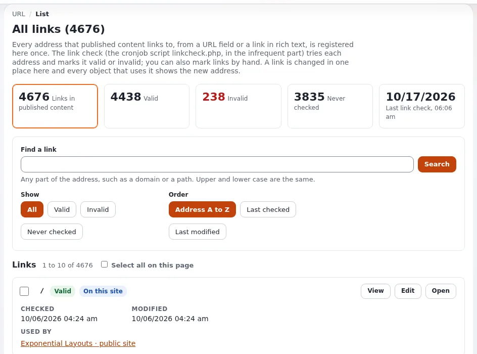

# Wie finde und repariere ich defekte Links?

Exponential führt eine Liste aller Links in den Inhalten und prüft sie mit einem Cronjob. Reparieren Sie einen defekten
Link einmal, und jedes Objekt, das ihn verwendet, ist repariert.

## Wer das tun kann

Benutzer, deren Rolle Zugriff auf das Modul `url` hat (Administratoren). Redakteure, die die Inhalte reparieren,
brauchen `content/edit` für die Objekte.

## Schritte

1. Öffnen Sie **Setup** > **URL Management**.
   Die Seite **Alle URLs** zeigt eine Übersicht und das Datum der letzten Linkprüfung.
2. Klicken Sie unter **Anzeigen** auf **Ungültig** (oder auf die Zahl **Ungültig** der Übersicht).
   Die Seite listet die Links auf, die fehlgeschlagen sind. **Einen Link finden** grenzt sie auf eine Domain oder einen
   Pfad ein.
3. Klicken Sie neben einem Link auf **Ansehen**, um die Objekte zu sehen, die ihn verwenden (**Verwendet von**).
4. Reparieren Sie ihn:
   - wenn die Adresse umgezogen ist, klicken Sie auf **Bearbeiten** und geben Sie die neue Adresse ein: Jedes Objekt,
     das den Link verwendet, ändert sich;
   - wenn die Seite nicht mehr existiert, bearbeiten Sie die Objekte und entfernen oder ersetzen Sie den Link.
5. Wenn ein Link in Ordnung ist, die Prüfung aber fehlschlägt (eine Website, die Prüfungen ablehnt), markieren Sie ihn
   und klicken Sie auf **Ausgewählte als gültig markieren**.

## Was schiefgehen kann

- **„The link check has not run yet“.** Der Cronjob für die Linkprüfung läuft nicht. Fragen Sie die Person, die den
  Server betreibt.
- **Ein Link auf diese Website ist als ungültig markiert.** Die Seite wurde verschoben oder umbenannt und hat keinen
  Adress-Alias für den alten Pfad. Verlinken Sie das Objekt im Editor mit **Durchsuchen**; ein solcher Link folgt
  Verschiebungen.
- **Ungültige Relationen, keine Links.** Eingebettete Objekte und Relationsfelder, die auf Inhalte im Papierkorb zeigen,
  stehen unter **Setup** > **Ungültige Relationen**: siehe
  [Was findet die Inhaltsprüfung?](was-findet-die-inhaltspruefung.md)

## Verwandte Seiten

- [Link- und Inhaltsprüfungen](../../../eng-us/help/creators/website-creators/link-and-content-checks.md)
- [Wie füge ich im Online-Editor einen Link ein?](wie-fuege-ich-im-online-editor-einen-link-ein.md)
- [URLs und Aliase](../../anleitungen/urls-und-aliase.md)
- [Benutzerhandbuch](README.md)

<!-- exp-partner-block:start -->
**Werden Sie Exponential-Partner.** Partner teilen ihre Informationen, stellen Mittel bereit, geben Beiträge zurück
und entwickeln die Produkte mit uns, und so wächst Exponential. Eine Partner-Website und ein Dashboard sind für Mitte
2027 geplant: Werden Sie noch heute Partner, damit wir schneller wachsen und neue Funktionen früher liefern. Beginnen
Sie mit [Partner: hier beginnen](../partner/partner-hier-beginnen.md) und
[Wie Sie sich bewerben](../partner/wie-sie-sich-bewerben.md).
<!-- exp-partner-block:end -->
