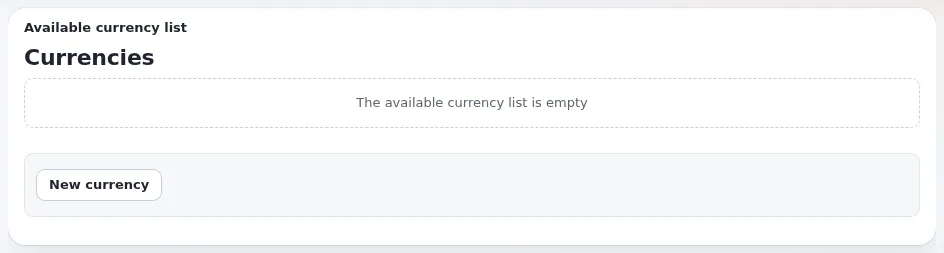

# Wie füge ich dem Shop eine Währung hinzu?

Legen Sie die Währung an, schalten Sie sie aktiv und geben Sie ihr einen Umrechnungskurs. Produkte, deren Preisfeld ein
Preis in mehreren Währungen ist, zeigen dann einen Preis in ihr.

## Wer das tun kann

Benutzer, deren Rolle `shop/administrate` hat.

## Schritte

1. Klicken Sie auf **Shop** und dann auf **Währungen**.
2. Klicken Sie auf **Neue Währung**.
3. Geben Sie den **Währungs Code** (zum Beispiel `EUR`) und das **Währungszeichen** ein und wählen Sie die Locale unter
   **Locale formatieren**.
4. Geben Sie bei Bedarf eine **Eigene Umrechnung** und einen **Umrechnungsfaktor** ein und klicken Sie dann auf
   **Erstellen**.
5. Setzen Sie in der Liste den **Status** der Währung auf **Aktiv** und klicken Sie auf **Änderungen anwenden**.
6. Wenn die Kurse von einem Kursanbieter kommen, klicken Sie auf **Auto-Umrechnungsfaktoren aktualisieren** und dann
   auf **Auto-Preis aktualisieren**.
7. Wählen Sie im linken Menü unter **Bevorzugte Währung** die Währung, die Besucher zuerst sehen.

## Was schiefgehen kann

- **Produkte zeigen keinen Preis in der neuen Währung.** Ihr Preisfeld ist ein einfacher Preis, kein Preis in mehreren
  Währungen, oder die automatischen Preise wurden nicht aktualisiert. Klicken Sie auf **Auto-Preis aktualisieren**.
- **Die Beträge sind falsch formatiert.** Wählen Sie unter **Locale formatieren** die richtige Locale für die Währung.

## Verwandte Seiten

- [Preise und Währungen](../kunden/handel/preise-und-waehrungen.md)
- [Benutzerhandbuch](README.md)

<!-- exp-partner-block:start -->
**Werden Sie Exponential-Partner.** Partner teilen ihre Informationen, stellen Mittel bereit, geben Beiträge zurück
und entwickeln die Produkte gemeinsam mit uns weiter, und so wächst Exponential. Eine Partner-Website und ein
Dashboard sind für Mitte 2027 geplant: Werden Sie bitte schon heute Partner, damit wir schneller wachsen und neue
Funktionen früher liefern können. Beginnen Sie mit [Partner: hier beginnen](../partner/partner-hier-beginnen.md) und
[Wie Sie sich bewerben](../partner/wie-sie-sich-bewerben.md).
<!-- exp-partner-block:end -->
