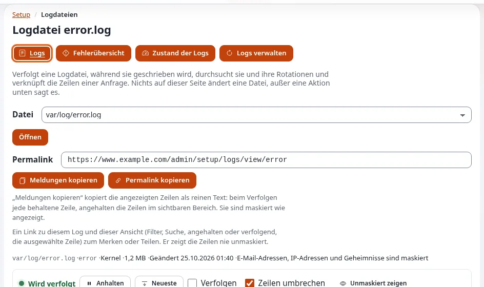

# Wie lese ich die Logdateien?

Der Log-Viewer zeigt die Logdateien der Installation im Browser, sodass Sie ohne Zugriff auf den Server sehen können,
was schiefgegangen ist.

## Wer das tun kann

Benutzer, deren Rolle `setup/logs` hat. **Unmaskiert zeigen** (IP-Adressen und andere personenbezogene Daten im
Klartext) braucht `setup/unmasklogs`; **Logs verwalten** (rotieren, entfernen) braucht `setup/managelogs`.

## Schritte

1. Öffnen Sie **Setup** > **Logdateien**.
2. Wählen Sie unter **Datei** das Log, zum Beispiel `var/log/error.log`, und klicken Sie auf **Öffnen**.
   Die neuesten Zeilen werden angezeigt, und neue erscheinen, sobald sie geschrieben werden (**Wird verfolgt**).
   **Anhalten** stoppt das Mitlaufen; **Neueste** springt zurück ans Ende.
3. Verwenden Sie die **Steuerung**, um nach Stufe zu filtern oder nach einem Wort zu suchen, zum Beispiel nach einer
   Fehlerreferenz von einer Fehlerseite.
4. Klicken Sie auf eine Zeile, um den ganzen **Eintrag** zu sehen. **Permalink kopieren** liefert einen Link auf diese
   Zeile für eine Kollegin oder einen Kollegen; **Meldungen kopieren** kopiert die Zeilen.
5. Für einen Überblick klicken Sie auf **Fehlerübersicht** (die Fehler nach Art gruppiert) oder **Zustand der Logs**
   (Größen und Wachstum).

## Was schiefgehen kann

- **Adressen und Namen erscheinen maskiert.** Das ist die Voreinstellung zum Schutz personenbezogener Daten. Bitten Sie
  nur dann um `setup/unmasklogs`, wenn Sie es brauchen.
- **Ein Log ist leer.** Diese Art von Ereignis ist nicht vorgekommen, oder die Protokollierung dafür ist ausgeschaltet.
- **Eine Fehlerseite zeigt eine Referenz wie `k1-...`.** Suchen Sie im Log danach: siehe
  [Einen Fehler über seine Referenz finden](../../anleitungen/fehler-anhand-der-referenz-finden.md).

## Verwandte Seiten

- [Der Log-Viewer](../../funktionen/6.0/log-betrachter.md)
- [Rotation und Bereinigung der Logs](../../funktionen/6.0/log-rotation.md)
- [Logs für Inhaber](../kunden/gesund-halten/logs-fuer-betreiber.md)
- [Benutzerhandbuch](README.md)

<!-- exp-partner-block:start -->
**Werden Sie Exponential-Partner.** Partner teilen ihre Informationen, stellen Mittel bereit, geben Beiträge zurück
und entwickeln die Produkte mit uns, und so wächst Exponential. Eine Partner-Website und ein Dashboard sind für Mitte
2027 geplant: Werden Sie noch heute Partner, damit wir schneller wachsen und neue Funktionen früher liefern. Beginnen
Sie mit [Partner: hier beginnen](../partner/partner-hier-beginnen.md) und
[Wie Sie sich bewerben](../partner/wie-sie-sich-bewerben.md).
<!-- exp-partner-block:end -->
