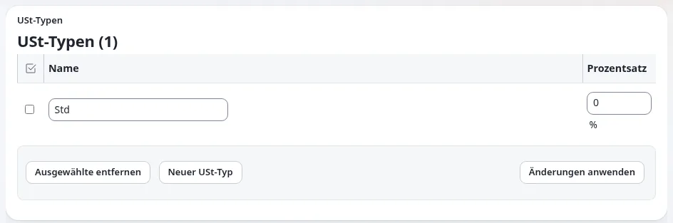

# Wie richte ich die USt für meine Produkte ein?

Ein USt-Typ ist ein Name und ein Prozentsatz, und das Preisfeld eines Produkts nennt seinen USt-Typ. Regeln für die
Berechnung der USt wählen den Typ nach dem Land des Kunden und der Produktkategorie, wo sich der Satz unterscheidet.

## Wer das tun kann

Benutzer, deren Rolle `shop/administrate` hat. Legen Sie die Sätze zuerst mit Ihrer Steuerberatung fest.

## Schritte

1. Klicken Sie auf **Shop** und dann auf **USt-Typen**.
2. Klicken Sie auf **Neuer USt-Typ**.
   Eine leere Zeile wird hinzugefügt.
3. Geben Sie den **Namen** (zum Beispiel „Regelsatz“) und den **Prozentsatz** ein.
4. Klicken Sie auf **Änderungen anwenden**.
5. Wenn der Satz vom Land oder von der Art des Produkts abhängt, klicken Sie im linken Menü auf **USt-Regeln** und dann
   auf **Neue Regel**.
6. Wählen Sie das **Land/Region**, die **Produkt Kategorien** (oder **Beliebig**) und den **USt-Typ** und klicken Sie
   dann auf **Erstellen**.
7. Bearbeiten Sie ein Produkt, wählen Sie in seinem Preisfeld den USt-Typ und veröffentlichen Sie es.

### Sätze, die vom Land oder von der Art des Produkts abhängen

Regeln nach Land und Produktkategorie funktionieren nur, wenn die Website dafür eingerichtet ist: der USt-Handler
`ezdefault` in `shop.ini [VATSettings]`, ein Länderfeld in der Benutzerklasse (`UserCountryAttribute`) und ein Feld für
die Produktkategorie in der Produktklasse (`ProductCategoryAttribute`). Fragen Sie einen Administrator. Dann:

1. Klicken Sie auf **Shop** und dann auf **Produkt Kategorien**, klicken Sie auf **Neue Produktkategorie**, geben Sie
   ihr einen Namen (zum Beispiel „Geschenkkarten“) und klicken Sie auf **Änderungen anwenden**.
2. Bearbeiten Sie jedes Produkt und wählen Sie seine Kategorie im Feld für die Produktkategorie.
3. Wählen Sie im Preisfeld des Produkts den USt-Typ *Determined by VAT charging rules*, damit die Regeln entscheiden.
4. Fügen Sie die Regeln wie in den Schritten 5 und 6 hinzu, mit einer Regel für **Beliebig** als Land und **Beliebig**
   als Kategorie als Rückfall.

## Was schiefgehen kann

- **Preise zeigen 0 % USt.** Die Produkte verwenden einen USt-Typ mit dem Prozentsatz 0, oft den, den eine neue
  Installation mitbringt. Das Shop-Dashboard führt das unter **Nächste Schritte** auf.
- **„Wrong or missing rules“ auf der Seite USt-Regeln.** Für ein Land oder eine Produktkategorie gibt es keine Regel, und
  es gibt keine Regel für **Beliebig**. Fügen Sie eine Regel für **Beliebig** als Rückfall hinzu.
- **Sie können einen USt-Typ nicht entfernen.** Produkte verwenden ihn noch. Ändern Sie zuerst diese Produkte.

## Verwandte Seiten

- [USt-Typen und -Regeln](../kunden/handel/ust-typen-und-ust-regeln.md)
- [USt-Checkliste](../kunden/handel/mehrwertsteuer-checkliste.md)
- [Ein Produkt anlegen](../kunden/handel/ein-produkt-anlegen.md)
- [Benutzerhandbuch](README.md)

<!-- exp-partner-block:start -->
**Werden Sie Exponential-Partner.** Partner teilen ihre Informationen, stellen Mittel bereit, geben Beiträge zurück
und entwickeln die Produkte mit uns, und so wächst Exponential. Eine Partner-Website und ein Dashboard sind für Mitte
2027 geplant: Werden Sie noch heute Partner, damit wir schneller wachsen und neue Funktionen früher liefern. Beginnen
Sie mit [Partner: hier beginnen](../partner/partner-hier-beginnen.md) und
[Wie Sie sich bewerben](../partner/wie-sie-sich-bewerben.md).
<!-- exp-partner-block:end -->
