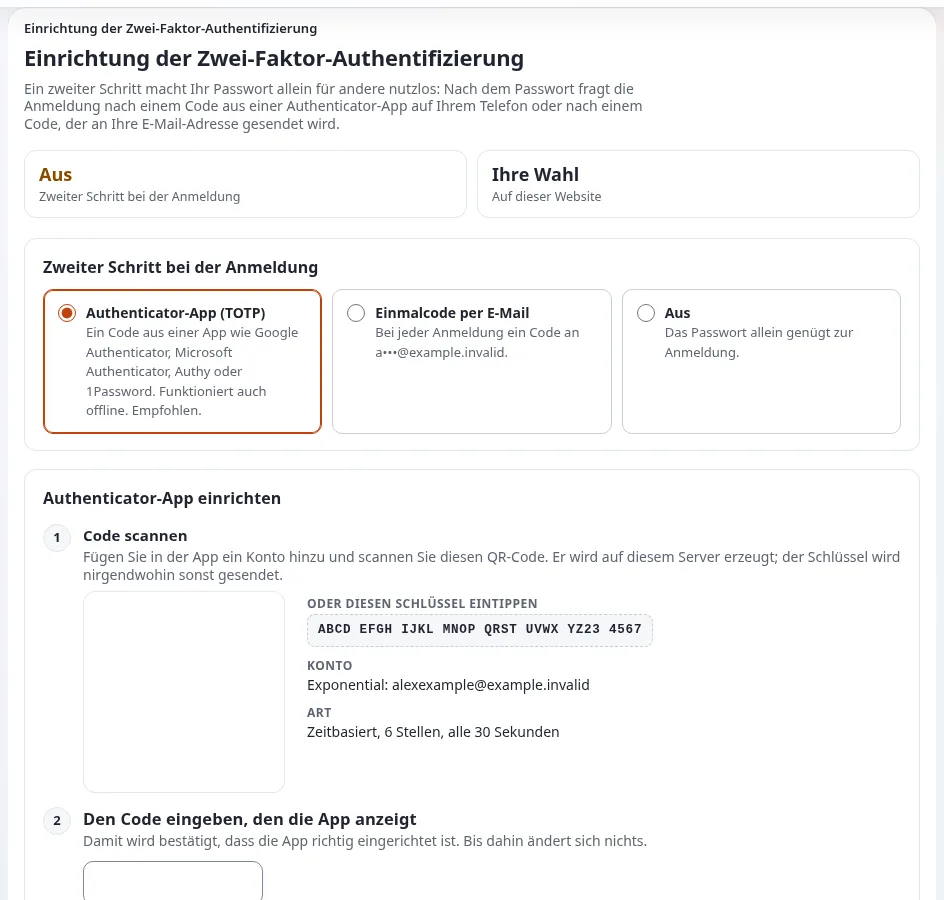

# Wie schalte ich die zweistufige Anmeldung für mein Konto ein?

Mit der zweistufigen Anmeldung reicht Ihr Passwort allein nicht: Danach fragt die Anmeldung nach einem Code aus einer
App auf Ihrem Telefon oder aus einer E-Mail. Schalten Sie sie für jedes Konto ein, das veröffentlichen oder
Einstellungen ändern kann.

## Wer das tun kann

Jeder angemeldete Benutzer, dessen Rolle `user2fa/setup` hat, auf einer Website, auf der die Erweiterung für die
zweistufige Anmeldung aktiv ist (in einer neuen Installation ist sie es). Halten Sie eine Authenticator-App auf Ihrem
Telefon bereit, etwa eine quelloffene oder die, die Ihre Organisation verwendet.

## Schritte

1. Öffnen Sie **Mein Konto** (klicken Sie in der rechten Werkzeugleiste auf **Informationen ändern**).
2. Klicken Sie unter **Zweistufige Anmeldung** auf **Einschalten**.
   Die Seite **Two-Factor Authentication Setup** öffnet sich.
3. Wählen Sie unter **Second step at sign-in** **Authenticator app (TOTP)**.
4. Fügen Sie unter **Scan the code** in Ihrer App ein Konto hinzu und scannen Sie den QR-Code, oder tippen Sie den
   daneben angezeigten Schlüssel ein.
5. Tippen Sie unter **Enter the code the app shows** den sechsstelligen Code aus der App ein.
6. Klicken Sie auf **Save settings**.
   Ab Ihrer nächsten Anmeldung wird der Code nach Ihrem Passwort abgefragt.

## Was schiefgehen kann

- **„The code is wrong.“** Die Uhrzeit des Telefons stimmt nicht. Schalten Sie auf dem Telefon die automatische Uhrzeit
  ein und versuchen Sie einen neuen Code.
- **Kein Telefon zur Hand.** Wählen Sie stattdessen **E-mail one-time code**: Der Code wird dann bei jeder Anmeldung an
  Ihre E-Mail-Adresse geschickt.
- **Sie haben das Telefon verloren.** Allein können Sie sich nicht anmelden. Fragen Sie einen Administrator: siehe
  [Ein Benutzer hat sein Telefon verloren: wie meldet er sich wieder an?](telefon-verloren-wie-meldet-sich-ein-benutzer-an.md)
- **Ändern oder Ausschalten fragt nach einem Code.** Das ist Absicht, damit niemand an einem unbeaufsichtigten Computer
  Ihr Konto schwächen kann.

## Verwandte Seiten

- [Zweistufige Anmeldung](../../anleitungen/zwei-faktor-anmeldung.md)
- [Konten, Passwörter und Zwei-Faktor](../kunden/alltag/konten-passwoerter-und-zweistufige-anmeldung.md)
- [Was kann ich auf meiner Kontoseite tun?](was-steht-auf-meiner-kontoseite.md)
- [Benutzerhandbuch](README.md)

<!-- exp-partner-block:start -->
**Werden Sie Exponential-Partner.** Partner teilen ihre Informationen, stellen Mittel bereit, geben Beiträge zurück
und entwickeln die Produkte mit uns, und so wächst Exponential. Eine Partner-Website und ein Dashboard sind für Mitte
2027 geplant: Werden Sie noch heute Partner, damit wir schneller wachsen und neue Funktionen früher liefern. Beginnen
Sie mit [Partner: hier beginnen](../partner/partner-hier-beginnen.md) und
[Wie Sie sich bewerben](../partner/wie-sie-sich-bewerben.md).
<!-- exp-partner-block:end -->
