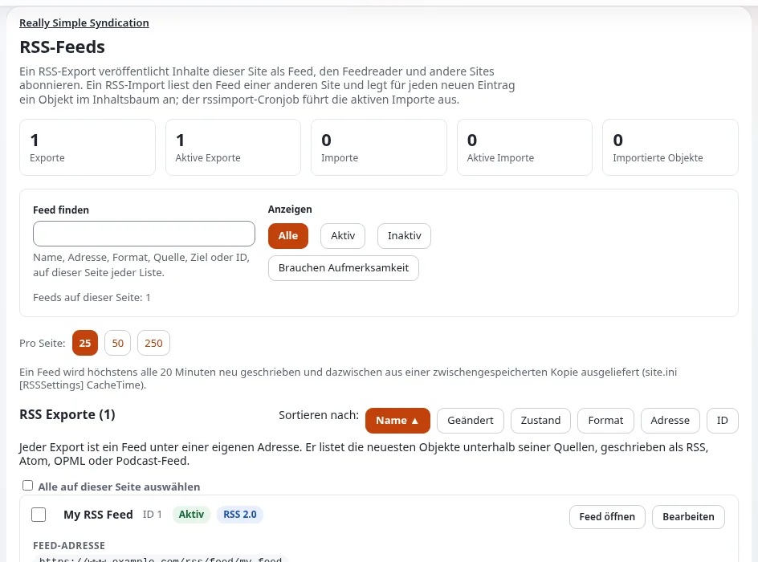

# Wie veröffentliche ich einen RSS-Feed meiner Inhalte?

Ein RSS-Export veröffentlicht die neuesten Einträge eines Ordners als Feed, den Leser und andere Websites abonnieren
können.

## Wer das tun kann

Benutzer, deren Rolle `rss/edit` hat.

## Schritte

1. Öffnen Sie **Setup** > **RSS**.
   Die Seite **RSS-Feeds** listet **RSS Exporte** und **RSS Importe** auf.
2. Klicken Sie unter **RSS Exporte** auf **Neuer Export**.
3. Geben Sie den **Namen** (den Titel des Feeds), eine **Beschreibung** und die **URL der Website** ein.
4. Klicken Sie unter **Quelle** auf **Durchsuchen** und wählen Sie den Ordner, dessen Einträge der Feed auflistet.
   Wählen Sie die **Klasse** der Einträge und klicken Sie auf **Setzen**; wählen Sie dann, welches Feld der Titel und
   welches die Beschreibung ist.
5. Wählen Sie das **Feed-Format**, die **Anzahl der Objekte** und die **URL des erzeugten RSS-Feeds** (den letzten Teil
   der Adresse des Feeds).
6. Markieren Sie **Aktiv** und klicken Sie auf **OK**.
7. Klicken Sie in der Liste auf **Feed öffnen**, um ihn zu prüfen.

## Was schiefgehen kann

- **Der Feed ist leer.** Die Klasse oder der Ordner ist falsch, oder die Einträge sind für Besucher nicht lesbar.
- **Leser sehen den falschen Text.** Wählen Sie andere Felder für Titel und Beschreibung und klicken Sie dann auf
  **OK**.

## Verwandte Seiten

- [RSS-Feeds](../../anleitungen/rss-feeds.md)
- [RSS-Feeds für Ihre Website](../ersteller/website-ersteller/rss-feeds-fuer-ihre-website.md)
- [RSS: Feeds für Apple Podcasts, eine blätterbare Feed-Liste und sicherere Exporte](../../funktionen/6.0/rss-podcast-und-feed-liste.md)
- [Wie importiere ich einen RSS-Feed?](wie-importiere-ich-einen-rss-feed.md)
- [Benutzerhandbuch](README.md)

<!-- exp-partner-block:start -->
**Werden Sie Exponential-Partner.** Partner teilen ihre Informationen, stellen Mittel bereit, geben Beiträge zurück
und entwickeln die Produkte mit uns, und so wächst Exponential. Eine Partner-Website und ein Dashboard sind für Mitte
2027 geplant: Werden Sie noch heute Partner, damit wir schneller wachsen und neue Funktionen früher liefern. Beginnen
Sie mit [Partner: hier beginnen](../partner/partner-hier-beginnen.md) und
[Wie Sie sich bewerben](../partner/wie-sie-sich-bewerben.md).
<!-- exp-partner-block:end -->
