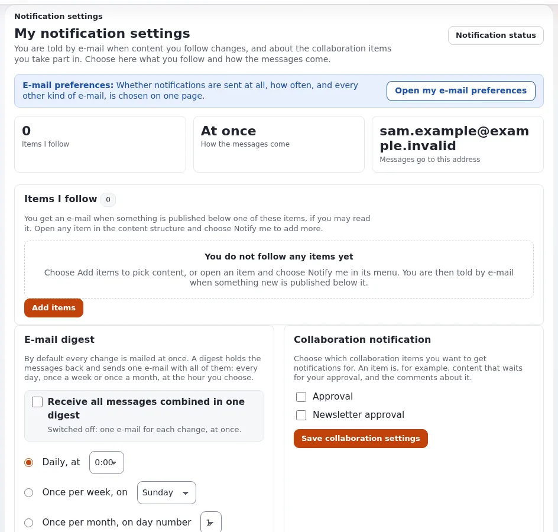

# Wie wähle ich, welche Benachrichtigungen ich bekomme?

Benachrichtigungen schicken Ihnen eine Mail, wenn sich Inhalte ändern, denen Sie folgen. Sie wählen, wem Sie folgen und
wie oft die Mail kommt.

## Wer das tun kann

Benutzer, deren Rolle `notification/use` hat.

## Schritte

1. Öffnen Sie im oberen Menü **Dashboard** und wählen Sie **Meine Benachrichtigungen**, oder klicken Sie auf
   **Mein Konto** auf **Benachrichtigungseinstellungen**.
   Die Seite **Meine Benachrichtigungen** öffnet sich.
2. Unter **Einträge, denen ich folge** sehen Sie, wem Sie folgen. Markieren Sie Einträge und klicken Sie auf
   **Ausgewählte entfernen**, um ihnen nicht mehr zu folgen.
3. Markieren Sie unter **E-Mail-Digest** **Alle Nachrichten in einer Zusammenfassung erhalten** und wählen Sie
   **Täglich**, **Once per week** oder **Once per month**, mit der Uhrzeit. Klicken Sie auf
   **Digest-Einstellungen speichern**. Ohne das Häkchen schickt Ihnen jede Änderung sofort eine Mail.
4. Markieren Sie unter **Benachrichtigung zur Zusammenarbeit** die Arten von Elementen, die Ihnen eine Mail schicken
   sollen (zum Beispiel **Freigabe**), und klicken Sie auf **Einstellungen zur Zusammenarbeit speichern**.
5. Um optionale E-Mails ganz abzustellen, öffnen Sie **Meine E-Mail-Einstellungen** und klicken Sie auf **Alle
   optionalen E-Mails ausschalten**, oder entfernen Sie die Häkchen bei Kategorien und klicken Sie auf **Meine Auswahl
   speichern**.

## Was schiefgehen kann

- **Es kommt keine Mail an.** Der Cronjob für Benachrichtigungen ist noch nicht gelaufen, Ihre E-Mail-Einstellungen
  schalten die Kategorie aus, oder die Mail ist im Spam gelandet. Siehe „Why did I not get a mail?“ in der Anleitung zu
  Benachrichtigungen.
- **Zu viele Mails.** Wählen Sie einen Digest statt sofortiger Mails, oder folgen Sie einem kleineren Teil des Baums.
- **Ein Eintrag sagt „Content no longer exists“.** Er wurde gelöscht. Entfernen Sie ihn aus der Liste.

## Verwandte Seiten

- [Wie folge ich einem Teil der Website?](wie-folge-ich-einem-teil-der-website.md)
- [Benachrichtigungen: die Anleitung für Benutzer](../../../eng-us/features/6.0/notifications.md)
- [E-Mail-Einstellungen: die Anleitung für Benutzer](../../../eng-us/features/6.0/mail-preferences.md)
- [Benutzerhandbuch](README.md)

<!-- exp-partner-block:start -->
**Werden Sie Exponential-Partner.** Partner teilen ihre Informationen, stellen Mittel bereit, geben Beiträge zurück
und entwickeln die Produkte mit uns, und so wächst Exponential. Eine Partner-Website und ein Dashboard sind für Mitte
2027 geplant: Werden Sie noch heute Partner, damit wir schneller wachsen und neue Funktionen früher liefern. Beginnen
Sie mit [Partner: hier beginnen](../partner/partner-hier-beginnen.md) und
[Wie Sie sich bewerben](../partner/wie-sie-sich-bewerben.md).
<!-- exp-partner-block:end -->
