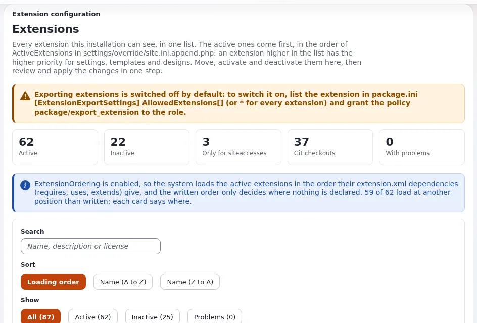

# Änderungen ausrollen

Diese Seite ist für Systemadministratoren, die Änderungen auf gehostete Exponential-Websites bringen, ob die Änderung vom
Hoster kommt (ein neues Release, eine geänderte Einstellung) oder vom Entwickler eines Kunden. Sie beantwortet: welche Schritte
eine Änderung live machen, in welcher Reihenfolge und warum, wie ein Neuladen von PHP-FPM andere Kunden auf demselben Server
betrifft, was für eine Template-Änderung genügt und wie Sie die Konfiguration einer ausgerollten Website unter
Versionsverwaltung halten.



Die Referenz ist [Eine PHP-Änderung ausrollen](../../../bc/6.0/velocity-engines.md#eine-php-änderung-bereitstellen-expvelocity-deploy);
die Schritt-für-Schritt-Anleitung ist [Exponential ausrollen](../../../anleitungen/bereitstellung.md#7-eine-php-änderung-mit-einem-befehl-ausliefern).

## Inhalt

1. [Ein Befehl für eine PHP-Änderung](#ein-befehl-für-eine-php-änderung)
2. [Die Schritte und ihre Reihenfolge](#die-schritte-und-ihre-reihenfolge)
3. [PHP-FPM auf einem geteilten Server neu laden](#php-fpm-auf-einem-geteilten-server-neu-laden)
4. [Änderungen an Templates und Stylesheets](#änderungen-an-templates-und-stylesheets)
5. [Große Änderungen und mehrere Knoten](#große-änderungen-und-mehrere-knoten)
6. [Einstellungen je Umgebung](#einstellungen-je-umgebung)
7. [Konfiguration über das Ausrollen verwaltet](#konfiguration-über-das-ausrollen-verwaltet)
8. [Checkliste](#checkliste)

## Ein Befehl für eine PHP-Änderung

Nach einer geänderten PHP-Klasse, einem Operator oder einer INI-Datei:

```bash
./console exp:velocity deploy --dry-run --allow-root-user   # what it would do, nothing else
./console exp:velocity deploy --allow-root-user             # the usual case
./console exp:velocity deploy --kernel --allow-root-user    # a kernel class was added or renamed
```

Ein echter Lauf gibt für jeden Schritt PASS, FAIL oder SKIP und die Dauer aus und hält beim ersten Fehler mit dem Exit-Status 1
an. Trotz seines Namens dient der Befehl jeder Einrichtung: `--no-velocity` für eine Website, die nur Apache oder nginx
ausliefert, `--no-fpm` für eine, die nur Velocity ausliefert.

| Option | Nutzen Sie sie, wenn |
|---|---|
| `--kernel` | eine Kernel-Klasse hinzugefügt oder umbenannt wurde (Autoloads des Kernels, auf `kernel/` und `lib/` beschränkt) |
| `--fpm-reload` | `php.ini` oder der Pool sich geändert hat, eine PHP-Erweiterung hinzukam, PHP-Dateien an Ort und Stelle entfernt oder umbenannt wurden |
| `--no-fpm`, `--no-velocity`, `--no-autoload` | dieser Teil übersprungen werden soll |
| `--packer` | eine Funktion `ezjscServer_*` oder ihre Einstellungen sich geändert haben: auch gepackte Skripte und Styles leeren |
| `--rebuild-phar` | der Neuaufbau des Engine-Archivs von Velocity erzwungen werden soll |

## Die Schritte und ihre Reihenfolge

| # | Schritt |
|---|---|
| 1 | Autoloads der Erweiterungen |
| 2 | Autoloads des Kernels, nur mit `--kernel` |
| 3 | INI-Caches |
| 4 | Caches für Templates, Template-Overrides, Übersetzungen und design_base |
| 5 | das Engine-Archiv von Velocity, wenn sich eine Datei in `kernel/`, `lib/` oder `autoload/` geändert hat (jede Datei wird zuerst geparst) |
| 6 | PHP-FPM: warten, bis OPcache die geänderten Dateien neu geprüft hat, oder neu laden, wenn man sich darauf nicht verlassen kann |
| 7 | Velocity neu starten, wenn er läuft |
| 8 | Caches für Inhalte, HTTP und Template-Blöcke (und der Packer mit `--packer`) |
| 9 | der Antwort-Cache von Velocity |
| 10 | Vorwärmen: jede `[DeploySettings] WarmUpURL[]` wird einmal von einem Hintergrundprozess angefragt |

Die Reihenfolge ist der Kern der Sache. Die Caches, die gerenderte Ausgabe enthalten, werden erst geleert, wenn PHP-FPM und
Velocity den neuen Code ausführen; werden sie vorher geleert, wird jede in der Zwischenzeit angefragte Seite vom alten Code
gerendert und erneut zwischengespeichert, und die Änderung sieht aus, als hätte sie nicht gewirkt. Eine Datei, die sich nicht
parsen lässt, lässt Schritt 5 scheitern, bevor ein laufender Server berührt wird.

Setzen Sie die Adressen zum Vorwärmen pro Installation, damit der erste Besucher die Caches nicht neu aufbaut:

```ini
# settings/override/velocity.ini.append.php
[DeploySettings]
WarmUpURL[]=https://www.example.com/
WarmUpURL[]=https://www.example.com/admin/user/login
```

## PHP-FPM auf einem geteilten Server neu laden

`[DeploySettings] PhpFpmService=auto` findet den PHP-FPM-Dienst, der die Installation ausliefert (es sucht den Pool, der nach
der Hosting-Domain der Installation benannt ist), sodass auf einem Server mit mehreren PHP-Versionen der richtige neu geladen
wird. Auf einem Plesk-Server zum Beispiel startet `systemctl restart php-fpm` ein PHP neu, das keine Website nutzt
([Ausrollen, 3.4](../../../anleitungen/bereitstellung.md#34-nach-jeder-php-änderung-das-richtige-php-fpm-neu-laden)).

> **Warnung**
> Ein Neuladen beschränkt sich nicht auf einen Kunden. Der Master bittet jedes Kind jedes Pools, seine Anfrage zu beenden, und
> startet kein neues Kind, bis das letzte fertig ist. Jede Anfrage, die in der Zwischenzeit ankommt, auf jeder Website dieser
> PHP-Version, wartet auf die längste noch laufende Anfrage. Deshalb lädt `[DeploySettings] PhpFpmReload=auto` (mitgeliefert)
> nicht neu, wenn das OPcache des Pools Dateien selbst neu prüft (`opcache.validate_timestamps` an, `revalidate_freq`
> höchstens 60 Sekunden): Es wartet stattdessen so lange.

Für einen Hoster heißt das: Behalten Sie `PhpFpmReload=auto`, konfigurieren Sie die Neuprüfung von OPcache in den Pools
([OPcache](../leistung/opcache.md)), und planen Sie Änderungen, die `--fpm-reload` brauchen (eine Änderung an `php.ini` oder
am Pool), als Serverwartung, nicht als Ausrollen eines Kunden. Ein eigener Pool pro Kunde begrenzt, wer wartet, aber nicht das
Neuladen des Masters ([Benutzer und Pools pro Kunde](../sicherheit/benutzer-und-pools-pro-kunde.md)).

Das Neuladen braucht root; als jemand anderes ausgeführt, wird der Schritt mit einem Hinweis übersprungen, der den Dienst nennt.

## Änderungen an Templates und Stylesheets

Änderungen an einem Template oder einem Stylesheet brauchen weniger: Leeren Sie die Caches ohne Neustart.

```bash
./console exp:cache clear --id=template --allow-root-user
./console exp:velocity cache clear --allow-root-user
```

Nachdem eine Erweiterung aktiviert wurde, werden ihre Templates nicht gefunden, bis der Cache design_base geleert ist: Die Seite
antwortet mit 200 und einem leeren Inhaltsbereich. `exp:velocity deploy` leert ihn immer, zusammen mit dem Cache der
Template-Overrides, in Schritt 4. Für Stylesheets, die ezjscore packt, rollen Sie mit `--packer` aus. Führen Sie nie nur
`exp:cache clear --all` aus und vergessen dann den Webserver: FPM und Velocity halten die alten Klassen im Speicher, bis sie neu
geladen werden.

## Große Änderungen und mehrere Knoten

- **Wartung.** `exp:velocity deploy` schaltet den Wartungsmodus weder ein noch aus. Für ein Ausrollen, das die Datenbank oder
  viele Dateien auf einmal ändert, öffnen Sie zuerst ein Fenster und schließen es nach dem Rauchtest
  ([Wartungsmodus](wartungsmodus.md)).
- **Mehrere Knoten.** Führen Sie das Ausrollen auf jedem Knoten aus ([Mehrere Web-Knoten](mehrere-web-knoten.md)).
- **Keine Shell.** Für Kunden ohne Shell-Zugang bietet die Erweiterung `git_manager` ein Git-Dashboard und Backups in der
  Administration ([git_manager](../../../funktionen/6.0/erweiterungen/git_manager.md)); die Schritte für Caches und Neuladen müssen
  danach trotzdem erfolgen.

## Einstellungen je Umgebung

Eine Installation existiert oft als Live-Website, als Staging-Kopie und als Kopie eines Entwicklers. `EXP_ENV` nennt die Umgebung
einer Maschine in `config.env.php` (kopiert aus `config.env.php.example`, außerhalb der Versionsverwaltung gehalten), und jede
Einstellungsdatei kann daneben eine Variante dafür haben, etwa `settings/override/site.ini.test.append.php`
([Einstellungen je Umgebung](../../../funktionen/6.0/umgebungseinstellungen.md)). Mailtransport, Adressen der Website und
Debug-Einstellungen unterscheiden sich dann je Maschine ohne Handarbeit nach jedem Ausrollen.

## Konfiguration über das Ausrollen verwaltet

Auf einer Website, deren Konfiguration in der Versionsverwaltung liegt, landen Änderungen aus der Administration im
Release-Verzeichnis, wo die Versionsverwaltung sie nicht sieht und das nächste Ausrollen sie verwirft. Ein Schalter pro
Siteaccess verhindert das ([Konfiguration über das Ausrollen verwaltet](../../../funktionen/6.0/durch-deployment-verwaltet.md)):

```ini
# settings/siteaccess/<admin siteaccess>/site.ini.append.php
[ConfigurationSettings]
ManagedByDeployment=enabled
```

Damit antworten der Einstellungs-Editor, die Editoren für Werkzeugleisten und Menüs, der Template-Editor, der Setup-Assistent,
die Aktivierung von Erweiterungen, die Code-Generatoren sowie Hochladen, Installieren und Entfernen von Paketen wie eine
deaktivierte Ansicht, und `eZINI::save()` verweigert in einer Web-Anfrage. Skripte der Kommandozeile und das Ausrollen selbst
schreiben weiterhin. Er wird mit `disabled` ausgeliefert. Dateiberechtigungen auf dem Release-Verzeichnis bleiben die stärkere
Maßnahme.

> **Tipp**
> Bieten Sie `ManagedByDeployment=enabled` als Standard eines verwalteten Tarifs an, in dem der Hoster oder die Entwickler des
> Kunden aus einem Repository ausrollen; lassen Sie es bei Tarifen aus, in denen Kunden ihre Website im Browser konfigurieren.

## Checkliste

- [ ] Jede PHP-Änderung endet mit `exp:velocity deploy` (mit `--no-velocity` oder `--no-fpm`, wie die Einrichtung es verlangt).
- [ ] `PhpFpmService` findet den richtigen Dienst; `PhpFpmReload=auto` bleibt, und OPcache prüft in den Pools neu.
- [ ] `WarmUpURL[]` nennt die Startseite und die Anmeldeseite der Administration jeder Website.
- [ ] Template-Änderungen leeren die Template-Caches und den Antwort-Cache von Velocity.
- [ ] Großes Ausrollen läuft in einem Wartungsfenster; Ausrollen auf mehreren Knoten deckt jeden Knoten ab.
- [ ] Umgebungsvarianten verhindern, dass Staging sich wie live verhält; ausgerollte Websites nutzen `ManagedByDeployment`, wo es passt.

## Verwandte Seiten

- [Kunden-Websites aktualisieren](kunden-websites-aktualisieren.md)
- [Caches leeren und vorwärmen](../leistung/caches-leeren-und-vorwaermen.md)
- [Abstimmung von PHP-FPM](../leistung/abstimmung-von-php-fpm.md)
- [Velocity für Hoster](../server/velocity-fuer-hoster.md)
- [Composer und Git auf Servern](../grundlagen/composer-und-git-auf-servern.md)
- [Freie Dokumentation](../../freie-dokumentation.md): Diese Seite darf unter der GNU FDL 1.3 frei kopiert, übersetzt und verbessert werden.

<!-- exp-partner-block:start -->
**Werden Sie Exponential-Partner.** Partner teilen ihre Informationen, stellen Mittel bereit, geben Beiträge zurück
und entwickeln die Produkte mit uns, und so wächst Exponential. Eine Partner-Website und ein Dashboard sind für Mitte
2027 geplant: Werden Sie noch heute Partner, damit wir schneller wachsen und neue Funktionen früher liefern. Beginnen
Sie mit [Partner: hier beginnen](../../partner/partner-hier-beginnen.md) und
[Wie Sie sich bewerben](../../partner/wie-sie-sich-bewerben.md).
<!-- exp-partner-block:end -->
