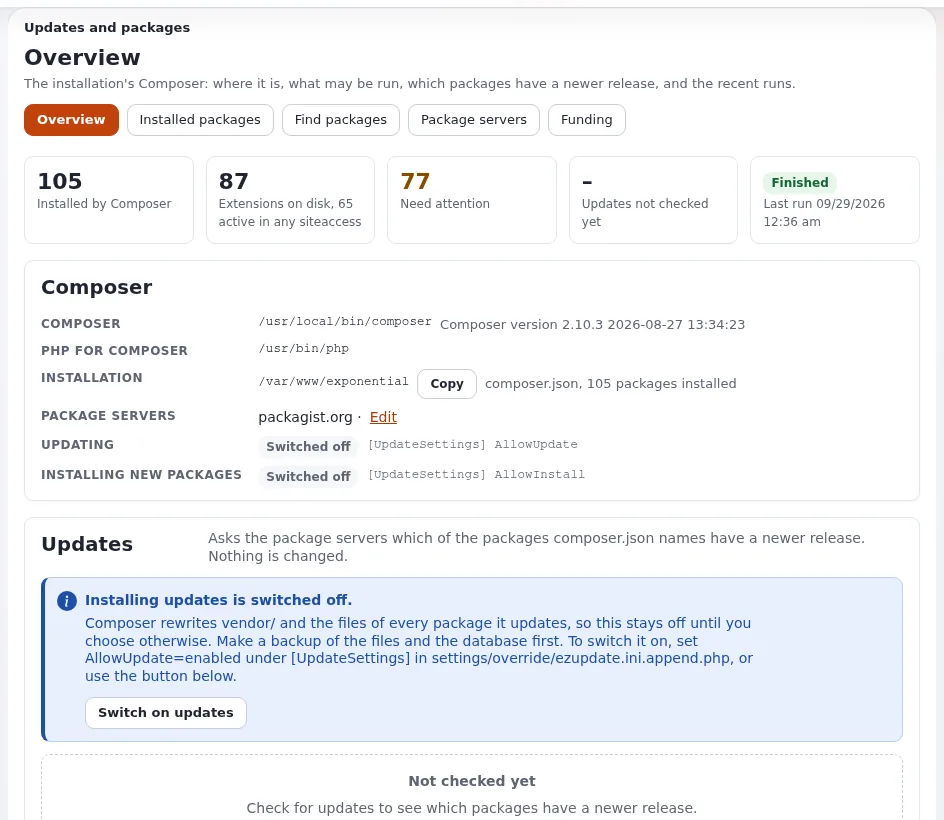
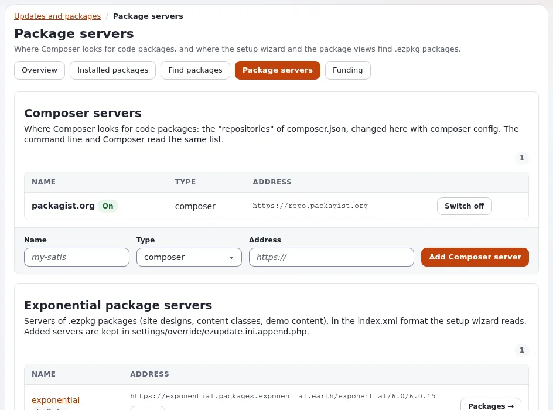
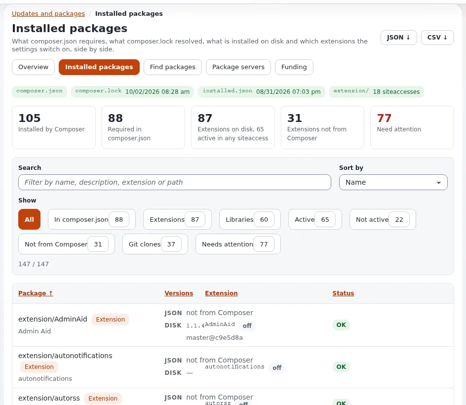
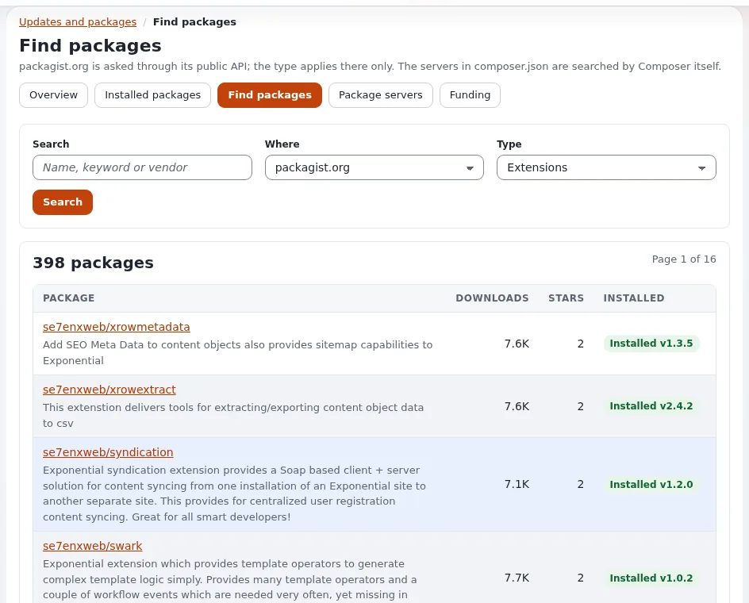

# Automatische Updates mit ezupdate

Diese Seite ist für Systemadministratoren, die viele Exponential-Installationen aktuell halten, und für Produktmanager, die
entscheiden, ob Kunden ihre eigenen Websites aktualisieren dürfen. Sie beantwortet: was `ezupdate` tut, mit welchen Schaltern
es ausgeliefert wird, wie ein Update abläuft, welche Teile sich sicher automatisieren lassen und was ein bewusster Schritt
bleiben muss.

`ezupdate` ist der Paketmanager einer Exponential-Installation, in der Administration (**Setup > Updates and packages**,
`/update/dashboard`) und auf der Kommandozeile. Der Überblick ist
[ezupdate: Updates und Pakete in der Administration](../../../../eng-us/features/6.0/extensions/ezupdate.md); die eigenen Anleitungen
der Erweiterung (Benutzerhandbuch, Konfiguration, Kommandozeile, Sicherheit) liegen in ihrem Ordner `doc/`.

## Inhalt

1. [Was es tut](#was-es-tut)
2. [Es installieren](#es-installieren)
3. [Schalter und Berechtigungen](#schalter-und-berechtigungen)
4. [Wie ein Update abläuft](#wie-ein-update-abläuft)
5. [Was Sie automatisieren, und was nicht](#was-sie-automatisieren-und-was-nicht)
6. [Einstellungen, die einen Hoster betreffen](#einstellungen-die-einen-hoster-betreffen)
7. [Checkliste](#checkliste)

## Was es tut

| Funktion | Was sie einem Hoster gibt |
|---|---|
| **Übersicht** | wo Composer liegt und welches PHP es ausführt, ob Aktualisieren und Installieren erlaubt sind, **Check for updates** (`composer outdated`, ändert nichts), ein Probelauf eines Updates, ein abgesichertes Update, die letzten Ausführungen |
| **Installed packages** | `composer.json`, `composer.lock`, `vendor/composer/installed.json` und die Erweiterungsverzeichnisse nebeneinander, mit den aktiven Erweiterungen; nennt, was nicht übereinstimmt; Downloads als JSON und CSV |
| **Pakete finden** | packagist.org oder die Server in `composer.json` durchsuchen, zuerst mit einem Probelauf installieren |
| **Laufende Ausführungen** | Updates und Installationen laufen im Hintergrund, eine nach der anderen, mit einer Sperre; die Seite folgt der Ausgabe von Composer |
| **Kommandozeile** | dasselbe aus `php extension/ezupdate/bin/php/ezupdate.php` |



> **Hinweis**
> „Automatisch“ heißt hier: die Prüfungen, die Probeläufe und die Berichte. `ezupdate` hat keinen eigenen Zeitplan, der eine
> Website unbeaufsichtigt aktualisiert, und die mitgelieferten Schalter halten Aktualisieren und Installieren aus, bis ein
> Administrator sie einschaltet.

## Es installieren

Die `composer.json` im Wurzelverzeichnis von Exponential verlangt `se7enxweb/ezupdate`. Auf einer Installation, die es noch
nicht hat:

```bash
composer require se7enxweb/ezupdate
# settings/override/site.ini.append.php:
#   [ExtensionSettings]
#   ActiveExtensions[]=ezupdate
php bin/php/ezpgenerateautoloads.php --extension
php bin/php/ezcache.php --clear-all
```

Führen Sie Composer als der Benutzer aus, dem die Dateien der Installation gehören, damit das, was es schreibt, dem richtigen
Konto gehört.

## Schalter und Berechtigungen

**Aktualisieren und Installieren sind aus, bis Sie sie einschalten**, in `settings/override/ezupdate.ini.append.php`:



```ini
[UpdateSettings]
AllowUpdate=enabled
AllowInstall=enabled
```

Composer schreibt `vendor/` und jedes Paket, das es verwaltet, neu; schalten Sie diese also nur dort ein, wo das gewollt ist,
mit einem Backup. Probeläufe funktionieren immer.

| Richtlinie | Erlaubt |
|---|---|
| `update/ezupdate` | ansehen, auf Updates prüfen, Probelauf |
| `update/manage` | aktualisieren, installieren, abrufen, Paketserver ändern |

Administratoren haben beide. Ein Hoster entscheidet pro Tarif, ob die eigenen Administratoren des Kunden `update/manage`
erhalten oder ob Updates ein Dienst sind, den der Hoster ausführt.

## Wie ein Update abläuft

1. **Check for updates** (`composer outdated`): ändert nichts.
2. **Vorschau (Probelauf)**: zeigt, was Composer ändern würde; jedes Paket ist als *Can be installed* oder *Blocked by
   composer.json (constraint)* gekennzeichnet.
3. Bestätigen Sie, dass **ein Backup existiert**, dann **Install updates** für die angehakten Pakete. Es läuft im Hintergrund.
4. Nach einer erfolgreichen Ausführung laufen die `[JobSettings] AfterRunCommands[]`: standardmäßig
   `bin/php/ezpgenerateautoloads.php --extension` und `bin/php/ezcache.php --clear-tag=ini,template,content`.
5. Die Seite zeigt das Ergebnis: aktuell, eine Zusammenfassung der Änderungen oder den Exit-Code einer gescheiterten
   Ausführung.



Auf einer Website, die von PHP-FPM oder Velocity ausgeliefert wird, halten die laufenden Prozesse die alten Klassen im Speicher,
bis sie neu geladen werden. Schließen Sie ein Update mit einem Ausrollen ab, das PHP-FPM neu lädt oder darauf wartet, Velocity
neu startet und die Caches in der richtigen Reihenfolge leert ([Änderungen ausrollen](aenderungen-ausrollen.md)).

## Was Sie automatisieren, und was nicht

| Sicher zu automatisieren | Bewusst halten |
|---|---|
| `ezupdate.php status` und `outdated` auf jeder Website, in einem Bericht gesammelt | `update` und `require` auf einer Live-Website |
| `ezupdate.php installed --issues`, um Websites zu finden, deren Lock-Datei und `vendor/` nicht übereinstimmen | `AllowUpdate` oder `AllowInstall` einschalten |
| Probeläufe eines Updates, um zu sehen, welche Pakete sich ändern würden | Updates ohne frisches Backup |
| `fund --direct --json` für eine Liste, wovon die installierten Pakete finanziert werden möchten | Updates ohne Test auf einer Staging-Kopie bei angepassten Websites |

Die Aktionen auf der Kommandozeile:

```bash
php extension/ezupdate/bin/php/ezupdate.php status
php extension/ezupdate/bin/php/ezupdate.php installed --issues
php extension/ezupdate/bin/php/ezupdate.php outdated
php extension/ezupdate/bin/php/ezupdate.php jobs
```

Die vollständige Liste ist `status`, `installed [--issues] [--json]`, `outdated`, `search`, `show`, `servers`, `server-add`,
`server-remove`, `packagist on|off`, `packages`, `fetch`, `require`, `update`, `jobs` und `fund`. Auf der Kommandozeile
gestartete Ausführungen erscheinen auch unter *Letzte Ausführungen* in der Administration. Die Anleitung der Erweiterung zur
Kommandozeile dokumentiert ihre Exit-Codes für die Nutzung in Skripten.

> **Tipp**
> Ein nächtlicher Job pro Installation, der `outdated` als Benutzer der Website ausführt und das Ergebnis per Mail an Ihr Team
> schickt oder dort veröffentlicht, macht aus der Frage, ob alles aktuell ist, einen Bericht, ohne eine einzige Datei zu
> ändern. Spielen Sie die Updates in einem Wartungsfenster ein, nach einem Backup, mit dem Probelauf, den Sie bereits
> durchgesehen haben.

## Einstellungen, die einen Hoster betreffen

Alle in `ezupdate.ini`, überschrieben in `settings/override/ezupdate.ini.append.php`:



| Schlüssel | Mitgeliefert | Warum es einen Hoster betrifft |
|---|---|---|
| `[ComposerSettings] SearchPath[]` | `var/ezupdate/`, `bin/`, `./`, `vendor/bin/`, dann `/usr/local/bin/`, `/usr/bin/`, `/opt/cpanel/composer/bin/` | relative Einträge kommen zuerst, weil `open_basedir` (Standard bei Plesk) die Systemordner verbirgt |
| `[ComposerSettings] PHPBinary` | leer | das PHP, das Composer und die Hintergrundjobs ausführt; setzen Sie es auf Hosts mit mehreren PHP-Versionen |
| `[ComposerSettings] ComposerHome` | `var/ezupdate/composer` | `COMPOSER_HOME`, wenn der Webserver keines übergibt, ein Ordner pro Systemkonto |
| `[ComposerSettings] Timeout` | `900` | Sekunden, die eine Ausführung von Composer dauern darf |
| `[UpdateSettings] PreferredInstall` | `auto` | `dist`, `source` oder `auto` |
| `[JobSettings] KeepJobs` | `20` | aufbewahrte abgeschlossene Jobs |

*Get Composer* in der Übersicht kann ein per SHA-256 geprüftes `composer.phar` nach `var/ezupdate/` herunterladen, wo kein
Composer installiert ist. Composer wird ohne Shell gestartet, im Wurzelverzeichnis der Installation, mit einer Zeitgrenze und
ohne Rückfragen.

## Checkliste

- [ ] `ezupdate` ist auf jeder Installation aktiv, die Sie aktualisieren, mit gesetztem `PHPBinary`, wo es mehrere PHP-Versionen gibt.
- [ ] `AllowUpdate` und `AllowInstall` sind nur dort an, wo Updates aus der Administration zum Tarif gehören.
- [ ] `update/manage` wird bewusst vergeben.
- [ ] Prüfungen auf Updates laufen nach Zeitplan und berichten an das Team; nichts wird unbeaufsichtigt aktualisiert.
- [ ] Vor jedem Update steht ein Backup, danach ein Ausrollen und ein Rauchtest.

## Verwandte Seiten

- [Kunden-Websites aktualisieren](kunden-websites-aktualisieren.md)
- [Änderungen ausrollen](aenderungen-ausrollen.md)
- [Composer und Git auf Servern](../grundlagen/composer-und-git-auf-servern.md)
- [Sicherheitsupdates und Offenlegung](../sicherheit/sicherheitsupdates-und-offenlegung.md)
- [ezupdate](../../../../eng-us/features/6.0/extensions/ezupdate.md) (Referenz der Funktion)
- [Freie Dokumentation](../../freie-dokumentation.md): Diese Seite darf unter der GNU FDL 1.3 frei kopiert, übersetzt und verbessert werden.

<!-- exp-partner-block:start -->
**Werden Sie Exponential-Partner.** Partner teilen ihre Informationen, stellen Mittel bereit, geben Beiträge zurück
und entwickeln die Produkte mit uns, und so wächst Exponential. Eine Partner-Website und ein Dashboard sind für Mitte
2027 geplant: Werden Sie noch heute Partner, damit wir schneller wachsen und neue Funktionen früher liefern. Beginnen
Sie mit [Partner: hier beginnen](../../partner/partner-hier-beginnen.md) und
[Wie Sie sich bewerben](../../partner/wie-sie-sich-bewerben.md).
<!-- exp-partner-block:end -->
