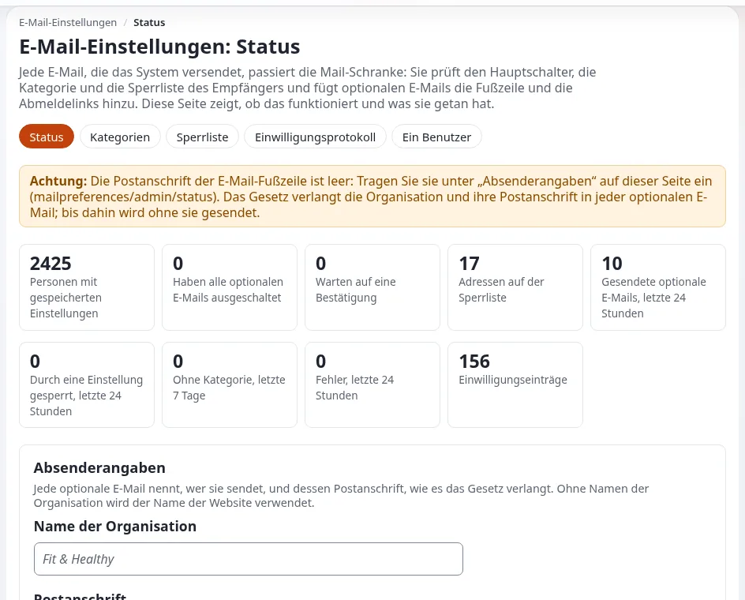

# Einwilligung und Bounces bei Mails

Diese Seite ist für Systemadministratoren und Support-Mitarbeitende, die die Mail gehosteter Exponential-Websites betreiben, und
für Produktmanager, die beschreiben, was die Plattform bei Einwilligung und Abmeldung tut. Sie beantwortet: wie Exponential
entscheidet, ob eine Mail versandt werden darf, was pro Kunde eingerichtet werden muss, wie Bounces und Spam-Beschwerden auf die
Unterdrückungsliste kommen und wie Anfragen zu personenbezogenen Daten behandelt werden.



Die Anleitung für Administratoren ist [E-Mail-Einstellungen: einrichten und betreiben](../../../anleitungen/mail-einstellungen-administrator.md);
die Einstellungen stehen in `settings/mailpreferences.ini`. Transporte und Zustellbarkeit stehen auf
[Mailzustellung](mailzustellung.md).

> **Hinweis**
> Diese Seite beschreibt, was die Software bereitstellt. Sie ist keine Rechtsberatung. Welche Mail eine Einwilligung braucht,
> was eine Fußzeile sagen muss und wie lange Aufzeichnungen aufbewahrt werden, sind rechtliche Fragen; der Hoster und seine
> Kunden müssen ihren eigenen rechtlichen Rat einholen. Das Projekt führt eine Checkliste der Regeln, die es berücksichtigt hat,
> einschließlich ihrer Lücken: [Compliance der E-Mail-Einstellungen](../../../spezifikationen/6.0/mail-einstellungen-compliance.md).

## Inhalt

1. [Die Mail-Sperre](#die-mail-sperre)
2. [Einrichtung pro Kunde](#einrichtung-pro-kunde)
3. [Die Unterdrückungsliste](#die-unterdrückungsliste)
4. [Das Bounce-Postfach](#das-bounce-postfach)
5. [Das Einwilligungsprotokoll und Anfragen zu Daten](#das-einwilligungsprotokoll-und-anfragen-zu-daten)
6. [Aufbewahrung](#aufbewahrung)
7. [Checkliste](#checkliste)

## Die Mail-Sperre

Jede Mail, die die Installation versendet, passiert die Mail-Sperre in `eZMailTransport::send()`, welchen Transport Sie auch
nutzen. Eine Mail, die eine Kategorie angibt, wird gegen die Einstellungen des Empfängers, die Unterdrückungsliste und ein
ausstehendes Double-Opt-in geprüft:

- **Optionale Mail** geht nur an Personen, die sie eingeschaltet haben, eine Mail pro Empfänger, mit einer Fußzeile (warum,
  abmelden, verwalten, die Organisation und ihre Postanschrift) und den Headern für das Abmelden mit einem Klick aus RFC 8058
  (`List-Unsubscribe`, `List-Unsubscribe-Post`).
- **Notwendige Mail** geht immer.
- **Mail ohne Kategorie** wird wie bisher versandt und gezählt, sodass Sie den Code finden können, der sie versendet.

Die mitgelieferten Kategorien in `mailpreferences.ini`:

| Optional (aus, bis eingeschaltet) | Notwendig (immer versandt) |
|---|---|
| `content` (Benachrichtigungen zu Inhalten), `collaboration`, `newsletter` (Double-Opt-in), `marketing` (Double-Opt-in), `system` | `security` (Zurücksetzen des Passworts, Aktivierung, Bestätigung der Adresse), `orders`, `legal`, `admin` |

## Einrichtung pro Kunde

1. **Tabellen.** Fünf Tabellen (`expmail_category`, `expmail_preference`, `expmail_consent_log`, `expmail_suppression`,
   `expmail_pending`) sind im Schema einer neuen Installation; eine aktualisierte bekommt sie aus
   `update/database/<engine>/6.0/dbupdate-6.0.0-6.0.15.sql`. Prüfen Sie mit `./console exp:mail:status` (fünfmal `ok`).
2. **Fußzeile.** `[FooterSettings] OrganisationName` und `OrganisationAddress` sind leer ausgeliefert; die Statusseite warnt,
   bis sie ausgefüllt sind. Setzen Sie sie in einer Überschreibung, nie in der mitgelieferten Datei:

   ```bash
   ./console exp:ini set mailpreferences.ini/FooterSettings/OrganisationName "<customer organization>" global --dry-run
   ```

   Lassen Sie `--dry-run` weg, um zu schreiben; tun Sie dasselbe für `OrganisationAddress` (ein Zeilenumbruch wird als `\n`
   geschrieben).
3. **Linkadresse.** `[LinkSettings] BaseURL` ist leer, was `https://` und die `SiteURL` des Standard-Siteaccess bedeutet. Setzen
   Sie sie, wenn die öffentliche Website einen anderen Hostnamen hat.
4. **Website-Geheimnis.** Wird bei der ersten Verwendung in `settings/override/mailpreferences.ini.append.php` erzeugt
   (`[SecretSettings] TokenSecret`). Ein neues Geheimnis macht jeden Link in jeder bereits versandten Mail ungültig, und kein
   Eintrag der Unterdrückungsliste passt mehr. Sichern Sie es, und kopieren Sie es, wenn eine Website umzieht
   ([Was gesichert werden muss](backups-was-gesichert-werden-muss.md)).
5. **Rollen.** `mailpreferences/administrate` öffnet **Setup > E-Mail-Einstellungen**; `mailpreferences/export` erlaubt den
   CSV-Export des Einwilligungsprotokolls. Entscheiden Sie, ob die Administratoren des Kunden sie erhalten.
6. **Cron.** Der Bounce-Leser läuft in `frequent`, die Aufbewahrung in `infrequent` ([Cronjobs](cronjobs.md)).

## Die Unterdrückungsliste

An eine Adresse auf der Liste geht keine optionale Mail. Gründe (`[SuppressionSettings] Reasons[]`): `bounce`, `complaint`,
`unsubscribe_all`, `legal`, `admin` und `bridge`. Gespeichert wird nur ein Hash der Adresse, sodass die Liste nicht gelesen werden
kann; ein Eintrag wird gefunden, indem man die Adresse eingibt.

```bash
./console exp:mail:suppression check --email=<address>
./console exp:mail:suppression add --email=<address> --reason=legal --note="Ticket reference, no personal data"
./console exp:mail:suppression lift --email=<address>
```

Einträge für Bounces, Beschwerden und rechtliche Anfragen bleiben, bis ein Administrator sie aufhebt, und sie stoppen auch Mails
mit „Link schicken“ und Bestätigungsmails. Erweiterungen können ihre eigenen Sperrlisten über `[SuppressionSettings] Listeners[]`
im Gleichschritt halten (die Newsletter-Erweiterung fügt dort ihre Blacklist hinzu).

## Das Bounce-Postfach

Der Bounce-Leser liest das Postfach, in dem Bounces und Spam-Beschwerden ankommen (der `Return-Path` der Mail und die Adresse,
die den Feedback Loops großer Mailanbieter genannt wurde). Hard Bounces (Delivery Status Notifications nach RFC 3464) und
Beschwerden (Berichte nach RFC 5965) setzen die Adresse auf die Unterdrückungsliste. Er ist aus, bis er eingerichtet wird
(`[BounceSettings] Reader=disabled`).

```ini
# settings/override/mailpreferences.ini.append.php (never committed)
[BounceSettings]
Reader=enabled
Protocol=imap
Server=<mail server>
User=<mailbox user>
Password=<mailbox password>
SSL=enabled
Folder=INBOX
AfterRead=keep
```

| Einstellung | Mitgeliefert | Bedeutung |
|---|---|---|
| `Protocol` | `imap` | `imap` oder `pop3` |
| `Port` | leer | 993 für IMAP und 995 für POP3 mit SSL, 143 und 110 ohne |
| `AfterRead` | `keep` | `keep`: IMAP liest nur ungelesene Nachrichten; `delete`: verstandene Nachrichten werden gelöscht |
| `MaxMessages` | `500` | Nachrichten pro Lauf |
| `HardStatusCodes[]` | `5.1.`, `5.2.1`, `5.4.4` | Fehler, die als Hard Bounces zählen; andere werden gezählt, nicht unterdrückt |
| `StatusFile` | `log/mailbounces.json` | der letzte Lauf, für die Statusseite |

Er wird vom Cronjob-Teil `mailbounces` gelesen (auch in `frequent`). Probieren Sie ihn aus, ohne etwas zu ändern:

```bash
./console exp:mail:bounces --dry-run
```

> **Tipp**
> Ein Hoster, der das Mail-Relay betreibt, kann das Bounce-Postfach als Teil des Tarifs anbieten: ein Postfach pro Domain des
> Kunden, als Absender im Umschlag gesetzt, mit seinen Zugangsdaten, die die Bereitstellung in die Überschreibung des Kunden
> schreibt.

## Das Einwilligungsprotokoll und Anfragen zu Daten

Jede Änderung einer Einstellung wird in das Einwilligungsprotokoll geschrieben, mit genau dem Text, den die Person gesehen hat.
**Setup > E-Mail-Einstellungen > Einwilligungsprotokoll** filtert und exportiert es; der Export enthält Adressen und
IP-Adressen, behandeln Sie ihn also als personenbezogene Daten und löschen Sie ihn, wenn die Anfrage, die er beantwortet,
erledigt ist.

| Anfrage | Befehl |
|---|---|
| „Was haben Sie über mich gespeichert?“ | `./console exp:mail:preferences export --email=<address> --format=json --output=var/tmp/request.json` (mit Modus 0600 geschrieben) |
| „Schicken Sie mir nichts mehr“ | der Abmeldelink der Person oder ein Eintrag in der Unterdrückungsliste mit dem Grund `legal` |
| „Löschen Sie meine Daten“ | `./console exp:mail:preferences erase --email=<address> --yes` |

Das Löschen entfernt die Einstellungen und anonymisiert die Zeilen des Einwilligungsprotokolls, die Zeit, Kategorie und Änderung
behalten, damit Sie weiterhin beweisen können, dass der Versand aufgehört hat. Das Entfernen eines Benutzerkontos löscht dessen
Einstellungen noch nicht; löschen Sie sie in der Konsole, wenn Sie ein Konto auf Anfrage entfernen.

## Aufbewahrung

Der Cronjob-Teil `mailpreferences` (in `infrequent`) entfernt Zeilen des Einwilligungsprotokolls von Personen, die nicht mehr da
sind, sobald sie älter sind als `[ConsentSettings] RetentionDays` (mitgeliefert `1095`), entfernt Bestätigungen, die älter sind als
`PendingDays` (`7`), und alte Einträge der Unterdrückungsliste, wenn `[SuppressionSettings] RetentionDays` über `0` liegt
(mitgeliefert `0`: für immer behalten). Vorschau:

```bash
./console exp:mail:consent cleanup --dry-run
```

Siehe [Backup-Zeitpläne und Aufbewahrung](backup-zeitplaene-und-aufbewahrung.md#aufbewahrung-in-exponential), wie diese Zeiträume
mit dem Backup-Zeitraum zusammenspielen.

## Checkliste

- [ ] `./console exp:mail:status` zeigt die fünf Tabellen mit `ok` und keine Probleme.
- [ ] `OrganisationName` und `OrganisationAddress` sind für den Kunden ausgefüllt.
- [ ] `BaseURL` stimmt; ein Verwaltungslink öffnet sich in einem Browser.
- [ ] Das Website-Geheimnis steht in der Überschreibungsdatei und in jedem Backup.
- [ ] Das Bounce-Postfach ist eingerichtet, wo der Kunde optionale Mail versendet, und `frequent` läuft.
- [ ] Rollen für die E-Mail-Einstellungen werden bewusst vergeben; Exporte von Einwilligungen werden als personenbezogene Daten behandelt.
- [ ] Der Kunde hat sich rechtlich zu Kategorien, Fußzeile und Aufbewahrung beraten lassen.

## Verwandte Seiten

- [Mailzustellung](mailzustellung.md)
- [Compliance und DSGVO](../sicherheit/compliance-und-dsgvo.md)
- [Aufbewahrung von Logs und Daten](../sicherheit/aufbewahrung-von-logs-und-daten.md)
- [Cronjobs](cronjobs.md)
- [E-Mail-Einstellungen](../../../funktionen/6.0/e-mail-einstellungen.md) (was die Menschen auf einer Website sehen)
- [Freie Dokumentation](../../freie-dokumentation.md): Diese Seite darf unter der GNU FDL 1.3 frei kopiert, übersetzt und verbessert werden.

<!-- exp-partner-block:start -->
**Werden Sie Exponential-Partner.** Partner teilen ihre Informationen, stellen Mittel bereit, geben Beiträge zurück
und entwickeln die Produkte mit uns, und so wächst Exponential. Eine Partner-Website und ein Dashboard sind für Mitte
2027 geplant: Werden Sie noch heute Partner, damit wir schneller wachsen und neue Funktionen früher liefern. Beginnen
Sie mit [Partner: hier beginnen](../../partner/partner-hier-beginnen.md) und
[Wie Sie sich bewerben](../../partner/wie-sie-sich-bewerben.md).
<!-- exp-partner-block:end -->
