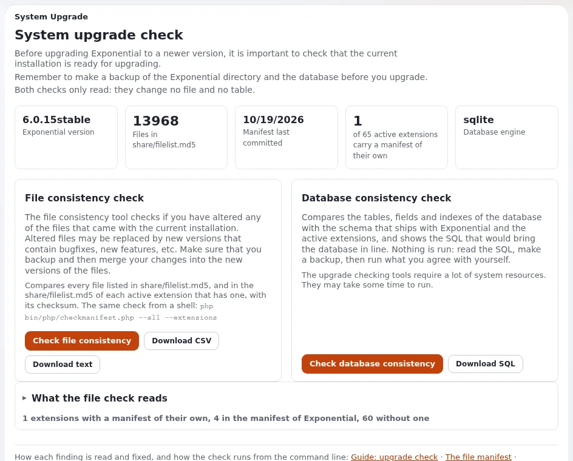
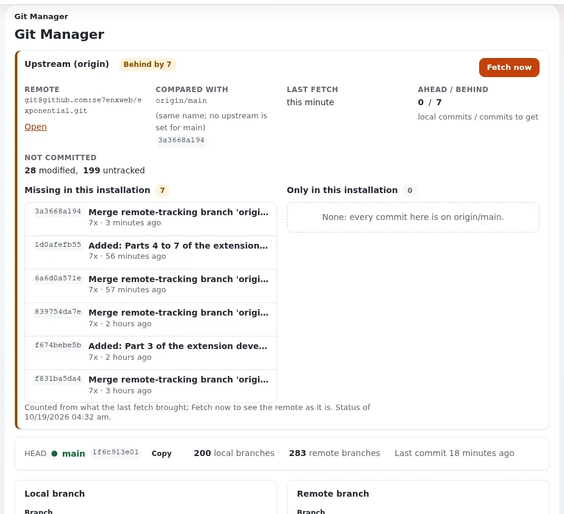

# Kunden-Websites aktualisieren

Diese Seite ist für Systemadministratoren und Support-Verantwortliche bei einem Hoster, die viele Exponential-Installationen auf
aktuellen Releases halten. Sie beantwortet: wie Sie herausfinden, welches Release jede Website betreibt, wie Sie Upgrades über
Kunden hinweg planen, welche Schritte ein Upgrade innerhalb der Linie 6.0 umfasst, wie Sie das Ergebnis prüfen und wie Sie sich
erholen, wenn ein Schritt scheitert.





Das Verfahren ist [Kapitel 11, Upgrade](../../../installation/11-aktualisieren.md) des Installationsbuchs und die Anleitung
[Upgrade](../../../anleitungen/aktualisieren.md); diese Seite ordnet es für einen Hoster. Kunden, die von älteren Hauptversionen oder anderen
Produkten kommen, stehen auf [Kunden migrieren](../migrationen/README.md).

## Inhalt

1. [Regeln vor allem anderen](#regeln-vor-allem-anderen)
2. [Bestand erfassen](#bestand-erfassen)
3. [Das Upgrade pro Kunde planen](#das-upgrade-pro-kunde-planen)
4. [Das Upgrade innerhalb der Linie 6.0](#das-upgrade-innerhalb-der-linie-60)
5. [Das Ergebnis prüfen](#das-ergebnis-prüfen)
6. [Wenn etwas schiefgeht](#wenn-etwas-schiefgeht)
7. [Checkliste](#checkliste)

## Regeln vor allem anderen

- **Führen Sie nie einen Installer über einer bestehenden Website aus.** Der Setup-Assistent, der Kickstarter und `exp:install`
  legen eine neue Datenbank an. Ein Upgrade ersetzt den Code und aktualisiert die bestehende Datenbank an Ort und Stelle.
  `exp:install` verweigert den Lauf, wo eine Installation existiert; fügen Sie auf einer Live-Website nicht `--force` hinzu, um
  daran vorbeizukommen ([11.1](../../../installation/11-aktualisieren.md#111-bevor-sie-beginnen)).
- **Zuerst sichern, jedes Mal.** Der Datenbankschritt ist der, der sich nicht durch Zurücklegen von Dateien rückgängig machen lässt.
- **Als Benutzer der Website ausführen.** Dateien, die root in `var/` anlegt, beschädigen die Website später.
- **Ein veröffentlichtes Release lässt sich nicht ändern.** Der Weg zu einer Korrektur ist die nächste Version. Planen Sie, nach vorn
  zu gehen, nicht ein Release an Ort und Stelle zu flicken.

## Bestand erfassen

Halten Sie für jede Installation das Release, die PHP-Version, die Datenbank-Engine und den Webserver oder die Engine fest:

- In der Administration: **Setup > Systeminformationen** nennt die Version, PHP und den Server, der geantwortet hat.
- Auf der Kommandozeile: `./console exp:systeminfo --json`.
- In der Datenbank die Zeile mit der Version (ihr Name behält absichtlich die historische Schreibweise):

  ```bash
  mysql -u USER -p DATABASE -e "SELECT name, value FROM ezsite_data WHERE name LIKE 'ezpublish-%';"
  ```

  Nutzen Sie den entsprechenden Client für PostgreSQL oder SQLite.

Welcher Teil der Anleitung gilt, ergibt sich aus der Version ([Welchen Teil lese ich?](../../../anleitungen/aktualisieren.md#welchen-teil-lese-ich)):

| Die Website läuft auf | Weg |
|---|---|
| 3.10 bis 5.3 | die alte Update-Kette, dann 5.4 zu 6.0, dann die Linie 6.0 ([Teil A](../../../anleitungen/aktualisieren.md#teil-a-von-310-bis-53-die-alte-kette)) |
| 5.4 oder 5.90 | 5.4 zu 6.0.0, dann die Linie 6.0 ([Teil B](../../../anleitungen/aktualisieren.md#teil-b-von-54-oder-590-auf-exponential-600)) |
| einem früheren 6.0.x | die Linie 6.0 ([Teil C](../../../anleitungen/aktualisieren.md#teil-c-von-einer-beliebigen-60x-auf-den-aktuellen-stand)) |
| LoveStack | `exp:lovestack check`, dann Teil C, dann `exp:lovestack migrate` ([Von LoveStack kommend](../../../anleitungen/aktualisieren.md#umstieg-von-lovestack)) |

## Das Upgrade pro Kunde planen

| Schritt | Was zu entscheiden ist |
|---|---|
| PHP | Exponential 6.0 braucht auf der aktuellen Linie PHP 8.0 oder neuer, auch für Velocity; eine Website, die auf PHP 7.4 bleiben muss, bleibt auf 6.0.7 ([PHP-Versionen und Erweiterungen](../grundlagen/php-versionen-und-erweiterungen.md)) |
| Anpassungen | eigene Erweiterungen und Template-Overrides: zuerst auf einer Kopie testen |
| Staging | das neueste Backup auf einer Staging-Kopie wiederherstellen, dort aktualisieren, den Kunden prüfen lassen |
| Fenster | ein Wartungsfenster für den Datenbankschritt, dem Kunden angekündigt |
| Rückfall | das Backup, das direkt vor dem Fenster erstellt wurde, und die Dauer einer Wiederherstellung |

> **Tipp**
> Gruppieren Sie Kunden nach ihrem aktuellen Release und danach, wie stark sie angepasst sind. Nicht angepasste Websites auf
> demselben Release können einem getesteten Runbook folgen; angepasste erhalten jeweils eine Staging-Kopie.

## Das Upgrade innerhalb der Linie 6.0

Aus [11.6 Von jedem 6.0.x bis heute](../../../installation/11-aktualisieren.md#116-von-einer-beliebigen-60x-auf-den-heutigen-stand) und
[Teil C](../../../anleitungen/aktualisieren.md#teil-c-von-einer-beliebigen-60x-auf-den-aktuellen-stand):

1. **Wartung an** und ein frisches Backup:

   ```bash
   php bin/php/maintenance.php on --message="Upgrade in progress" --until=30m
   ```

2. **Bringen Sie den neuen Code an seinen Platz**: ein Checkout des neuen Tags oder `composer update` von
   `se7enxweb/exponential` in der `composer.json` des Projekts. Halten Sie `settings/override/`, `settings/siteaccess/`, Ihre
   Erweiterungen und Designs aus jedem Befehl heraus, der Dateien ersetzt. Dann:

   ```bash
   php bin/php/ezpgenerateautoloads.php -e
   php bin/php/ezcache.php --clear-all --allow-root-user
   ```

3. **Spielen Sie das Datenbank-Update** der Linie ein, einmal, vollständig, in Reihenfolge:
   `update/database/<engine>/6.0/dbupdate-6.0.0-6.0.15.sql`. Dateien gibt es für MySQL (auch für MariaDB genutzt), PostgreSQL und
   SQLite; die Dateien für Oracle kommen mit der Erweiterung `ezoracle`, und MongoDB braucht keine SQL-Datei
   ([11.3 Je Engine](../../../installation/11-aktualisieren.md#nach-engine)).

   ```bash
   mysql -u USER -p DATABASE < update/database/mysql/6.0/dbupdate-6.0.0-6.0.15.sql
   ```

4. **Führen Sie die Datenskripte** der Linie einmal aus (einmal pro var-Verzeichnis, auf jedem Webserver eines Clusters):

   ```bash
   php update/common/scripts/6.0/createaudittables.php
   php update/common/scripts/6.0/movetrashrecords.php --remove-file
   ```

5. **Eindeutige Anmeldenamen.** Listen Sie Konten auf, die sich einen Anmeldenamen teilen, und fügen Sie den eindeutigen Index
   hinzu, wenn es keine gibt:

   ```bash
   ./console exp:user-login-check --allow-root-user
   ./console exp:user-login-check --fix-index --allow-root-user
   ```

6. **Lesen Sie die Checkliste jedes Zeitraums, den Sie durchlaufen** (Changelogs und Hinweise zu Verhaltensänderungen, aufgeführt in
   [C3](../../../anleitungen/aktualisieren.md#c3-die-checkliste-jedes-durchlaufenen-zeitraums-lesen)). Die Änderungen, auf die man am häufigsten
   trifft: Konten ohne Zeile in `ezuser_setting` können sich nicht anmelden; Overrides folgen `Priority`; Sicherheitsheader,
   Cookie-Merkmale und eine strengere Prüfung von Uploads sind standardmäßig an.
7. **Prüfen Sie eigene Erweiterungen**: `./console exp:checkclasses --allow-root-user` meldet Klassen, die PHP nicht laden will.
8. **Ausrollen**: Laden Sie das PHP-FPM neu, das die Website ausliefert, oder führen Sie auf Velocity `./console exp:velocity deploy`
   aus ([Änderungen ausrollen](aenderungen-ausrollen.md)). Leeren Sie nach dem Neuladen den Content-Cache und den Antwort-Cache von
   Velocity.
9. **Wartung aus** nach den Prüfungen unten.

## Das Ergebnis prüfen

```bash
php bin/php/ezcache.php --clear-all --allow-root-user     # ends without an error
./console exp:checkdbfiles --allow-root-user               # no file marked missing for your line
```

Dann im Browser: Die Startseite lädt; melden Sie sich in der Administration an; **Setup > Systeminformationen** zeigt die neue
Version; veröffentlichen Sie ein Testobjekt und sehen Sie es auf der Website. **Setup > Upgrade-Prüfung** und
**Überprüfe Dateikonsistenz** listen Dateien des Codes auf, die vom Release abweichen; absichtlich geänderte Dateien werden dort
erwartet ([Die Upgrade-Prüfung](../../../anleitungen/upgrade-pruefung.md)).

## Wenn etwas schiefgeht

| Symptom | Was zu tun ist |
|---|---|
| Eine weiße Seite nach der Codeänderung | `var/log/error.log`; führen Sie Schritt 2 erneut aus; `vendor/` muss zur neuen `composer.json` passen |
| `Class ... not found` | `php bin/php/ezpgenerateautoloads.php -e`, dann die Caches leeren |
| Bibliotheken fehlen nach einem gescheiterten Lauf von Composer | [Eine Installation reparieren](../../../../eng-us/bc/6.0/repair.md) |
| Eine SQL-Datei scheiterte auf halbem Weg | das Backup wiederherstellen und die Datei erneut von vorn einspielen; nie von Hand reparieren und erneut ausführen |
| Jemand kann sich nicht anmelden | der Punkt zu `ezuser_setting` in den [Verhaltensänderungen von Juli und August 2026](../../../../eng-us/bc/6.0/behaviour-changes-2026-07-08.md) |

Quelle: [Wenn etwas schiefgeht](../../../anleitungen/aktualisieren.md#wenn-etwas-schiefgeht).

## Checkliste

- [ ] Bestand: Release, PHP, Datenbank-Engine und Server pro Website festgehalten.
- [ ] Angepasste Websites auf einer aus einem Backup wiederhergestellten Staging-Kopie getestet.
- [ ] Backup direkt vor dem Fenster erstellt; Dauer einer Wiederherstellung bekannt.
- [ ] Code, Autoloads, Caches, Datenbankdatei, Datenskripte und Prüfung der Anmeldenamen in Reihenfolge erledigt.
- [ ] Die Checklisten jedes durchlaufenen Zeitraums wurden gelesen.
- [ ] PHP-FPM neu geladen oder Velocity ausgerollt; Content- und Antwort-Caches danach geleert.
- [ ] `exp:checkdbfiles`, die Upgrade-Prüfung und eine Testveröffentlichung bestehen; der Kunde ist informiert.

## Verwandte Seiten

- [PHP-Upgrade](../runbooks/php-upgrade.md) (Runbook)
- [Von älteren Exponential-Versionen](../migrationen/kunden-von-aelteren-versionen-migrieren.md)
- [Automatische Updates mit ezupdate](automatische-updates-mit-ezupdate.md)
- [Wartungsmodus](wartungsmodus.md), [Änderungen ausrollen](aenderungen-ausrollen.md)
- [Kapitel 11: Upgrade](../../../installation/11-aktualisieren.md)
- [Freie Dokumentation](../../freie-dokumentation.md): Diese Seite darf unter der GNU FDL 1.3 frei kopiert, übersetzt und verbessert werden.

<!-- exp-partner-block:start -->
**Werden Sie Exponential-Partner.** Partner teilen ihre Informationen, stellen Mittel bereit, geben Beiträge zurück
und entwickeln die Produkte mit uns, und so wächst Exponential. Eine Partner-Website und ein Dashboard sind für Mitte
2027 geplant: Werden Sie noch heute Partner, damit wir schneller wachsen und neue Funktionen früher liefern. Beginnen
Sie mit [Partner: hier beginnen](../../partner/partner-hier-beginnen.md) und
[Wie Sie sich bewerben](../../partner/wie-sie-sich-bewerben.md).
<!-- exp-partner-block:end -->
