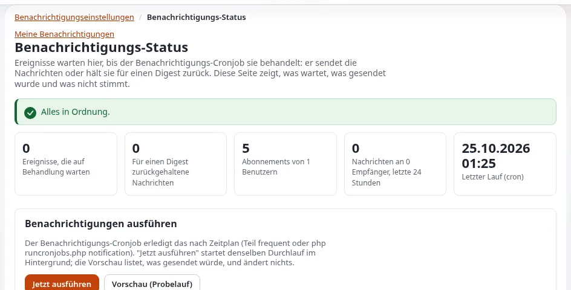

# Mailzustellung

Diese Seite ist für Systemadministratoren, die Exponential-Websites an einen Maildienst anbinden, und für
Support-Mitarbeitende, die die Meldung beantworten, dass die Mail zum Passwort nie angekommen ist. Sie beantwortet: welche
Transporte Exponential hat, welche Einstellungen sie auswählen und konfigurieren, was die Mail-Einrichtung des Hosters
bereitstellen muss und wie Sie eine Testkopie davon abhalten, echte Mail zu versenden.



Die Einstellungen stehen in `settings/site.ini [MailSettings]`; die Schritt-für-Schritt-Anleitung ist
[10.4 Mail: der Datei-Transport und echter Versand](../../../installation/10-nach-der-installation.md#104-mail-der-datei-transport-und-echter-versand).
Einwilligung, Abmeldung und Bounces stehen auf [Einwilligung und Bounces bei Mails](einwilligung-und-bounces-bei-mails.md).

## Inhalt

1. [Was Mail versendet](#was-mail-versendet)
2. [Die drei Transporte](#die-drei-transporte)
3. [Einstellungen pro Kunde](#einstellungen-pro-kunde)
4. [Was der Hoster bereitstellen muss](#was-der-hoster-bereitstellen-muss)
5. [Test- und Staging-Websites](#test--und-staging-websites)
6. [Wenn Mail nicht ankommt](#wenn-mail-nicht-ankommt)
7. [Checkliste](#checkliste)

## Was Mail versendet

Exponential versendet Mail bei Passwortänderungen und -zurücksetzungen, Registrierungen, Formularen mit einem E-Mail-Empfänger,
Benachrichtigungen und Newslettern. Jede Mail passiert die **Mail-Sperre** in `eZMailTransport::send()`, welcher Transport auch
genutzt wird; die Sperre prüft optionale Mail gegen die Einstellungen des Empfängers
([E-Mail-Einstellungen](../../../anleitungen/mail-einstellungen-administrator.md)). Benachrichtigungen werden vom Cronjob-Teil
`frequent` versendet; Mail, die von ihnen abhängt, geht also nur raus, wenn Cron läuft ([Cronjobs](cronjobs.md)).

## Die drei Transporte

`[MailSettings] Transport` wählt einen; `TransportAlias[]` ordnet die Namen Klassen zu:

| Transport | Klasse | Was er tut | Nutzen Sie ihn für |
|---|---|---|---|
| `sendmail` (mitgeliefert) | `eZSendmailTransport` | übergibt die Mail dem lokalen Programm `sendmail` | einen Server mit einem lokalen Mail Transfer Agent oder einem sendmail-kompatiblen Relay-Client |
| `SMTP` | `eZSMTPTransport` | verbindet sich mit einem SMTP-Server, wahlweise mit TLS und Anmeldung | einen Relay-Dienst oder den Mailserver des Hosters |
| `file` | `eZFileTransport` | schreibt jede Mail als Datei nach `var/log/mail/` (oder `FileTransportDirectory`) | Test, Staging und Wiederherstellungstests |

## Einstellungen pro Kunde

Schreiben Sie diese in die `settings/override/site.ini.append.php` jeder Installation. Ein SMTP-Beispiel aus dem
Installationsbuch:

```ini
[MailSettings]
Transport=SMTP
TransportServer=smtp.example.com
TransportPort=587
TransportConnectionType=tls
TransportUser=<smtp user>
TransportPassword=<smtp password>
SenderHost=www.example.com
AdminEmail=webmaster@example.com
EmailSender=noreply@example.com
```

| Schlüssel | Mitgeliefert | Bedeutung |
|---|---|---|
| `TransportServer`, `TransportPort` | leer, `25` | der SMTP-Server; sicheres SMTP ist meist 465 (`ssl`) oder 587 (`tls`) |
| `TransportConnectionType` | leer | leer (keine Verschlüsselung), `ssl` oder `tls`; eine ohne Verschlüsselung an einen anderen Host als `localhost` gesendete Anmeldung schreibt eine Warnung |
| `TransportUser`, `TransportPassword` | leer | die SMTP-Anmeldung |
| `TransportAuthMethod` | leer | das SMTP-Anmeldeverfahren: `PLAIN`, `LOGIN`, `CRAM-MD5`, `DIGEST-MD5`, `NTLM` oder `XOAUTH2`; leer versucht das stärkste, das der Server anbietet. Setzen Sie `LOGIN` oder `PLAIN` für einen Server, der `NTLM` anbietet, das die Erweiterung mcrypt braucht, die PHP nicht mehr hat ([Härtung des Mailversands](../../../bc/6.0/mail-transport-haertung.md)) |
| `SenderHost` | `localhost` | der in `EHLO` genannte Name; setzen Sie ihn auf den Hostnamen der Website |
| `AdminEmail` | ein Platzhalter | die Adresse des Administrators und der Rückfall-Absender; **ändern Sie sie** |
| `EmailSender`, `EmailReplyTo` | leer | `From` und `Reply-To`, sofern ein Template sie nicht setzt |
| `UserAgent` | leer | der Header `User-Agent` jeder Mail, nur ASCII |
| `SendmailOptions[]` | leer | zusätzliche Optionen für sendmail, eine pro Zeile |
| `SendmailEnvelopeSender` | `enabled` | `disabled` lässt `-f <sender>` weg, für msmtp mit `--read-envelope-from`. `-f` wird nur für eine einfache Adresse gegeben (Buchstaben, Ziffern, `._%+=-`, ein `@`, ein Hostname); jeder andere Absender wird mit einer Warnung im Debug-Log weggelassen |
| `ExcludeHeaders[]` | leer | Header, die vor dem Versand per SMTP entfernt werden; fügen Sie `bcc` hinzu, wenn Ihr Server sie nicht verbirgt |
| `DebugSending`, `DebugReceiverEmail` | `disabled`, leer | jede Mail an eine Adresse statt an ihre Empfänger senden |

> **Warnung**
> `TransportPassword` ist ein Zugangsdatum in `settings/override/`. Halten Sie dieses Verzeichnis aus der Versionsverwaltung
> und aus allem heraus, was ein Kunde herunterlädt, und geben Sie jeder Kunden-Website eine eigene SMTP-Anmeldung, damit ein
> durchgesickertes Passwort nicht im Namen aller Kunden Mail versendet.

## Was der Hoster bereitstellen muss

Aus [10.4](../../../installation/10-nach-der-installation.md#104-mail-der-datei-transport-und-echter-versand): Mail, die echte Postfächer
erreichen soll, braucht eine Absenderadresse einer Domain, die Sie kontrollieren, mit SPF-Einträgen (und vorzugsweise DKIM und
DMARC), die den sendenden Server erlauben, für jede Adressfamilie, von der der Server sendet: Wenn der Server über IPv6 sendet
und der SPF-Eintrag nur IPv4-Adressen nennt, lehnen große Anbieter die Mail ab.

Für einen Hoster heißt das, pro Domain des Kunden:

- eine Absenderadresse (`EmailSender`) in einer Domain, die der Kunde kontrolliert, nicht `localhost` oder der eigene Name des
  Hosters;
- SPF, das das Relay oder den Server nennt, der sendet, über IPv4 und IPv6, wenn beides genutzt wird;
- DKIM-Signatur am Relay; die Checkliste der E-Mail-Einstellungen verlangt außerdem, dass Ihr Mailserver `List-Unsubscribe`
  und `List-Unsubscribe-Post` mit DKIM signiert;
- ein Bounce-Postfach, wenn der Kunde Newsletter versendet ([Einwilligung und Bounces bei Mails](einwilligung-und-bounces-bei-mails.md)).

Ein verwaltetes Relay mit vorbereiteten Einträgen anzubieten, ist ein natürlicher Teil eines Tarifs für Exponential-Hosting; ob
es enthalten oder eine Option ist, entscheiden Sie.

## Test- und Staging-Websites

Eine Kopie einer Live-Website hat echte Adressen. Bevor sie läuft:

```ini
# settings/override/site.ini.append.php of the copy (or an EXP_ENV variant)
[MailSettings]
Transport=file
```

Jede Mail wird dann als `<time>-<random>.mail` nach `var/log/mail/` geschrieben:

```bash
ls -lt var/log/mail/ | head
```

Alternativ stellt `DebugSending=enabled` mit `DebugReceiverEmail=<test address>` jede Mail an ein Testpostfach zu. Eine
Variantendatei pro Maschine hält das aus den Live-Einstellungen heraus
([Einstellungen je Umgebung](../../../funktionen/6.0/umgebungseinstellungen.md)). Lassen Sie auf einer Kopie auch die Crontab weg,
sonst gehen Benachrichtigungen an echte Menschen ([Wiederherstellung und Wiederherstellungstests](wiederherstellung-und-wiederherstellungstests.md)).

> **Warnung**
> `Transport` kann in mehreren Dateien gesetzt sein (der globalen Überschreibung, einem Siteaccess, einer Erweiterung), und eine
> Kopie behält sie alle. Prüfen Sie, welche Datei gewinnt, bevor Sie einer Testkopie vertrauen:
> `./console exp:ini where site.ini/MailSettings/Transport` listet jede Datei auf, die ihn setzt, in Ladereihenfolge, und den
> wirksamen Wert ([exp:ini](../../../bc/6.0/console-exp-ini.md)).

## Wenn Mail nicht ankommt

| Symptom | Sehen Sie nach |
|---|---|
| Überhaupt keine Mail | `Transport` und seine Einstellungen; `var/log/error.log`; bei `sendmail` das lokale Mail-Log des Servers |
| Mail wird von großen Anbietern abgelehnt | Absenderdomain, SPF (einschließlich IPv6), DKIM, DMARC |
| Benachrichtigungen fehlen, Passwort-Mail funktioniert | Cron: `frequent` muss laufen |
| Optionale Mail fehlt bei einer Person | die Mail-Sperre: Einstellungen, Unterdrückungsliste ([Einwilligung und Bounces bei Mails](einwilligung-und-bounces-bei-mails.md)) |
| msmtp lehnt die Mail ab | `SendmailEnvelopeSender=disabled` für `--read-envelope-from` |
| Empfänger sehen die Adressen der anderen | fügen Sie für SMTP `bcc` zu `ExcludeHeaders[]` hinzu |

Senden Sie einen Test, indem Sie das Passwort eines Testbenutzers ändern oder ein Formular mit einem E-Mail-Empfänger nutzen,
und lesen Sie das Log des Mailservers. **Setup > Systeminformationen** hat eine Karte **E-Mail** mit dem wirksamen Transport.

## Checkliste

- [ ] `AdminEmail` und `EmailSender` sind echte Adressen in der Domain des Kunden.
- [ ] SMTP-Zugangsdaten gibt es pro Kunde, und sie liegen nur in `settings/override/`.
- [ ] SPF deckt jede Adressfamilie ab, die der sendende Server nutzt; DKIM signiert; DMARC ist veröffentlicht.
- [ ] Test- und Staging-Kopien nutzen den Datei-Transport oder `DebugSending` und führen keine Crontab aus.
- [ ] `frequent` läuft, sodass Benachrichtigungen rausgehen.

## Verwandte Seiten

- [Einwilligung und Bounces bei Mails](einwilligung-und-bounces-bei-mails.md)
- [Cronjobs](cronjobs.md)
- [Checkliste für den Start einer Kunden-Website](../checklisten/checkliste-fuer-den-start-einer-kunden-website.md)
- [Compliance und DSGVO](../sicherheit/compliance-und-dsgvo.md)
- [E-Mail-Einstellungen: einrichten und betreiben](../../../anleitungen/mail-einstellungen-administrator.md)
- [Freie Dokumentation](../../freie-dokumentation.md): Diese Seite darf unter der GNU FDL 1.3 frei kopiert, übersetzt und verbessert werden.

<!-- exp-partner-block:start -->
**Werden Sie Exponential-Partner.** Partner teilen ihre Informationen, stellen Mittel bereit, geben Beiträge zurück
und entwickeln die Produkte mit uns, und so wächst Exponential. Eine Partner-Website und ein Dashboard sind für Mitte
2027 geplant: Werden Sie noch heute Partner, damit wir schneller wachsen und neue Funktionen früher liefern. Beginnen
Sie mit [Partner: hier beginnen](../../partner/partner-hier-beginnen.md) und
[Wie Sie sich bewerben](../../partner/wie-sie-sich-bewerben.md).
<!-- exp-partner-block:end -->
