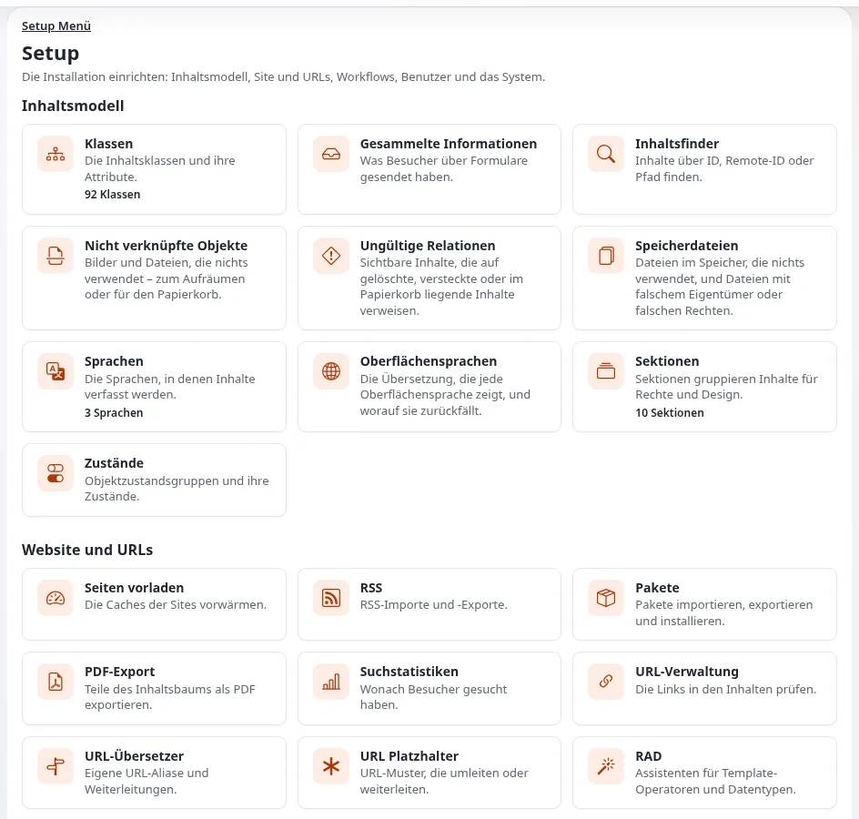

# Hosting-Anbieter: hier beginnen

Dieser Bereich der Hilfe ist für **Hosting-Anbieter und Dienstleister**, die Exponential-Websites für ihre Kunden hosten
oder das möchten: Produktmanager, die ein Angebot „Exponential-Hosting“ entwerfen, Systemadministratoren, die die Server
aufbauen und betreiben, Support-Mitarbeitende, die Kunden antworten, und die Menschen, die das Angebot vermarkten. Er
beantwortet: Was eine Exponential-Website von einem Server braucht, welche Hosting-Modelle und Server-Stacks passen, wie
Sie Kunden-Websites installieren, aktualisieren, sichern, überwachen und absichern und wie Sie all das als Produkt
schnüren.

Jeder Befehl und jede Einstellung in diesem Bereich wurde gegen den Quellcode und das Installationsbuch dieses Release
geprüft. Wo die Quellen keine Zahl nennen (Preise, Reaktionszeiten, Kapazität pro Server), nennen auch die Seiten
keine: Sie zeigen, wie Sie messen und entscheiden.

## Inhalt

1. [Exponential in einer Minute, für Hoster](#exponential-in-einer-minute-für-hoster)
2. [Was ein Server bereitstellen muss](#was-ein-server-bereitstellen-muss)
3. [Wie dieser Bereich aufgebaut ist](#wie-dieser-bereich-aufgebaut-ist)
4. [Ihre erste Woche](#ihre-erste-woche)
5. [Lesepfade nach Rolle](#lesepfade-nach-rolle)
6. [Die Seiten, die Sie am häufigsten nutzen werden](#die-seiten-die-sie-am-häufigsten-nutzen-werden)
7. [Wo Sie Hilfe bekommen](#wo-sie-hilfe-bekommen)

## Exponential in einer Minute, für Hoster

- **Es ist eine PHP-Anwendung.** Exponential ist „ein professionelles PHP-Anwendungsframework mit fortgeschrittener
  CMS-Funktionalität (Content-Management-System)“ (`README.md`). Es läuft auf PHP 8.0 bis 8.5 (PHP 7.4 ohne Support nutzbar), auf fast jedem
  Betriebssystem, auf dem PHP 8 läuft ([Betriebssystemunterstützung](../betriebssystemunterstuetzung.md)).
- **Es ist freie Software.** Der Code steht unter der GPL v2 oder später und kostet nichts; Sie können es für beliebig
  viele Kunden installieren. Die Dokumentation, einschließlich dieser Seite, steht unter der GNU FDL 1.3
  ([Freie Dokumentation](../freie-dokumentation.md)).
- **Es hat eine lange Geschichte.** Exponential führt die Codebasis von eZ Publish fort, einem Produkt, das sein
  Hersteller nach fast 18 Jahren eingestellt hat; 7x und die Exponential Foundation pflegen es heute
  ([Wer ist 7x?](../wer-ist-7x.md), [Wer ist die Exponential Foundation?](../wer-ist-die-exponential-foundation.md)).
- **Es braucht eine Datenbank, einen Webserver oder eine Engine und beschreibbaren Speicher.** Das ist der ganze
  Fußabdruck; es gibt keinen separaten Anwendungsserver, der lizenziert werden müsste.
- **Es bringt seine eigene Engine mit.** Exponential Velocity ist ein in PHP geschriebener Webserver mit dauerhaften
  Workern, empfohlen für jede Phase; FrankenPHP ist eine produktionsreife Alternative; Apache oder nginx mit PHP-FPM
  bleiben vollständig unterstützt und sind das, was Shared Hosting meist anbietet ([Kapitel 8](../../installation/08-die-website-ausliefern.md)).

## Was ein Server bereitstellen muss

| Bedarf | Minimum | Hinweise |
|---|---|---|
| PHP | 8.0 (einschließlich Velocity) | das neueste 8.x, das Ihr System anbietet; 8.5 wird unterstützt |
| Datenbank | eine der sechs | in der offiziellen Reihenfolge: 1. SQLite 3 (Standard) · 2. PostgreSQL · 3. MongoDB · 4. MariaDB · 5. Oracle · 6. MySQL. Microsoft SQL Server ist derzeit bekanntermaßen mit zusätzlicher Arbeit möglich. |
| `php.ini` | `memory_limit` 64M, `max_execution_time` 30, `date.timezone` gesetzt, `file_uploads` an | vom Setup-Assistenten geprüft |
| Webserver | keiner erforderlich | Velocity liefert HTTP und HTTPS selbst aus; oder Apache/nginx mit PHP-FPM |
| Composer | 2.x | für Installationen und Updates aus dem Quellcode |
| Bildkonvertierung | GD oder ImageMagick | beide empfohlen |
| Beschreibbare Verzeichnisse | `var/` (Cache, Log, Speicher, Autoload) und die Verzeichnisse unter `settings/`, in die das Setup schreibt | die Prüfung `directory_permissions` des Setup-Assistenten listet sie auf; Details in [Beschreibbare Verzeichnisse und Berechtigungen](grundlagen/beschreibbare-verzeichnisse-und-berechtigungen.md) |

Quellen: [Kapitel 2: Anforderungen](../../installation/02-voraussetzungen.md), [Datenbankunterstützung](../datenbankunterstuetzung.md).
Das vollständige Bild steht unter [Anforderungen auf einen Blick](grundlagen/anforderungen-auf-einen-blick.md).

## Wie dieser Bereich aufgebaut ist

| Abschnitt | Was er abdeckt |
|---|---|
| [Grundlagen des Hostings](grundlagen/README.md) | Anforderungen, PHP, die sechs Datenbanken in Reihenfolge, Betriebssysteme, Composer und Git, Berechtigungen, Dimensionierung, Medien, Suche |
| [Hosting-Modelle](modelle/README.md) | Shared, VPS, dediziert, Container, Kubernetes, Platform as a Service, Managed Hosting |
| [Control Panels](control-panels/README.md) | Plesk (auf dem der eigene Entwicklungsserver des Projekts läuft), cPanel, DirectAdmin, ISPConfig, Webmin; PHP-Pools, Cron, Datenbanken, Zertifikate |
| [Webserver und Engines](server/README.md) | Apache, nginx, Caddy, LiteSpeed, IIS, Exponential Velocity, FrankenPHP |
| [Leistung](leistung/README.md) | Abstimmung von PHP-FPM, OPcache, die Cache-Schichten, der Antwort-Cache von Velocity, HTTP-Caching, Reverse Proxies, CDN, Valkey, statischer Cache, Benchmarks |
| [Betrieb](betrieb/README.md) | Speicher und Clustering, Backups und Wiederherstellung, Überwachung und Logs, Cronjobs, E-Mail, Updates mit ezupdate, Ausrollen, Wartungsmodus |
| [Sicherheit](sicherheit/README.md) | Härtung, TLS, Content Security Policy, request-shield, Zugriff auf die Administration, zweistufige Anmeldung, Prüfprotokoll, Trennung von Mandanten, Compliance |
| [Bereitstellung](bereitstellung/README.md) | Ein-Klick-Installer: `exp:install`, der Kickstarter, der Setup-Assistent; Seitenpakete; Automatisierung; mehrere Websites |
| [Das Hosting-Geschäft](geschaeft/README.md) | Tarife, SLA- und Support-Optionen, Abrechnungsoptionen, Marketing, Partnerprogramme, Lizenzierung |
| [Kunden migrieren](migrationen/README.md) | Kunden-Websites zu Ihrem Hosting bringen, von älteren Versionen und anderen Plattformen |
| [Checklisten](checklisten/README.md) | neuer Server, Start einer Website, monatlicher Betrieb, Sicherheitsprüfung, Kundenaustritt |
| [Runbooks](runbooks/README.md) | Website nicht erreichbar, langsame Website, Festplatte voll, Wiederherstellung, kompromittierte Website, PHP-Upgrade, ablaufendes Zertifikat, Velocity startet nicht |
| [Glossar für Hoster](glossar-fuer-hoster.md) | die Begriffe, die in diesem Bereich verwendet werden |

## Ihre erste Woche

Ein Plan für ein Team, das Exponential in sein Angebot aufnehmen will.

| Tag | Tun Sie | Lesen Sie |
|---|---|---|
| 1 | Entscheiden Sie, welches Hosting-Modell und welchen Stack Ihr erstes Angebot nutzt | [Ein Hosting-Modell wählen](modelle/ein-hosting-modell-waehlen.md), [Einen Webserver wählen](server/einen-webserver-waehlen.md) |
| 2 | Bauen Sie nach der Checkliste einen Testserver; installieren Sie eine Website mit `exp:install` | [Checkliste für einen neuen Server](checklisten/checkliste-fuer-einen-neuen-server.md), [Ein-Klick-Installer](bereitstellung/ein-klick-installer-fuer-exponential.md) |
| 3 | Härten Sie ihn und legen Sie die Logs dorthin, wo Ihre Überwachung sie lesen kann | [Härtung für Hoster](sicherheit/haertung-fuer-hoster.md), [Überblick über die Überwachung](betrieb/ueberblick-ueber-die-ueberwachung.md) |
| 4 | Sichern Sie ihn und stellen Sie ihn dann auf einer zweiten Maschine wieder her | [Was gesichert werden muss](betrieb/backups-was-gesichert-werden-muss.md), [Wiederherstellung und Wiederherstellungstests](betrieb/wiederherstellung-und-wiederherstellungstests.md) |
| 5 | Messen Sie ihn, schreiben Sie die Grenzen eines Tarifs auf und entwerfen Sie das Angebot | [Benchmark einer gehosteten Website](leistung/benchmark-einer-gehosteten-website.md), [Hosting-Tarife gestalten](geschaeft/hosting-tarife-gestalten.md) |

> **Tipp**
> Machen Sie Tag 4 wirklich. Ein Backup, das nie wiederhergestellt wurde, ist eine Hoffnung, kein Backup; die
> Checkliste für die erste Woche im Installationsbuch verlangt ein Backup, das „erstellt **und auf einer anderen
> Maschine wiederhergestellt**“ wurde ([10.15](../../installation/10-nach-der-installation.md#1015-eine-checkliste-für-die-erste-woche)).

## Lesepfade nach Rolle

- **Produktmanager beim Hoster:** diese Seite, [Ein Hosting-Modell wählen](modelle/ein-hosting-modell-waehlen.md),
  [Hosting-Tarife gestalten](geschaeft/hosting-tarife-gestalten.md), [SLA-Optionen](geschaeft/sla-optionen-fuer-exponential-hosting.md),
  [Support-Stufen](geschaeft/support-stufen-fuer-exponential-hosting.md), [Exponential-Hosting vermarkten](geschaeft/exponential-hosting-vermarkten.md).
- **Systemadministrator:** [Anforderungen auf einen Blick](grundlagen/anforderungen-auf-einen-blick.md),
  [Datenbanken in der offiziellen Reihenfolge](grundlagen/datenbanken-in-der-offiziellen-reihenfolge.md),
  [Velocity für Hoster](server/velocity-fuer-hoster.md), [Abstimmung von PHP-FPM](leistung/abstimmung-von-php-fpm.md),
  [Cache-Schichten](leistung/cache-schichten.md), [Trennung von Mandanten](sicherheit/trennung-von-mandanten.md),
  die [Checklisten](checklisten/README.md) und [Runbooks](runbooks/README.md).
- **Support-Mitarbeitende:** [Überblick über die Überwachung](betrieb/ueberblick-ueber-die-ueberwachung.md),
  [Log-Viewer und Log-Rotation](betrieb/log-viewer-und-log-rotation.md), [Website nicht erreichbar](runbooks/website-nicht-erreichbar.md),
  [Langsame Website](runbooks/langsame-website.md), [Wenn etwas schiefgeht](../wenn-etwas-schiefgeht.md).
- **Migrationsteam:** [Kunden zu Ihrem Hosting migrieren](migrationen/kunden-zu-ihrem-hosting-migrieren.md) und die
  Kapitel [14](../../installation/14-migration-von-4x.md) bis [17](../../installation/17-migrationsreferenz.md) des
  Installationsbuchs.

## Die Seiten, die Sie am häufigsten nutzen werden

- [Anforderungen auf einen Blick](grundlagen/anforderungen-auf-einen-blick.md)
- [Datenbanken in der offiziellen Reihenfolge](grundlagen/datenbanken-in-der-offiziellen-reihenfolge.md)
- [Ein Hosting-Modell wählen](modelle/ein-hosting-modell-waehlen.md)
- [Einen Webserver wählen](server/einen-webserver-waehlen.md)
- [Velocity für Hoster](server/velocity-fuer-hoster.md)
- [Cache-Schichten](leistung/cache-schichten.md)
- [Was gesichert werden muss](betrieb/backups-was-gesichert-werden-muss.md)
- [Härtung für Hoster](sicherheit/haertung-fuer-hoster.md)
- [Trennung von Mandanten](sicherheit/trennung-von-mandanten.md)
- [Ein-Klick-Installer](bereitstellung/ein-klick-installer-fuer-exponential.md)
- [Checkliste für den Start einer Kunden-Website](checklisten/checkliste-fuer-den-start-einer-kunden-website.md)

## Wo Sie Hilfe bekommen

- **Diese Hilfe.** Durchsuchen Sie sie über das Feld oben im Dashboard der Hilfe; filtern Sie nach der Zielgruppe Hosting.
- **Fehler und Sicherheitsprobleme.** Melden Sie einen Softwarefehler wie in [Wenn etwas schiefgeht](../wenn-etwas-schiefgeht.md)
  beschrieben; melden Sie ein Sicherheitsproblem vertraulich, wie es `SECURITY.md` im Repository beschreibt, nie in
  einem öffentlichen Issue ([Sicherheitsupdates und Offenlegung](sicherheit/sicherheitsupdates-und-offenlegung.md)).
- **Das Projekt und seine Betreuer.** 7x und die Exponential Foundation werden unter [Wer ist 7x?](../wer-ist-7x.md) und
  [Wer ist die Exponential Foundation?](../wer-ist-die-exponential-foundation.md) vorgestellt; wie Hoster mit ihnen
  zusammenarbeiten, steht unter [Mit dem Projekt und 7x zusammenarbeiten](geschaeft/mit-dem-projekt-und-7x-zusammenarbeiten.md).
- **Andere Hoster und Partner.** Der Bereich Partner dieser Hilfe beschreibt die Partnerprogramme; die Orte der Community
  sind unter [Wer ist die Exponential Foundation?](../wer-ist-die-exponential-foundation.md#orte-der-community) aufgeführt.

**Öffentliche Demos.** Hosten Sie eine öffentliche Demo von Exponential mit einer veröffentlichten Administrator-Anmeldung? Betreiben Sie sie im Demomodus (`EXP_DEMO_MODE=1` nur für diese Website): [Demomodus für Hoster](sicherheit/demomodus-fuer-hoster.md), [Rezept: eine öffentliche Demo auf LiteSpeed und Plesk betreiben](server/rezept-eine-oeffentliche-demo-auf-litespeed-und-plesk-betreiben.md), [Probleme mit dem Demomodus](runbooks/probleme-mit-dem-demomodus.md).

## Verwandte Seiten

- [Hosting, Datenbank und Betriebssystem wählen](../fuehrung/hosting-datenbank-und-betriebssystem-waehlen.md) (für Projektverantwortliche)
- [Datenbankunterstützung](../datenbankunterstuetzung.md)
- [Betriebssystemunterstützung](../betriebssystemunterstuetzung.md)
- [Sicherheitshärtung](../sicherheitshaertung.md)
- [Das Installationsbuch](../../installation/README.md)
- [Freie Dokumentation](../freie-dokumentation.md): Diese Seite darf unter der GNU FDL 1.3 frei kopiert, übersetzt und verbessert werden.

<!-- exp-partner-block:start -->
**Werden Sie Exponential-Partner.** Partner teilen ihre Informationen, stellen Mittel bereit, geben Beiträge zurück
und entwickeln die Produkte mit uns, und so wächst Exponential. Eine Partner-Website und ein Dashboard sind für Mitte
2027 geplant: Werden Sie noch heute Partner, damit wir schneller wachsen und neue Funktionen früher liefern. Beginnen
Sie mit [Partner: hier beginnen](../partner/partner-hier-beginnen.md) und
[Wie Sie sich bewerben](../partner/wie-sie-sich-bewerben.md).
<!-- exp-partner-block:end -->
