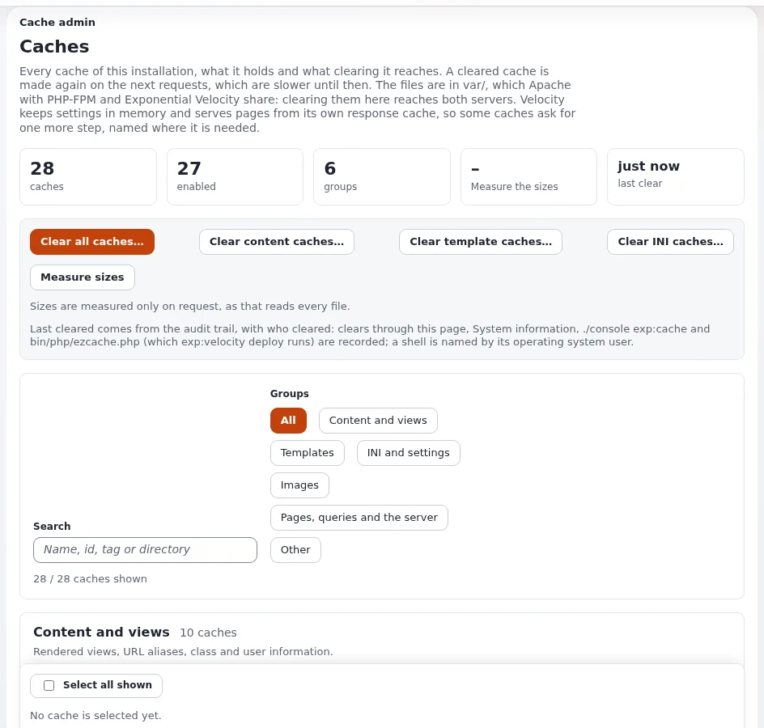

# Caches leeren und vorwärmen

Diese Seite ist für Systemadministratoren und Support-Mitarbeitende bei Hosting-Anbietern. Sie beantwortet: welcher Cache für
welche Art von Änderung geleert wird, in welcher Reihenfolge, mit welchem Befehl, wie sich das Leeren auf einer ausgelasteten
Website verhält und wie Sie eine Website danach vorwärmen, damit die ersten Besucher nicht dafür bezahlen. Die Quellen sind
[Caches](../../../anleitungen/caches.md), [Kapitel 10, Abschnitt 10.6](../../../installation/10-nach-der-installation.md#106-caches),
[Cache-Steuerung aus der Konsole](../../../bc/6.0/cache-konsole.md) und [Caches vorladen](../../../anleitungen/caches-vorwaermen.md).

## Inhalt

1. [Welcher Cache für welche Änderung](#welcher-cache-für-welche-änderung)
2. [Die Reihenfolge nach einer Codeänderung](#die-reihenfolge-nach-einer-codeänderung)
3. [Die Befehle](#die-befehle)
4. [Leeren auf einer ausgelasteten Website](#leeren-auf-einer-ausgelasteten-website)
5. [Der Cronjob zum Aufräumen](#der-cronjob-zum-aufräumen)
6. [Vorwärmen](#vorwärmen)
7. [Wer was geleert hat](#wer-was-geleert-hat)
8. [Checkliste](#checkliste)

## Welcher Cache für welche Änderung

Aus [Kapitel 10, Was zu leeren ist](../../../installation/10-nach-der-installation.md#welcher-cache-zu-leeren-ist), mit `php bin/php/ezcache.php`:



| Sie haben geändert | Leeren |
|---|---|
| eine `.ini`-Einstellung | `--clear-tag=ini` (nicht `--clear-id=ini`, das den globalen INI-Cache verfehlt) |
| eine `.tpl`-Datei | `--clear-tag=template` |
| eine neue `.tpl`-Datei, eine Override-Regel, eine Erweiterung oder ein Design | `--clear-id=template-override,design_base` |
| ein Stylesheet oder Skript | `--clear-id=ezjscore-packer,template-block`, dann den Cache von Velocity |
| Inhalte wirken veraltet | `--clear-tag=content` |
| Rollen und Richtlinien | `--clear-tag=user` |
| die Definition eines Bild-Alias | `--clear-id=imagealias` |
| eine Übersetzung | `--clear-tag=i18n` |
| eine Wiederherstellung der Datenbank oder ein Schreiben von außerhalb von Exponential | `--clear-id=querycache` |
| unsicher | `--clear-all` (kostet danach einen langsameren ersten Aufruf jeder Seite) |

Kompilierte Templates werden nicht mit ihrer Quelle verglichen, es sei denn, `[TemplateSettings] DevelopmentMode=enabled`, was Live-
Websites aus lassen sollten. Unter Velocity starten Sie nach dem Leeren der INI-Caches neu (Worker halten Einstellungen im Speicher)
und leeren nach Änderungen an Templates den Antwort-Cache.

## Die Reihenfolge nach einer Codeänderung

Eine Seite, die vom alten Code zwischen dem Leeren eines Caches und dem Neuladen von PHP gerendert wird, wird erneut
zwischengespeichert und sieht aus, als hätte die Änderung nicht gewirkt. Die Reihenfolge: INI- und Template-Caches, dann PHP-FPM neu
laden und Velocity neu starten, und **erst dann** die Caches für Inhalte, HTTP, Template-Blöcke und Antworten. `exp:velocity deploy`
tut genau das, mit `PASS` oder `FAIL` pro Schritt, auf Velocity und auf Websites nur mit Apache (`--no-velocity`):

| # | Schritt |
|---|---|
| 1 | Autoloads der Erweiterungen (`--kernel`: auch Autoloads des Kernels) |
| 2 | INI-Caches (`--clear-tag=ini`) |
| 3 | Caches für Templates, Template-Overrides, Übersetzungen und design_base |
| 4 | Engine-Archiv, wenn Velocity aus einem läuft |
| 5 | PHP-FPM: warten, bis OPcache neu geprüft hat, oder neu laden |
| 6 | Velocity neu starten, wenn er läuft |
| 7 | Caches für Inhalte, exphttpcache, (mit `--packer`) ezjscore-packer und Template-Blöcke |
| 8 | der Antwort-Cache von Velocity |
| 9 | Vorwärmen: jede `[DeploySettings] WarmUpURL[]` wird einmal im Hintergrund angefragt |

Die Schritte sind aus [Engines von Velocity](../../../bc/6.0/velocity-engines.md#eine-php-änderung-bereitstellen-expvelocity-deploy) verdichtet.

```bash
php bin/php/console exp:velocity deploy --dry-run --allow-root-user
php bin/php/console exp:velocity deploy --allow-root-user
```

## Die Befehle

| Befehl | Nutzung |
|---|---|
| `php bin/php/ezcache.php --clear-id=<id>[,<id>]`, `--clear-tag=<tag>`, `--clear-all` | das klassische Leeren eines Caches |
| `./console exp:cache <group> [action]` | jede Aktion von Setup > Caches, dazu statische, HTTP-, Abfrage- und Velocity-Caches; endet mit `PASS` oder `FAIL` |
| `./console exp:cache clear --tag=ini --dry-run` | was geleert würde, mit Größen, ohne etwas zu ändern |
| `./console exp:cache status` | jede Gruppe auf einem Bildschirm |
| `php bin/php/console exp:velocity cache clear` | der Antwort-Cache von Velocity |
| `php bin/php/console exp:velocity restart` | Velocity, nachdem sich Einstellungen geändert haben |

Führen Sie sie als Benutzer der Website aus, damit das, was sie neu anlegen, für den Webserver beschreibbar bleibt; als root brauchen
sie `--allow-root-user`. `exp:cache` endet mit 0, wenn erledigt, mit 1, wenn es gescheitert ist, mit 2 bei einem Bedienungsfehler,
was zu Skripten passt.

> **Hinweis**
> Setup > Caches (`/setup/cache`, Richtlinie `setup/managecache`) gibt dem Administrator eines Kunden dieselben Aktionen im Browser,
> gruppiert, mit Größen und dem Zeitpunkt, wann jeder Cache zuletzt geleert wurde. Die meisten Support-Fragen zu veralteten Seiten
> enden dort: Leeren Sie den Antwort-Cache von Velocity oder warten Sie einige Sekunden; ist es eine geänderte Einstellung, starten Sie
> Velocity neu.

## Leeren auf einer ausgelasteten Website

Seit 6.0.15 **benennt** ein Leeren ein Cache-Verzeichnis in einem Schritt zur Seite **um** und löscht es von dort
([Leeren von Caches, das Verzeichnisse zur Seite verschiebt](../../../funktionen/6.0/cache-leeren-durch-umbenennen.md)): Es kehrt auch bei
Hunderttausenden von Dateien schnell zurück, und nichts, was in der Zwischenzeit erzeugt wird, wird vom Löschen erfasst.
Einstellungen: `site.ini [FileSettings] RenameBeforeDelete=enabled` und `RenameExpiredCaches=enabled` (beide mitgeliefert).


Wenn eine Änderung die View-Caches von `[ContentSettings] CacheThreshold` Knoten oder mehr (250) leeren würde, wird stattdessen der
ganze View-Cache als abgelaufen markiert, und das Log meldet `Expiring all view cache`. Gelegentlich nach einem großen Verschieben ist
das erwartet; bei gewöhnlichen Bearbeitungen deutet es auf Beziehungen oder `viewcache.ini` hin.

## Der Cronjob zum Aufräumen

Das Leeren des View-Caches oder der Template-Blöcke verschiebt nur einen Zeitstempel; die Dateien bleiben also, bis der Cronjob-Teil
`cache_cleanup` sie entfernt (Dateien nach ihrem Ablauf oder älter als `cronjob.ini [CacheCleanupSettings] MaxAge`, 172800 s; auch
Dateien des HTTP-Caches und des Abfrage-Caches). Er läuft pro var-Verzeichnis:

```bash
php runcronjobs.php -s site cache_cleanup
```

Planen Sie ihn für jede Kunden-Website, sonst wächst `var/`. Siehe [Cronjobs](../betrieb/cronjobs.md).

## Vorwärmen

| Werkzeug | Was es tut | Wann |
|---|---|---|
| `php bin/php/console exp:warm` (`bin/php/warm.php`) | fragt jede veröffentlichte Seite an, damit kein Besucher für ein Rendering bezahlt; `--limit`, `--verbose`, `--json` | nach einem Leeren und mit einem Zeitgeber, der kürzer ist als das Cache-Fenster |
| `php bin/php/preload.php --siteaccess=<site>` (Setup > Seiten vorladen) | durchläuft eine Website von ihren Bereichsseiten aus bis zu einer Seitengrenze und Linktiefe, wärmt View-Cache, Bild-Aliase und kompilierte Templates vor, listet defekte Links auf | nach einem Ausrollen oder einem nächtlichen Leeren; immer nur ein Lauf |
| `[DeploySettings] WarmUpURL[]` | Seiten, die am Ende von `exp:velocity deploy` von einem Hintergrundprozess je einmal angefragt werden | immer, für die Startseite und die Anmeldung der Administration |

Beispiele aus den Quellen:

```bash
php bin/php/preload.php --siteaccess=site --dry-run
php bin/php/preload.php --siteaccess=site --max-pages=20 --max-depth=1
```

```text
30 4 * * * cd /path/to/exponential && php bin/php/preload.php --siteaccess=site -q
*/4 * * * * cd /path/to/exponential && php bin/php/warm.php --allow-root-user >> var/log/cache-warm.log 2>&1
```

- Der Preloader wärmt Dateien vor, die Apache/PHP-FPM und Velocity teilen. Der Antwort-Cache von Velocity behält eine anonyme Seite
  nur `DefaultTtl` Sekunden (30), sodass ein Vorwärmen vor den Besuchern dort nicht anhält.
- Seiten für angemeldete Benutzer werden nicht vorgewärmt: Der Lauf ist ein anonymer Besucher.
- Vorwärmen rendert Seiten und kostet daher CPU. Planen Sie es auf einer geteilten Maschine in ruhigen Stunden und versetzt für die
  Kunden.
- Auf der Testinstallation der Quelle brauchte `exp:warm` kalt 9,6 s für 142 Seiten und warm 0,3 s
  ([HTTP/2 und Vorwärmen des Caches](../../../bc/6.0/http2-und-cache-vorwaermen.md#den-cache-gefüllt-halten)).

## Wer was geleert hat

Jedes Leeren wird im Prüfprotokoll als `system.cache.clear` festgehalten, über die Seite, `exp:cache` und `bin/php/ezcache.php`
gleichermaßen, bei einer Shell mit dem Benutzer des Betriebssystems. Setup > Caches zeigt Benutzern, die den Systemkanal des Audits
lesen dürfen, wann und von wem jeder Cache zuletzt geleert wurde ([Caches, zuletzt geleert](../../../anleitungen/caches.md#3-zuletzt-geleert)).
Der Support kann daher beantworten, wer den Cache geleert hat, bevor die Website langsam wurde.

## Checkliste

- [ ] Der Support hat die Tabelle „Welcher Cache für welche Änderung“.
- [ ] Ausrollen nutzt `exp:velocity deploy` oder dieselbe Reihenfolge von Hand.
- [ ] `cache_cleanup` ist für jedes var-Verzeichnis geplant.
- [ ] Eine Strategie zum Vorwärmen (Zeitgeber für exp:warm, nächtliches Vorladen, `WarmUpURL[]`) pro Tarif gewählt und versetzt.
- [ ] Der Abfrage-Cache wird nach jeder Wiederherstellung der Datenbank geleert.

## Verwandte Seiten

- [Cache-Schichten](cache-schichten.md)
- [Änderungen ausrollen](../betrieb/aenderungen-ausrollen.md)
- [Langsame Website](../runbooks/langsame-website.md)
- [Caches vorladen](../../../anleitungen/caches-vorwaermen.md)
- [Cache-Steuerung aus der Konsole](../../../bc/6.0/cache-konsole.md)
- [Freie Dokumentation](../../freie-dokumentation.md): Diese Seite darf unter der GNU FDL 1.3 frei kopiert, übersetzt und verbessert werden.

<!-- exp-partner-block:start -->
**Werden Sie Exponential-Partner.** Partner teilen ihre Informationen, stellen Mittel bereit, geben Beiträge zurück
und entwickeln die Produkte mit uns, und so wächst Exponential. Eine Partner-Website und ein Dashboard sind für Mitte
2027 geplant: Werden Sie noch heute Partner, damit wir schneller wachsen und neue Funktionen früher liefern. Beginnen
Sie mit [Partner: hier beginnen](../../partner/partner-hier-beginnen.md) und
[Wie Sie sich bewerben](../../partner/wie-sie-sich-bewerben.md).
<!-- exp-partner-block:end -->
