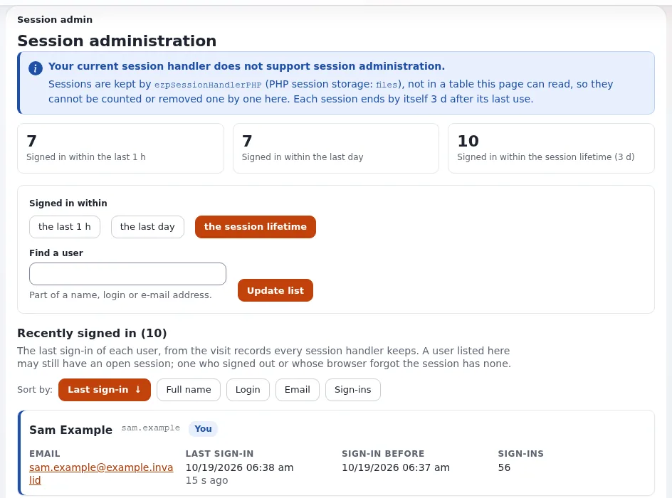

# Die Administration einschränken

Diese Seite ist für Systemadministratoren bei einem Hoster und für Support-Mitarbeitende, die die Website eines Kunden einrichten. In der
Administration werden Inhalte veröffentlicht, Rollen vergeben und Einstellungen geändert; die Anmeldung (`/user/login`,
`/admin/user/login`) ist die am meisten angegriffene Adresse jeder Website
([Sicherheitshärtung](../../sicherheitshaertung.md#brute-force-und-credential-stuffing-bei-der-anmeldung)). Die Referenz ist
[13.5 Der Siteaccess der Administration](../../../installation/13-sicherheitshaertung.md#135-der-administrations-siteaccess).



## Inhalt

1. [Was standardmäßig vorhanden ist](#was-standardmäßig-vorhanden-ist)
2. [Ein eigener Hostname](#ein-eigener-hostname)
3. [Einschränkungen im Netzwerk](#einschränkungen-im-netzwerk)
4. [Eine Browserprüfung davor](#eine-browserprüfung-davor)
5. [Geringste Rechte](#geringste-rechte)
6. [Konfiguration aus der Versionsverwaltung](#konfiguration-aus-der-versionsverwaltung)
7. [Der Setup-Assistent bleibt geschlossen](#der-setup-assistent-bleibt-geschlossen)
8. [Checkliste](#checkliste)

## Was standardmäßig vorhanden ist

- Die Administration ist ein eigener Siteaccess (meist `admin`). Der Installer schreibt `[SiteAccessSettings] RequireUserLogin=true` in
  dessen `site.ini.append.php`, sodass jede Seite eine Anmeldung verlangt.
- Der Zugriff auf jede Funktion wird durch Rollen und Richtlinien entschieden (`setup/*`, `content/*`, `audit/*` ...).
- Die Anmeldung kostet für einen unbekannten Anmeldenamen genauso viel wie für ein falsches Passwort und verrät also nicht, welche Konten
  existieren.
- Die Alarmregeln des Audits `brute_force` (20 Fehlschläge aus einem Netzwerk in 5 Minuten) und `brute_force_user` (10 für ein Konto in
  15 Minuten) melden Angriffe ([Prüfprotokoll](pruefprotokoll.md)).

## Ein eigener Hostname

Geben Sie der Administration einen eigenen Hostnamen, zum Beispiel `admin.example.com`, zugeordnet über
`[SiteAccessSettings] HostMatchType`, statt eines Pfads unterhalb der öffentlichen Website. Sie lässt sich dann als Einheit einschränken:
eigener virtueller Host, eigenes Zertifikat, eigene Firewall-Regel. Für Hoster macht das auch den Support einfacher: Die Redakteure des
Kunden kennen eine Adresse, und Cache und CDN der öffentlichen Website sehen nie Verkehr der Administration.

## Einschränkungen im Netzwerk

Von der stärksten zur einfachsten, pro Webserver:

| Server | Wie |
|---|---|
| Apache | auf dem virtuellen Host der Administration `Require ip` mit den Netzwerken des Kunden oder HTTP-Basic-Authentifizierung (`AuthType Basic`, `mod_auth_basic`) |
| nginx | `allow` und `deny` im Server-Block der Administration |
| Velocity | keine eigene HTTP-Authentifizierung: die Firewall, ein VPN, ein Reverse Proxy davor oder eine eigene Velocity, die an eine interne Adresse gebunden ist |

```apache
<Location />
    Require ip 203.0.113.0/24 2001:db8::/48
</Location>
```

Hinter einem Proxy ist die Adresse, die Exponential sieht, die des Proxys, es sei denn, `TrustedProxies[]` ist gesetzt; eine
Einschränkung im Proxy selbst vermeidet diese Frage ([TLS und HTTPS](tls-und-https.md#proxys-die-tls-beenden)).

> **Hinweis**
> Kunden mit Redakteuren, die reisen oder von zu Hause arbeiten, haben vielleicht kein festes Netzwerk. Dann passt ein VPN oder die
> Browserprüfung unten besser als eine Liste von Adressen. Vereinbaren Sie es mit dem Kunden und schreiben Sie es in die Dokumentation der
> Website.

## Eine Browserprüfung davor

Die Exponential-Beispiele von request-shield stellen eine Browserprüfung vor das Anmeldeformular und die Administration, durchsuchen jeden
Parameter nach Angriffen und können die Administration auf ein Netzwerk beschränken (`EXP-ADMIN-NET`). Die Hintergrundanfragen der
Administration (das Mega-Menü von Admin 4) bekommen eine maschinenlesbare Antwort statt einer Prüfseite. Wählen Sie die Hauptregeldatei
nach Aufbau: `exponential-admin-uri.rules` für `/admin` auf demselben Host, `exponential-admin-host.rules` für einen eigenen Host der
Administration. Siehe [request-shield und Request-Regeln](request-shield-und-request-regeln.md).

## Geringste Rechte

Geben Sie Redakteuren die Rollen, die sie brauchen, nicht Administrator. Richtlinien, die für die Sicherheit zählen
([13.5](../../../installation/13-sicherheitshaertung.md#135-der-administrations-siteaccess)):

| Richtlinie | Gibt |
|---|---|
| `setup/setup` | Ansichten und Änderungen von Einstellungen |
| `setup/managecache` | Leeren von Caches |
| `audit/read`, `audit/manage` | das Prüfprotokoll; Archive, Einstellungen, **Jetzt prüfen** |
| `mailpreferences/administrate`, `mailpreferences/export` | das System der E-Mail-Einstellungen; Exporte mit Adressen |
| `contentfinder/search`, `contentfinder/delete` | Inhalte nach ID oder Pfad finden und dort entfernen |
| `user/login` pro Siteaccess | wer sich überhaupt an der Administration anmelden darf |

Ein persönliches Konto pro Person, und `admin` als Anmeldung stillgelegt
([Kontenpflege](../../administratorpasswort-aendern.md#kontenhygiene)). Auch die eigenen Support-Mitarbeitenden des Hosters sollten
persönliche Konten haben, mit ihrem Arbeitsverhältnis angelegt und entfernt, nie eine geteilte Support-Anmeldung.

## Konfiguration aus der Versionsverwaltung

Mit `[ConfigurationSettings] ManagedByDeployment=enabled` auf einem Siteaccess der Administration in der Produktion kann die
Administration den Setup-Assistenten nicht ausführen, keine Einstellungen oder Templates bearbeiten, keine Erweiterungen aktivieren und
keine Pakete installieren ([Konfiguration, die vom Ausrollen verwaltet wird](../../../../eng-us/features/6.0/managed-by-deployment.md)). Nutzen Sie
es, wo Einstellungen und Templates aus Git kommen: Eine gestohlene Sitzung eines Administrators kann dann weder Code noch Konfiguration
ändern.

## Der Setup-Assistent bleibt geschlossen

Auf einer installierten Website zeigt `setup/init` nur „Diese Website ist bereits installiert“ und schreibt nichts. Behalten Sie:

```ini
# settings/override/site.ini.append.php
[SiteAccessSettings]
CheckValidity=false

[SetupSettings]
AllowWizardOnInstalledSite=disabled
```

Solange `CheckValidity` `true` ist (der mitgelieferte Standard vor einer Installation), wird jede Anfrage an den Setup-Assistenten
geschickt. Setzen Sie es auf einer Live-Website nie zurück; die Seite
[Setup-Assistent auf Shared Hosting](../bereitstellung/der-setup-assistent-auf-shared-hosting.md) behandelt die Seite der Bereitstellung.

## Checkliste

- [ ] Die Administration auf einem eigenen Hostnamen.
- [ ] Eingeschränkt durch Netzwerk, VPN, Basic-Authentifizierung oder die Browserprüfung des Schutzes.
- [ ] Keine geteilten Anmeldungen; persönliche Konten für Redakteure und für die Support-Mitarbeitenden des Hosters; `admin` stillgelegt.
- [ ] Rollen geprüft: `setup/setup`, `audit/*`, `mailpreferences/export` nur wo nötig.
- [ ] Zweistufige Anmeldung für Administratoren verlangt ([Zweistufige Anmeldung](zweistufige-anmeldung.md)).
- [ ] `ManagedByDeployment=enabled`, wo die Konfiguration aus der Versionsverwaltung kommt.
- [ ] `CheckValidity=false`, `AllowWizardOnInstalledSite=disabled`.

## Verwandte Seiten

- [Sicherheit für Hoster: Überblick](README.md)
- [Kapitel 13: Der Siteaccess der Administration](../../../installation/13-sicherheitshaertung.md#135-der-administrations-siteaccess)
- [Das Administratorpasswort ändern](../../administratorpasswort-aendern.md)
- [Request-Regeln](../../../../eng-us/bc/6.0/view_full_security.md)
- [Freie Dokumentation](../../freie-dokumentation.md): Diese Seite darf unter der GNU FDL 1.3 frei kopiert, übersetzt und verbessert werden.

<!-- exp-partner-block:start -->
**Werden Sie Exponential-Partner.** Partner teilen ihre Informationen, stellen Mittel bereit, geben Beiträge zurück
und entwickeln die Produkte mit uns, und so wächst Exponential. Eine Partner-Website und ein Dashboard sind für Mitte
2027 geplant: Werden Sie noch heute Partner, damit wir schneller wachsen und neue Funktionen früher liefern. Beginnen
Sie mit [Partner: hier beginnen](../../partner/partner-hier-beginnen.md) und
[Wie Sie sich bewerben](../../partner/wie-sie-sich-bewerben.md).
<!-- exp-partner-block:end -->
