# Inhalte erstellen und bearbeiten

Diese Seite ist für Redakteure. Sie erklärt, wie Sie ein neues Objekt erstellen, ein vorhandenes ändern, was die
Teile des Bearbeitungsformulars tun und wie Sie viele Objekte auf einmal verschieben, kopieren oder ändern.
Veröffentlichen, Entwürfe und Versionen haben eine eigene Seite:
[Veröffentlichen, Versionen und der Papierkorb](veroeffentlichen-und-versionen.md).

## Ein neues Objekt erstellen

1. Öffnen Sie die Stelle, an die das neue Objekt gehört, zum Beispiel einen Ordner (siehe [Suchen](suchen.md)
   oder den Baum in der linken Spalte).
2. Klicken Sie unter **Unterelemente** auf **Neu erstellen**. Es öffnet sich eine nach Gruppen geordnete Liste der
   Inhaltstypen, die Sie hier erstellen dürfen.
3. Wählen Sie den Typ, zum Beispiel **Artikel** oder **Ordner**. Das Bearbeitungsformular öffnet sich mit einem
   leeren Entwurf.
4. Füllen Sie die Felder aus und klicken Sie auf **Zur Veröffentlichung schicken**.

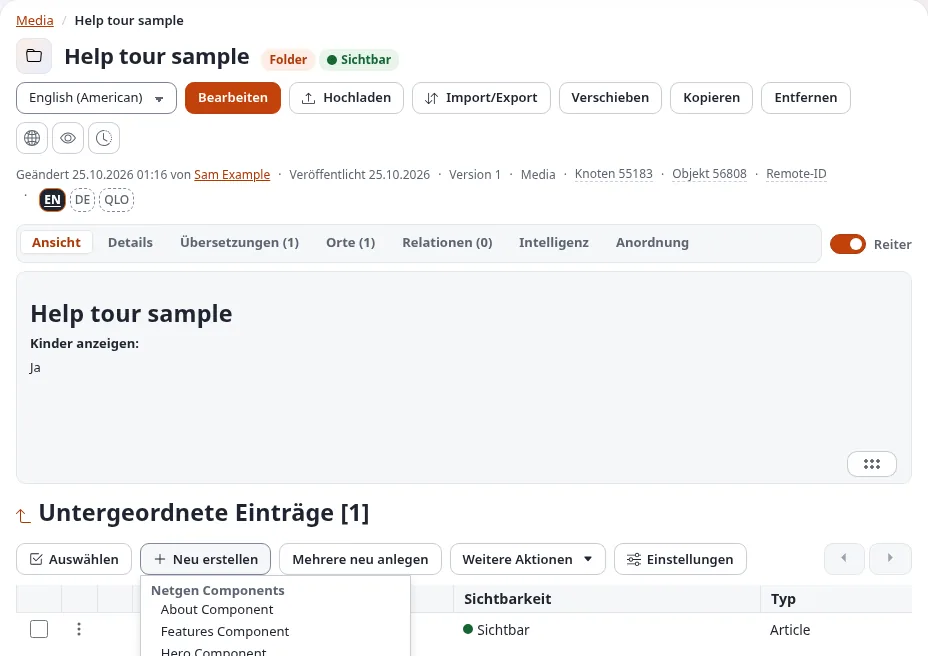

Andere Wege zum selben Ergebnis:

- Das Menü eines Objekts im Baum (klicken Sie auf das Symbol vor seinem Namen) enthält **Hier erstellen** mit
  derselben Liste.
- **Mehrere neu anlegen** öffnet ein Formular, in dem Sie mehrere neue Objekte unterhalb derselben Stelle auf
  einmal ausfüllen.

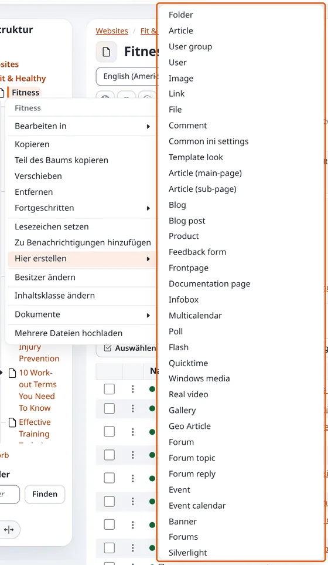

Verlassen Sie das Formular mit **Entwurf verwerfen**, wird das neue Objekt gar nicht erst angelegt.

## Ein Objekt bearbeiten

1. Öffnen Sie das Objekt.
2. Gibt es das Objekt in mehr als einer Sprache, wählen Sie zuerst die Sprache in der Liste neben **Bearbeiten**.
3. Klicken Sie auf **Bearbeiten**. Das Bearbeitungsformular öffnet sich mit einem neuen Entwurf, einer Kopie der
   veröffentlichten Version.
4. Ändern Sie, was nötig ist, und klicken Sie auf **Zur Veröffentlichung schicken**.

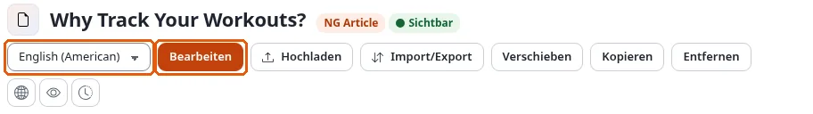

Sie können auch im Menü des Objekts im Baum **Bearbeiten in** wählen oder Objekte in einer Liste ankreuzen und
**Ausgewählte bearbeiten** wählen (siehe [Viele Objekte auf einmal](#viele-objekte-auf-einmal)).

### Wenn jemand anderes bearbeitet

Haben Sie oder hat jemand anderes bereits einen Entwurf des Objekts, erscheint zuerst die Seite **Möglicher
Bearbeitungs-Konflikt**. Sie listet die Entwürfe mit ihrem Ersteller und der Uhrzeit auf. Sie können einen **Ihrer**
Entwürfe fortsetzen (markieren Sie ihn und klicken Sie auf **Ausgewählte bearbeiten**), einen **Neuen Entwurf** aus
der veröffentlichten Version beginnen oder **Abbrechen**. Den Entwurf einer anderen Person können Sie nicht
bearbeiten; sprechen Sie mit ihr, oder legen Sie einen neuen Entwurf an.

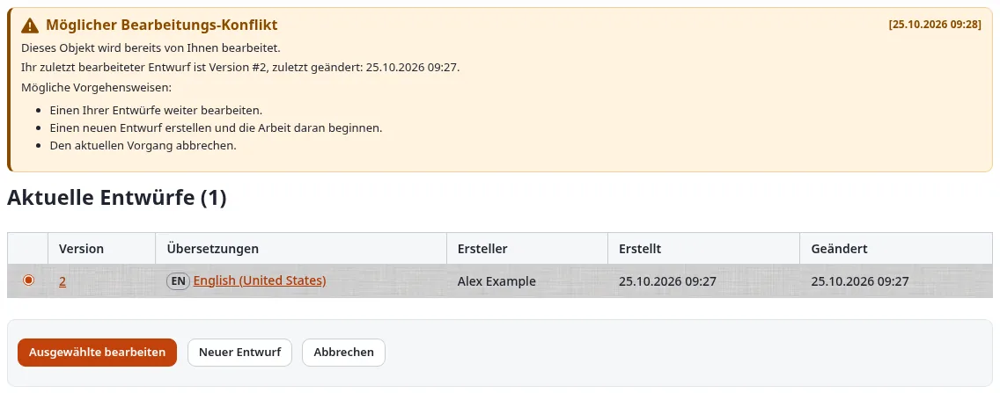

## Das Bearbeitungsformular

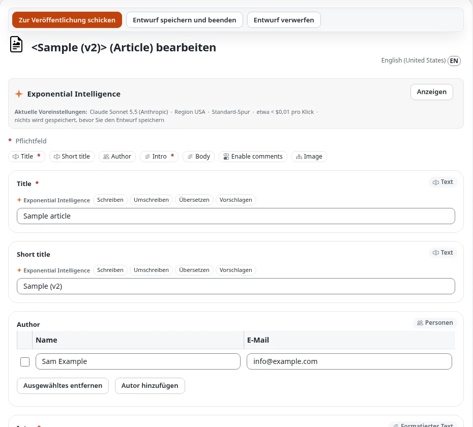

- **Die Schaltflächen oben**: **Zur Veröffentlichung schicken** veröffentlicht den Entwurf; **Entwurf speichern und
  beenden** behält den Entwurf und verlässt das Formular; **Entwurf verwerfen** wirft den Entwurf weg (nach Ihrer
  Bestätigung) und lässt die veröffentlichte Version unverändert. Manche Sites bieten außerdem **Ohne Benachrichtigung
  veröffentlichen** an; damit wird veröffentlicht, ohne den Personen eine E-Mail zu schicken, die diesem Bereich der
  Site folgen.
- **Die Titelzeile** nennt das Objekt und seinen Typ sowie die Sprache, die Sie bearbeiten, zum Beispiel *English
  (American)*.
- **Die Feldleiste**: eine Schaltfläche pro Feld (*Title*, *Short title*, *Intro* ...); ein Klick springt zu diesem
  Feld. Ein rotes `*` kennzeichnet ein **Pflichtfeld**: Solange es leer ist, lässt sich der Entwurf nicht
  veröffentlichen.
- **Die Felder** folgen, jedes mit seinem Typ in der Ecke (*Text*, *Rich Text*, *Personen*, *Verknüpfung* ...). Ist
  ein Feld beim Veröffentlichen fehlerhaft, kehrt das Formular mit einer Meldung oben und am Feld zurück.
- **Die linke Spalte** zeigt die Nummern und Daten des Objekts, den Entwurf, an dem Sie arbeiten, **Versionen
  verwalten** und **Vorschau** (der Entwurf so, wie er aussehen wird), die vorhandenen Übersetzungen und die
  **Sektion**, zu der das Objekt gehört.

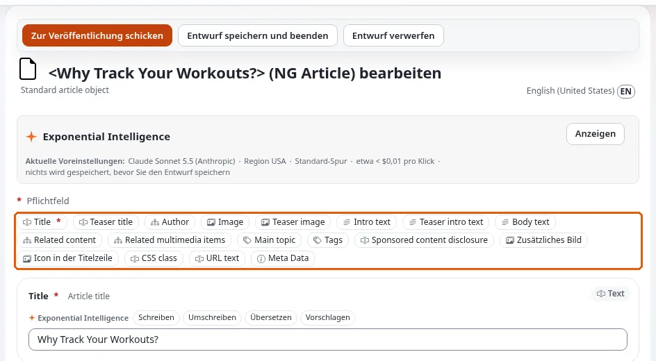

Der Entwurf wird während der Arbeit alle paar Minuten automatisch gespeichert, ein geschlossener Browser-Tab kostet
also wenig. Die Eingabetaste in einem einzeiligen Feld wirkt wie ein Klick auf **Zur Veröffentlichung schicken**.

### Rich Text

Rich-Text-Felder (wie *Intro* und *Body*) haben einen Editor mit einer Werkzeugleiste: Absatzformate, fett, kursiv,
Listen, Links, Tabellen, Sonderzeichen, **Objekt einbetten** (ein Bild oder ein anderes Objekt im Text),
**Vollbild** und **Quellcode**. Unter dem Feld können Sie zwischen den Editoren wechseln, die Ihre Site anbietet, zum
Beispiel **TinyMCE 8** und **Tiptap**. Die Schaltfläche **Hilfe** von TinyMCE listet seine Tastenkürzel auf.

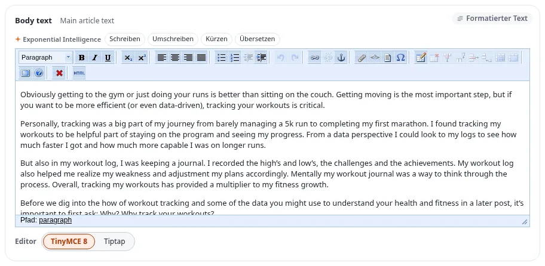

### Verknüpfungen und Bilder

Ein Feld vom Typ *Verknüpfung* (wie *Image* eines Artikels) verweist auf andere Objekte. Seine Schaltflächen:

- **Vorhandenes hinzufügen** (oder **Ein vorhandenes Objekt hinzufügen**) öffnet einen Browser, in dem Sie ein
  bereits vorhandenes Objekt auswählen;
- **Neu hochladen** (oder **Datei hochladen**) lädt eine Datei von Ihrem Computer hoch, erstellt daraus ein Objekt
  und verknüpft es.

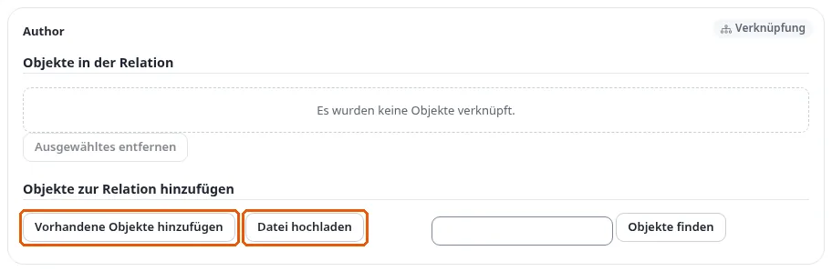

Bilder brauchen einen **Alternativtext**, eine kurze Beschreibung für Menschen, die das Bild nicht sehen können. Wo
die Site ihn verlangt, ist das Bildfeld mit **Alternativer Bildtext (Pflichtfeld)** gekennzeichnet, und die Dialoge
zum Hochladen fragen danach.

### Exponential Intelligence

Hat Ihre Site den Schreibassistenten eingeschaltet, zeigt jedes Textfeld **Exponential Intelligence** mit
Schaltflächen wie **Schreiben**, **Umschreiben**, **Übersetzen**, **Vorschlagen** und **Verbessern**. Seine
Vorschläge ändern nichts, bis Sie sie übernehmen und den Entwurf speichern. Der Kasten oben im Formular nennt den
verwendeten Dienst und was ein Klick kostet.

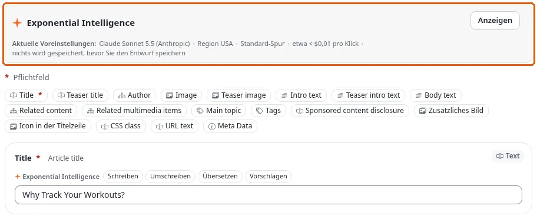

## Verschieben, kopieren und entfernen

Auf der Seite des Objekts:

- **Verschieben** setzt das Objekt an eine andere Stelle: Wählen Sie im sich öffnenden Browser das neue
  übergeordnete Objekt.
- **Kopieren** legt eine Kopie des Objekts an einer Stelle Ihrer Wahl an. Das Menü des Objekts im Baum enthält
  außerdem **Teilbaum kopieren**, das das Objekt mit allem darunter kopiert.
- **Entfernen** verschiebt das Objekt nach einer Bestätigung in den Papierkorb. Siehe
  [Veröffentlichen, Versionen und der Papierkorb](veroeffentlichen-und-versionen.md#entfernen-und-wiederherstellen).

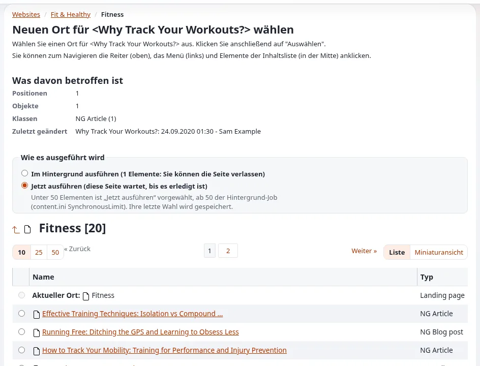

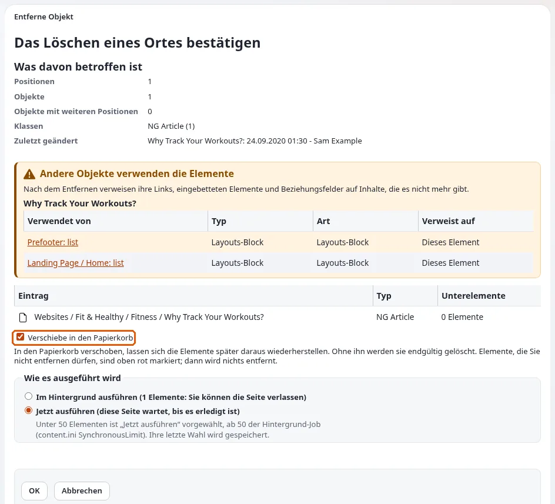

Eine Schaltfläche, die Sie nicht verwenden dürfen, ist ausgegraut; wenn Sie mit dem Mauszeiger darauf zeigen,
erfahren Sie den Grund.

## Viele Objekte auf einmal

Kreuzen Sie in der Liste **Unterelemente** eines Ordners die Objekte mit den Kontrollkästchen an (oder wählen Sie
mit **Auswählen** alle, keine oder die umgekehrte Auswahl) und öffnen Sie dann **Weitere Aktionen**:

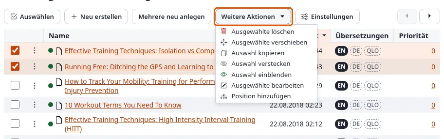

- **Ausgewählte bearbeiten**: ein Formular mit allen ausgewählten Objekten, die Sie gemeinsam veröffentlichen;
- **Ausgewählte entfernen**, **Auswahl verschieben**, **Auswahl kopieren**;
- **Auswahl verstecken** und **Auswahl einblenden**;
- **Position hinzufügen**: Die Objekte erscheinen zusätzlich an einer anderen Stelle, ohne kopiert zu werden.

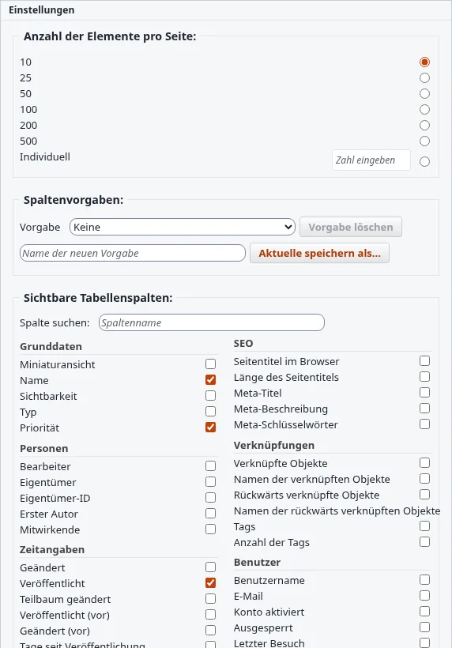

Unter **Einstellungen** der Tabelle wählen, ordnen und speichern Sie die Spalten der Liste, legen fest, wie viele
Zeilen eine Seite zeigt (10, 25, 50 oder 100), und exportieren die sichtbaren Spalten als CSV-Datei. Ist die Liste nach
Priorität sortiert, ändert der Griff am Anfang jeder Zeile die Reihenfolge durch Ziehen (oder mit der Tastatur,
siehe [Tastenkürzel](tastenkuerzel.md#listen-von-unterelementen)).

## Mehr erfahren

- [Das Inhaltsmodell und das Bearbeiten von Inhalten](../anleitungen/inhaltsmodell-und-bearbeitung.md), der vollständige
  Leitfaden für Redakteure und Site-Entwickler.
- [Veröffentlichen, Versionen und der Papierkorb](veroeffentlichen-und-versionen.md)
- [Bilder, Medien und Uploads](medien-und-uploads.md)
- [Sprachen](sprachen.md), zum Übersetzen eines Objekts.

<!-- exp-partner-block:start -->
**Werden Sie Exponential-Partner.** Partner teilen ihre Informationen, stellen Mittel bereit, geben Beiträge zurück
und entwickeln die Produkte mit uns, und so wächst Exponential. Eine Partner-Website und ein Dashboard sind für Mitte
2027 geplant: Werden Sie noch heute Partner, damit wir schneller wachsen und neue Funktionen früher liefern. Beginnen
Sie mit [Partner: hier beginnen](partner/partner-hier-beginnen.md) und
[Wie Sie sich bewerben](partner/wie-sie-sich-bewerben.md).
<!-- exp-partner-block:end -->
