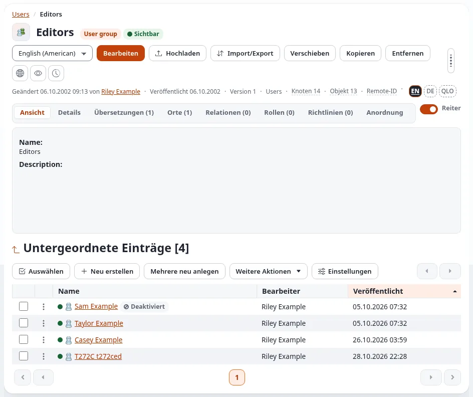
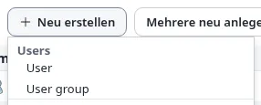
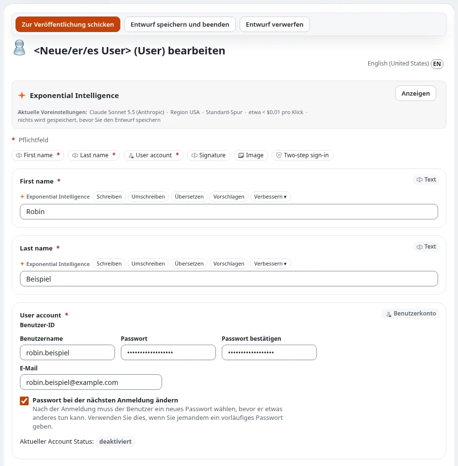
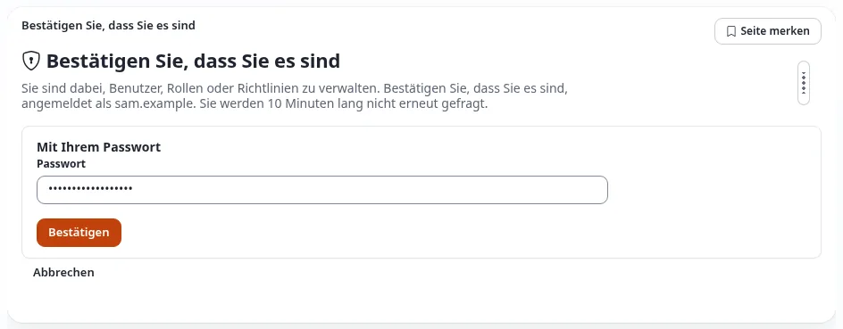
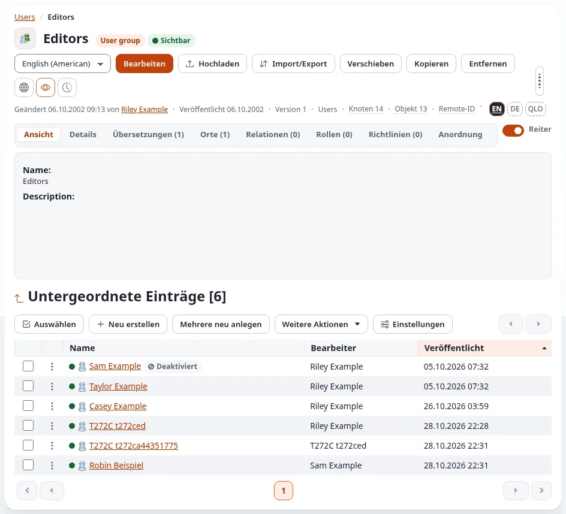
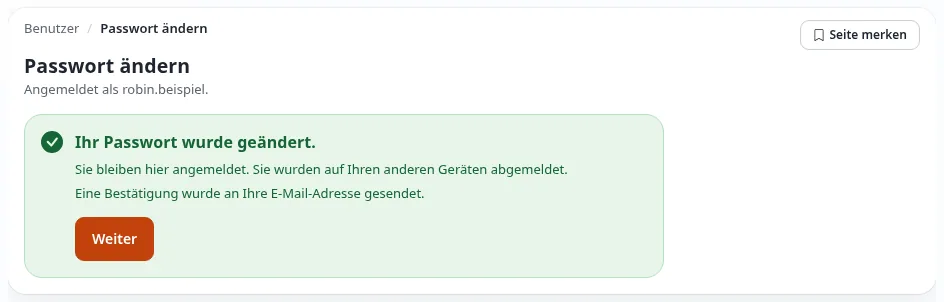
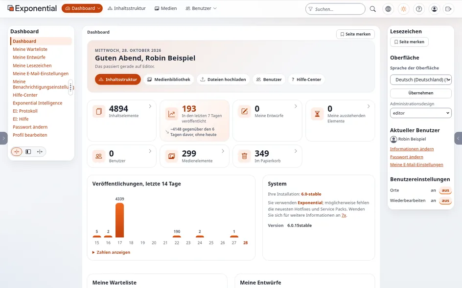
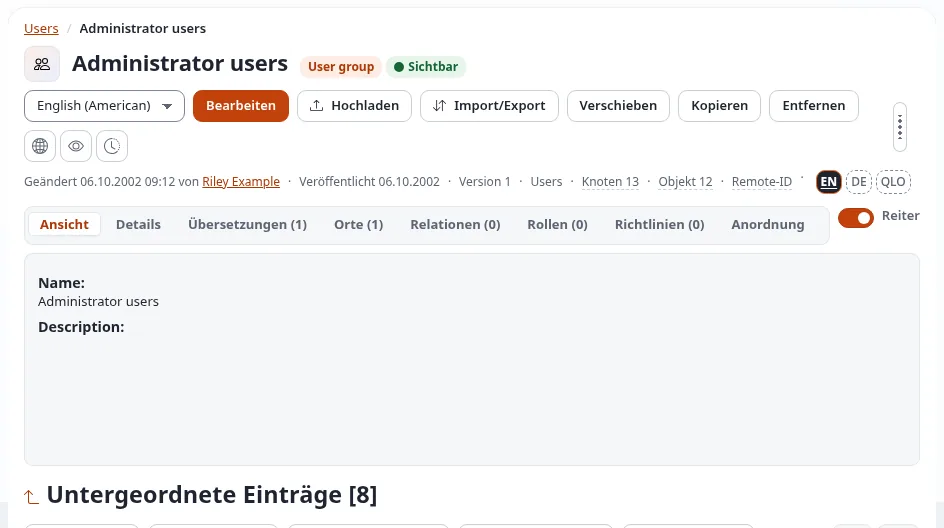

# Konten für Redakteure und Administratoren einrichten

Diese Seite führt einen Administrator durch die Einrichtung eines Zugangs für eine neue Person: welche Art von Konto
sie braucht, wie Sie es anlegen, wie Sie prüfen, dass es funktioniert, und wie Sie es so übergeben, dass nur die neue
Person das Passwort kennt. Zu jedem Schritt zeigt ein Bildschirmfoto, was Sie sehen.

Das Beispiel verwendet die Adresse `https://www.example.com/editor` für den Editor und `https://www.example.com/admin`
für die Administration. Ihre Installation kann andere Adressen haben, etwa `https://edit.example.com`; siehe
[Anmelden im Editor](anmelden-im-editor.md#die-adresse).

## Welches Konto für wen

Wo Sie ein Konto anlegen, entscheidet darüber, was die Person tun darf: Ein Konto erhält die Rollen der Benutzergruppe,
in der es liegt. Die Gruppen tragen in der Oberfläche ihre englischen Namen.

| Gruppe (unter **Users**) | Für wen | Was sie erhalten |
|---|---|---|
| **Editors** | Personen, die Inhalte schreiben, bearbeiten und veröffentlichen (Redakteure) | Die Rollen der Gruppe Editors: *Editor* (auf die Bäume Content und Media beschränkt), *Member*, *Member management* und *Editor account requests*. Siehe [Was die Redakteursrolle erlaubt](was-die-redakteursrolle-erlaubt.md). |
| **Administrator users** | Nur die Systemadministratoren, die Entwickler und die Eigentümer der Website | Die Rolle *Administrator*: alles, auch Benutzer, Rollen, Einstellungen und Aktualisierungen. |
| **Members** | Die Mitglieder der Website (Personen mit einem Konto auf der öffentlichen Website) | Die Rollen der Gruppe Members. Redakteure verwalten diese Konten; siehe [Mitglieder verwalten](mitglieder-verwalten.md). |

Geben Sie Redakteuren ein Konto in **Editors**, nie in Administrator users, auch wenn sie um „vollen Zugriff“ bitten:
Ein Administratorkonto kann jede Einstellung, jede Rolle und jedes andere Konto ändern, und die Arbeit eines Redakteurs
braucht nichts davon. Legen Sie ein Administratorkonto nur für eine Person an, die sich um die Installation selbst
kümmert.

Jede Person erhält ihr **eigenes** Konto. Teilen Sie ein Konto nie zwischen mehreren Personen: Nur so können die
Versionsgeschichte, das Audit-Protokoll und das [Benutzer-Auditprotokoll](das-benutzer-auditprotokoll.md) sagen, wer
was getan hat.

## Bevor Sie beginnen

- Sie sind Administrator und kennen Ihr eigenes Passwort; Sie werden noch einmal danach gefragt (**Bestätigen Sie,
  dass Sie es sind**).
- Sie haben Vorname, Nachname und E-Mail-Adresse der neuen Person und haben einen Benutzernamen vereinbart (zum
  Beispiel `robin.beispiel`).
- Sie erreichen die Person noch auf einem zweiten Weg außer E-Mail: per Telefon, persönlich oder über einen Messenger.
  Auf diesem Weg geben Sie das vorläufige Passwort weiter.

## 1. Im Editor anmelden

Öffnen Sie die Adresse des Editors, zum Beispiel `https://www.example.com/editor`, und melden Sie sich mit Ihrem
Administratorkonto an, wie in [Anmelden im Editor](anmelden-im-editor.md#anmelden) beschrieben. Als Administrator
sehen Sie dort jeden Reiter, auch **Benutzer**.

Sie können das Konto genauso in der Administration (`https://www.example.com/admin`) anlegen. Der Editor ist
empfehlenswert, weil der neue Redakteur mit ihm arbeiten wird: Sie sehen, was er sehen wird.

## 2. Die Gruppe Editors öffnen

1. Klicken Sie im oberen Menü auf **Benutzer**.
2. Klicken Sie in der linken Spalte (**Benutzer-Struktur**) auf **Editors**.

Die Gruppe öffnet sich mit ihren Konten unter **Untergeordnete Einträge**.

## 3. Einen neuen Benutzer anlegen

Klicken Sie unter **Untergeordnete Einträge** auf **Neu erstellen** und wählen Sie in der Gruppe **Users** den
Eintrag **User** (die Inhaltsklassen tragen ihre englischen Namen).

Hat die Installation mehr als eine Inhaltssprache, fragt zuerst eine Seite **Sprachauswahl**, in welcher Sprache das
Objekt angelegt wird: Wählen Sie die Hauptsprache (meist Englisch) und klicken Sie auf **OK**.

## 4. Das Konto ausfüllen

1. **First name** und **Last name**: der Name der Person, wie er in der Geschichte und in den Listen erscheint.
2. Unter **User account**:
   - **Benutzername**: der Name, mit dem sich die Person anmeldet. Er lässt sich später im Formular nicht ändern.
   - **E-Mail**: die eigene dienstliche Adresse der Person. Jede Adresse kann nur zu einem Konto gehören.
   - **Passwort** und **Passwort bestätigen**: ein **vorläufiges** Passwort. Es muss die Passwortregeln der Website
     erfüllen (mindestens 10 Zeichen und kein bekanntes Passwort). Nehmen Sie einen Passwortmanager oder einen
     Zufallsgenerator, und verwenden Sie es nur für dieses Konto.
   - **Passwort bei der nächsten Anmeldung ändern**: Lassen Sie das Kästchen **angekreuzt** (bei einem neuen Konto ist
     es das). Die Person muss dann das vorläufige Passwort durch ihr eigenes ersetzen, bevor sie etwas anderes tun kann.
3. Lassen Sie **Signature**, **Image** und **Two-step sign-in** unverändert; die Person kann sie später ausfüllen.

*Aktueller Account Status: deaktiviert* unter den Kontofeldern beschreibt den Entwurf: Das Konto kann sich anmelden,
sobald es veröffentlicht ist.

## 5. Zur Veröffentlichung schicken und bestätigen, dass Sie es sind

Klicken Sie auf **Zur Veröffentlichung schicken**. Weil Sie ein Benutzerkonto anlegen, bittet die Website Sie zu
bestätigen, dass Sie es sind:

Geben Sie **Ihr eigenes** Passwort ein (nicht das der neuen Person) und klicken Sie auf **Bestätigen**. Das Konto wird
dann veröffentlicht, und in den nächsten 10 Minuten werden Sie nicht erneut gefragt. Mit einem Passkey oder einer
Authenticator-App bietet die Seite diese an. Siehe [Identität bestätigen](../anleitungen/identitaet-bestaetigen.md).

Legt ein Administrator ein Konto in Editors an, wird es sofort veröffentlicht. Legt ein *Redakteur* ein Konto in
Editors an, wartet es zuerst auf die Freigabe eines Administrators
([Neue Redakteurskonten freigeben](../anleitungen/neue-redakteurskonten-freigeben.md)).

## 6. Das Konto prüfen

Zurück in der Gruppe Editors steht das neue Konto in der Liste:

Klicken Sie auf seinen Namen und öffnen Sie den Reiter **Rollen**. Ein Konto in Editors hat die Rollen der Gruppe:

| Rolle | Einschränkung | Wofür sie da ist |
|---|---|---|
| Editor | Subtree Content (`/1/2/`) | Schreiben und Veröffentlichen im Inhaltsbaum |
| Editor | Subtree Media (`/1/43/`) | die Medienbibliothek |
| Member | keine | das eigene Konto: Passwort, Profil, Benachrichtigungen |
| Member management | keine (jede Richtlinie ist auf Members beschränkt) | die Mitglieder der Website verwalten |
| Editor account requests | keine | ein neues Redakteurskonto beantragen, das ein Administrator freigibt |

Fehlt eine Rolle, liegt das Konto in der falschen Gruppe; verschieben Sie es
([Wie verschiebe ich einen Benutzer in eine andere Gruppe?](handbuch/wie-verschiebe-ich-einen-benutzer-in-eine-andere-gruppe.md)).
Der Reiter **Richtlinien** listet jede einzelne Berechtigung auf, die das Konto aus all seinen Rollen hat.

## 7. Abmelden und als neuer Benutzer anmelden

Prüfen Sie, dass Benutzername und vorläufiges Passwort funktionieren, bevor Sie sie weitergeben:

1. Klicken Sie auf die letzte Schaltfläche der Kopfleiste, **Abmelden**.
2. Geben Sie auf der Anmeldeseite des Editors den neuen **Benutzernamen** und das **vorläufige Passwort** ein und
   klicken Sie auf **Anmelden**.

Die Website öffnet nicht das Dashboard: Weil das Konto markiert ist, zeigt sie **Passwort ändern** mit dem Hinweis,
dass ein Administrator um ein neues Passwort gebeten hat.

Diese Seite beweist, dass das Konto besteht, aktiviert ist und das Passwort annimmt. **Ändern Sie das Passwort hier
nicht**: Das tut der neue Redakteur. Klicken Sie in der Kopfleiste auf **Abmelden** (das geht auch auf dieser Seite),
und die Prüfung ist fertig.

Schlägt die Anmeldung stattdessen fehl, lesen Sie [Wenn etwas schiefgeht](#wenn-etwas-schiefgeht) weiter unten.

## 8. Die Anmeldung übergeben

Schicken Sie dem neuen Redakteur die **Adresse** des Editors und seinen **Benutzernamen**, zum Beispiel per E-Mail:

> Ihr Konto für den Editor unserer Website: https://www.example.com/editor, Benutzername `robin.beispiel`. Ein
> vorläufiges Passwort sage ich Ihnen am Telefon. Bei Ihrer ersten Anmeldung wählen Sie Ihr eigenes Passwort.

Geben Sie das **vorläufige Passwort** auf dem zweiten Weg weiter: am Telefon, persönlich oder über einen Messenger,
der nicht Ihre E-Mail ist. Schreiben Sie Adresse, Benutzername und Passwort nie in eine einzige Nachricht: Wer diese
Nachricht liest, könnte sich anmelden.

Bitten Sie die Person, sich bald anzumelden. Bis dahin kennen zwei Personen das vorläufige Passwort.

## 9. Die erste Anmeldung des Redakteurs

Der neue Redakteur geht so vor (Sie können ihm diesen Abschnitt schicken):

1. Die Adresse öffnen, Benutzername und vorläufiges Passwort eingeben und auf **Anmelden** klicken.
2. Die Seite **Passwort ändern** öffnet sich (wie in Schritt 7). Unter **Aktuelles Passwort** das vorläufige Passwort
   eingeben, dann ein neues Passwort unter **Neues Passwort** und noch einmal unter **Neues Passwort bestätigen**.
   **Sicheres Passwort erzeugen** schlägt eines vor; **Anzeigen** zeigt, was Sie getippt haben. Die Liste wird grün,
   wenn das Passwort die Regeln erfüllt.
3. Auf **Passwort ändern** klicken.
4. Die Website fragt noch einmal **Bestätigen Sie, dass Sie es sind**, weil Sie ändern, wie Sie sich anmelden: das
   **vorläufige** Passwort (das ersetzt wird) eingeben und auf **Bestätigen** klicken.
5. Die Seite bestätigt die Änderung:

6. Auf **Weiter** klicken. Das Dashboard des Editors öffnet sich und begrüßt den Redakteur mit Namen:

Ab jetzt kennt nur der Redakteur das Passwort; das vorläufige funktioniert nicht mehr, und eine E-Mail an die Adresse
des Kontos bestätigt die Änderung. Empfehlen Sie, gleich die **zweistufige Anmeldung** einzuschalten
([Ihr Konto und die Anmeldung](konten-und-anmeldung.md#zweistufige-anmeldung)).

## Weitere Redakteure anlegen

Wiederholen Sie die Schritte 2 bis 9 für jede Person. Manche Installationen lassen Redakteure das Konto einer neuen
Kollegin selbst beantragen: Ein Redakteur legt es in Editors an, und es wartet, bis ein Administrator es freigibt
([Neue Redakteurskonten freigeben](../anleitungen/neue-redakteurskonten-freigeben.md)).

## Weitere Administratoren anlegen

Nur die Systemadministratoren, die Entwickler und die Eigentümer der Website erhalten ein Administratorkonto. So legen
Sie eines an:

1. Melden Sie sich in der **Administration** an (`https://www.example.com/admin`), klicken Sie auf **Benutzer** und
   öffnen Sie **Administrator users**.

   

2. Fahren Sie fort wie in den Schritten 3 bis 9: **Neu erstellen** > **User**, das Konto mit einem vorläufigen
   Passwort und angekreuztem *Passwort bei der nächsten Anmeldung ändern* ausfüllen, **Zur Veröffentlichung
   schicken**, mit Ihrem eigenen Passwort bestätigen, den Reiter **Rollen** prüfen (er zeigt *Administrator*), sich
   einmal als neuer Benutzer anmelden und die Anmeldung auf zwei Wegen übergeben.

Für Administratoren außerdem:

- Bitten Sie sie, die zweistufige Anmeldung sofort einzuschalten. Eine Website kann sie für Administratoren
  verlangen ([Zweistufige Anmeldung](../anleitungen/zwei-faktor-anmeldung.md)).
- Halten Sie die Zahl der Administratoren klein, und machen Sie nie einen Redakteur zum Administrator, um eine
  fehlende Berechtigung zu beheben: Geben Sie stattdessen seiner Gruppe die Berechtigung
  ([Rollen und Richtlinien](../anleitungen/rollen-und-richtlinien.md)).
- Die Vergabe der Rolle Administrator wird im Audit-Protokoll aufgezeichnet
  ([Sicherheit und Audit](../anleitungen/sicherheit-und-audit.md)).

## Wenn jemand geht

Deaktivieren Sie das Konto noch am selben Tag
([Wie deaktiviere oder entsperre ich ein Benutzerkonto?](handbuch/wie-deaktiviere-oder-entsperre-ich-ein-benutzerkonto.md)).
Ein deaktiviertes Konto behält seinen Namen in der Geschichte von allem, was die Person getan hat; entfernen Sie das
Konto erst, wenn nichts mehr darauf verweist. Das [Benutzer-Auditprotokoll](das-benutzer-auditprotokoll.md) zeigt, was
mit dem Konto geschah und was es getan hat.

## Wenn etwas schiefgeht

| Was Sie sehen | Was zu tun ist |
|---|---|
| *Der Benutzername existiert bereits.* oder *Ein Benutzer mit dieser E-Mail ist bereits vorhanden.* | Jeder Benutzername und jede E-Mail-Adresse gehört zu einem Konto. Wählen Sie einen anderen Benutzernamen; bei der Adresse prüfen Sie, ob die Person schon ein Konto hat (etwa als Mitglied), und verschieben Sie dieses. |
| Das Formular zeigt einen Fehler unter **Passwort** | Das Passwort erfüllt die Regeln nicht (zu kurz oder ein bekanntes Passwort). Nehmen Sie ein längeres zufälliges. |
| *Bestätigen Sie, dass Sie es sind* weist Ihr Passwort ab | Geben Sie **Ihr eigenes** Passwort ein, nicht das der neuen Person. Nach mehreren Fehlversuchen werden Sie abgemeldet. |
| Der neue Benutzer kann sich nicht anmelden | Prüfen Sie Benutzername und vorläufiges Passwort (Groß- und Kleinschreibung zählt). Öffnen Sie das Konto: Unter **User account** muss der *Account Status* *aktiviert* sein; **Benutzerkonten-Einstellungen konfigurieren** aktiviert es. Zu viele falsche Passwörter sperren ein Konto; siehe [Wie deaktiviere oder entsperre ich ein Benutzerkonto?](handbuch/wie-deaktiviere-oder-entsperre-ich-ein-benutzerkonto.md). |
| Der neue Benutzer kommt direkt ins Dashboard, ohne das Passwort zu ändern | Das Kästchen *Passwort bei der nächsten Anmeldung ändern* war nicht angekreuzt. Bearbeiten Sie das Konto, kreuzen Sie es an und veröffentlichen Sie; die nächste Anmeldung verlangt ein neues Passwort. |
| Der neue Benutzer sieht *Zugriff verweigert* oder ihm fehlt ein Reiter | Das Konto liegt in der falschen Gruppe, oder der Gruppe fehlt eine Rolle. Prüfen Sie den Reiter **Rollen** (Schritt 6). |
| **User** fehlt unter **Neu erstellen** | Ihr Konto darf hier keine Benutzer anlegen: Sie sind kein Administrator. Fragen Sie einen, oder beantragen Sie das Konto wie in [Neue Redakteurskonten freigeben](../anleitungen/neue-redakteurskonten-freigeben.md) beschrieben. |

**Datenschutz:** Ein Konto enthält personenbezogene Daten (Name, E-Mail-Adresse). Speichern Sie nur, was die Arbeit
braucht, halten Sie das vorläufige Passwort aus E-Mails heraus und deaktivieren Sie das Konto, wenn die Person geht.

## Verwandte Seiten

- [Was die Redakteursrolle erlaubt](was-die-redakteursrolle-erlaubt.md)
- [Mitglieder verwalten](mitglieder-verwalten.md), für Redakteure
- [Das Benutzer-Auditprotokoll](das-benutzer-auditprotokoll.md)
- [Anmelden im Editor](anmelden-im-editor.md) und [Anmelden in der Administration](anmelden-in-der-administration.md)
- [Ihr Konto und die Anmeldung](konten-und-anmeldung.md)
- [Wie lege ich einen Benutzer oder eine Benutzergruppe an?](handbuch/wie-lege-ich-einen-benutzer-oder-eine-benutzergruppe-an.md)
- [Administratorkonten und Zugriff](kunden/gesund-halten/administratorkonten-und-zugriff.md)
- [Passwort bei der nächsten Anmeldung ändern](../funktionen/6.0/passwort-bei-naechster-anmeldung-aendern.md), die technische Beschreibung
- [Freie Dokumentation](freie-dokumentation.md): Diese Seite darf unter der GNU FDL 1.3 frei kopiert, übersetzt und verbessert werden.

<!-- exp-partner-block:start -->
**Werden Sie Exponential-Partner.** Partner teilen ihre Informationen, stellen Mittel bereit, geben Beiträge zurück
und entwickeln die Produkte mit uns, und so wächst Exponential. Eine Partner-Website und ein Dashboard sind für Mitte
2027 geplant: Werden Sie noch heute Partner, damit wir schneller wachsen und neue Funktionen früher liefern. Beginnen
Sie mit [Partner: hier beginnen](partner/partner-hier-beginnen.md) und
[Wie Sie sich bewerben](partner/wie-sie-sich-bewerben.md).
<!-- exp-partner-block:end -->
