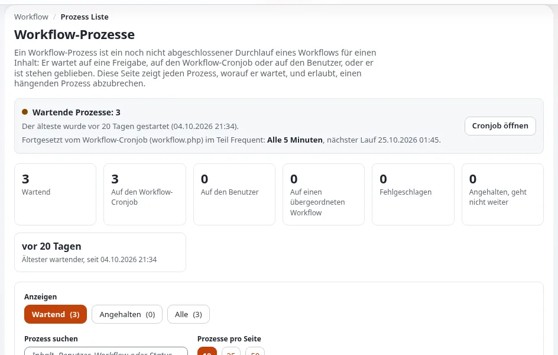

# Freigabe und Prüfung

Diese Seite ist für den Betreiber und die Chefredaktion, die entscheiden, ob Inhalte geprüft werden müssen, bevor
Besucher sie sehen. Exponential kann eine Version zurückhalten, bis eine freigebende Person sie annimmt: ein
**Freigabe-Workflow**, der mit dem Veröffentlichen verbunden ist. Ihr Administrator richtet ihn ein
([Workflows](../../../anleitungen/workflows.md)); diese Seite hilft Ihnen zu entscheiden, wie er sich verhalten soll und wie
Sie ihn im Alltag betreiben.

## Inhalt

1. [Brauchen Sie ihn?](#brauchen-sie-ihn)
2. [Die Entscheidungen, die Sie treffen](#die-entscheidungen-die-sie-treffen)
3. [Was Autoren und freigebende Personen sehen](#was-autoren-und-freigebende-personen-sehen)
4. [Das eine, was laufen muss](#das-eine-was-laufen-muss)
5. [Eine tägliche Routine für freigebende Personen](#eine-tägliche-routine-für-freigebende-personen)
6. [Leichtere Alternativen](#leichtere-alternativen)

## Brauchen Sie ihn?

| Situation | Lohnt sich eine Freigabe? |
|---|---|
| Rechtliche, medizinische, finanzielle Aussagen oder Pressemitteilungen | ja, für diese Sektion |
| Neue oder unerfahrene Autoren, Agenturen, Ehrenamtliche | ja, für sie, bis sie die Regeln kennen |
| Übersetzungen durch einen externen Übersetzer | ja, pro Sprache ([Übersetzungsroutine](uebersetzungsroutine.md)) |
| Ein kleines Team erfahrener Redakteure | oft nicht; mit Versionen lässt sich alles rückgängig machen ([Entwürfe, Versionen und Rückgängigmachen](entwuerfe-versionen-und-rueckgaengig.md)) |
| Tippfehlerkorrekturen durch die Redakteure, die die Seite geschrieben haben | meist nicht; nehmen Sie ihre Gruppe aus |

## Die Entscheidungen, die Sie treffen

Das Ereignis *Approve* grenzt ein, wer und was eine Freigabe braucht; Inhalte außerhalb davon werden sofort
durchgelassen ([Workflows, 3.2 Das Ereignis Approve einrichten](../../../anleitungen/workflows.md#32-das-ereignis-freigeben-einrichten)):

| Feld | Ihre Entscheidung |
|---|---|
| Betroffene Sektionen | welche Teile der Website geprüft werden müssen (*Alle Sektionen* oder eine Liste) |
| Betroffene Sprachen | nur Versionen, deren Ausgangssprache eine davon ist, für eine Prüfung pro Sprache |
| Betroffene Versionen | alle Versionen, nur neue Objekte oder nur Aktualisierungen bestehender Objekte |
| Benutzer, die Inhalte freigeben | namentlich benannte freigebende Personen |
| Gruppen, die Inhalte freigeben | jedes Mitglied dieser Gruppen ist freigebende Person (ziehen Sie eine Gruppe vor) |
| Ausgenommene Benutzergruppen | Benutzer in diesen Gruppen veröffentlichen ohne Freigabe |

Eine freigebende Person braucht nie eine Freigabe für ihre eigenen Inhalte: Ist die veröffentlichende Person eine der
freigebenden Personen, lässt das Ereignis die Version durch (dieselbe Quelle). Pro Trigger läuft ein Workflow; mehrere
Freigaberegeln werden mit einem Ereignis *Multiplexer* kombiniert, das Ihr Administrator einrichtet.

## Was Autoren und freigebende Personen sehen

- Der **Autor** drückt **Zur Veröffentlichung schicken**; die Version wird **ausstehend** und erscheint in seiner
  Liste *Meine Warteliste* ([Veröffentlichen, Versionen und der Papierkorb](../../veroeffentlichen-und-versionen.md)).
- Die **freigebende Person** findet die Anfrage unter **Mein Konto > Zusammenarbeit**, sieht sich die Vorschau an und
  drückt **Freigeben**, oder **Ablehnen** mit einem Kommentar für den Autor ([Workflows, 3.5 Ausprobieren](../../../anleitungen/workflows.md#35-ausprobieren)).
- Abgelehnt: Die Version ist wieder ein Entwurf des Autors. Freigegeben: Sie wird beim nächsten Lauf des
  Workflow-Cronjobs veröffentlicht.

Inhalte, die der Schreibassistent verfasst hat, gehen denselben Weg: „Zur Freigabe senden“ führt den normalen
Veröffentlichungsvorgang aus, sodass die Freigabe sie zurückhält ([Exponential Intelligence](../wachstum/exponential-intelligence.md)).

## Das eine, was laufen muss

> **Warnung**
> Freigegebene Inhalte werden vom **Workflow-Cronjob** veröffentlicht (`workflow.php`, im Teil *frequent*). Ohne ihn
> werden freigegebene Inhalte nie veröffentlicht ([Workflows](../../../anleitungen/workflows.md)). **Setup >
> Workflow-Prozesse** hat eine Statusleiste, die anzeigt, ob der Cronjob eingeplant ist und wann er als Nächstes
> läuft. Bitten Sie Ihren Hoster oder Partner zu bestätigen, dass er eingeplant ist, und sehen Sie sich diese Leiste
> nach jedem Serverumzug an.

## Eine tägliche Routine für freigebende Personen

1. Öffnen Sie *Meine Warteliste* oder den Posteingang der Zusammenarbeit ein- oder zweimal am Tag, zu festen Zeiten,
   die die Autoren kennen.
2. Entscheiden Sie; wenn Sie ablehnen, schreiben Sie einen Kommentar, der sagt, was zu ändern ist.
3. Prüfen Sie vor einem Veröffentlichungstag im [Redaktionskalender](redaktionskalender.md), dass nichts Wichtiges wartet.
4. Einmal pro Woche sieht sich die Chefredaktion **Setup > Workflow-Prozesse** an: Ein Prozess, der seit Tagen wartet,
   bedeutet meist, dass eine freigebende Person gegangen ist oder der Cronjob angehalten hat ([Workflows](../../../anleitungen/workflows.md)).

   

## Leichtere Alternativen

- **Vorschau vor dem Veröffentlichen**: Mit der Vorschau im Bearbeitungsformular und der Versionsvorschau kann ein
  Kollege hinsehen, bevor der Autor veröffentlicht ([Vorschau vor dem Veröffentlichen](../../unternehmen/zuverlaessigkeit/vorschau-vor-dem-veroeffentlichen.md)).
- **Objektzustände** als Prüfstufen (Entwurf, in Prüfung, freigegeben), die Rollen nutzen können
  ([Objektzustände](../../../anleitungen/objektzustaende.md)).
- **Nachträgliche Prüfung** mit Versionen und der Vergleichsansicht
  ([Versionen eines Objekts](../../../anleitungen/inhaltsverlauf.md)).

## Verwandte Seiten

- [Workflows](../../../anleitungen/workflows.md)
- [Freigabe-Workflows für Intranets](../../unternehmen/intranets/freigabe-workflows.md)
- [Entwürfe, Versionen und Rückgängigmachen](entwuerfe-versionen-und-rueckgaengig.md)
- [Freie Dokumentation](../../freie-dokumentation.md): Diese Seite darf unter der GNU FDL 1.3 frei kopiert, übersetzt und verbessert werden.

<!-- exp-partner-block:start -->
**Werden Sie Exponential-Partner.** Partner teilen ihre Informationen, stellen Mittel bereit, geben Beiträge zurück
und entwickeln die Produkte mit uns, und so wächst Exponential. Eine Partner-Website und ein Dashboard sind für Mitte
2027 geplant: Werden Sie noch heute Partner, damit wir schneller wachsen und neue Funktionen früher liefern. Beginnen
Sie mit [Partner: hier beginnen](../../partner/partner-hier-beginnen.md) und
[Wie Sie sich bewerben](../../partner/wie-sie-sich-bewerben.md).
<!-- exp-partner-block:end -->
