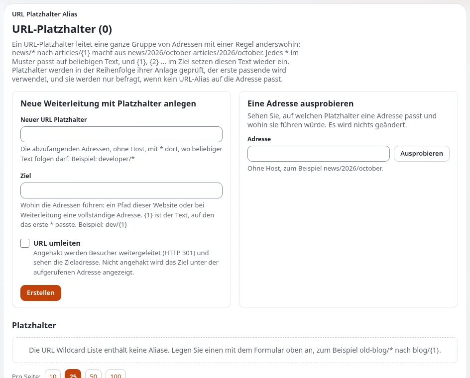

# URLs, Weiterleitungen und verschobene Seiten

Diese Seite ist für Betreiber und Redakteure, die Seiten umbenennen, verschieben und entfernen und möchten, dass
Besucher und Suchmaschinen sie weiterhin finden. Exponential erzeugt lesbare Adressen aus den Namen der Inhalte und hält
alte Adressen nach den meisten Änderungen funktionsfähig ([Weiterleitungen und verschobene Inhalte](../../ersteller/website-ersteller/weiterleitungen-und-verschobene-inhalte.md)).
Der einzige Fall, der eine Entscheidung erfordert, ist das Entfernen einer Seite.

## Inhalt

1. [Was von selbst geschieht](#was-von-selbst-geschieht)
2. [Wenn eine Seite wegfällt](#wenn-eine-seite-wegfällt)
3. [Kurze Adressen für Kampagnen](#kurze-adressen-für-kampagnen)
4. [Ein Relaunch oder eine große Umstrukturierung](#ein-relaunch-oder-eine-große-umstrukturierung)
5. [Regeln für die Redaktion](#regeln-für-die-redaktion)

## Was von selbst geschieht

Aus [Weiterleitungen und verschobene Inhalte](../../ersteller/website-ersteller/weiterleitungen-und-verschobene-inhalte.md):

| Ereignis | Ergebnis |
|---|---|
| Ein Element wird umbenannt | eine neue Adresse entsteht; die alte bleibt und leitet auf die neue weiter |
| Ein Element wird verschoben | dasselbe: Der alte Pfad leitet weiter |
| Eine Übersetzung wird umbenannt | dasselbe, pro Sprache |
| Ein Element wird entfernt | die Adresse antwortet mit „nicht gefunden“; nichts leitet weiter |

Redakteure dürfen also ohne Sorge umbenennen und verschieben. Auch das Verbergen eines Elements nimmt es von der
Website, mit allem, was darunter liegt ([Veröffentlichen, Versionen und der Papierkorb](../../veroeffentlichen-und-versionen.md#ein-objekt-verstecken)).

## Wenn eine Seite wegfällt

Bevor Sie eine Seite entfernen, die Menschen als Lesezeichen gespeichert haben könnten oder die Suchmaschinen kennen,
entscheiden Sie, wohin ihre Besucher stattdessen gelangen sollen:

| Situation | Was Sie anfordern | Werkzeug |
|---|---|---|
| Die Seite hat einen natürlichen Nachfolger | die alte Adresse als Alias der neuen Seite | der Reiter **URL-Aliase** des Knotens |
| Ein ganzer Ordner alter Seiten fällt weg | eine Wildcard vom alten Muster zum neuen Ort | **Setup > URL Platzhalter** |
| Nichts ersetzt sie | sie bewusst mit „nicht gefunden“ antworten lassen | keins |

Wildcards werden nur herangezogen, wenn kein Alias passt, und **Eine Adresse ausprobieren** auf der Seite der Wildcards
zeigt, zu welcher Wildcard eine Adresse passt, ohne etwas zu ändern
([URL-Aliase, Wildcards und Suchstatistiken](../../../anleitungen/urls-und-aliase.md#4-url-platzhalter)).

> **Tipp**
> Entfernte Inhalte kommen in den Papierkorb und lassen sich mit ihrer Adresse wiederherstellen
> ([Archivieren und der Papierkorb](archivieren-und-der-papierkorb.md)). War eine Entfernung ein Versehen, ist Wiederherstellen
> besser als eine Weiterleitung.

## Kurze Adressen für Kampagnen

Für einen gedruckten Flyer oder einen Radiospot möchten Sie vielleicht `/autumn` statt eines langen Pfades. Ihr
Administrator kann unter **Setup > URL-Übersetzer** einen **globalen URL-Alias** anlegen, mit „Alias should redirect“
für eine dauerhafte Weiterleitung ([Weiterleitungen und verschobene Inhalte](../../ersteller/website-ersteller/weiterleitungen-und-verschobene-inhalte.md)).
Notieren Sie jede kurze Adresse mit dem Datum, ab dem sie entfernt werden darf, in Ihrem [Redaktionskalender](redaktionskalender.md).

## Ein Relaunch oder eine große Umstrukturierung

Wenn sich viele Adressen auf einmal ändern, bitten Sie Ihren Partner vor dem Start um einen Weiterleitungsplan
([Weiterleitungen und verschobene Inhalte](../../ersteller/website-ersteller/weiterleitungen-und-verschobene-inhalte.md)):

1. Exportieren Sie die alten Adressen (Sitemap, die Liste der indexierten Seiten der Suchmaschine, Serverlogs).
2. Legen Sie jedes neue Ziel fest: dieselbe Seite, eine bessere Seite oder keine.
3. Muster werden zu Wildcards; einzelne Seiten werden zu Aliasen.
4. Jede alte Adresse wird vor dem Start auf eine dauerhafte Weiterleitung an die richtige Stelle getestet.
5. Beobachten Sie nach dem Start das Fehlerlog und die Crawl-Fehler der Suchmaschinen.

Ihr Teil als Betreiber ist Schritt 2: Nur Sie wissen, welche neue Seite die richtige ist.

## Regeln für die Redaktion

- [ ] Wählen Sie Namen mit Bedacht: Der Name wird zur Adresse.
- [ ] Umbenennen und verschieben; nicht entfernen und neu anlegen.
- [ ] Fragen Sie vor dem Entfernen einer Seite, ob etwas sie ersetzt.
- [ ] Verlinken Sie Seiten mit dem Link-Werkzeug des Editors, nicht durch Eintippen von Adressen; Links auf Inhalte
      folgen Verschiebungen.
- [ ] Melden Sie Adressen, die mit „nicht gefunden“ antworten, mit der Adresse und der Stelle, an der Sie den Link gefunden haben.

## Verwandte Seiten

- [URL-Aliase und sprechende URLs](../../ersteller/website-ersteller/url-aliasse-und-sprechende-urls.md)
- [URL-Wildcards und eigene Aliase](../../ersteller/website-ersteller/url-platzhalter.md)
- [SEO-Prüfungen](seo-pruefungen.md)
- [Freie Dokumentation](../../freie-dokumentation.md): Diese Seite darf unter der GNU FDL 1.3 frei kopiert, übersetzt und verbessert werden.

<!-- exp-partner-block:start -->
**Werden Sie Exponential-Partner.** Partner teilen ihre Informationen, stellen Mittel bereit, geben Beiträge zurück
und entwickeln die Produkte mit uns, und so wächst Exponential. Eine Partner-Website und ein Dashboard sind für Mitte
2027 geplant: Werden Sie noch heute Partner, damit wir schneller wachsen und neue Funktionen früher liefern. Beginnen
Sie mit [Partner: hier beginnen](../../partner/partner-hier-beginnen.md) und
[Wie Sie sich bewerben](../../partner/wie-sie-sich-bewerben.md).
<!-- exp-partner-block:end -->
