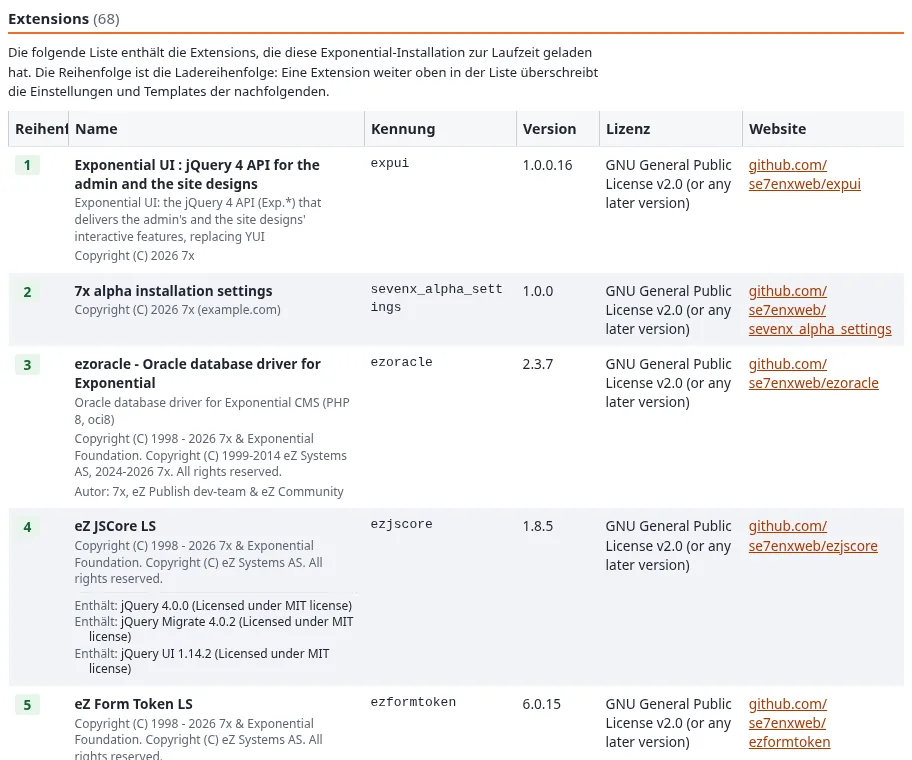
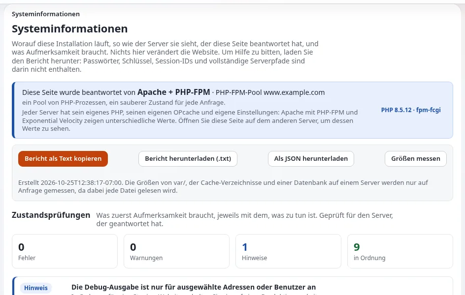

# Eine Website übernehmen

Vielleicht erben Sie eine Website: eine neue Stelle, eine Fusion, ein ausgeschiedener Kollege oder ein Anbieter, der
ohne viel Vorwarnung gegangen ist. Diese Seite gibt die Reihenfolge der Arbeit für die ersten Wochen vor, aus Sicht des
Betreibers. Wenn eine ordentliche Übergabe noch möglich ist, verwenden Sie zuerst die
[Checkliste für die Übergabe](checkliste-uebergabe.md).

## Erste Woche: Zugänge und Sicherheit

1. **Verschaffen Sie sich Administratorzugang auf Ihren eigenen Namen**, mit zweistufiger Anmeldung
   ([Administratorkonten und Zugriff](../gesund-halten/administratorkonten-und-zugriff.md)).
2. **Listen Sie auf, wer sonst Administratorrechte hat**, unter **Benutzer** und in den Zuweisungen der Rolle
   Administrator, und unter **Benutzer > Benutzerkonten prüfen** ([Benutzerkonten prüfen](../../../funktionen/6.0/benutzerpflege.md)).
   Deaktivieren Sie Konten von Personen, die gegangen sind.
3. **Finden Sie heraus, wo die Website gehostet wird**, wer das Hosting-Konto und die Domain hat und ob Sie diese
   Personen erreichen können.
4. **Bestätigen Sie, dass ein Backup existiert**, von Datenbank und Dateien, aus den letzten Tagen, und dass Sie eine
   Kopie bekommen können ([Backups](../gesund-halten/backups.md)).

## Zweite Woche: Was betreibt sie?

| Herausfinden | Wo |
|---|---|
| Version von Exponential | **Setup > Systeminformationen** ([Systeminformationen](../../../anleitungen/systeminformationen.md)) |
| PHP, Datenbank, Engine | Dieselbe Seite |
| Erweiterungen und ihre Versionen | **Setup > Extensions** und **Info > Über** |
| Ob Dateien gegenüber dem Release geändert wurden | **Setup > Upgrade-Prüfung** ([Die Upgrade-Prüfung](../../../anleitungen/upgrade-pruefung.md)) |
| Warnungen zum Zustand | Die Statusprüfungen oben auf **Setup > Systeminformationen** |
| Eingeplante Jobs | **Setup > Cronjobs** |

Vergleichen Sie die Version mit der gepflegten Linie ([Release-Linie und Support](../gesund-halten/release-linie-und-support.md)).
Eine Website auf 5.x oder älter braucht ein Upgrade-Projekt ([Upgrade](../../../anleitungen/aktualisieren.md)).

> **Tipp**
> **Bericht als Text kopieren** auf **Setup > Systeminformationen** liefert eine Zusammenfassung für eine
> Support-Anfrage ohne Passwörter, Schlüssel, Tokens oder vollständige Serverpfade ([Systeminformationen](../../../anleitungen/systeminformationen.md)).
> Sie ist ein gutes erstes Dokument für einen neuen Partner.

## Dritte Woche: Historie und Personen

- **Lesen Sie die jüngste Historie.** Das Prüfprotokoll hält fest, wer was getan hat: Anmeldungen, Inhaltsänderungen,
  Einstellungen, Deployments ([Das Prüfprotokoll](../../../funktionen/6.0/pruefprotokoll.md)). Bitten Sie Ihren Administrator
  um eine Zusammenfassung der letzten Monate.
- **Lesen Sie die Fehler.** Die Fehlerübersicht unter **Setup > Logdateien** fasst die verschiedenen Fehler der letzten
  24 Stunden zusammen ([Der Log-Viewer](../../../funktionen/6.0/log-betrachter.md)).
- **Erfassen Sie die beteiligten Personen**: Redakteure, den Hoster, einen etwaigen Partner und wer was getan hat.
  Füllen Sie [Wer was macht](wer-was-macht.md) und die [Eskalationskontakte](vorlage-eskalationskontakte.md) aus.
- **Finden Sie die Dokumente**: Verträge, ein Übergabedokument, das Repository mit dem Code der Website.

## Vierte Woche: entscheiden

Sortieren Sie das Gefundene in drei Listen:

| Liste | Beispiele |
|---|---|
| Sofort | Unbekannte Administratorkonten, kein funktionierendes Backup, eine nicht unterstützte Version mit ausstehenden bekannten Sicherheitskorrekturen |
| Dieses Quartal | Ein Upgrade auf die neueste 6.0.x, ein Wiederherstellungstest, zweistufige Anmeldung für alle Administratoren |
| Später | Designänderungen, neue Funktionen |

Entscheiden Sie dann, ob der derzeitige Hoster und Partner bleiben; [Einen Partner auswählen](einen-partner-auswaehlen.md) und
[Einen Hoster auswählen](einen-hoster-auswaehlen.md) helfen, wenn nicht.

## Wenn etwas nicht stimmt

Unbekannte Administratorkonten, ohne Erklärung geänderte Dateien oder Seiten, die niemand veröffentlicht hat, können
Anzeichen eines Einbruchs sein. Löschen Sie nichts; rufen Sie den Hoster an und behandeln Sie es als Schweregrad 1
([Wenn die Website nicht erreichbar ist](../gesund-halten/wenn-die-website-nicht-erreichbar-ist.md), [Kompromittierte Website](../../hosting/runbooks/kompromittierte-website.md)).

## Verwandte Seiten

- [Sicherheits-Checkliste für Betreiber](../gesund-halten/sicherheits-checkliste-fuer-betreiber.md)
- [Zuverlässigkeits-Scorecard](../../unternehmen/zuverlaessigkeit/bewertungsbogen-zuverlaessigkeit.md)
- [Zu Exponential wechseln](../../unternehmen/auswahl/zu-exponential-wechseln.md)
- [Freie Dokumentation](../../freie-dokumentation.md): Diese Seite darf unter der GNU FDL 1.3 frei kopiert, übersetzt und verbessert werden.

<!-- exp-partner-block:start -->
**Werden Sie Exponential-Partner.** Partner teilen ihre Informationen, stellen Mittel bereit, geben Beiträge zurück
und entwickeln die Produkte mit uns, und so wächst Exponential. Eine Partner-Website und ein Dashboard sind für Mitte
2027 geplant: Werden Sie noch heute Partner, damit wir schneller wachsen und neue Funktionen früher liefern. Beginnen
Sie mit [Partner: hier beginnen](../../partner/partner-hier-beginnen.md) und
[Wie Sie sich bewerben](../../partner/wie-sie-sich-bewerben.md).
<!-- exp-partner-block:end -->
