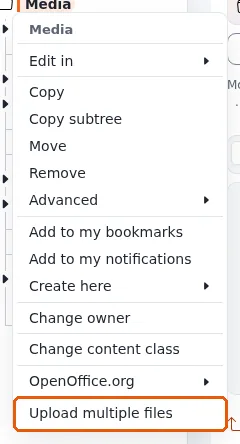
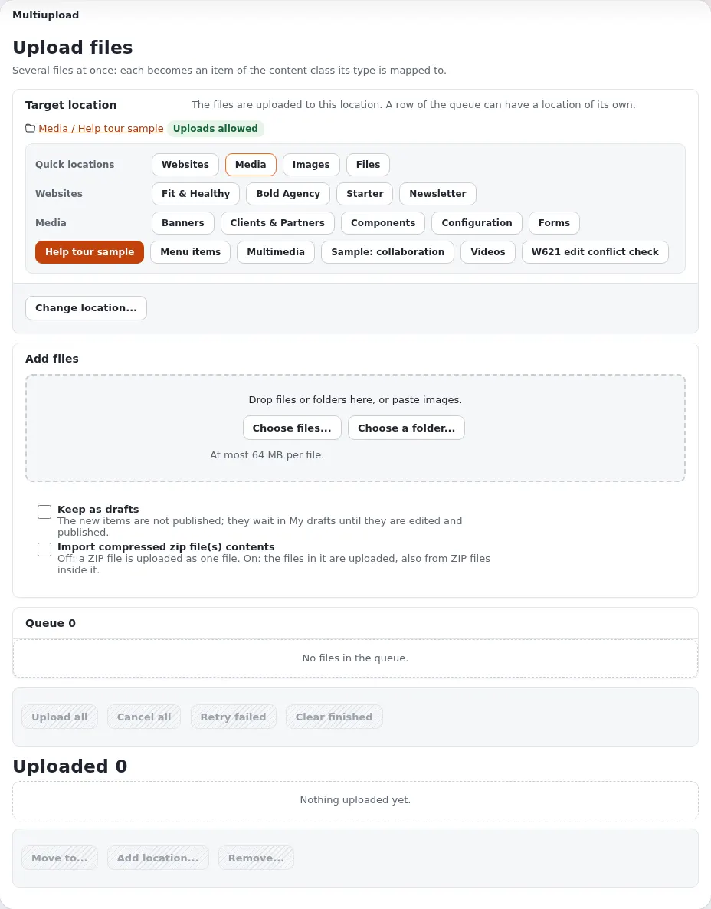
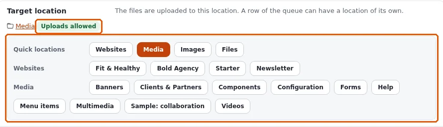
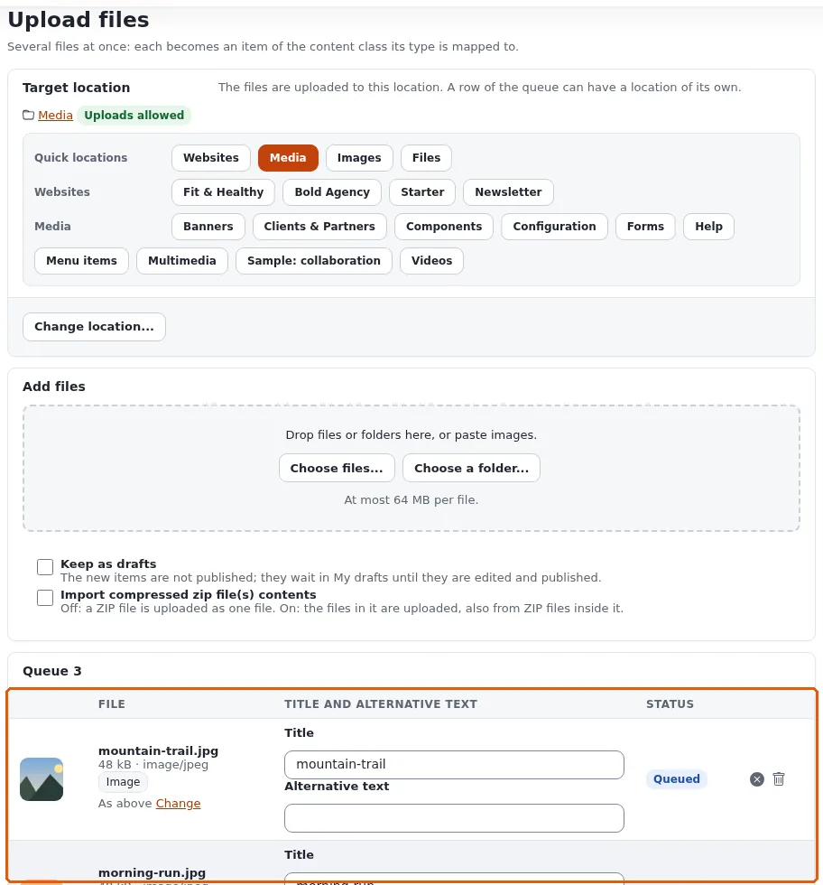
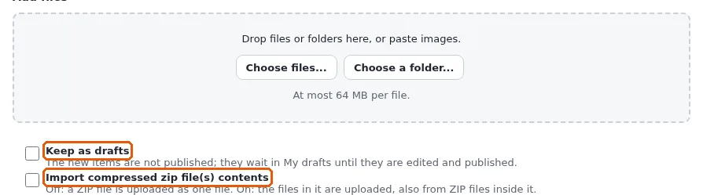

# Bilder, Medien und Uploads

Diese Seite richtet sich an Redakteure, die Bilder, Dokumente und andere Dateien auf die Site stellen. Jede Datei, die
Sie hochladen, wird zu einem eigenen Inhaltsobjekt: Ein Bild wird zu einem Objekt vom Typ *Image*, die meisten anderen
Dateien zu einem Objekt vom Typ *File* (Ihre Site legt fest, zu welchem Typ jede Dateiart wird). Sie können es dann wie
jedes andere Objekt in Artikeln, Galerien und Seiten verwenden.

## Die Medienbibliothek

Der Reiter **Medien** öffnet die Medienbibliothek, einen Teil des Inhaltsbaums, der für Dateien vorgesehen ist. Auf den
meisten Sites hat sie Ordner wie **Images**, **Files** und **Multimedia**. Sie funktioniert wie die
**Inhaltsstruktur**: Öffnen Sie Ordner im Baum links, öffnen Sie ein Objekt, um es anzusehen, und verwenden Sie darauf
**Bearbeiten**, **Verschieben** und **Entfernen**.

Dateien müssen nicht in der Medienbibliothek liegen. Sie können sie in jeden Ordner hochladen, der sie annimmt, zum
Beispiel neben den Artikel, der sie verwendet.

## Dateien hochladen

Die Upload-Seite nimmt eine Datei oder Hunderte an, per Schaltfläche, per Ziehen oder durch Einfügen eines Bildes.
Öffnen Sie sie über:

- **Dateien hochladen** in den Schnellaktionen des Dashboards (sie öffnet sich bei den Bildern der Medienbibliothek oder
  bei Medien);
- **Hochladen** auf der Seite eines Ordners (lädt in diesen Ordner hoch);
- **Multi Upload** im Menü eines Objekts im Baum.

1. **Zielort**: wohin die Dateien kommen. Der Pfad wird mit *Hochladen erlaubt* angezeigt, wenn dort Dateien
   hochgeladen werden können. Klicken Sie auf einen Eintrag der **Schnellauswahl** (etwa **Media**, **Images** oder
   **Files**) oder auf **Ort ändern ...**, um einen anderen Ort zu wählen. Die Seite merkt sich den zuletzt gewählten
   Ort.
2. **Dateien hinzufügen**: Klicken Sie auf **Dateien wählen ...** oder **Ordner wählen ...**, ziehen Sie Dateien oder
   ganze Ordner auf die gestrichelte Fläche oder fügen Sie ein kopiertes Bild ein. Die Seite zeigt die größte Datei, die
   sie annimmt, zum Beispiel *Höchstens 64 MB pro Datei*.
3. **Die Warteschlange** listet jede Datei auf, bevor etwas gesendet wird: ihren Namen, ihre Größe und ihren Typ, eine
   Vorschau eines Bildes, den Objekttyp, zu dem sie wird, wohin sie kommt, und einen **Titel**, den Sie ändern können
   (standardmäßig der Dateiname). Füllen Sie bei einem Bild den **Alternativtext** aus, wo die Site ihn verlangt. Eine
   Datei, die nicht hochgeladen werden kann (ein nicht erlaubter Typ, zu groß, keine Berechtigung an diesem Ort), sagt,
   warum.
4. Klicken Sie auf **Alle hochladen**. Es werden jeweils drei Dateien gleichzeitig gesendet, jede mit einem
   Fortschrittsbalken. **Alle abbrechen** hält an, **Fehlgeschlagene erneut versuchen** versucht die fehlgeschlagenen
   noch einmal, **Erledigte entfernen** räumt die Liste auf.

Eine Datei mit demselben Namen und derselben Größe, die es am Zielort bereits gibt, wird markiert. Sie entscheiden, ob
Sie sie überspringen, die neue umbenennen oder sie trotzdem hochladen; **Alle hochladen** fragt einmal für alle solchen
Dateien.

### Optionen

- **Als Entwürfe behalten**: Die neuen Objekte werden nicht veröffentlicht. Sie warten unter **Meine Entwürfe**, bis Sie
  sie bearbeiten und veröffentlichen, zum Beispiel um zuerst eine Beschreibung hinzuzufügen.
- **Inhalt komprimierter ZIP-Dateien importieren**: Ist die Option aus, wird eine ZIP-Datei als eine Datei
  hochgeladen. Ist sie an, werden die Dateien darin (auch die von ZIP-Dateien darin) einzeln hochgeladen; Sie können vor
  dem Import die Haken bei denen entfernen, die Sie nicht möchten. Bilder aus einer ZIP-Datei werden übersprungen, wo
  die Site einen Alternativtext verlangt, weil eine ZIP-Datei keinen Platz dafür hat.

### Nach dem Hochladen

Die Liste **Hochgeladen** zeigt, was entstanden ist, mit **Ansehen** und **Bearbeiten** für jedes Objekt. Kreuzen Sie
darin Objekte an, um sie zu verschieben (**Verschieben nach ...**), sie zusätzlich an einem weiteren Ort zu platzieren
(**Ort hinzufügen ...**) oder sie zu entfernen (**Entfernen ...**, nach einer Bestätigung).

## Aus dem Bearbeitungsformular hochladen

Wenn Sie einen Artikel bearbeiten und sein Feld *Image* (oder ein anderes Beziehungsfeld) leer ist, lädt **Neu
hochladen** eine Datei direkt aus dem Formular hoch und verknüpft sie. Das neue Objekt landet an dem Ort, den Ihre Site
für solche Uploads festgelegt hat. Siehe
[Inhalte anlegen und bearbeiten](inhalte-bearbeiten.md#verknüpfungen-und-bilder).

## Bewährte Vorgehensweise

- Geben Sie jedem Bild einen **Alternativtext**, der sagt, was das Bild zeigt, für Menschen, die einen Screenreader
  verwenden, und für den Fall, dass das Bild nicht geladen werden kann.
- Geben Sie Dateien einen klaren **Titel**: Ihn sehen Redakteure in Listen und Suchen, und oft sehen ihn Besucher als
  Linktext.
- Ordnen Sie die Medienbibliothek in Ordnern, damit Sie und andere eine Datei wiederfinden. [Suchen](suchen.md)
  findet sie ebenfalls.
- Entfernen Sie Dateien, die nicht mehr verwendet werden; sie kommen zuerst in den Papierkorb und können
  wiederhergestellt werden. Siehe
  [Veröffentlichen, Versionen und der Papierkorb](veroeffentlichen-und-versionen.md#entfernen-und-wiederherstellen).

## Wenn ein Upload fehlschlägt

| Meldung oder Anzeichen | Was es bedeutet |
|---|---|
| Die Zeile meldet, dass der Typ nicht erlaubt ist | Ihre Site nimmt diese Dateiart dort nicht an. Fragen Sie einen Administrator oder verwenden Sie ein anderes Format. |
| Die Zeile meldet, dass die Datei zu groß ist | Machen Sie sie kleiner (bei einem Bild: weniger Pixel oder eine stärkere Kompression) oder fragen Sie einen Administrator. |
| Der Zielort meldet, dass Uploads nicht erlaubt sind | Sie dürfen dort keine Objekte anlegen, oder der Ort kann keine Objekte aufnehmen. Wählen Sie einen anderen Ort. |
| Die Schaltfläche **Dateien hochladen** oder die Seite fehlt | Ihre Rolle umfasst das Hochladen nicht. Fragen Sie einen Administrator. |

## Mehr erfahren

- Die vollständige Beschreibung der Upload-Seite mit jeder Option: `extension/ezmultiupload/doc/upload-page.md` in der
  Installation.
- [Inhalte anlegen und bearbeiten](inhalte-bearbeiten.md)

<!-- exp-partner-block:start -->
**Werden Sie Exponential-Partner.** Partner teilen ihre Informationen, stellen Mittel bereit, geben Beiträge zurück
und entwickeln die Produkte mit uns, und so wächst Exponential. Eine Partner-Website und ein Dashboard sind für Mitte
2027 geplant: Werden Sie noch heute Partner, damit wir schneller wachsen und neue Funktionen früher liefern. Beginnen
Sie mit [Partner: hier beginnen](partner/partner-hier-beginnen.md) und
[Wie Sie sich bewerben](partner/wie-sie-sich-bewerben.md).
<!-- exp-partner-block:end -->
