# Migrationen: Änderungen aufzeichnen

**Setup > Migrationen > Aufzeichnung** hält fest, was Sie in der Administration ändern, als Schritte einer Migration:
Inhalte, die Sie veröffentlichen, Klassen, die Sie speichern, Rollen, die Sie zuweisen, Sektionen, Einstellungen, die
Sie schreiben. Wenn Sie fertig sind, beenden Sie die Aufzeichnung, sehen sich an, was sie erfasst hat, und erzeugen
eine Migration, die dieselben Änderungen auf Staging und Produktion macht. Wie das Aufzeichnen funktioniert, seine
Befehle und die Schritte, die es aufzeichnet, stehen in der Anleitung
[Migrationen: erzeugen und Änderungen aufzeichnen](../../anleitungen/migrationen-erzeugen-und-aufzeichnen.md).

**Wer diese Seite benutzen darf:** Benutzer mit der Richtlinie `migration/edit`. In einer neuen Installation hat sie
nur die Rolle Administrator. Das Öffnen des Fensters für die ganze Website fragt zuerst nach
[„Identität bestätigen“](../../anleitungen/identitaet-bestaetigen.md).

## Inhalt

1. [Die Seite Aufzeichnung](#die-seite-aufzeichnung)
2. [Die eigenen Änderungen aufzeichnen](#die-eigenen-änderungen-aufzeichnen)
3. [Die Aufzeichnungsleiste](#die-aufzeichnungsleiste)
4. [Das Fenster für die ganze Website](#das-fenster-für-die-ganze-website)
5. [Was eine Aufzeichnung erfasst hat](#was-eine-aufzeichnung-erfasst-hat)
6. [Die Migration erzeugen](#die-migration-erzeugen)
7. [Eine Aufzeichnung verwerfen](#eine-aufzeichnung-verwerfen)
8. [Auf der Konsole](#auf-der-konsole)
9. [Was nie aufgezeichnet wird](#was-nie-aufgezeichnet-wird)
10. [Wenn etwas schiefgeht](#wenn-etwas-schiefgeht)
11. [Verwandte Seiten](#verwandte-seiten)

## Die Seite Aufzeichnung

Öffnen Sie **Setup > Migrationen** und wählen Sie den Reiter **Aufzeichnung** (`/migration/recording`). Sie hat zwei
Karten, **Meine Änderungen** und **Fenster für die ganze Website**, und darunter die Liste **Aufzeichnungen**.

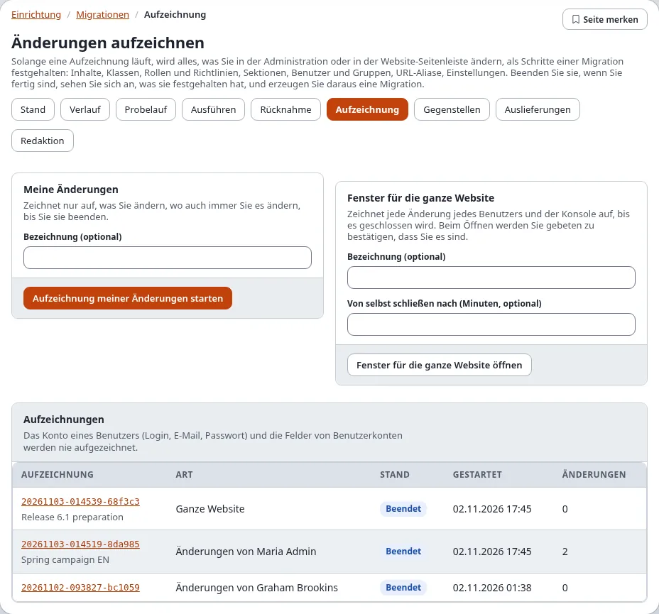

## Die eigenen Änderungen aufzeichnen

Die Karte **Meine Änderungen** zeichnet nur auf, was Sie ändern, wo auch immer (in der Administration, in der
Website-Seitenleiste oder in einem Befehl unter Ihrem Namen), bis Sie sie beenden.

1. Sagen Sie unter **Bezeichnung (optional)**, wofür die Aufzeichnung ist, zum Beispiel `Frühjahrskampagne`. Sie wird
   zum Namen der erzeugten Migration.

   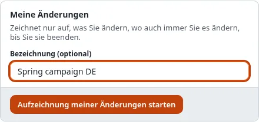

2. Drücken Sie **Aufzeichnung meiner Änderungen starten**. Die Karte sagt jetzt **Aufzeichnung seit ..., bisher N
   Änderung(en).**, mit **Zeigen, was sie festgehalten hat** und **Aufzeichnung beenden**:

   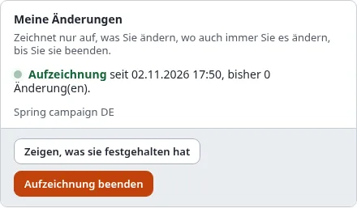

3. Machen Sie Ihre Änderungen wie gewohnt: die Sektion anlegen, die Klasse ändern, die Rolle zuweisen.
4. Drücken Sie **Aufzeichnung beenden** in der Aufzeichnungsleiste, in der Karte oder auf der Seite der Aufzeichnung.

Sie können eine Aufzeichnung ansehen, während sie läuft (**Zeigen, was sie festgehalten hat**); ihre Seite hat dann
oben **Aufzeichnung beenden**.

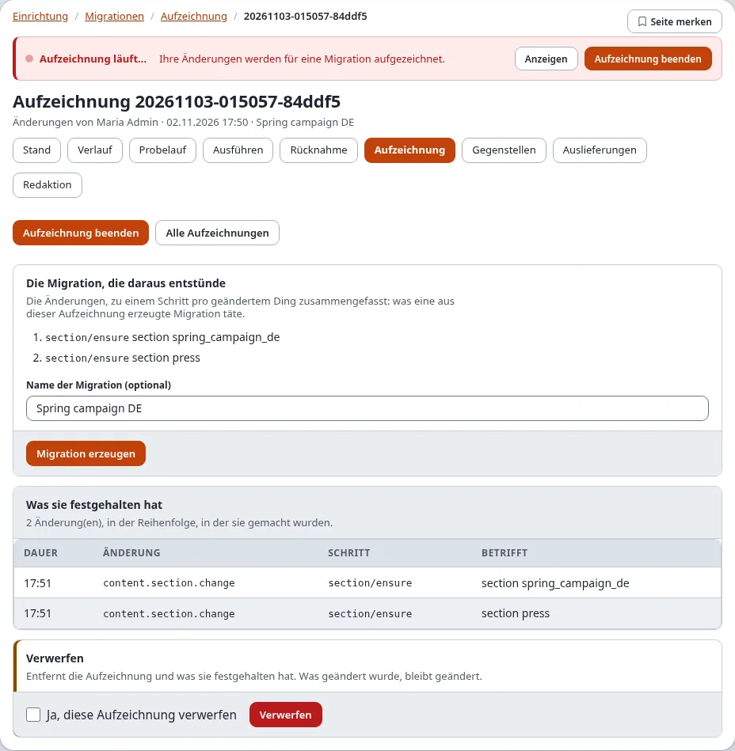

## Die Aufzeichnungsleiste

Solange eine Aufzeichnung von Ihnen läuft oder ein Fenster für die ganze Website offen ist, steht oben auf jeder
Seite der Administration eine rote Leiste **Aufzeichnung läuft…**:

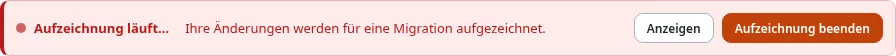

- **Anzeigen** öffnet die Aufzeichnung.
- **Aufzeichnung beenden** beendet sie und bringt Sie zurück auf die Seite, auf der Sie waren.

Die Website-Seitenleiste zeigt dasselbe mit ihren Schaltflächen **Meine Änderungen aufzeichnen** und **Aufzeichnung
beenden** ([Migrationen in der Website-Seitenleiste](expwt-panel.md)).

## Das Fenster für die ganze Website

Die Karte **Fenster für die ganze Website** zeichnet jede Änderung jedes Benutzers und der Konsole auf, bis es
geschlossen wird. Verwenden Sie es, wenn mehrere Personen gemeinsam ein Release vorbereiten.

1. Geben Sie eine **Bezeichnung (optional)** ein, zum Beispiel `Vorbereitung Release 6.1`.
2. Geben Sie unter **Von selbst schließen nach (Minuten, optional)** ein, wie lange das Fenster offen bleibt, zum
   Beispiel `60`. Leer: Es bleibt offen, bis jemand es schließt. Ein Fenster ist höchstens 31 Tage lang.

   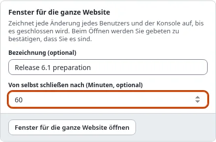

3. Drücken Sie **Fenster für die ganze Website öffnen** und bestätigen Sie „Identität bestätigen“.
4. Die Karte sagt **Offen** und **Es schließt sich von selbst um <Zeit>.** Jeder Benutzer der Administration sieht
   jetzt die Aufzeichnungsleiste, denn seine Änderungen werden auch aufgezeichnet.

   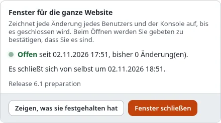

5. Schließen Sie es früher mit **Fenster schließen** (Inhaber von `migration/edit`, hier oder in der Leiste). An
   seinem Ende schließt es sich von selbst: Nach dem Ende wird nichts mehr aufgezeichnet, und sein Ende bleibt die
   Zeit, zu der es aufhörte.

Es kann immer nur ein Fenster für die ganze Website und eine Aufzeichnung Ihrer eigenen Änderungen laufen. Eine
Änderung, während beide laufen, steht in beiden.

Die Liste **Aufzeichnungen** zeigt jede Aufzeichnung: ihre Art (**Ganze Website** oder **Änderungen von** einem
Benutzer), ihren Stand (**Aufzeichnung** oder **Beendet**), wann sie begann und wie viele Änderungen sie hat. Ein
Klick öffnet sie.

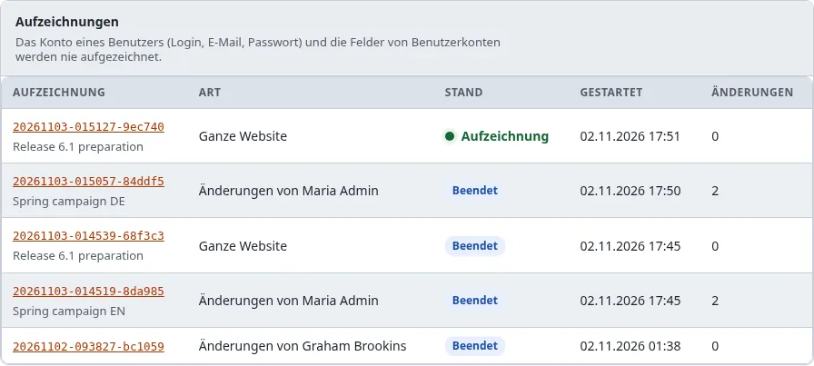

## Was eine Aufzeichnung erfasst hat

Öffnen Sie eine Aufzeichnung aus der Liste, mit **Anzeigen** in der Leiste oder mit **Zeigen, was sie festgehalten
hat**.

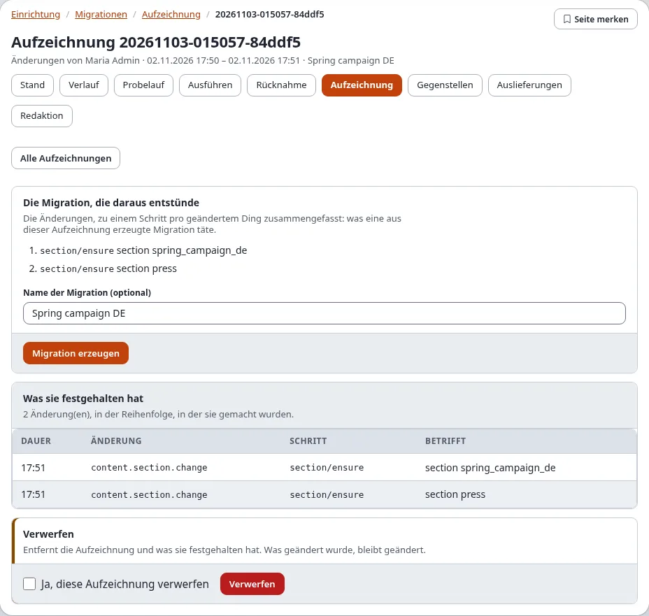

- **Die Migration, die daraus entstünde**: ein Schritt je geänderter Sache, in der Reihenfolge, in der sie zuerst
  geändert wurden. Eine angelegte und geänderte Sache ist ein Schritt, der sie mit ihren letzten Werten anlegt; eine
  angelegte und wieder entfernte fällt weg. **Absichtlich weggelassen** nennt, was eine Migration nicht tragen darf
  (Konten, Geheimnisse).
- **Was sie festgehalten hat**: jede Änderung in der Reihenfolge, in der sie gemacht wurde: die Zeit, die Änderung
  (das Audit-Ereignis, zum Beispiel `content.section.change`), der Schritt, für den sie steht, und worum es geht, über
  Remote-ID oder Bezeichner, nie über eine Zahl, die sich zwischen Installationen unterscheidet. Die Seite listet die
  ersten 1000.

  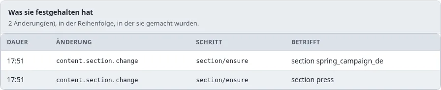

## Die Migration erzeugen

1. Beenden Sie die Aufzeichnung.
2. Geben Sie unter **Die Migration, die daraus entstünde** einen **Name der Migration (optional)** ein (Vorgabe ist
   die Bezeichnung).
3. Drücken Sie **Migration erzeugen**. Die Meldung nennt die Datei, die in das Migrationsverzeichnis der Site
   geschrieben wurde, `migrations/<Zeit>_<Name>.yml`, und dass Änderungen, die kein Schritt machen kann, oben in der
   Datei stehen und von Hand zu machen sind (ein Tausch zweier Orte, ein Workflow-Auslöser, eine geheime Einstellung).

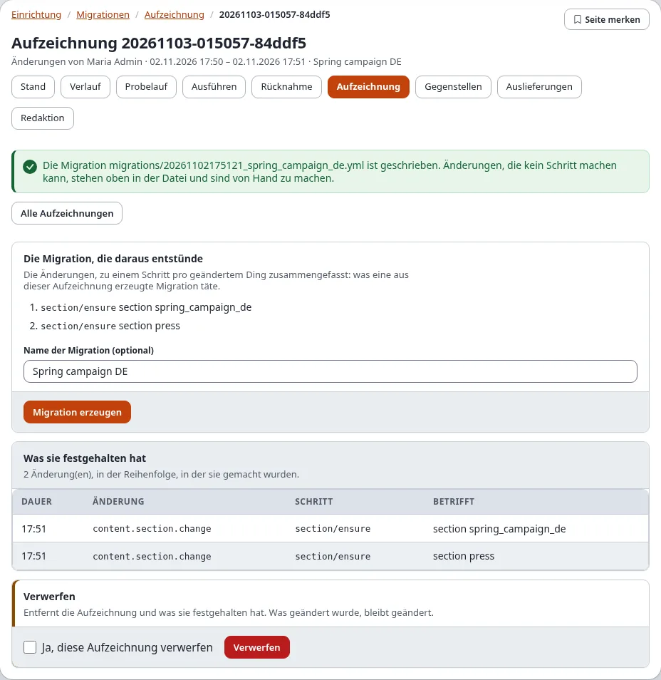

Die neue Migration steht auf der Seite Stand als **ausstehend**. Prüfen Sie sie mit **Probelauf**, dann committen oder
liefern Sie sie aus; auf der Installation, auf der aufgezeichnet wurde, findet die Migration alles vor (Modus
`ensure`). Ist eine Erweiterung nicht aktiv, die einen benötigten Schritttyp mitbringt, nennt ein Hinweis statt der
Schaltfläche die Schritttypen. Weitere Wege zu einer Migration: [Migrationen erzeugen](migrationen-erzeugen.md).

## Eine Aufzeichnung verwerfen

Unten auf der Seite einer Aufzeichnung: Kreuzen Sie **Ja, diese Aufzeichnung verwerfen** an und drücken Sie
**Verwerfen**. Die Aufzeichnung und was sie festgehalten hat werden entfernt. Was geändert wurde, bleibt geändert.

## Auf der Konsole

| Befehl | Tut |
|---|---|
| `./console exp:migration:record:start --label="news section" --apply` | startet eine Aufzeichnung Ihrer Änderungen (`--user=<login>` für einen anderen Benutzer) |
| `./console exp:migration:record:start --site-wide --for=120 --apply` | öffnet ein Fenster für die ganze Website für 120 Minuten |
| `./console exp:migration:record:start --site-wide --until="2026-11-20 18:00" --apply` | öffnet ein Fenster für die ganze Website bis zu dieser Zeit |
| `./console exp:migration:record:status` | was gerade aufgezeichnet wird |
| `./console exp:migration:record:stop --apply` | beendet Ihre Aufzeichnung (`--site-wide` schließt das Fenster, `<id>` beendet diese Aufzeichnung) |
| `./console exp:migration:record:show <id>` | jede Änderung einer Aufzeichnung |
| `./console exp:migration:generate --from-recording=<id> --apply` | erzeugt die Migration |
| `./console exp:migration:record:discard <id> --apply` | verwirft sie |

`--for` und `--until` gehen auch für eine Aufzeichnung der eigenen Änderungen.

## Was nie aufgezeichnet wird

- Das Konto eines Benutzers (Login, E-Mail-Adresse, Passwort) und die Felder von Benutzerkonten: eine Aufzeichnung
  hält nur fest, dass ein Benutzer angelegt oder geändert wurde, seine Gruppen und ob er aktiv ist.
  „Absichtlich weggelassen“ nennt, was weggelassen wurde.
- Der Wert einer Einstellung, deren Name sagt, dass sie ein Geheimnis ist.
- Wer eine Änderung gemacht hat, in der Migration: eine erzeugte Migration nennt niemanden. Einen Benutzer, den sie
  anlegt, nennt sie über Geheimnisse (Setup > Geheimnisse) für Login, E-Mail-Adresse und Passwort, die auf jeder
  Installation vor dem Lauf angelegt werden.
- Lesen, Suchen, Anmelden und Caches leeren: sie ändern nichts.
- Die Änderungen eines Migrationslaufs: sie sind schon eine Migration.

## Wenn etwas schiefgeht

| Was Sie sehen | Warum, und was zu tun ist |
|---|---|
| „Die Aufzeichnungstabellen gibt es noch nicht“ | Die Installation hat das Upgrade, das sie anlegt, noch nicht ausgeführt: `./console exp:upgrade --apply` (Schritt `6.0.15-migration-recording-tables`). |
| „Aufzeichnen ist in der migration.ini ausgeschaltet“ | `[RecordingSettings] Recording=disabled`; schalten Sie es in `settings/override/migration.ini.append.php` ein. |
| „Eine Aufzeichnung dieser Art läuft schon“ | Sie zeichnen schon auf, oder ein Fenster für die ganze Website ist offen. Beenden Sie es zuerst. |
| Die Leiste erscheint, aber keine Aufzeichnung ist gelistet | Die Datei der laufenden Aufzeichnungen in `var/` ist veraltet: `./console exp:migration:record:status` schreibt sie neu. |
| Eine Aufzeichnung sagt, sie füge ab einer Zahl von Ereignissen nichts mehr hinzu | `[RecordingSettings] MaxEvents` ist erreicht. Beenden Sie sie und starten Sie eine neue. |
| Das Fenster für die ganze Website schloss sich, bevor Sie fertig waren | Seine Minuten waren abgelaufen. Öffnen Sie ein neues Fenster; erzeugen Sie aus jeder Aufzeichnung eine Migration. |
| „Nichts wurde aufgezeichnet.“ | Während sie lief, wurde nichts geändert, oder nur, was nie aufgezeichnet wird. |
| Der Reiter Aufzeichnung fehlt | Ihnen fehlt `migration/edit`. |

## Verwandte Seiten

- [Ein Rundgang durch Setup > Migrationen](rundgang-durch-setup-migrationen.md), [Migrationen erzeugen](migrationen-erzeugen.md)
- [Migrationen: erzeugen und Änderungen aufzeichnen](../../anleitungen/migrationen-erzeugen-und-aufzeichnen.md)
- [Ein Aufzeichnungsfenster auf Zeit](../../anleitungen/migrationen-pakete-deploy-und-lange-laeufe.md#ein-aufzeichnungsfenster-auf-zeit)
- [Rezept: eine Sitzung in der Administration aufzeichnen](../../beispiele/kochbuch/migrationen-sitzung-aufzeichnen.md)
- [Die Ansicht migration/recording](../../beispiele/modulansichten/migration/recording.md) und [die Richtlinien des Moduls migration](../../beispiele/richtlinien/migration.md)
- [Migrationen in der Administration](in-der-administration.md)
