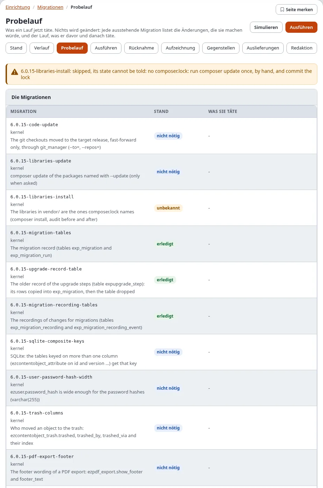
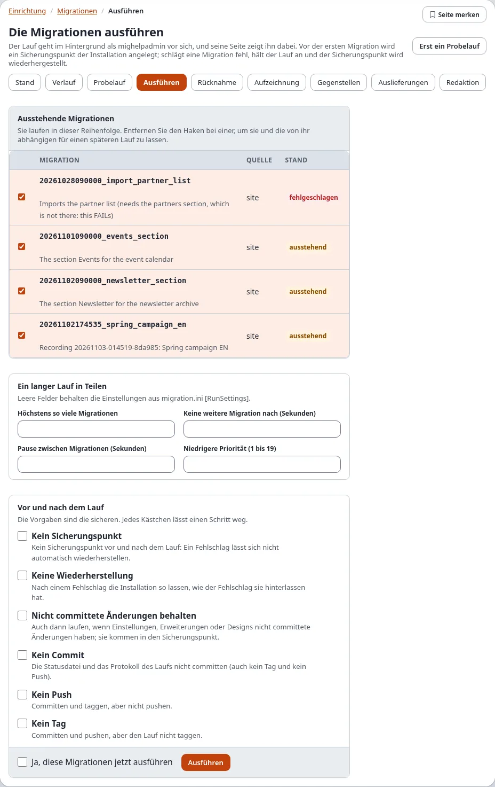
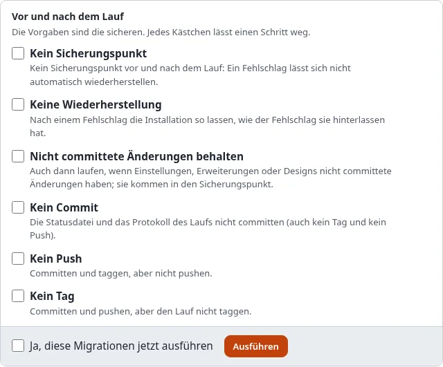
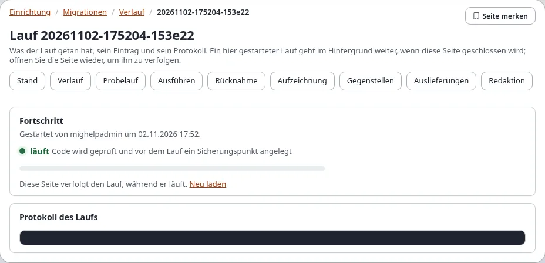
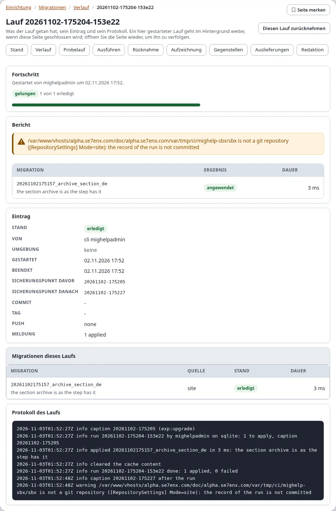
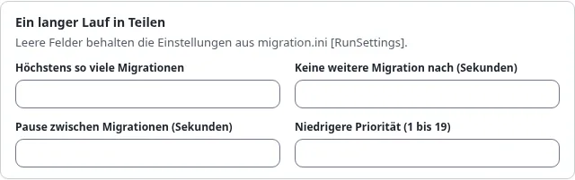
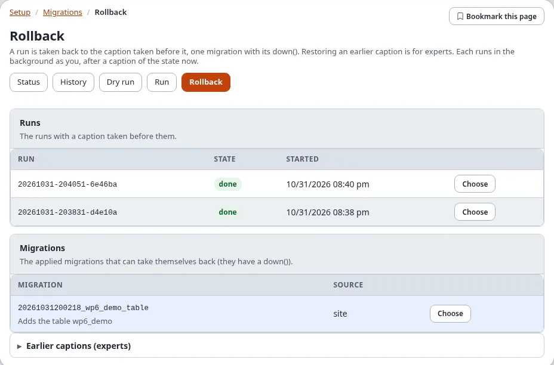
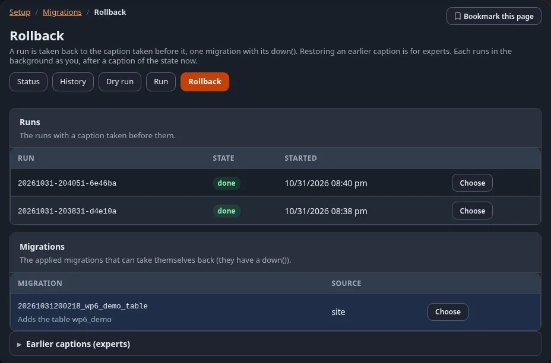

# Migrationen: Ausführen, Probelauf und Rücknahme

Die Seiten von **Setup > Migrationen**, die etwas ändern: der Probelauf (der nichts ändert, aber einen Lauf
simulieren kann), das Ausführen, das Fortsetzen eines fehlgeschlagenen Laufs und die Rücknahme. Sie tun, was die
Konsolenbefehle tun (`exp:migration:dry-run`, `exp:migration:migrate --apply`, `exp:migration:resume --apply`,
`exp:migration:rollback --apply`), mit denselben Sicherungen. Das Ansehen der Migrationen und Läufe erklärt
[Stand und Verlauf](status-und-verlauf.md).

**Wer was darf:**

| Seite | Richtlinie | „Identität bestätigen“ |
|---|---|---|
| **Probelauf** | `migration/read` | nur für **Simulieren** |
| **Ausführen**, **Fortsetzen** | `migration/run` (auch für **Simulieren** nötig) | ja |
| **Rücknahme** | `migration/rollback` | ja |

In einer neuen Installation hat nur die Rolle Administrator diese Richtlinien. „Identität bestätigen“ fragt vor der
Aktion noch einmal nach Ihrem Passwort (oder einem Passkey) und dann einige Minuten lang nicht mehr; siehe
[Identität bestätigen](../../anleitungen/identitaet-bestaetigen.md). Die Regeln stehen in
`site.ini [ReauthGroup_system]`.

## Inhalt

1. [Probelauf](#probelauf)
2. [Ausführen](#ausführen)
3. [Ein langer Lauf in Teilen](#ein-langer-lauf-in-teilen)
4. [Einen fehlgeschlagenen Lauf fortsetzen](#einen-fehlgeschlagenen-lauf-fortsetzen)
5. [Zurücknehmen](#zurücknehmen)
6. [Wie ein hier gestarteter Lauf weitergeht](#wie-ein-hier-gestarteter-lauf-weitergeht)
7. [Wenn ein Lauf nicht starten kann](#wenn-ein-lauf-nicht-starten-kann)
8. [Verwandte Seiten](#verwandte-seiten)

## Probelauf

**Probelauf** (`/migration/dryrun`) zeigt, was ein Lauf jetzt täte, und ändert nichts:

- **Die Migrationen**: jede ausstehende Migration mit dem, was sie laut ihrem Plan ändern würde;
- **Vor und nach dem Lauf**: ob vor dem Lauf (**Sicherungspunkt davor**) und danach (**Sicherungspunkt danach**) ein
  Sicherungspunkt genommen wird und was committet, getaggt und gepusht würde.

**Simulieren** (mit `migration/run`) geht weiter: Die ausstehenden Migrationen laufen wirklich, in einer Transaktion,
die danach zurückgerollt wird, und die Seite listet auf, was jede in der Datenbank geändert hat. Nichts bleibt. Eine
Simulation braucht PostgreSQL oder SQLite, deren Schemaänderungen sich zurückrollen lassen; unter MySQL/MariaDB,
Oracle und MongoDB zeigt die Seite stattdessen den Plan und sagt das. Solange ein Lauf im Gang ist, warten Sie mit dem
Simulieren, bis er beendet ist.

## Ausführen

**Ausführen** (`/migration/run`, oder **N ausstehende ausführen** auf der Seite Stand) ist ein Formular:

1. **Ausstehende Migrationen**: jede ausstehende oder fehlgeschlagene Migration, alle angehakt, in der Reihenfolge, in
   der sie laufen. Entfernen Sie den Haken bei einer, um sie und die von ihr abhängigen für einen späteren Lauf zu
   lassen. Eine Migration, die **während des Laufs den Wartungsmodus einschaltet**, sagt das.
2. **Nach dem Anwenden geändert** (nur wenn es welche gibt): Migrationen, deren Datei nicht die angewendete ist. Der
   Lauf lehnt sie ab, außer Sie haken **Die Änderungen annehmen** an und schreiben unter **Warum** eine Begründung
   (höchstens 500 Zeichen). Sie laufen nicht noch einmal; die neue Prüfsumme wird aufgezeichnet und die Begründung im
   Audit-Log festgehalten.
3. **Ein langer Lauf in Teilen** (optional): Grenzen für einen langen Lauf, siehe
   [Ein langer Lauf in Teilen](#ein-langer-lauf-in-teilen). Leere Felder behalten die Einstellungen von
   `migration.ini [RunSettings]`.
4. **Vor und nach dem Lauf**: Die Vorgaben sind die sicheren. Jedes Kästchen lässt einen Schritt weg:

   

   | Kästchen | Lässt weg |
   |---|---|
   | **Kein Sicherungspunkt** | die Sicherungspunkte vor und nach dem Lauf; ein Fehlschlag lässt sich nicht automatisch wiederherstellen |
   | **Keine Wiederherstellung** | die Wiederherstellung des Sicherungspunkts nach einem Fehlschlag |
   | **Nicht committete Änderungen behalten** | die Ablehnung nicht committeter Änderungen in Einstellungen, Erweiterungen und Designs (sie kommen in den Sicherungspunkt) |
   | **Kein Commit** | den Commit der Statusdatei und des Laufprotokolls (auch kein Tag und kein Push) |
   | **Kein Push** | den Push (Commit und Tag finden statt) |
   | **Kein Tag** | den Tag (Commit und Push finden statt) |

5. Haken Sie **Ja, diese Migrationen jetzt ausführen** an und klicken Sie auf **Ausführen**. Nach „Identität
   bestätigen“ startet der Lauf, und seine Seite öffnet sich, auf der Sie ihn verfolgen
   ([Die Seite eines Laufs](status-und-verlauf.md#die-seite-eines-laufs)).

Der Lauf nimmt zuerst einen Sicherungspunkt der Installation. Scheitert eine Migration, hält der Lauf an und der
Sicherungspunkt wird wiederhergestellt. Ein gelungener Lauf nimmt danach einen Sicherungspunkt und committet, taggt
und pusht seinen Eintrag. **Erst ein Probelauf** öffnet den Probelauf.

Was Sie nach **Ausführen** sehen: die Seite des Laufs mit **Fortschritt**: die Phase (zuerst „Code wird geprüft und
vor dem Lauf ein Sicherungspunkt angelegt“, dann „... läuft (n von m)“), ein Balken und das Protokoll des Laufs, die
ohne Neuladen wachsen.

Ist er beendet, lädt sich die Seite mit dem Bericht, dem Eintrag und dem Protokoll des Laufs neu:

## Ein langer Lauf in Teilen

Die Karte **Ein langer Lauf in Teilen** des Formulars Ausführen teilt und taktet einen Lauf vieler Migrationen oder
einer, die viele Objekte ändert:

| Feld | Option | Was es tut |
|---|---|---|
| **Höchstens so viele Migrationen** | `--max-migrations` | wendet höchstens so viele an; der Rest bleibt ausstehend („zurückgestellt“) |
| **Keine weitere Migration nach (Sekunden)** | `--max-time` | startet nach dieser Zeit keine weitere Migration; die laufende wird beendet |
| **Pause zwischen Migrationen (Sekunden)** | `--throttle` | eine Pause zwischen zwei Migrationen und zwischen den Stapeln einer PHP-Migration (`0.5` ist eine halbe Sekunde, höchstens 60) |
| **Niedrigere Priorität (1 bis 19)** | `--nice` | lässt den Hintergrundprozess mit niedrigerer Priorität laufen, wie `nice(1)` |

Ein leeres Feld behält die Einstellung von `migration.ini [RunSettings]`, die als Platzhalter des Felds steht. Ein
Lauf, der an einer Grenze anhält, endet ohne Fehler; die Migrationen, die er lässt, bleiben für den nächsten Lauf oder
eine Fortsetzung ausstehend. Die erste Migration eines Laufs startet immer. Einzelheiten:
[Lange Läufe](../../anleitungen/migrationen-pakete-deploy-und-lange-laeufe.md#lange-läufe).

## Einen fehlgeschlagenen Lauf fortsetzen

Ein fehlgeschlagener oder unterbrochener Lauf lässt sich fortsetzen: **Fortsetzen** im Verlauf oder **Diesen Lauf
fortsetzen** auf der Seite des Laufs. Das ist ein neuer Lauf dessen, was der fehlgeschlagene offen gelassen hat
(`exp:migration:resume`), und er startet auf dieselbe Weise, mit „Identität bestätigen“.

## Zurücknehmen

**Rücknahme** (`/migration/rollback`) listet auf, was sich zurücknehmen lässt:

| Abschnitt | Was **Auswählen** zurücknimmt |
|---|---|
| **Läufe** | einen Lauf mit Sicherungspunkt davor: dieser Sicherungspunkt wird wiederhergestellt |
| **Migrationen** | eine angewendete Migration mit `down()`: ihr `down()` läuft |
| **Frühere Sicherungspunkte (Fachleute)** | einen beliebigen früheren Sicherungspunkt, wiederhergestellt |

**Zum Zustand vor einem Lauf zurück, Schritt für Schritt:**

1. Öffnen Sie **Rücknahme**. Suchen Sie den Lauf unter **Läufe** (die neuesten zuerst) und drücken Sie **Auswählen**.
2. Wählen Sie die **Wiederherzustellenden Teile** (die Vorgaben passen meistens).
3. Haken Sie **Ja, zurücknehmen** an und drücken Sie **Zurücknehmen**; bestätigen Sie „Identität bestätigen“.
4. Die Seite der Rücknahme öffnet sich und verfolgt sie. Danach zeigt der Stand die Migrationen des Laufs wieder als
   ausstehend, und der Verlauf listet die Rücknahme unter **Hier gestartet**. Unter Umständen müssen Sie sich neu
   anmelden.

**Auswählen** öffnet die Bestätigung (`/migration/rollback/<Kennung des Laufs, der Migration oder des
Sicherungspunkts>`; auch **Zurücknehmen** im Verlauf und **Diesen Lauf zurücknehmen** auf der Seite eines Laufs öffnen
sie):

- **Ein Lauf**: Wählen Sie die **Wiederherzustellenden Teile** (**Die Datenbank**, **Die gespeicherten Dateien
  (var/)**, **Die Einstellungen (settings/override)**; die Vorgaben kommen aus
  `migration.ini [CaptionSettings] RestoreParts`), haken Sie **Ja, zurücknehmen** an und klicken Sie auf
  **Zurücknehmen**.
- **Eine Migration**: Haken Sie **Ja, zurücknehmen** an und klicken Sie auf **Zurücknehmen**.
- **Ein früherer Sicherungspunkt**: Wählen Sie die Teile, haken Sie **Ich weiß, was das wiederherstellt** an und geben
  Sie die Kennung des Sicherungspunkts noch einmal ein.

Zuerst wird ein Sicherungspunkt des jetzigen Zustands genommen, sodass sich auch eine Rücknahme zurücknehmen lässt.
Das Wiederherstellen der Datenbank setzt sie auf den Zeitpunkt des Sicherungspunkts zurück, die Sitzungen
eingeschlossen: Danach werden Sie unter Umständen erneut nach der Anmeldung gefragt, und alles, was seitdem geändert
wurde, ist verloren. Ein Lauf ohne Sicherungspunkt davor lässt sich nicht als Ganzes zurücknehmen: Nehmen Sie seine
Migrationen einzeln zurück oder stellen Sie einen früheren Sicherungspunkt wieder her.

Die Rücknahme läuft wie ein Lauf im Hintergrund, und ihre Seite öffnet sich. Im Verlauf steht sie unter **Hier
gestartet**.

## Wie ein hier gestarteter Lauf weitergeht

Ein auf diesen Seiten gestarteter Lauf, eine Fortsetzung oder eine Rücknahme läuft auf dem Server als eigener
Konsolenprozess unter dem angemeldeten Benutzer, sodass ein langer Lauf die Seite nie offen hält:

- er läuft weiter, wenn die Seite geschlossen wird; öffnen Sie seine Seite wieder, um ihn zu verfolgen;
- immer nur einer: Solange einer im Gang ist oder ein anderer Lauf oder ein Upgrade die Sperre der Installation hält,
  wird ein neuer mit Begründung abgelehnt;
- seine Dateien liegen in `var/<site>/migration/jobs/`: der Auftrag, sein Fortschritt, was der Befehl ausgegeben hat
  und seine Prozesskennung. Die neuesten 50 Aufträge behalten ihre Dateien
  (`migration.ini [AdminSettings] JobHistory`); ein noch laufender Auftrag wird immer behalten;
- er nutzt das PHP-Kommandozeilenprogramm: `migration.ini [AdminSettings] PhpCliPath`, sonst
  `cronjob.ini [AdminSettings] PhpCliPath`, sonst die üblichen Orte.

Die Konsolenbefehle dahinter sind dieselben, die Sie selbst ausführen können. Die Administration übergibt die
Kennung des Laufs mit `--run-id` und eine Fortschrittsdatei mit `--progress`, sodass Lauf, Eintrag und Protokoll eine
Kennung teilen.

## Wenn ein Lauf nicht starten kann

| Meldung | Was zu tun ist |
|---|---|
| **Ein hier gestarteter Lauf ist noch im Gang** | warten Sie, bis er beendet ist; verfolgen Sie ihn von der Seite Stand aus |
| **Ein anderer Lauf hält die Sperre der Installation** | ein Upgrade oder ein Lauf auf der Konsole ist im Gang; warten Sie darauf |
| **Es wurde kein PHP-Kommandozeilenprogramm gefunden** | setzen Sie `migration.ini [AdminSettings] PhpCliPath` auf den vollen Pfad des PHP-Kommandozeilenprogramms (nie das php-fpm-Programm) |
| **proc_open ist abgeschaltet, deshalb lässt sich hier kein Lauf starten** | das PHP des Webservers kann keine Prozesse starten: führen Sie `./console exp:migration:migrate --apply` auf dem Server aus |
| **Der Ordner der Läufe ist nicht beschreibbar** | lassen Sie den Webserver `var/<site>/migration/jobs/` beschreiben |
| **Der Lauf wurde gestartet, hat aber seine Prozesskennung nicht gemeldet** | sehen Sie in die `.err`-Datei des Auftrags in diesem Ordner |
| **Eine Migration hat sich nach dem Anwenden geändert** | stellen Sie die Datei wieder her oder haken Sie **Die Änderungen annehmen** an und geben Sie die Begründung an |

Mehr zu Fehlern des Runners: [Fehlerbehebung bei Migrationen](../../anleitungen/migrationen-fehlerbehebung.md).

## Verwandte Seiten

- [Migrationen: der Einstieg](README.md), [Alle Rezepte](rezepte/README.md), [Häufige Fragen](faq.md)
- [Die Anleitung](../../anleitungen/migrationen.md), [das Tutorial](../../anleitungen/migrationen-tutorial.md),
  [PHP-Migrationen](../../anleitungen/migrationen-php.md),
  [Zurücknehmen und Sicherungspunkte](../../anleitungen/migrationen-rueckgaengig-und-captions.md),
  [Das Migrations-Repository](../../anleitungen/migrationen-repositories.md)
- [In der Administration](in-der-administration.md), [Befehle](befehle.md), [Einstellungen](einstellungen.md),
  [Richtlinien, Ansichten und Ereignisse](richtlinien-ansichten-und-ereignisse.md)
- [Das Dateiformat](../../spezifikationen/6.0/migrationsdateiformat.md),
  [Die Funktion](../../funktionen/6.0/migrationen.md)
- [Wenn eine Migration scheitert](wenn-eine-migration-scheitert.md),
  [Fehlermeldungen](../../anleitungen/migrationen-fehlerbehebung.md)
- [Migrationen oder Umzug einer Site](migrationen-oder-umzug-einer-site.md)
- [Stand und Verlauf](status-und-verlauf.md)
- [migration.ini [AdminSettings]](../../beispiele/ini-einstellungen/migration/AdminSettings.md)
- [Die Ansichten des Moduls migration](../../beispiele/modulansichten/migration/README.md) und
  [seine Richtlinien](../../beispiele/richtlinien/migration.md)
