# Migrationen: ausliefern, Schritt für Schritt

Eine **Auslieferung** (ein Deploy) sendet die Migrationen dieser Installation an die gewählten Gegenstellen und führt
sie dort aus, alle auf einmal und im Gleichstand: Jede Gegenstelle wird zuerst geprüft, und scheitert eine, wird jede
Gegenstelle, die angewendet hat, zurückgenommen. Sie starten sie unter **Setup > Migrationen > Auslieferungen**; die
Gegenstellen müssen vorher angelegt sein ([Eine Gegenstelle anlegen, Schritt für Schritt](eine-gegenstelle-anlegen-schritt-fuer-schritt.md)).

**Wer das darf:** Benutzer mit der Richtlinie `migration/deploy` (in einer neuen Installation Administrator).
Ausliefern, Freigeben und Zurücknehmen fragen nach [„Identität bestätigen“](../../anleitungen/identitaet-bestaetigen.md);
Nur Preflight nicht. Die Seiten sind mit `migration/read` sichtbar.

## Inhalt

1. [Bevor Sie ausliefern](#bevor-sie-ausliefern)
2. [Die Seite Auslieferungen](#die-seite-auslieferungen)
3. [Die Gegenstellen wählen](#die-gegenstellen-wählen)
4. [Wählen, wie](#wählen-wie)
5. [Nur Preflight](#nur-preflight)
6. [Ausliefern und live verfolgen](#ausliefern-und-live-verfolgen)
7. [Der Bericht](#der-bericht)
8. [Deploys in Stufen und das Tor](#deploys-in-stufen-und-das-tor)
9. [Einen Deploy zurücknehmen](#einen-deploy-zurücknehmen)
10. [Der Verlauf](#der-verlauf)
11. [Die Hinweis-Mails](#die-hinweis-mails)
12. [Im Gleichstand und nicht im Gleichstand](#im-gleichstand-und-nicht-im-gleichstand)
13. [Wenn etwas schiefgeht](#wenn-etwas-schiefgeht)
14. [Verwandte Seiten](#verwandte-seiten)

## Bevor Sie ausliefern

1. Auf dieser Installation sind die Migrationen, die Sie ausliefern möchten, gelaufen und bestanden (**Stand**: keine
   fehlgeschlagene Migration, die Sie senden wollen).
2. Jede gewählte Gegenstelle antwortet auf der Seite Gegenstellen auf **Verbindung testen**.
3. Kein Lauf ist im Gang (sonst meldet die Seite Auslieferungen **Ein Lauf ist im Gang**).

## Die Seite Auslieferungen

Öffnen Sie **Setup > Migrationen** und wählen Sie den Reiter **Auslieferungen** (`/migration/deploy`). Oben steht das
Formular, darunter der Verlauf.

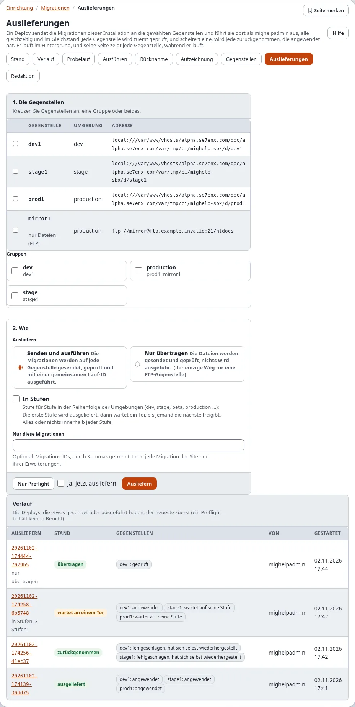

## Die Gegenstellen wählen

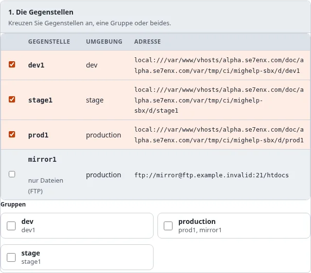

1. Kreuzen Sie **Dorthin ausliefern** für jede Gegenstelle an, oder eine Gruppe (jede ihrer Gegenstellen), oder beides.
2. Eine Gegenstelle mit **Einstellungen zu korrigieren** lässt sich erst wählen, wenn ihre Einstellungen korrigiert
   sind. Eine Gegenstelle mit **nur Dateien (FTP)** geht nur mit **Nur übertragen** (außer sie hat den Trigger).

## Wählen, wie

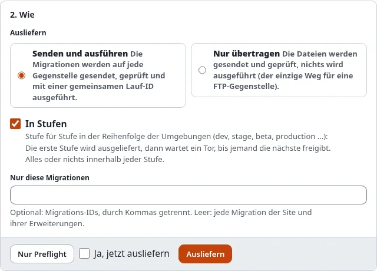

| Auswahl | Was geschieht |
|---|---|
| **Senden und ausführen** | die Migrationen werden auf jede Gegenstelle gesendet, geprüft und mit einer gemeinsamen Lauf-ID ausgeführt |
| **Nur übertragen** | die Dateien werden gesendet und geprüft; nichts wird ausgeführt (der einzige Weg für eine FTP-Gegenstelle ohne Trigger) |
| **In Stufen** | Stufe für Stufe in der Reihenfolge der Umgebungen (dev, stage, beta, production ...): die erste Stufe wird ausgeliefert, dann wartet ein Tor, bis jemand die nächste freigibt. Alles oder nichts innerhalb jeder Stufe |
| **Nur diese Migrationen** | optional: Migrations-IDs, durch Kommas getrennt. Leer: jede Migration der Site und ihrer Erweiterungen |

## Nur Preflight

Drücken Sie **Nur Preflight**, um zu prüfen, ohne etwas zu ändern. Jede Gegenstelle wird geprüft: erreichbar, ihre
Sperre frei, nichts dort fehlgeschlagen, dieselbe Kernel-Version, genug Plattenplatz, die PHP- und
Erweiterungsversionen, keine Migration dort nach dem Anwenden geändert; und die zu sendenden Dateien werden geplant.
Nichts wird gesendet, und kein Bericht bleibt.

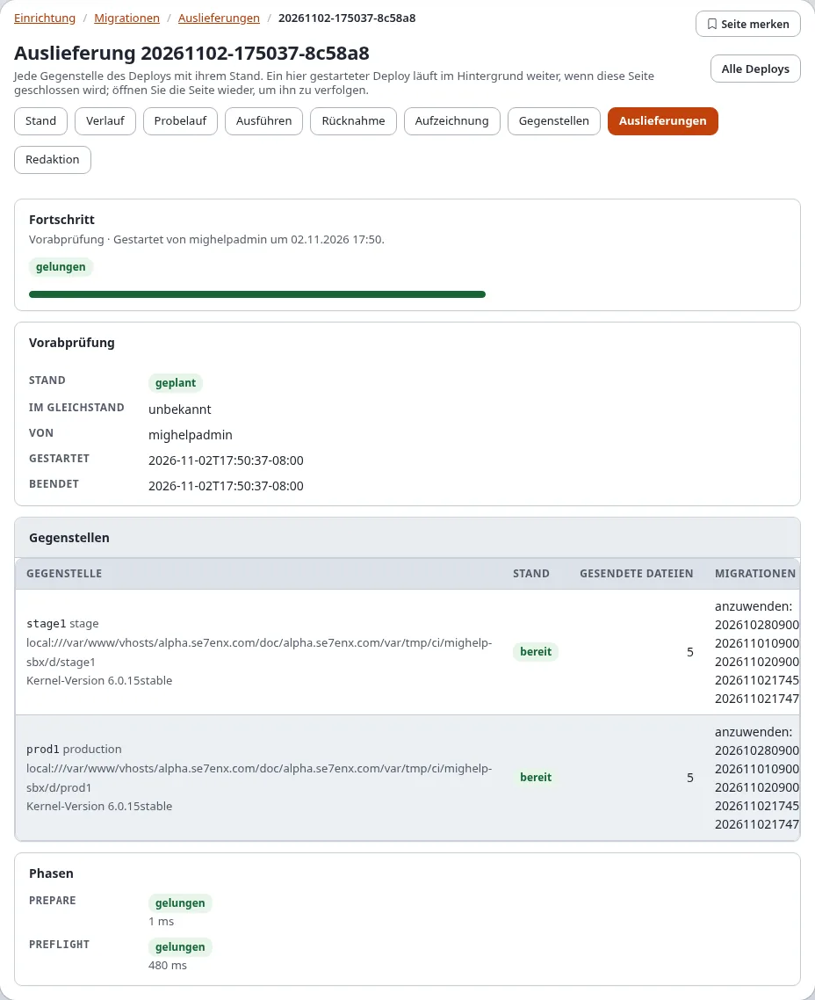

Jede Gegenstelle ist **bereit** oder nennt das Problem, das die Auslieferung anhalten würde.

## Ausliefern und live verfolgen

1. Kreuzen Sie **Ja, jetzt ausliefern** an.
2. Drücken Sie **Ausliefern** und bestätigen Sie „Identität bestätigen“.
3. Die Seite des Deploys öffnet sich (`/migration/deployment/<Deploy-ID>`) und verfolgt ihn: die Phase (Einstellungen
   und Zugangsdaten prüfen, der Preflight, die Migrationsdateien senden, prüfen, was ankam, die Migrationen auf jeder
   Gegenstelle ausführen) und eine Zeile je Gegenstelle, die sich mit ihr ändert (ausgewählt, bereit, Dateien
   gesendet, geprüft, angewendet).

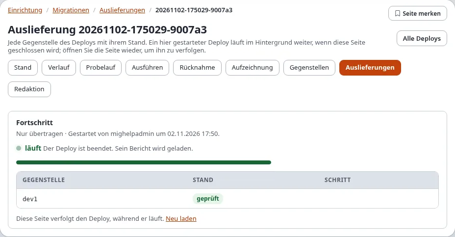

Die Auslieferung läuft im Hintergrund unter Ihrem Namen. Das Schließen der Seite hält sie nicht an; öffnen Sie sie
aus dem Verlauf wieder, um sie weiter zu verfolgen. Es läuft immer nur ein Lauf oder Deploy aus der Administration
auf einmal.

## Der Bericht

Ist die Auslieferung beendet, zeigt ihre Seite den Bericht:

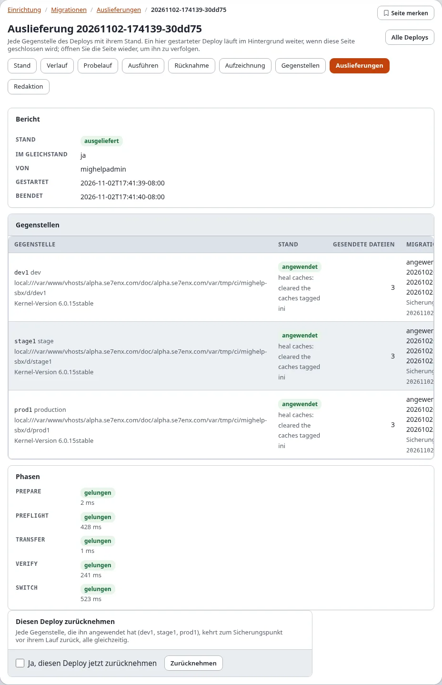

| Teil | Zeigt |
|---|---|
| **Bericht** | den Stand des Deploys, **Im Gleichstand**, wer ihn gestartet hat, wann er begann und endete, und die Warnungen |
| **Gegenstellen** | für jede Gegenstelle: ihre Stufe, ihren Stand mit Problem oder Korrektur, die gesendeten Dateien, die angewendeten (oder anzuwendenden) Migrationen, den Sicherungspunkt vor ihrem Lauf, die Kernel-Version |
| **Phasen** | jede Phase mit bestanden oder fehlgeschlagen und ihrer Dauer |

| Stand des Deploys | Bedeutung |
|---|---|
| geplant | ein Preflight: nichts wurde gesendet |
| übertragen | Nur übertragen: die Dateien sind dort, nichts lief |
| ausgeliefert | jede Gegenstelle hat angewendet |
| wartet an einem Tor | eine Auslieferung in Stufen: die bisherigen Stufen sind ausgeliefert, die nächste wartet auf Freigabe |
| zurückgenommen | eine Gegenstelle ist gescheitert; jede, die angewendet hatte, wurde auf ihren Sicherungspunkt zurückgesetzt |
| nicht im Gleichstand | eine Gegenstelle ist gescheitert, und nicht jede konnte zurückgenommen werden |
| fehlgeschlagen, abgelehnt | die Übertragung oder Prüfung ist gescheitert, oder eine Gegenstelle war nicht nutzbar; keine wurde umgeschaltet |

Ein Deploy mit **Nur übertragen** endet als **übertragen**:

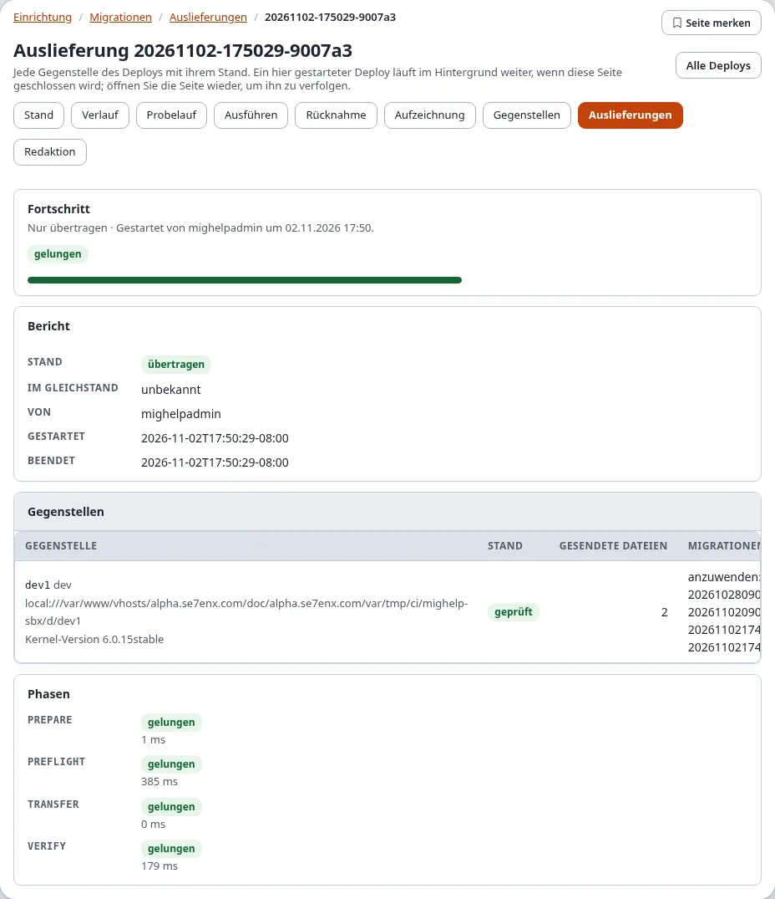

## Deploys in Stufen und das Tor

Mit **In Stufen** prüft der Preflight trotzdem zuerst jede Gegenstelle. Dann wird die erste Stufe (zum Beispiel dev)
gesendet, geprüft und ausgeführt, und die Auslieferung **wartet an einem Tor**. Eine Hinweis-Mail geht hinaus
([Die Hinweis-Mails](#die-hinweis-mails)).

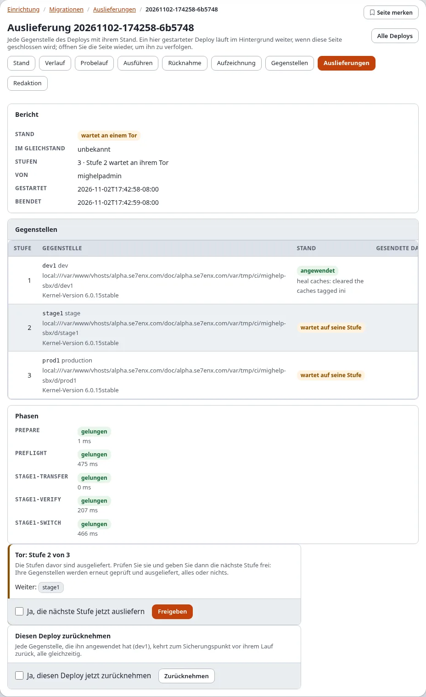

So liefern Sie die nächste Stufe aus:

1. Prüfen Sie die ausgelieferte Stufe (zum Beispiel die Site auf dev).
2. Öffnen Sie die Seite des Deploys (aus dem Verlauf oder über den Link der Hinweis-Mail). **Tor: Stufe 2 von 3**
   nennt die Gegenstellen der nächsten Stufe.
3. Kreuzen Sie **Ja, die nächste Stufe jetzt ausliefern** an und drücken Sie **Freigeben**; bestätigen Sie
   „Identität bestätigen“.
4. Die nächste Stufe wird erneut geprüft und ausgeliefert, alles oder nichts, und die Auslieferung wartet am nächsten
   Tor, bis zur letzten Stufe. Wer jedes Tor wann freigegeben hat, steht im Bericht.

Auf der Konsole: `./console exp:migration:deploy --continue=<Deploy-ID> --apply`.

Scheitert eine spätere Stufe, wird diese Stufe zurückgenommen; die Stufen davor bleiben ausgeliefert, und der Bericht
sagt, dass die Gegenstellen nicht im Gleichstand sind. Nehmen Sie den Deploy zurück, um auch diese zurückzunehmen,
oder beheben Sie das Problem und liefern Sie erneut aus.

Dieselbe Seite im dunklen Modus:

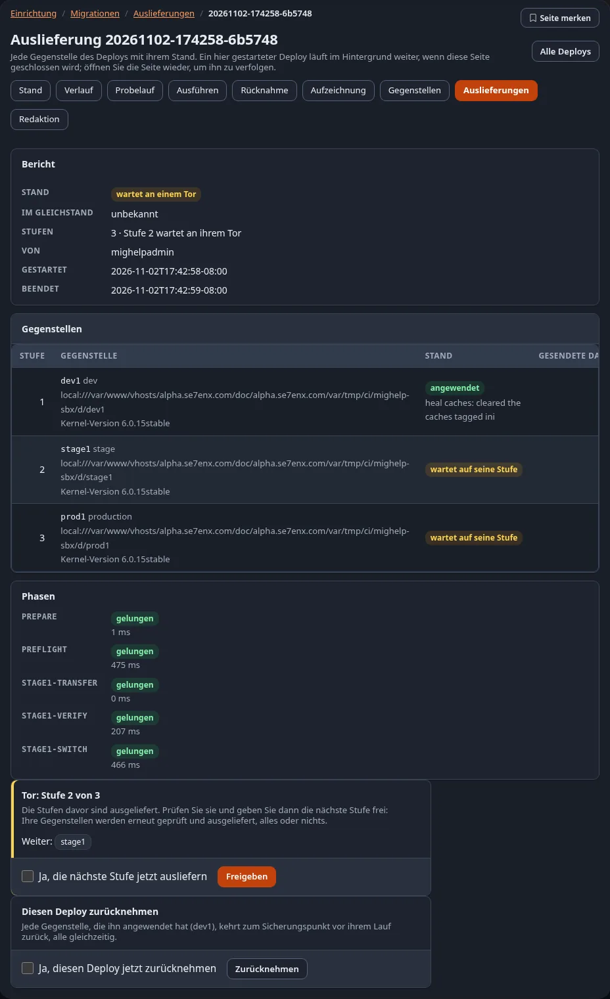

## Einen Deploy zurücknehmen

Ein Deploy, den einige Gegenstellen angewendet haben, zeigt **Diesen Deploy zurücknehmen**: Jede Gegenstelle, die ihn
angewendet hat, geht auf den Sicherungspunkt vor ihrem Lauf zurück, alle auf einmal.

1. Öffnen Sie die Seite des Deploys.
2. Kreuzen Sie **Ja, diesen Deploy jetzt zurücknehmen** an und drücken Sie **Zurücknehmen**; bestätigen Sie
   „Identität bestätigen“.
3. Die Seite verfolgt die Rücknahme; der Stand wird **zurückgenommen**.

Ein Deploy, bei dem eine Gegenstelle scheitert, wird von selbst zurückgenommen:

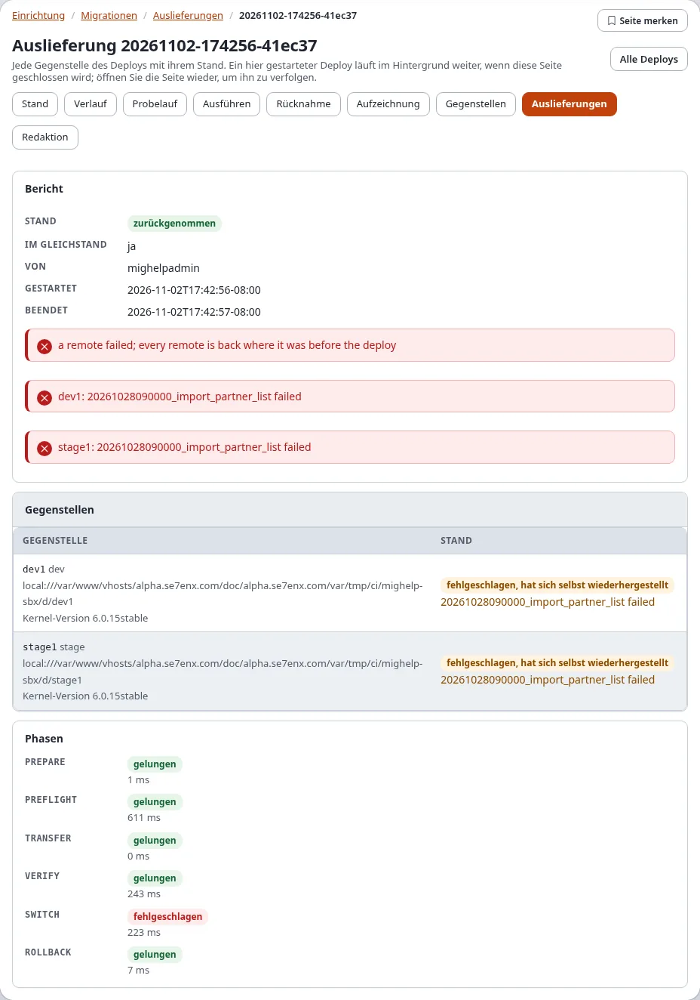

Eine Gegenstelle, die sich nicht zurücknehmen lässt, wird gemeldet, und der Deploy wird mit dem Stand jeder
Gegenstelle als **nicht im Gleichstand** markiert.

## Der Verlauf

Unter dem Formular listet **Verlauf** jeden Deploy, der etwas gesendet oder ausgeführt hat, den neuesten zuerst:
seine ID (ein Link auf seine Seite), seinen Stand, jede Gegenstelle mit ihrem Stand, wer ihn wann gestartet hat. Ein
Preflight behält keinen Bericht und steht nicht in der Liste.

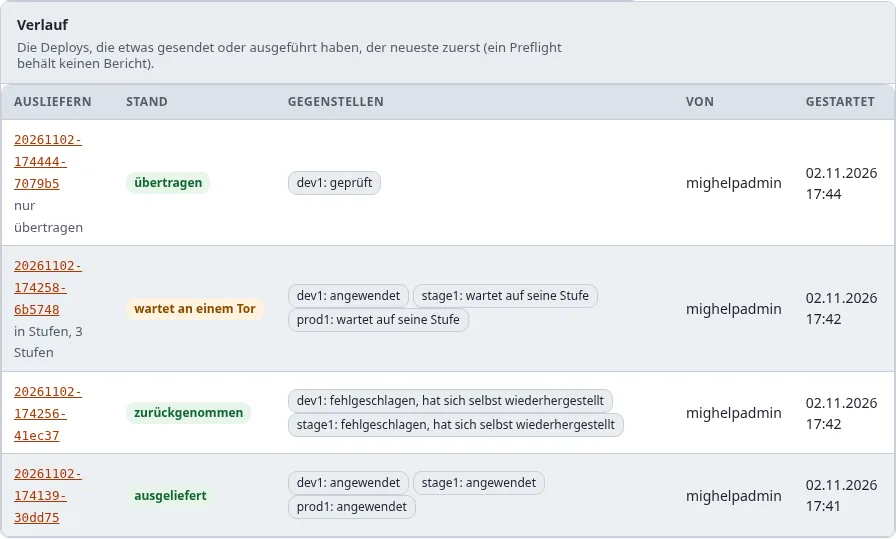

Berichte liegen in `var/<site>/migration/deploy/reports/<Deploy-ID>.json` und, sobald der Upgrade-Schritt
`6.0.15-migration-deploy-tables` gelaufen ist, in den Tabellen `exp_migration_deploy` und `exp_migration_deploy_host`.
Das Panel Migrationen der Website-Seitenleiste listet die letzten Auslieferungen auch
([Migrationen in der Website-Seitenleiste](expwt-panel.md)).

## Die Hinweis-Mails

Ein Deploy, der scheitert (abgelehnt, fehlgeschlagen, zurückgenommen, nicht im Gleichstand), und eine Auslieferung in
Stufen, die an einem Tor wartet, senden einen Hinweis per E-Mail:

- an `migration.ini [RemoteSettings] NotifyEmail` (leer: die Administratoradresse aus site.ini);
- für die Arten in `Notify[]`: `failure`, `gate` und `success` (Vorgabe sind die ersten beiden);
- als reiner Text: der Deploy, sein Ergebnis, jede Gegenstelle mit Stand und Problemen und die Adresse der Seite des
  Deploys, auf der ein Tor freigegeben wird.

## Im Gleichstand und nicht im Gleichstand

**Im Gleichstand: ja** heißt, jede Gegenstelle des Deploys hat denselben Migrationsstand erreicht: alle angewendet
oder alle zurück, wo sie waren. **Nicht im Gleichstand** heißt, eine Gegenstelle ist gescheitert und nicht jede
konnte zurückgenommen werden, oder eine spätere Stufe ist gescheitert, während frühere ausgeliefert bleiben: Die
Gegenstellen unterscheiden sich jetzt. Lesen Sie den Stand jeder Gegenstelle im Bericht, dann:

1. beheben Sie, was gescheitert ist (das Problem steht in der Zeile der Gegenstelle);
2. nehmen Sie den Deploy zurück oder liefern Sie nach der Behebung erneut aus;
3. stellen Sie auf einer Gegenstelle, die sich immer noch nicht zurücknehmen lässt, dort ihren Sicherungspunkt mit
   `./console exp:migration:rollback` wieder her.

## Wenn etwas schiefgeht

| Was Sie sehen | Warum, und was zu tun ist |
|---|---|
| **abgelehnt**: „the secret ... is not set“ | legen Sie das Geheimnis unter Setup > Secrets an |
| **abgelehnt**: „an FTP remote cannot run the migrations“ | **Nur übertragen** verwenden oder der Gegenstelle den Trigger geben ([Hosts nur mit FTP](eine-gegenstelle-anlegen-schritt-fuer-schritt.md#hosts-nur-mit-ftp-und-der-trigger)) |
| „a migration run holds the lock there“ | dort läuft ein Lauf, oder ein abgestürzter Lauf hat seine Sperre hinterlassen; die Selbstheilung `stale-lock` kann eine verwaiste entfernen |
| „the kernel version there is ...“ | aktualisieren Sie zuerst die Gegenstelle |
| „was applied there from a file that differs“ | die Migration wurde geändert, nachdem sie dort lief; gleichen Sie die Dateien an |
| **zurückgenommen**: „... failed“ | die Migration ist auf der Gegenstelle gescheitert; lesen Sie die Zeile der Gegenstelle und ihr Laufprotokoll, beheben Sie es in einer neuen Migration |
| „has the migration ..., which this installation does not have“ (eine Warnung) | die Gegenstelle hat eine Migration ausgeführt, die diese Installation nicht mitbringt (oder die **Nur diese Migrationen** ausgelassen hat) |
| **Ein Lauf ist im Gang** | warten Sie, oder verfolgen Sie ihn |

Mehr: [Fehlerbehebung](../../anleitungen/migrationen-remote-deploy.md#fehlerbehebung),
[Wenn eine Migration scheitert](wenn-eine-migration-scheitert.md).

## Verwandte Seiten

- [Eine Gegenstelle anlegen, Schritt für Schritt](eine-gegenstelle-anlegen-schritt-fuer-schritt.md), [Gegenstellen und Deploys](gegenstellen-und-deploys.md)
- [Migrationen: an entfernte Installationen ausliefern](../../anleitungen/migrationen-remote-deploy.md)
- [Rezept: mit Migrationen ausliefern](rezepte/mit-migrationen-ausliefern.md)
- [Ein Rundgang durch Setup > Migrationen](rundgang-durch-setup-migrationen.md)
