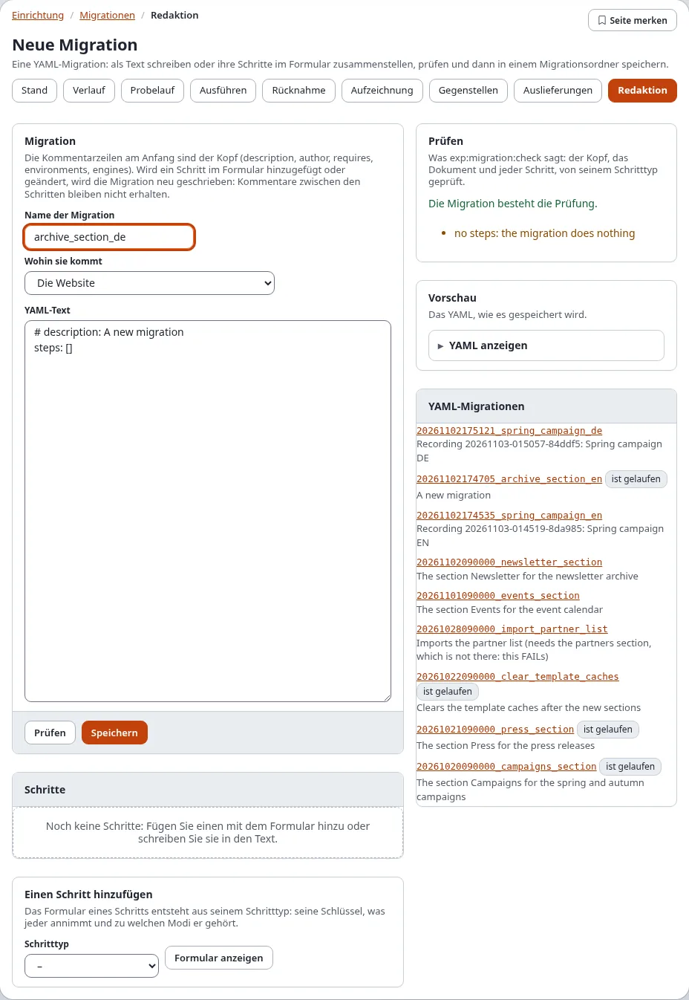
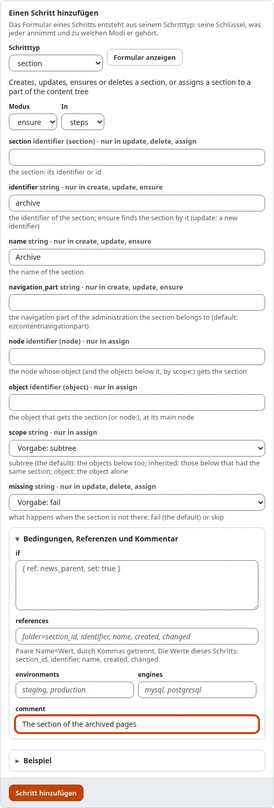
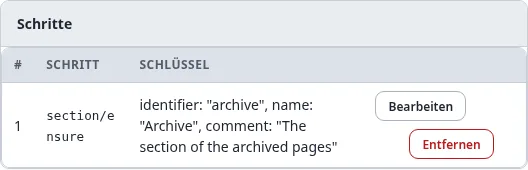
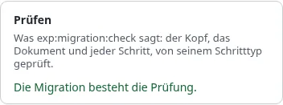
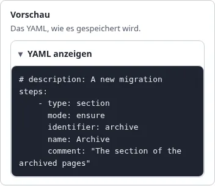
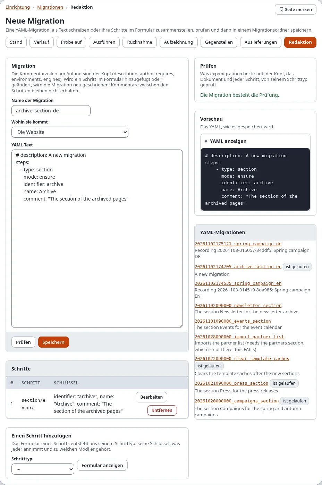
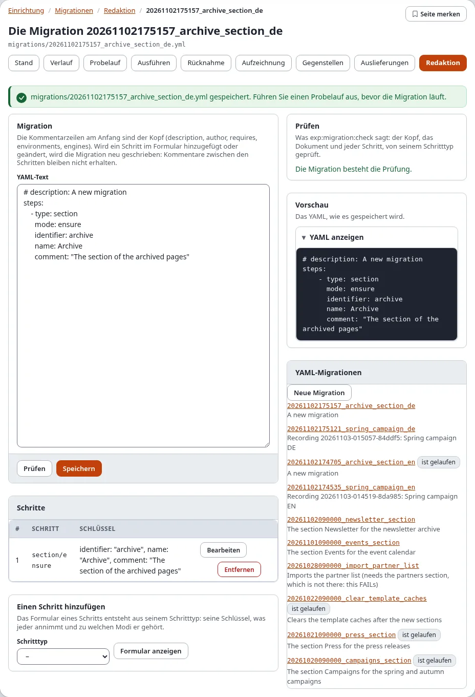
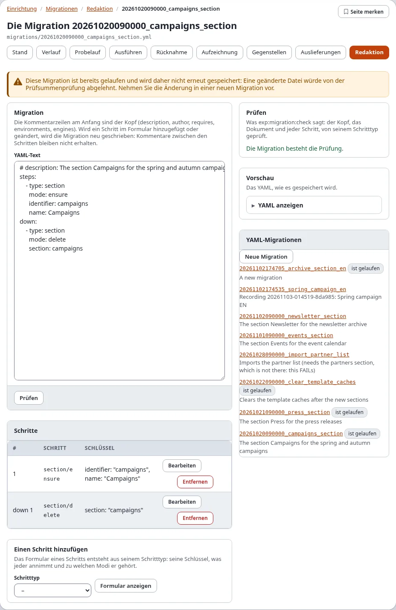

# Migrationen: der Migrationseditor

**Setup > Migrationen > Redaktion** schreibt YAML-Migrationen im Browser: Sie bauen die Schritte mit Formularen, die
aus jedem Schritttyp entstehen, prüfen die Migration so, wie `exp:migration:check` es täte, sehen das YAML an und
speichern es in einen Migrationsordner. Die gespeicherte Datei ist eine gewöhnliche Migration: Sie steht auf der
Seite Stand als ausstehend und wird ausgeführt, ausgeliefert und committet wie eine von Hand geschriebene.

**Wer den Editor benutzen darf:** Benutzer mit der Richtlinie `migration/edit` (in einer neuen Installation nur
Administrator). Die Datei schreibt der Webserver, der Migrationsordner muss also für ihn beschreibbar sein.

## Inhalt

1. [Eine neue Migration anlegen](#eine-neue-migration-anlegen)
2. [Das Formular eines Schritts](#das-formular-eines-schritts)
3. [Die Liste der Schritte](#die-liste-der-schritte)
4. [Prüfen und Vorschau](#prüfen-und-vorschau)
5. [Speichern](#speichern)
6. [Eine Migration ändern](#eine-migration-ändern)
7. [Eine Migration, die gelaufen ist](#eine-migration-die-gelaufen-ist)
8. [Wenn etwas schiefgeht](#wenn-etwas-schiefgeht)
9. [Verwandte Seiten](#verwandte-seiten)

## Eine neue Migration anlegen

1. Öffnen Sie **Setup > Migrationen** und wählen Sie den Reiter **Redaktion** (`/migration/editor`). Die Seite
   **Neue Migration** öffnet sich.
2. Geben Sie den **Name der Migration** ein: Buchstaben, Ziffern und `_`, zum Beispiel `archiv_sektion`. Die Datei
   heißt dann `<Datum und Uhrzeit>_<Name>.yml`, sodass Migrationen in der Reihenfolge laufen, in der sie entstanden.
3. Wählen Sie **Wohin sie kommt**: **Die Website** (der Ordner `migrations/` der Site) oder eine aktive Erweiterung
   mit einem Migrationsordner.
4. Ändern Sie, wenn nötig, die Kopfzeilen oben im **YAML-Text**: `# description:` zeigt die Seite Stand neben der
   Migration; `# requires:`, `# environments:` und `# engines:` erklärt
   [das Dateiformat](../../spezifikationen/6.0/migrationsdateiformat.md).
5. Fügen Sie die Schritte hinzu, mit dem Formular unter der Liste ([Das Formular eines Schritts](#das-formular-eines-schritts))
   oder als Text im **YAML-Text**.
6. **Prüfen**, dann **Speichern**.

Die rechte Spalte listet die **YAML-Migrationen**: jede YAML-Migration der durchsuchten Ordner, die neueste zuerst,
mit **ist gelaufen** bei denen, die gelaufen sind. Ein Klick öffnet eine im Editor.

## Das Formular eines Schritts

1. Wählen Sie unter **Einen Schritt hinzufügen** den **Schritttyp** (zum Beispiel `section`, `content_class`,
   `role`, `settings`, `cache`) und drücken Sie **Formular anzeigen**.
2. Das Formular entsteht aus der Beschreibung des Schritttyps. Wählen Sie den **Modus** (`create`, `update`,
   `ensure`, `delete` ..., je nach Typ; `ensure` legt an, was fehlt, und ändert, was abweicht) und **In** (`steps`,
   oder `down` für die Schritte, die die Migration zurücknehmen).
3. Füllen Sie die Schlüssel aus. Jedes Feld nennt den Schlüssel, seine Art (Text, ganze Zahl, wahr oder falsch, eine
   Knoten- oder Objektkennung, eine Liste oder Zuordnung als YAML), die Modi, zu denen es gehört („nur in update,
   delete, assign“), seinen Vorgabewert und was es tut. Felder anderer Modi bleiben leer.
4. **Bedingungen, Referenzen und Kommentar** (aufklappen) enthält `if` (eine Bedingung), `references`
   (Name=Wert-Paare, mit den Werten, die der Schritt liefert), `environments`, `engines` und einen `comment`.
5. **Beispiel** zeigt einen vollständigen Schritt des Typs.
6. Drücken Sie **Schritt hinzufügen**. Der Schritt kommt ans Ende von `steps` (oder `down`), und der YAML-Text wird
   neu geschrieben.

Schleifen (`foreach`) und Schritte eines Typs, den diese Installation nicht hat, lassen sich nicht im Formular bauen:
schreiben Sie sie in den YAML-Text. Die Referenz jedes Schritttyps steht unter
[den Migrationsschritten](../../beispiele/migrationsschritte/README.md).

## Die Liste der Schritte

**Schritte** listet jeden Schritt mit Nummer, Typ und Modus und seinen Schlüsseln:

| Schaltfläche | Was sie tut |
|---|---|
| **Bearbeiten** | lädt den Schritt ins Formular; ändern Sie ihn und drücken Sie **Schritt ändern**, dann steht er wieder an seiner Stelle |
| **Nach oben**, **Nach unten** | ändern die Reihenfolge (bei mehr als einem Schritt) |
| **Entfernen** | nimmt den Schritt heraus |

Wird ein Schritt über das Formular hinzugefügt oder geändert, wird der YAML-Text aus der gelesenen Migration neu
geschrieben: Die Kopfzeilen bleiben, Kommentare zwischen den Schritten nicht.

## Prüfen und Vorschau

- **Prüfen** führt aus, was `./console exp:migration:check` ausführt: den Kopf, das Dokument und jeden Schritt über
  seinen Schritttyp. Die Karte **Prüfen** meldet **Die Migration besteht die Prüfung.** oder listet jedes Problem mit
  dem Schritt, in dem es steckt. Eine Warnung (etwa „keine Schritte: die Migration tut nichts“) verhindert das
  Speichern nicht.
- **Vorschau** zeigt das YAML genau so, wie es gespeichert wird (**YAML anzeigen**).

Der ganze Editor nach einer Prüfung:

## Speichern

Drücken Sie **Speichern**. Fragt „Identität bestätigen“ nach Ihrem Passwort, geben Sie es ein. Der Editor schreibt
die Datei und öffnet sie:

- Eine neue Migration wird als `<jetzt>_<Name>.yml` in den Migrationsordner der Site geschrieben (der erste Eintrag
  von `[MigrationSettings] DirectoryList`) oder in den Migrationsordner der Erweiterung. Eine vorhandene Datei wird
  von einer neuen nie überschrieben.
- Ein Text, der die Prüfung nicht besteht, wird nicht gespeichert; stattdessen werden die Probleme gelistet.
- Der Editor schreibt nichts außerhalb der Migrationsordner.

**Wie es weitergeht:** Die Migration ist jetzt auf der Seite Stand **ausstehend**. Öffnen Sie **Probelauf**, um zu
sehen, was sie ändern wird, dann **Ausführen** ([Ausführen, Probelauf und Rücknahme](ausfuehren-probelauf-und-rueckgaengig.md)).
Committen Sie die Datei mit dem Rest der Site, damit die anderen Installationen sie bekommen, oder liefern Sie sie aus
([Ausliefern, Schritt für Schritt](ausliefern-schritt-fuer-schritt.md)).

## Eine Migration ändern

1. Wählen Sie die Migration rechts unter **YAML-Migrationen**, oder öffnen Sie `/migration/editor/<Migrations-ID>`.
2. Ändern Sie den Text oder die Schritte mit **Bearbeiten**, **Nach oben**, **Nach unten** und **Entfernen**.
3. **Prüfen**, dann **Speichern**: Die Datei wird an Ort und Stelle geschrieben.

## Eine Migration, die gelaufen ist

Eine Migration, die gelaufen ist, wird gezeigt, aber nicht noch einmal gespeichert:

Der Hinweis sagt: Diese Migration ist schon gelaufen und wird deshalb nicht noch einmal gespeichert, denn eine
geänderte Datei würde der Prüfsummenschutz ablehnen; die Änderung gehört in eine neue Migration. Jede Installation,
die sie angewendet hat, behält die Prüfsumme der Datei, die sie ausgeführt hat; eine geänderte Datei würde dort den
nächsten Lauf anhalten. Schreiben Sie die Änderung als neue Migration (sie darf die alte zurücknehmen oder
erweitern).

## Wenn etwas schiefgeht

| Was Sie sehen | Warum, und was zu tun ist |
|---|---|
| Der Webserver kann die Datei nicht schreiben | Der Migrationsordner ist für den Benutzer, unter dem PHP läuft, nicht beschreibbar. Korrigieren Sie die Rechte des Ordners, oder schreiben Sie die Migration auf der Konsole. |
| Die Prüfung listet ein Problem | Korrigieren Sie den genannten Schlüssel; die Seite des Schritttyps unter [den Migrationsschritten](../../beispiele/migrationsschritte/README.md) nennt jeden Schlüssel. |
| „Der Schritt hat Schlüssel, die sein Typ nicht kennt“ | Der Schritt wurde für eine andere Version des Schritttyps geschrieben. Die genannten Schlüssel fallen weg, wenn der Schritt im Formular geändert wird; ändern Sie ihn im Text, um sie zu behalten. |
| Ein Schritttyp fehlt in der Liste | Die Erweiterung, die ihn mitbringt, ist nicht aktiv. |
| Der Reiter Redaktion fehlt | Ihnen fehlt `migration/edit`. |

## Verwandte Seiten

- [Ein Rundgang durch Setup > Migrationen](rundgang-durch-setup-migrationen.md), [Migrationen erzeugen](migrationen-erzeugen.md)
- [Die YAML-Schritte](../../anleitungen/migrationen-yaml-schritte.md), [die Migrationsschritte](../../beispiele/migrationsschritte/README.md),
  [das Dateiformat](../../spezifikationen/6.0/migrationsdateiformat.md)
- [Migrationen: erzeugen und Änderungen aufzeichnen](../../anleitungen/migrationen-erzeugen-und-aufzeichnen.md#der-editor-in-der-administration)
- [Ausführen, Probelauf und Rücknahme](ausfuehren-probelauf-und-rueckgaengig.md), [Rezept: eine Migration prüfen](rezepte/eine-migration-pruefen-im-code-review.md)
