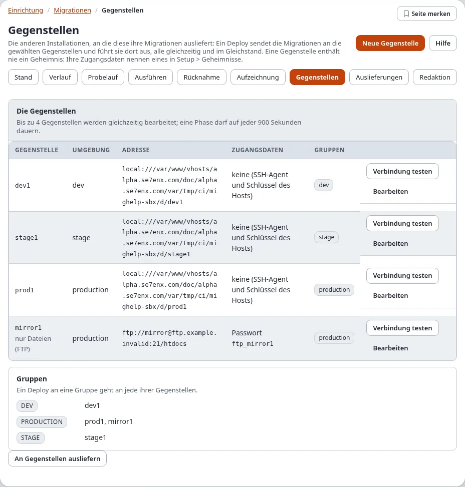
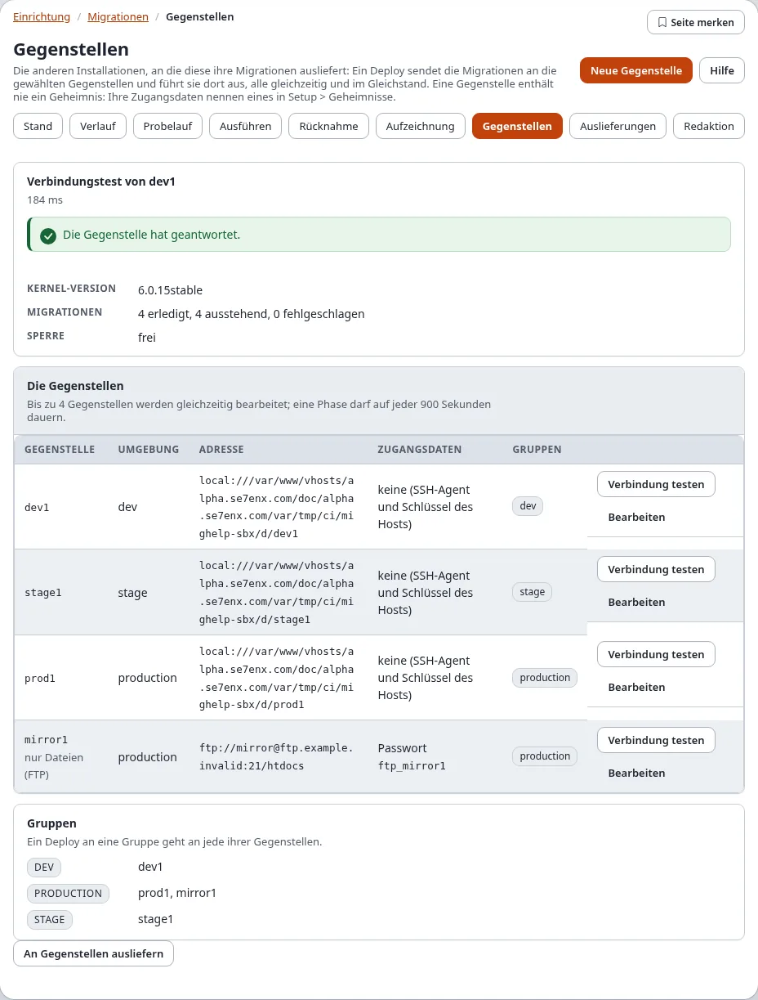
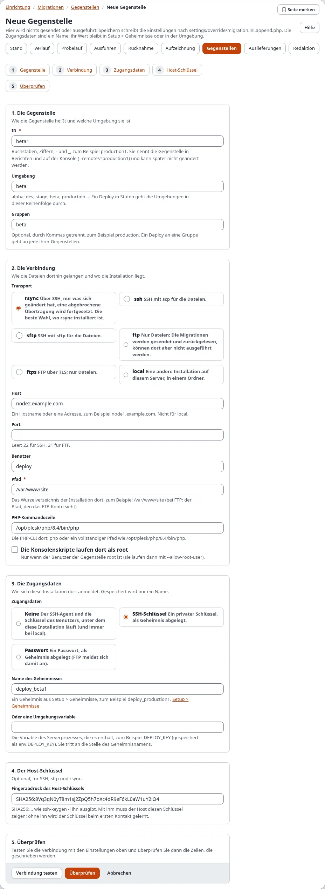
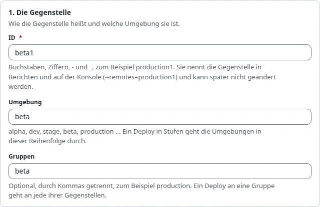
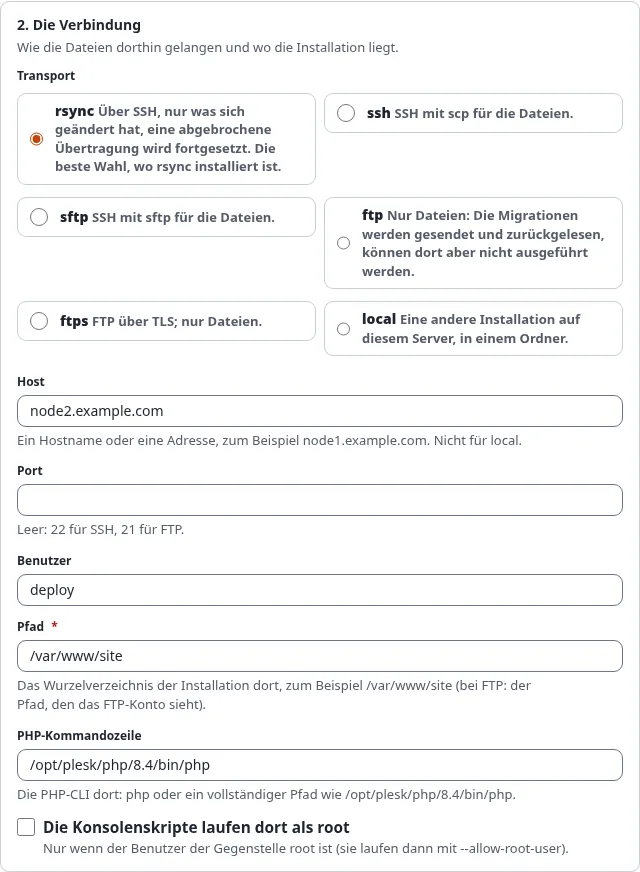
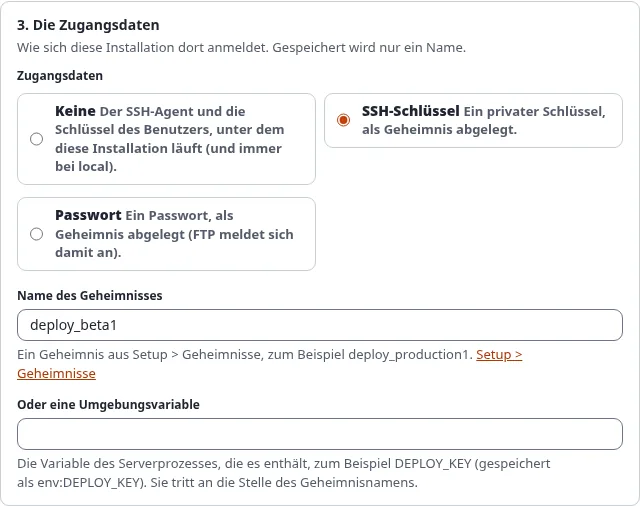
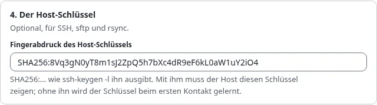
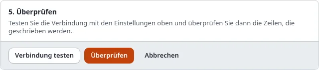
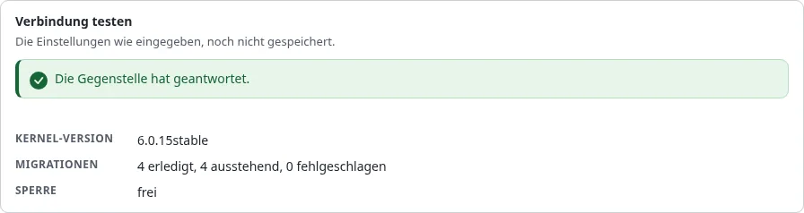
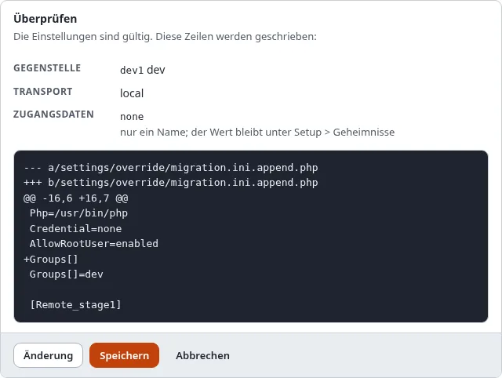

# Migrationen: eine Gegenstelle anlegen, Schritt für Schritt

Eine **Gegenstelle** ist eine andere Installation derselben Site, an die diese Installation ihre Migrationen
ausliefert: ein Entwicklungsserver, ein Staging-Server, die Produktion, ein zweiter Produktionsknoten. Sie legen jede
einmal unter **Setup > Migrationen > Gegenstellen** an; danach muss eine Auslieferung sie nur noch ankreuzen
([Ausliefern, Schritt für Schritt](ausliefern-schritt-fuer-schritt.md)).

**Wer das darf:** Benutzer mit der Richtlinie `migration/remotes` (in einer neuen Installation Administrator).
Speichern und Entfernen einer Gegenstelle fragen nach [„Identität bestätigen“](../../anleitungen/identitaet-bestaetigen.md).
Die Liste ist mit `migration/read` sichtbar.

## Inhalt

1. [Bevor Sie beginnen](#bevor-sie-beginnen)
2. [Die Liste der Gegenstellen](#die-liste-der-gegenstellen)
3. [Schritt 1: die Gegenstelle](#schritt-1-die-gegenstelle)
4. [Schritt 2: die Verbindung](#schritt-2-die-verbindung)
5. [Schritt 3: die Zugangsdaten](#schritt-3-die-zugangsdaten)
6. [Schritt 4: der Host-Schlüssel](#schritt-4-der-host-schlüssel)
7. [Schritt 5: testen, überprüfen und speichern](#schritt-5-testen-überprüfen-und-speichern)
8. [Eine Gegenstelle bearbeiten oder entfernen](#eine-gegenstelle-bearbeiten-oder-entfernen)
9. [Hosts nur mit FTP und der Trigger](#hosts-nur-mit-ftp-und-der-trigger)
10. [Selbstheilung](#selbstheilung)
11. [Wenn etwas schiefgeht](#wenn-etwas-schiefgeht)
12. [Verwandte Seiten](#verwandte-seiten)

## Bevor Sie beginnen

Halten Sie für den Host bereit:

- **Die Installation dort**: dieselbe Site, auf derselben Kernel-Version, mit ihren Migrationstabellen
  (`./console exp:upgrade --apply` dort) und eingeschalteten Sicherungspunkten (`migration.ini [CaptionSettings]`),
  damit eine gescheiterte Auslieferung zurückgenommen werden kann.
- **Wie sie erreichbar ist**: Hostname, Port, Benutzer, der Pfad der Installation und die PHP-Kommandozeile dort
  (zum Beispiel `/opt/plesk/php/8.4/bin/php`).
- **Die Zugangsdaten als Geheimnis**: ein privater SSH-Schlüssel oder ein Passwort, gespeichert unter **Setup >
  Secrets** mit einem Namen wie `deploy_production1` (oder eine Umgebungsvariable des Serverprozesses). Die
  Einstellungen der Gegenstelle enthalten immer nur diesen Namen. Für einen SSH-Schlüssel gehört sein öffentlicher
  Schlüssel in `~/.ssh/authorized_keys` des Benutzers dort.
- **Wahlweise den Fingerabdruck des Host-Schlüssels**: auf der Gegenstelle gibt
  `ssh-keygen -l -E sha256 -f /etc/ssh/ssh_host_ed25519_key.pub` `SHA256:...` aus.

## Die Liste der Gegenstellen

Öffnen Sie **Setup > Migrationen** und wählen Sie den Reiter **Gegenstellen** (`/migration/remotes`).



| Spalte | Zeigt |
|---|---|
| **Gegenstelle** | ihre ID; **nur Dateien (FTP)** für eine FTP-Gegenstelle ohne Trigger; **Einstellungen zu korrigieren** mit dem Fehler |
| **Umgebung** | dev, stage, production ...; eine Auslieferung in Stufen geht in dieser Reihenfolge durch |
| **Adresse** | `transport://benutzer@host:port/pfad` |
| **Zugangsdaten** | die Art und der Name des Geheimnisses, nie ein Wert |
| **Gruppen** | die Gruppen, zu denen sie gehört; **Gruppen** darunter listet jede Gruppe mit ihren Gegenstellen |

Jede Zeile hat **Verbindung testen** und **Bearbeiten**. **Verbindung testen** erreicht die Gegenstelle einmal und
ändert nichts; die Antwort steht oben auf der Seite: die Kernel-Version dort, wie viele Migrationen erledigt,
ausstehend und fehlgeschlagen sind und ob ein Lauf ihre Sperre hält.



Drücken Sie **Neue Gegenstelle** (oben rechts), um den Assistenten zu starten. Er ist eine Seite mit fünf Schritten;
die ganze Seite:



## Schritt 1: die Gegenstelle



1. **Gegenstelle**: die ID, Buchstaben, Ziffern, `-` und `_`, zum Beispiel `production1`. Sie benennt die Gegenstelle
   in Berichten und auf der Konsole (`--remotes=production1`) und lässt sich später nicht ändern.
2. **Umgebung**: `alpha`, `dev`, `stage`, `beta`, `production` ... Eine Auslieferung in Stufen geht die Umgebungen in
   der Reihenfolge von `[RemoteSettings] StageOrder[]` durch.
3. **Gruppen** (optional): Namen, durch Kommas getrennt, zum Beispiel `production`. Eine Auslieferung an eine Gruppe
   geht an jede ihrer Gegenstellen.

## Schritt 2: die Verbindung



1. **Transport**, wie die Dateien hinkommen:

   | Auswahl | Wann |
   |---|---|
   | **rsync** | die Gegenstelle hat rsync: über SSH, nur Geändertes, eine abgebrochene Übertragung wird fortgesetzt. Die beste Wahl |
   | **ssh** | SSH mit scp für die Dateien |
   | **sftp** | SSH mit sftp für die Dateien |
   | **ftp** | nur Dateien: die Migrationen werden gesendet und zurückgelesen, aber dort nicht ausgeführt (außer mit dem Trigger) |
   | **ftps** | FTP über TLS; nur Dateien |
   | **local** | eine andere Installation auf diesem Server, in einem Ordner |

2. **Host**: ein Hostname oder eine Adresse (nicht für local). **Port**: leer heißt 22 für SSH, 21 für FTP.
   **Benutzer**: das Konto dort.
3. **Pfad**: das Wurzelverzeichnis der Installation dort, zum Beispiel `/var/www/site` (für FTP der Pfad, den das
   FTP-Konto sieht).
4. **PHP-Kommandozeile**: `php` oder ein vollständiger Pfad.
5. **Die Konsolenskripte laufen dort als root**: nur ankreuzen, wenn der Benutzer dort root ist (die Skripte laufen
   dann mit `--allow-root-user`).

## Schritt 3: die Zugangsdaten



1. Wählen Sie die Art:
   - **Keine**: der SSH-Agent und die Schlüssel des Benutzers, unter dem diese Installation läuft (für local immer).
   - **SSH-Schlüssel**: ein privater Schlüssel, als Geheimnis gespeichert.
   - **Passwort**: ein Passwort, als Geheimnis gespeichert (FTP meldet sich damit an).
2. Geben Sie den **Name des Geheimnisses** so ein, wie er unter **Setup > Secrets** steht (der Link öffnet es), oder
   **Oder eine Umgebungsvariable**: die Variable des Serverprozesses (gespeichert als `env:VARIABLE`).

Gespeichert wird nur der Name. Ein Passwort oder Schlüssel, der irgendwo ins Formular getippt wird, wird nie
geschrieben.

## Schritt 4: der Host-Schlüssel



Optional, für SSH, sftp und rsync: Fügen Sie den **Fingerabdruck des Host-Schlüssels** (`SHA256:...`) ein. Mit ihm
muss der Host genau diesen Schlüssel zeigen; ohne ihn wird der Schlüssel beim ersten Kontakt gelernt.

## Schritt 5: testen, überprüfen und speichern



1. Drücken Sie **Verbindung testen**. Die Einstellungen werden so versucht, wie sie eingegeben sind, noch ohne zu
   speichern, und die Antwort steht über dem Formular:

   

2. Drücken Sie **Überprüfen**. Die Einstellungen werden geprüft, und die Zeilen, die in
   `settings/override/migration.ini.append.php` geschrieben werden, erscheinen als Unterschied:

   

3. Drücken Sie **Speichern** (oder **Ändern**, um zum Formular zurückzukehren, **Abbrechen**, um es zu verlassen).
   Bestätigen Sie „Identität bestätigen“. Die Zeilen werden geschrieben, eine Sicherung der Datei bleibt, die Änderung
   wird als `system.migration.remote` protokolliert, und die Liste der Gegenstellen öffnet sich mit der neuen.

Die Gegenstelle lässt sich jetzt auf der Seite Auslieferungen wählen. Drücken Sie in der Liste noch einmal
**Verbindung testen**, um sie von dort aus zu sehen.

## Eine Gegenstelle bearbeiten oder entfernen

- **Bearbeiten** in der Liste öffnet denselben Assistenten mit den Einstellungen der Gegenstelle (die ID lässt sich
  nicht ändern). Ändern Sie, was nötig ist, **Überprüfen**, **Speichern**. Einstellungen, die der Assistent nicht
  zeigt (`Trigger`, `TriggerSecret`), bleiben erhalten.
- **Diese Gegenstelle entfernen**, unten im Assistenten einer vorhandenen Gegenstelle: Kreuzen Sie **Ja, diese
  Gegenstelle entfernen** an und drücken Sie **Entfernen** (Identität bestätigen). Ihre Einstellungen werden aus der
  Override-Datei genommen. Auf der Gegenstelle ändert sich nichts, und ihre Auslieferungen bleiben im Verlauf.


## Hosts nur mit FTP und der Trigger

Ein Host, der nur per FTP erreichbar ist, kann keine Befehle ausführen; eine Auslieferung kann die Dateien dort also
nur senden (**Nur übertragen**). Bietet die Installation dort den signierten HTTP-Trigger, wird sie wie jede andere
Gegenstelle beliefert. Einzurichten in `settings/override/migration.ini.append.php`:

Auf der **Gegenstelle** (dem FTP-Host):

```ini
[TriggerSettings]
Trigger=enabled
Secret=migration_trigger
AllowedAddresses[]
AllowedAddresses[]=203.0.113.10
Php=/usr/bin/php8.4
```

Auf **dieser Installation**, im Abschnitt der Gegenstelle (nach dem Speichern mit dem Assistenten):

```ini
[Remote_webspace]
Trigger=https://www.example.com/migration/trigger
TriggerSecret=migration_trigger
```

Beide Geheimnisse benennen denselben Wert (mindestens 16 Zeichen), auf jeder Seite unter Setup > Secrets gespeichert.
Verbindung testen liest dann den Migrationsstand der Gegenstelle über den Trigger. Einzelheiten und jede Antwort des
Triggers: [FTP-Gegenstellen mit dem HTTP-Trigger](../../anleitungen/migrationen-remote-deploy.md#ftp-gegenstellen-mit-dem-http-trigger).

## Selbstheilung

Eine Auslieferung kann kleine Probleme auf einer Gegenstelle selbst beheben, jedes nur, wenn es in
`[RemoteSettings] SelfHeal[]` dieser Installation steht:

| Korrektur | Was sie tut |
|---|---|
| `stale-lock` | entfernt eine Laufsperre, deren Prozess beendet ist (älter als `StaleLockAge`, 7200 Sekunden) |
| `paths` | legt einen fehlenden Migrationsordner an |
| `modes` | ergänzt fehlende Dateirechte an den Migrationsordnern |
| `caches` | leert dort nach dem Lauf die INI- und Template-Override-Caches |

```ini
[RemoteSettings]
SelfHeal[]
SelfHeal[]=stale-lock
SelfHeal[]=paths
SelfHeal[]=caches
```

Jede vorgenommene Korrektur steht auf der Seite des Deploys unter der Gegenstelle („heal caches: cleared the caches
tagged ini“). Abweichende PHP- oder Erweiterungsversionen werden nie korrigiert, nur gemeldet.

## Wenn etwas schiefgeht

| Was Sie sehen | Warum, und was zu tun ist |
|---|---|
| **Einstellungen zu korrigieren** in der Liste | der Abschnitt der Gegenstelle ist unvollständig oder hat einen Wert, den der Assistent ablehnt; **Bearbeiten** und **Überprüfen** |
| „the secret ... is not set“ | der Name des Geheimnisses hat auf dieser Installation unter Setup > Secrets keinen Wert; legen Sie ihn dort an |
| Verbindung testen: `not reachable or no migration status (exit 255)` | SSH konnte nicht verbinden oder sich nicht anmelden: Host, Port, Benutzer, Schlüssel oder `authorized_keys` dort |
| `Permission denied (publickey)` | der öffentliche Schlüssel steht nicht in `authorized_keys` des Benutzers dort |
| `the host key ... does not have the fingerprint` | der Fingerabdruck passt nicht; prüfen Sie ihn auf der Gegenstelle |
| `an FTP remote cannot run the migrations` | mit **Nur übertragen** ausliefern oder den Trigger einrichten |
| Verbindung testen mit `"status":403` oder `401` | der Trigger hat abgelehnt: die Adresse steht nicht in `AllowedAddresses[]`, die Geheimnisse weichen ab, oder die Uhren liegen mehr als `Lifetime` auseinander |
| **Neue Gegenstelle** fehlt | Ihnen fehlt `migration/remotes` |

Mehr: [Fehlerbehebung](../../anleitungen/migrationen-remote-deploy.md#fehlerbehebung).

## Verwandte Seiten

- [Ausliefern, Schritt für Schritt](ausliefern-schritt-fuer-schritt.md), [Gegenstellen und Deploys](gegenstellen-und-deploys.md)
- [Migrationen: an entfernte Installationen ausliefern](../../anleitungen/migrationen-remote-deploy.md)
- [Ein Rundgang durch Setup > Migrationen](rundgang-durch-setup-migrationen.md), [Einstellungen](einstellungen.md)
