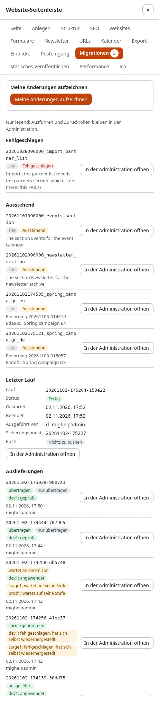

# Migrationen in der Website-Seitenleiste

Die Website-Seitenleiste (die Erweiterung expwt) hat ein Panel **Migrationen**: der Stand der Migrationen der
Installation auf jeder Seite der Site, ohne in die Administration zu wechseln. Ausführen, Fortsetzen, Zurücknehmen und
Ausliefern bleiben in **Setup > Migrationen** ([Ausführen, Probelauf und Rücknahme](ausfuehren-probelauf-und-rueckgaengig.md),
[Ausliefern, Schritt für Schritt](ausliefern-schritt-fuer-schritt.md)); das Einzige, was das Panel startet, ist eine
Aufzeichnung Ihrer eigenen Änderungen.

**Wer das Panel sieht:** Benutzer, die die Seitenleiste nutzen dürfen (`expwt/use`) und `migration/read` haben. Ohne
diese Richtlinie oder auf einem Kernel ohne Migrationen gibt es keinen Reiter Migrationen.

## Das Panel öffnen

1. Melden Sie sich an und öffnen Sie eine beliebige Seite der Site.
2. Öffnen Sie die Website-Seitenleiste und wählen Sie den Reiter **Migrationen**. Die Zahl am Reiter zählt die
   ausstehenden, fehlgeschlagenen und ohne Datei aufgezeichneten Migrationen.
3. **In der Administration öffnen** neben einem Eintrag öffnet seine Seite in Setup > Migrationen.

## Die eigenen Änderungen aus der Seitenleiste aufzeichnen

Mit `migration/edit` beginnt das Panel mit **Meine Änderungen aufzeichnen**. Drücken Sie es, machen Sie Ihre
Änderungen auf der Site (mit den Bearbeitungswerkzeugen der Seitenleiste oder in der Administration) und drücken Sie
dann im Panel **Aufzeichnung beenden**. Solange sie läuft, sagt das Panel, dass Ihre Änderungen für eine Migration
aufgezeichnet werden; ist ein Fenster für die ganze Website offen, sagt es, dass jede Änderung aufgezeichnet wird.
Erzeugen Sie die Migration aus der Aufzeichnung in der Administration
([Änderungen aufzeichnen](aufzeichnung.md#die-migration-erzeugen)).

## Was das Panel zeigt

- **Einen gerade aktiven Lauf**: die Sperre der Installation, was er tut, wer ihn gestartet hat und seit wann;
- die **fehlgeschlagenen** Migrationen, jede mit Quelle und Beschreibung;
- die **ausstehenden** Migrationen (Kennung, Quelle, Beschreibung; die ersten 50, der Rest gezählt);
- die Migrationen, die **aufgezeichnet sind, deren Datei aber fehlt** (die verwaisten des Stands);
- den **letzten Lauf**: seinen Stand, wann er begann und endete, wer ihn ausgeführt hat, seinen Sicherungspunkt, Tag
  und Push-Stand und die Meldung eines fehlgeschlagenen Laufs;
- die **Auslieferungen**: die letzten Deploys an Gegenstellen, jeder mit seinem Stand (ausgeliefert, übertragen,
  wartet an einem Tor, zurückgenommen ...), jede Gegenstelle mit ihrem Stand, wann und von wem; **In der
  Administration öffnen** öffnet die Seite des Deploys, auf der ein Tor freigegeben wird
  ([Ausliefern, Schritt für Schritt](ausliefern-schritt-fuer-schritt.md)).

Jeder Eintrag hat **In der Administration öffnen**: den Stand oder die Seite seines Laufs
([Stand und Verlauf](status-und-verlauf.md)).

Die Zahl der ausstehenden, fehlgeschlagenen und ohne Datei aufgezeichneten Migrationen steht als Zähler am Reiter des
Panels und wird höchstens einmal pro Minute ermittelt.

## Verwandte Seiten

- [Migrationen: der Einstieg](README.md), [Alle Rezepte](rezepte/README.md), [Häufige Fragen](faq.md)
- [Die Anleitung](../../anleitungen/migrationen.md), [das Tutorial](../../anleitungen/migrationen-tutorial.md),
  [PHP-Migrationen](../../anleitungen/migrationen-php.md),
  [Zurücknehmen und Sicherungspunkte](../../anleitungen/migrationen-rueckgaengig-und-captions.md),
  [Das Migrations-Repository](../../anleitungen/migrationen-repositories.md)
- [In der Administration](in-der-administration.md), [Befehle](befehle.md), [Einstellungen](einstellungen.md),
  [Richtlinien, Ansichten und Ereignisse](richtlinien-ansichten-und-ereignisse.md)
- [Das Dateiformat](../../spezifikationen/6.0/migrationsdateiformat.md),
  [Die Funktion](../../funktionen/6.0/migrationen.md)
- [Wenn eine Migration scheitert](wenn-eine-migration-scheitert.md),
  [Fehlermeldungen](../../anleitungen/migrationen-fehlerbehebung.md)
- [Migrationen oder Umzug einer Site](migrationen-oder-umzug-einer-site.md)
- [Stand und Verlauf](status-und-verlauf.md)
- [Die Website-Seitenleiste](../../funktionen/6.0/website-seitenleiste.md)
