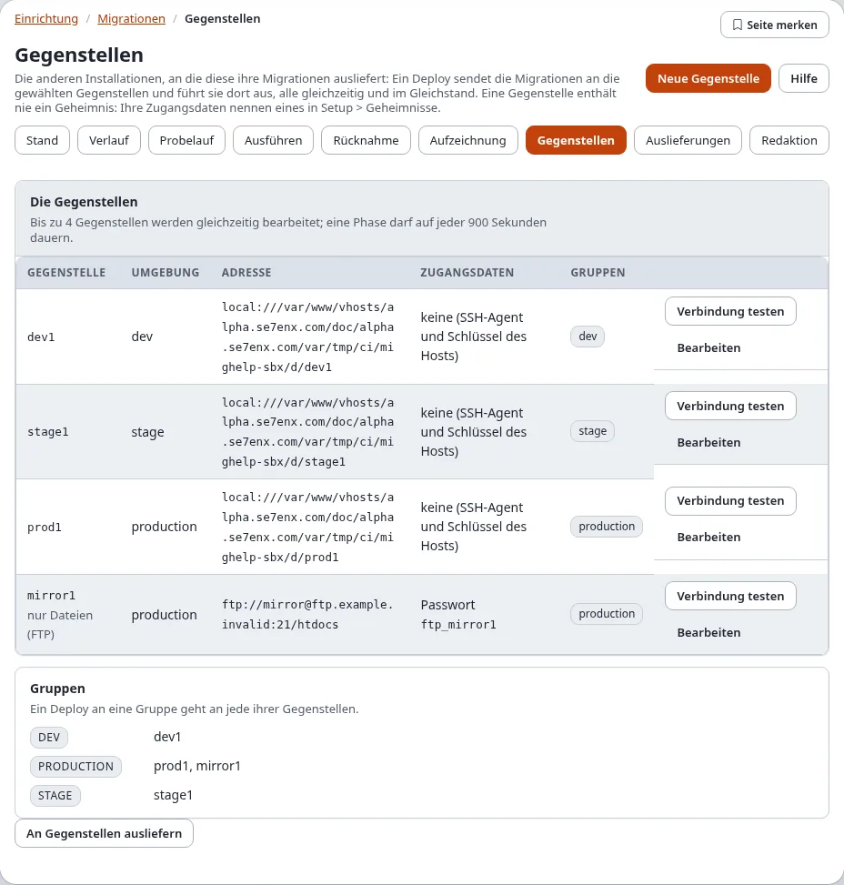
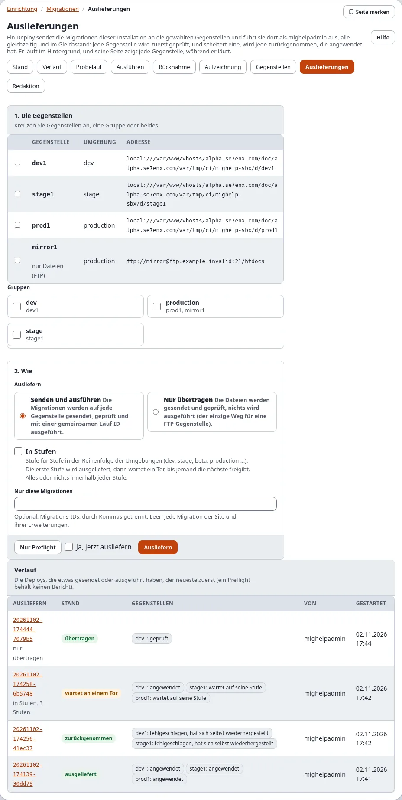

# Migrationen: Gegenstellen und Deploys

Eine **Gegenstelle** ist eine andere Installation derselben Site (dev, stage, beta, production ...), an die diese
Installation ihre Migrationen sendet. Ein **Deploy** sendet die Migrationen an die gewählten Gegenstellen und führt sie
dort aus, alle gleichzeitig und im Gleichstand: Jede Gegenstelle endet im selben Migrationsstand, oder keine ändert
sich. Die Seiten sind **Setup > Migrationen > Gegenstellen** und **Setup > Migrationen > Auslieferungen**; auf der Konsole
leistet `exp:migration:deploy` dasselbe (siehe [Remote-Deploy](../../anleitungen/migrationen-remote-deploy.md), das
auch jede Phase im Einzelnen erklärt).

Diese Seite ist das Nachschlagewerk. Dasselbe mit nummerierten Schritten und einem Bildschirmfoto jedes Bildschirms:
[Eine Gegenstelle anlegen, Schritt für Schritt](eine-gegenstelle-anlegen-schritt-fuer-schritt.md) und
[Ausliefern, Schritt für Schritt](ausliefern-schritt-fuer-schritt.md).

## Gegenstellen

**Gegenstellen** listet jede Gegenstelle aus `migration.ini [RemoteSettings] RemoteList[]` mit ihrer Umgebung, ihrer
Adresse (`transport://user@host:port/pfad`), ihren Zugangsdaten (die Art und der Name eines Geheimnisses, nie ein Wert)
und ihren Gruppen. Eine Gegenstelle mit falschen Einstellungen ist mit **Einstellungen zu korrigieren** markiert, samt
dem, was falsch ist.

**Verbindung testen** erreicht die Gegenstelle einmal und ändert nichts: Bei SSH, sftp, rsync und local liest es den
Migrationsstand der Gegenstelle (ihre Kernel-Version, wie viele Migrationen erledigt, ausstehend und gescheitert sind,
ob ein Lauf ihre Sperre hält); bei FTP meldet es sich an und liest `index.php` zurück, weil der Migrationsstand einer
FTP-Gegenstelle nicht gelesen werden kann (eine FTP-Gegenstelle mit dem HTTP-Trigger wird wie eine SSH-Gegenstelle
gelesen). Der Trigger (`Trigger`, `TriggerSecret`) wird in `settings/override/migration.ini.append.php` gesetzt; der
Assistent behält ihn beim Speichern der Gegenstelle. Siehe die Anleitung
[Migrationen: Deploy auf entfernte Installationen](../../anleitungen/migrationen-remote-deploy.md), „FTP-Gegenstellen
mit dem HTTP-Trigger“.

### Der Assistent

**Neue Gegenstelle** (oder **Bearbeiten** an einer Gegenstelle) öffnet den Assistenten, in fünf Schritten auf einer
Seite:

| Schritt | Was Sie eingeben |
|---|---|
| 1. Die Gegenstelle | ihre **ID** (Buchstaben, Ziffern, `-` und `_`; sie kann später nicht geändert werden), ihre **Umgebung** (alpha, dev, stage, beta, production ...) und optional **Gruppen**, durch Kommas getrennt |
| 2. Die Verbindung | die **Übertragung** (rsync, ssh mit scp, sftp, ftp, ftps, local), den **Host**, den **Port** (leer: 22 für SSH, 21 für FTP), den **Benutzer**, den **Pfad** der Installation dort, die **PHP-Kommandozeile** dort und ob ihre Konsolenskripte als root laufen |
| 3. Die Zugangsdaten | **Keine** (der SSH-Agent und die Schlüssel des Benutzers, unter dem diese Installation läuft), ein **SSH-Schlüssel** oder ein **Passwort**, als Name eines Geheimnisses in **Setup > Geheimnisse** oder als Umgebungsvariable (gespeichert als `env:VARIABLE`) |
| 4. Der Host-Schlüssel | optional: der Fingerabdruck (`SHA256:...`), den der Host zeigen muss; ohne ihn wird der Schlüssel beim ersten Kontakt gelernt |
| 5. Überprüfen | **Verbindung testen** probiert die Einstellungen wie eingegeben, ohne sie zu speichern; **Überprüfen** prüft sie und zeigt die Zeilen, die geschrieben werden |

**Speichern** schreibt die Zeilen nach `settings/override/migration.ini.append.php` (eine Sicherung der Datei wird
behalten, die Änderung wird als `system.migration.remote` protokolliert) und fragt **Identität bestätigen**. Ein
Geheimnis wird nie geschrieben: Ein Passwort oder Schlüssel, der irgendwo ins Formular getippt wird, wird nicht
behalten. **Diese Gegenstelle entfernen** nimmt ihre Einstellungen wieder aus dem Override (kreuzen Sie „Ja, diese
Gegenstelle entfernen“ an; ebenfalls mit Identität bestätigen); auf der Gegenstelle ändert sich nichts, und ihre Deploys
bleiben im Verlauf.

## Deploys

**Auslieferungen** hat das Formular, das einen Deploy startet, und darunter den **Verlauf**: jeden Deploy, der etwas gesendet
oder ausgeführt hat, den neuesten zuerst, mit seinem Stand, dem Stand jeder Gegenstelle, wer ihn gestartet hat und wann.

1. **Die Gegenstellen**: Kreuzen Sie Gegenstellen einzeln an, eine Gruppe (jede ihrer Gegenstellen) oder beides.
2. **Wie**:
   - **Senden und ausführen**: Die Migrationen werden auf jede Gegenstelle gesendet, geprüft und mit einer gemeinsamen
     Lauf-ID ausgeführt.
   - **Nur übertragen**: Die Dateien werden gesendet und geprüft, nichts wird ausgeführt (der einzige Weg für eine
     FTP-Gegenstelle ohne HTTP-Trigger).
   Die Korrekturen aus `[RemoteSettings] SelfHeal[]` (eine verwaiste Laufsperre, fehlende Ordner, Dateirechte, Caches)
   werden dabei auf jeder Gegenstelle vorgenommen, und die Seite des Deploys führt sie unter der Gegenstelle auf.
   - **In Stufen**: Stufe für Stufe, siehe unten.
   - **Nur diese Migrationen**: optional Migrations-IDs; leer heißt jede Migration der Site und ihrer Erweiterungen.

**Nur Preflight** startet einen Probelauf: Jede Gegenstelle wird geprüft (erreichbar, ihre Sperre frei, dort nichts
gescheitert, dieselbe Kernel-Version, keine Migration nach dem Anwenden geändert) und die zu sendenden Dateien werden
geplant; nichts wird gesendet oder geändert, und kein Bericht wird behalten. **Ausliefern** (kreuzen Sie „Ja, jetzt
ausliefern“ an) startet den Deploy und fragt **Identität bestätigen**.

Beide laufen im Hintergrund unter Ihrem Benutzer und öffnen die Seite des Deploys. Es läuft immer nur ein Lauf oder
Deploy, der in der Administration gestartet wurde.

### Die Seite eines Deploys

Während der Deploy läuft, zeigt seine Seite die Phase (Einstellungen prüfen, Preflight, senden, prüfen, ausführen) und
für jede Gegenstelle eine Zeile, die sich ändert, wie sich die Gegenstelle ändert: ausgewählt, bereit, Dateien
gesendet, geprüft, angewendet. Die Seite kann geschlossen werden: Der Deploy läuft weiter, und wenn Sie die Seite wieder
öffnen, verfolgt sie ihn wieder.

Wenn er beendet ist, zeigt die Seite den **Bericht**: den Stand des Deploys, ob die Gegenstellen **im Gleichstand**
sind, und für jede Gegenstelle ihre Stufe, ihren Stand mit jedem Problem, die Zahl der gesendeten Dateien, die
angewendeten (oder noch anzuwendenden) Migrationen und den Sicherungspunkt vor ihrem Lauf; darunter die Phasen mit ihren
Zeiten.

| Stand des Deploys | Bedeutung |
|---|---|
| geplant | ein Preflight: nichts wurde gesendet |
| übertragen | Nur übertragen: Die Dateien sind dort, nichts lief |
| ausgeliefert | jede Gegenstelle hat angewendet |
| wartet an einem Tor | ein Deploy in Stufen: Die Stufen bis hier sind ausgeliefert, die nächste wartet auf Freigabe |
| zurückgenommen | eine Gegenstelle ist gescheitert; jede, die angewendet hat, wurde zu ihrem Sicherungspunkt zurückgenommen |
| nicht im Gleichstand | eine Gegenstelle ist gescheitert, und nicht jede konnte zurückgenommen werden: Der Bericht listet den Stand jeder Gegenstelle |
| fehlgeschlagen, abgelehnt | die Übertragung oder die Prüfung ist fehlgeschlagen, oder eine Gegenstelle konnte nicht verwendet werden; keine wurde umgeschaltet |

### Deploys in Stufen und Tore

Mit **In Stufen** werden die Gegenstellen nach ihrer Umgebung in Stufen eingeteilt, in der Reihenfolge von
`[RemoteSettings] StageOrder[]` (alpha, dev, test, stage, beta, production, post, arch; eine Umgebung, die nicht
aufgeführt ist, kommt zuletzt). Der Preflight läuft trotzdem zuerst auf jeder Gegenstelle, sodass ein Problem irgendwo
den Deploy anhält, bevor sich etwas ändert. Dann wird die erste Stufe gesendet, geprüft und ausgeführt, alles oder
nichts innerhalb der Stufe, und der Deploy **wartet an einem Tor**.

Prüfen Sie die ausgelieferte Stufe. Dann nennt auf der Seite des Deploys **Tor: Stufe 2 von 3** die Gegenstellen der
nächsten Stufe: Kreuzen Sie „Ja, die nächste Stufe jetzt ausliefern“ an und **Freigeben** (Identität bestätigen). Die
nächste Stufe wird erneut geprüft und genauso ausgeliefert, bis zur letzten; wer jedes Tor freigegeben hat und wann,
steht im Bericht.

Scheitert eine spätere Stufe, wird sie zurückgenommen; die Stufen davor bleiben ausgeliefert, und der Bericht sagt,
dass die Gegenstellen nicht im Gleichstand sind. Nehmen Sie den Deploy zurück (unten), um auch diese zurückzunehmen,
oder beheben Sie das Problem und liefern Sie erneut aus.

### Einen Deploy zurücknehmen

Ein Deploy, den Gegenstellen angewendet haben, zeigt **Diesen Deploy zurücknehmen**: Jede Gegenstelle, die ihn
angewendet hat, kehrt zum Sicherungspunkt vor ihrem Lauf zurück, alle gleichzeitig (kreuzen Sie „Ja, diesen Deploy
jetzt zurücknehmen“ an, **Zurücknehmen**, Identität bestätigen). Eine Gegenstelle, die nicht zurückgenommen werden
kann, wird gemeldet, und der Deploy wird mit dem Stand jeder Gegenstelle als nicht im Gleichstand markiert.

## Hinweise per E-Mail

Ein Deploy, der scheitert (abgelehnt, gescheitert, zurückgenommen, nicht im Gleichstand), und ein Deploy in Stufen, der
an einem Tor wartet, senden einen Hinweis per E-Mail an `[RemoteSettings] NotifyEmail` (leer: die
Administratoradresse aus site.ini). `Notify[]` nennt die Arten: `failure`, `gate` und `success` (voreingestellt sind
die ersten beiden). Der Hinweis ist reiner Text: der Deploy, sein Ergebnis, jede Gegenstelle mit ihrem Stand und ihren
Problemen und die Adresse der Seite des Deploys.

## Wer was darf

| Richtlinie | Erlaubt |
|---|---|
| `migration/read` | die Seiten Gegenstellen und Auslieferungen, die Seite eines Deploys und seinen Bericht |
| `migration/remotes` | Gegenstellen anlegen, ändern und entfernen, Verbindung testen |
| `migration/deploy` | Preflight, Deploy, ein Tor freigeben, einen Deploy zurücknehmen |

Eine Gegenstelle speichern und entfernen, ein Deploy, ein Tor freigeben und einen Deploy zurücknehmen fragen
**Identität bestätigen**; die Listen, Verbindung testen und der Preflight nie. In einer neuen Installation hat nur
Administrator die Richtlinien.

## Die Aufzeichnung

Jeder Deploy, der etwas sendet oder ausführt, behält seinen Bericht in
`var/<site>/migration/deploy/reports/<Deploy-ID>.json` und, sobald der Aktualisierungsschritt
`6.0.15-migration-deploy-tables` gelaufen ist, eine Zeile in `exp_migration_deploy` mit einer Zeile je Gegenstelle in
`exp_migration_deploy_host`. Das Audit-Protokoll hat `system.migration.deploy`, `system.migration.deploy.rollback` und
`system.migration.remote`.

## Verwandte Seiten

- [Remote-Deploy](../../anleitungen/migrationen-remote-deploy.md): die Einstellungen, die Übertragungen, jede Phase, die Konsole
- [Migrationen in der Administration](in-der-administration.md)
- [Ausführen, Probelauf und Rücknahme](ausfuehren-probelauf-und-rueckgaengig.md): dasselbe auf dieser Installation
- [Wenn eine Migration scheitert](wenn-eine-migration-scheitert.md)
