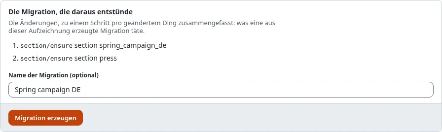
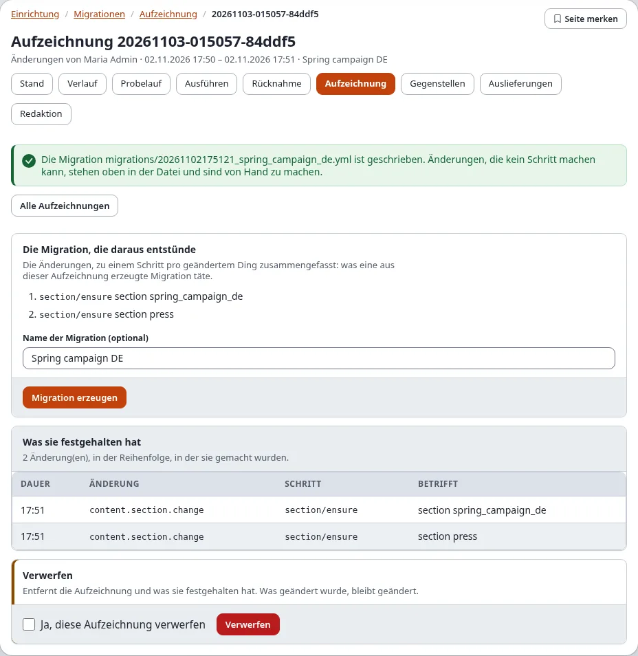

# Migrationen: Migrationen erzeugen

Eine Migration muss nicht von Hand geschrieben werden. Diese Seite nennt jeden Weg zu einer, welche davon in der
Administration und welche auf der Konsole gehen, und was danach mit der Datei geschieht. Die Optionen im Einzelnen
stehen in der Anleitung [Migrationen: erzeugen und Änderungen aufzeichnen](../../anleitungen/migrationen-erzeugen-und-aufzeichnen.md).

| Quelle | Wo | Am besten für |
|---|---|---|
| Eine Aufzeichnung von Hand gemachter Änderungen | Administration (**Aufzeichnung**) und Konsole | Änderungen in der Administration, die anderswo wiederholt werden sollen |
| Formulare der Schritttypen | Administration (**Redaktion**) | eine kurze Migration aus wenigen Schritten, ohne Shell |
| Was jetzt da ist (Inhalte, Klassen, Rollen, Sektionen, Einstellungen) | Konsole | eine Klasse, eine Rolle oder einen Teilbaum auf eine andere Installation bringen |
| Der Unterschied zu einem Sicherungspunkt, einem Dump oder einer anderen Installation | Konsole | alles seit einem bekannten Stand Geänderte, wenn keine Aufzeichnung lief |
| Ein Gerüst | Konsole | eine PHP-, YAML-, INI- oder SQL-Migration zum Ausfüllen |

## Inhalt

1. [Aus einer Aufzeichnung](#aus-einer-aufzeichnung)
2. [Im Editor](#im-editor)
3. [Aus dem, was da ist](#aus-dem-was-da-ist)
4. [Aus einem Unterschied](#aus-einem-unterschied)
5. [Gerüste](#gerüste)
6. [Nach dem Erzeugen](#nach-dem-erzeugen)
7. [Verwandte Seiten](#verwandte-seiten)

## Aus einer Aufzeichnung

1. Zeichnen Sie die Änderungen auf ([Änderungen aufzeichnen](aufzeichnung.md)) und beenden Sie die Aufzeichnung.
2. Öffnen Sie die Aufzeichnung (**Setup > Migrationen > Aufzeichnung**, dann die Aufzeichnung unter **Aufzeichnungen**).
3. Prüfen Sie **Die Migration, die daraus entstünde**: ein Schritt je geänderter Sache.
4. Geben Sie einen **Name der Migration (optional)** ein (sonst gilt die Bezeichnung der Aufzeichnung).
5. Drücken Sie **Migration erzeugen**. Die Seite nennt die geschriebene Datei, `migrations/<Zeit>_<Name>.yml`.





Auf der Konsole: `./console exp:migration:generate --from-recording=<Aufzeichnungs-ID> --apply`.

## Im Editor

**Setup > Migrationen > Redaktion** baut eine Migration Schritt für Schritt mit Formularen, prüft sie und speichert
sie: [Der Migrationseditor](der-migrationseditor.md).

## Aus dem, was da ist

`exp:migration:generate` schreibt eine Migration dessen, was diese Installation jetzt hat. Führen Sie es auf der
Installation aus, die die Änderung hat, und kopieren oder liefern Sie die Datei an die anderen aus. Ohne `--apply`
listet es nur, was es schreiben würde.

```text
$ ./console exp:migration:generate --from-class=news_article --from-role="News editor" --from-section=news news_setup --apply
```

| Option | Erzeugt |
|---|---|
| `--from-content=<Knoten>[,...]` | die Objekte der Knoten (`2`, `remote:<Remote-ID>`, `path:<URL-Pfad>`); `--depth=<n>` nimmt Ebenen darunter dazu, `--max-objects=<n>` hört nach so vielen auf (Vorgabe 500) |
| `--from-class=<Kennung>[,...]` | Inhaltsklassen mit ihren Attributen |
| `--from-role=<Name>[,...]` | Rollen mit ihren Richtlinien und Einschränkungen |
| `--from-section=<Kennung>[,...]` | Sektionen |
| `--from-settings=<Datei>[,...]` | die Einstellungen von `settings/override/<Datei>.append.php` (mit `--siteaccess=<Name>` die dieses Siteaccess) |

Die Schritte verwenden den Modus `ensure`, sodass die Migration auch dort läuft, wo ein Teil schon vorhanden ist.
Benutzer werden über Geheimnisse benannt, nie über Login oder E-Mail-Adresse, und geheime Einstellungen bleiben weg.

## Aus einem Unterschied

`--from-diff` vergleicht die Installation jetzt mit einem gespeicherten Stand und schreibt eine Migration dessen, was
sich geändert hat. Auf dem gespeicherten Stand ausgeführt, macht die Migration ihn dieser Installation gleich.

| `--from-diff=` | Der gespeicherte Stand |
|---|---|
| die ID eines Sicherungspunkts, zum Beispiel `20261102-101500` | ein Sicherungspunkt dieser Installation: sein Datenbank-Dump und seine Kopie von `settings/override`. `./console exp:migration:caption --list` listet sie; die Seite Rücknahme von Setup > Migrationen zeigt sie auch |
| eine Datei, zum Beispiel `var/backup/before.sqlite` | ein Datenbank-Dump desselben Schemas (SQLite, oder ein SQL-Dump der Engine dieser Installation) |
| eine Adresse, zum Beispiel `https://staging.example.com` | eine andere Installation, einmal über ihren REST-Snapshot gelesen (ein API-Schlüssel mit dem Bereich `migration:read`, benannt mit `--token=<Name des Geheimnisses>`) |

`--compare` wählt, was verglichen wird: `classes`, `roles`, `sections`, `states`, `languages`, `settings` (Vorgabe:
alles außer Inhalten) und `content` mit `--subtree=<Knoten>`.

```text
$ ./console exp:migration:generate --from-diff=20261102-101500 --compare=classes,roles,sections news_changes --apply
```

Ohne Unterschiede wird nichts geschrieben („no differences: nothing to generate“).

## Gerüste

`./console exp:migration:generate --skeleton <Name> --type=<Typ> --apply` schreibt eine leere Migration zum
Ausfüllen: `php` (die Vorgabe, eine Klasse mit `plan()`, `up()` und `down()`), `yml`, `graphql`, `ini` oder `sql`
(mit `--engine=<Engine>` für eine Datenbank-Engine).

## Nach dem Erzeugen

Gleich, woher sie kommt, eine erzeugte Migration ist eine Datei wie jede andere:

1. Lesen Sie sie. Oben steht, was nicht erzeugt werden konnte und von Hand zu tun ist (ein Tausch zweier Orte, ein
   Workflow-Auslöser, eine geheime Einstellung).
2. Öffnen Sie **Setup > Migrationen > Stand**: Sie steht dort als **ausstehend**. Oder führen Sie
   `./console exp:migration:check` aus.
3. Öffnen Sie **Probelauf**, um zu sehen, was sie hier ändern würde, dann **Ausführen**, wo sie gebraucht wird
   ([Ausführen, Probelauf und Rücknahme](ausfuehren-probelauf-und-rueckgaengig.md)). Auf der Installation, auf der die
   Änderung von Hand gemacht wurde, findet die Migration alles vor (Modus `ensure`).
4. Committen Sie sie mit der Site, oder liefern Sie sie an die Gegenstellen aus
   ([Ausliefern, Schritt für Schritt](ausliefern-schritt-fuer-schritt.md)).

## Verwandte Seiten

- [Migrationen: erzeugen und Änderungen aufzeichnen](../../anleitungen/migrationen-erzeugen-und-aufzeichnen.md) (jede Option)
- [Änderungen aufzeichnen](aufzeichnung.md), [Der Migrationseditor](der-migrationseditor.md)
- [Rücknahme und Sicherungspunkte](../../anleitungen/migrationen-rueckgaengig-und-captions.md), [Befehle](befehle.md)
- [Rezept: Inhalte für eine neue Site anlegen](rezepte/inhalte-fuer-eine-neue-site-anlegen.md),
  [Rezept: eine Inhaltsklasse anlegen oder ändern](rezepte/eine-inhaltsklasse-anlegen-oder-aendern.md)
