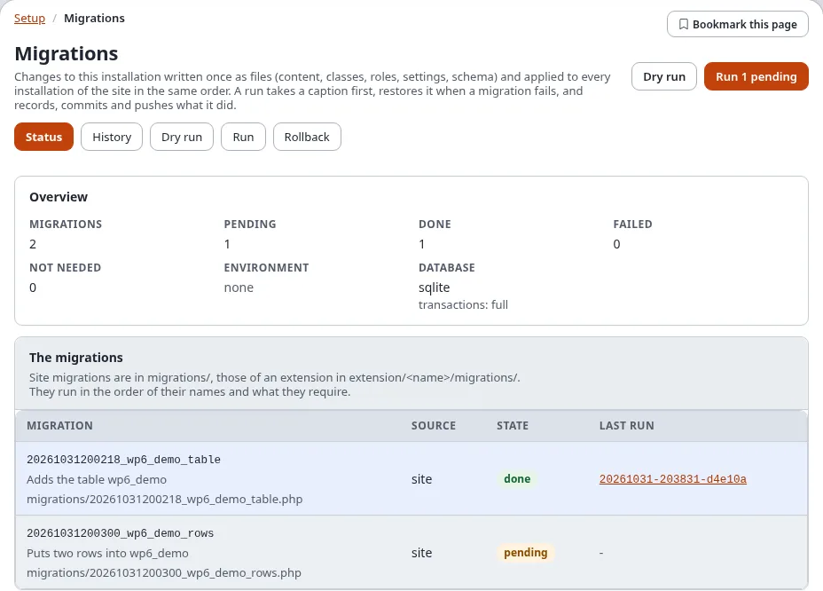
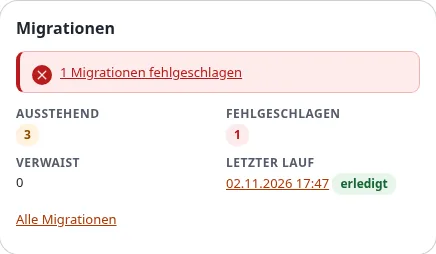

# Migrationen: ein Rundgang durch Setup > Migrationen

Alles, was Sie in der Administration mit Migrationen tun, geschieht unter **Setup > Migrationen** (in der deutschen
Oberfläche **Einrichtung > Migrationen**). Diese Seite geht seine Bildschirme einmal durch, damit Sie wissen, wo jede
Aufgabe zu finden ist; jeder Bildschirm hat eine eigene Seite mit den Schritten im Einzelnen.

## Inhalt

1. [Die Migrationsseiten öffnen](#die-migrationsseiten-öffnen)
2. [Die Reiter](#die-reiter)
3. [Welche Seite für welche Aufgabe](#welche-seite-für-welche-aufgabe)
4. [Der Dashboard-Block](#der-dashboard-block)
5. [Die Aufzeichnungsleiste](#die-aufzeichnungsleiste)
6. [Die Website-Seitenleiste](#die-website-seitenleiste)
7. [Wer was sieht](#wer-was-sieht)
8. [Verwandte Seiten](#verwandte-seiten)

## Die Migrationsseiten öffnen

1. Melden Sie sich in der Administration an.
2. Wählen Sie im oberen Menü **Einrichtung** (Setup).
3. Wählen Sie in der linken Spalte, Gruppe **System**, den Eintrag **Migrationen**. Die Seite **Stand** öffnet sich
   (`/migration/status`).

Die Schaltfläche **?** im Kopf öffnet auf jedem Reiter die Hilfeseite des Bildschirms, auf dem Sie gerade sind.

## Die Reiter

Jeder Bildschirm von Setup > Migrationen hat dieselbe Reihe von Reitern:

| Reiter | Adresse | Wofür | Hilfe |
|---|---|---|---|
| **Stand** | `/migration/status` | jede Migration mit ihrem Stand (erledigt, ausstehend, fehlgeschlagen, nicht nötig), die Sperre, die letzten Läufe | [Der Stand](status-und-verlauf.md#der-stand) |
| **Verlauf** | `/migration/history` | jeder Lauf mit Sicherungspunkten, Commit, Tag und Push; fortsetzen und zurücknehmen | [Der Verlauf](status-und-verlauf.md#der-verlauf) |
| **Probelauf** | `/migration/dryrun` | was ein Lauf jetzt ändern würde, ohne etwas zu ändern; **Simulieren** | [Probelauf](ausfuehren-probelauf-und-rueckgaengig.md#probelauf) |
| **Ausführen** | `/migration/run` | die ausstehenden Migrationen ausführen, mit den Feldern für lange Läufe und den Schutzvorkehrungen | [Ausführen](ausfuehren-probelauf-und-rueckgaengig.md#ausführen) |
| **Rücknahme** | `/migration/rollback` | einen Lauf, eine Migration oder einen früheren Sicherungspunkt zurücknehmen | [Zurücknehmen](ausfuehren-probelauf-und-rueckgaengig.md#zurücknehmen) |
| **Aufzeichnung** | `/migration/recording` | Ihre Änderungen oder jede Änderung in einem Zeitfenster aufzeichnen und daraus eine Migration erzeugen | [Änderungen aufzeichnen](aufzeichnung.md) |
| **Gegenstellen** | `/migration/remotes` | die anderen Installationen (dev, stage, production ...), auf die Migrationen ausgeliefert werden; **Neue Gegenstelle** | [Eine Gegenstelle anlegen, Schritt für Schritt](eine-gegenstelle-anlegen-schritt-fuer-schritt.md) |
| **Auslieferungen** | `/migration/deploy` | die Migrationen an Gegenstellen senden und dort ausführen, alle auf einmal oder in Stufen; der Verlauf | [Ausliefern, Schritt für Schritt](ausliefern-schritt-fuer-schritt.md) |
| **Redaktion** | `/migration/editor` | eine neue YAML-Migration mit Formularen schreiben, prüfen und speichern (der Migrationseditor) | [Der Migrationseditor](der-migrationseditor.md) |

Ein Reiter, für den Ihnen die Richtlinie fehlt, wird nicht gezeigt: **Ausführen** braucht `migration/run`,
**Rücknahme** `migration/rollback`, **Aufzeichnung** und **Redaktion** `migration/edit`.

## Welche Seite für welche Aufgabe

| Ich möchte ... | Öffnen | Schritte |
|---|---|---|
| sehen, ob etwas aussteht oder fehlgeschlagen ist | **Stand** | [Der Stand](status-und-verlauf.md#der-stand) |
| wissen, was ein Lauf ändern würde | **Probelauf** | [Probelauf](ausfuehren-probelauf-und-rueckgaengig.md#probelauf) |
| die ausstehenden Migrationen anwenden | **Ausführen** | [Ausführen](ausfuehren-probelauf-und-rueckgaengig.md#ausführen) |
| einen langen Lauf aufteilen oder mit niedrigerer Priorität laufen lassen | **Ausführen**, Karte **Ein langer Lauf in Teilen** | [Ein langer Lauf in Teilen](ausfuehren-probelauf-und-rueckgaengig.md#ein-langer-lauf-in-teilen) |
| sehen, warum ein Lauf scheiterte, und ihn fortsetzen | **Verlauf**, die Seite des Laufs | [Wenn eine Migration scheitert](wenn-eine-migration-scheitert.md) |
| zum Zustand vor einem Lauf zurück | **Rücknahme** | [Zurücknehmen](ausfuehren-probelauf-und-rueckgaengig.md#zurücknehmen) |
| Änderungen, die ich von Hand mache, zu einer Migration machen | **Aufzeichnung** | [Änderungen aufzeichnen](aufzeichnung.md) |
| eine Migration ohne Shell schreiben | **Redaktion** | [Der Migrationseditor](der-migrationseditor.md) |
| eine Migration einer vorhandenen Klasse, Rolle oder Sektion erzeugen | die Konsole | [Migrationen erzeugen](migrationen-erzeugen.md) |
| Staging oder Produktion als Ziel hinzufügen | **Gegenstellen**, **Neue Gegenstelle** | [Eine Gegenstelle anlegen, Schritt für Schritt](eine-gegenstelle-anlegen-schritt-fuer-schritt.md) |
| die Migrationen auf Staging und Produktion bringen | **Auslieferungen** | [Ausliefern, Schritt für Schritt](ausliefern-schritt-fuer-schritt.md) |
| die nächste Stufe einer Auslieferung freigeben | die Seite des Deploys, **Freigeben** | [Deploys in Stufen und das Tor](ausliefern-schritt-fuer-schritt.md#deploys-in-stufen-und-das-tor) |

## Der Dashboard-Block

Das Dashboard der Administration zeigt einen Block **Migrationen** mit der Zahl der ausstehenden und
fehlgeschlagenen Migrationen, den verwaisten und dem letzten Lauf, mit Links zum Stand:

## Die Aufzeichnungsleiste

Solange eine Aufzeichnung Ihrer Änderungen läuft oder ein Fenster für die ganze Website offen ist, steht oben auf
jeder Seite der Administration eine rote Leiste **Aufzeichnung läuft…** mit **Anzeigen** (die Aufzeichnung) und
**Aufzeichnung beenden**:

## Die Website-Seitenleiste

Auf den Seiten der Website hat die Website-Seitenleiste ein Panel **Migrationen**: die fehlgeschlagenen und
ausstehenden Migrationen, den letzten Lauf, die letzten Auslieferungen und **Meine Änderungen aufzeichnen**
([Migrationen in der Website-Seitenleiste](expwt-panel.md)).

## Wer was sieht

| Richtlinie | Zeigt |
|---|---|
| `migration/read` | Stand, Verlauf, Probelauf, Gegenstellen, Auslieferungen, die Seite eines Deploys, den Dashboard-Block, das Panel der Seitenleiste |
| `migration/run` | Ausführen, Fortsetzen, Simulieren |
| `migration/rollback` | Rücknahme |
| `migration/edit` | Aufzeichnung, Redaktion, Migration erzeugen |
| `migration/remotes` | Neue Gegenstelle, Bearbeiten, Entfernen, Verbindung testen |
| `migration/deploy` | Nur Preflight, Ausliefern, Freigeben, einen Deploy zurücknehmen |

In einer neuen Installation hat nur die Rolle Administrator sie. Jede Aktion, die etwas ändert, fragt zuerst nach
[„Identität bestätigen“](../../anleitungen/identitaet-bestaetigen.md)
([Richtlinien, Ansichten und Ereignisse](richtlinien-ansichten-und-ereignisse.md)).

## Verwandte Seiten

- [Migrationen: der Überblick](README.md), [In der Administration](in-der-administration.md),
  [Häufige Fragen](faq.md)
- [Stand und Verlauf](status-und-verlauf.md), [Ausführen, Probelauf und Rücknahme](ausfuehren-probelauf-und-rueckgaengig.md),
  [Änderungen aufzeichnen](aufzeichnung.md), [Der Migrationseditor](der-migrationseditor.md),
  [Migrationen erzeugen](migrationen-erzeugen.md)
- [Eine Gegenstelle anlegen, Schritt für Schritt](eine-gegenstelle-anlegen-schritt-fuer-schritt.md),
  [Ausliefern, Schritt für Schritt](ausliefern-schritt-fuer-schritt.md),
  [Gegenstellen und Deploys](gegenstellen-und-deploys.md)
- [Migrationen in der Website-Seitenleiste](expwt-panel.md), [Wenn eine Migration scheitert](wenn-eine-migration-scheitert.md)
