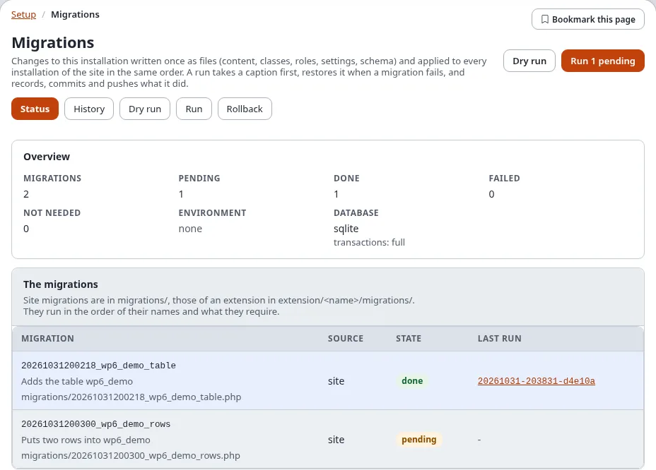
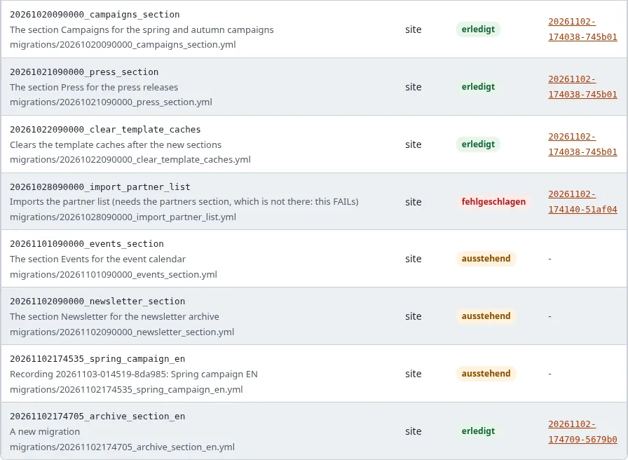
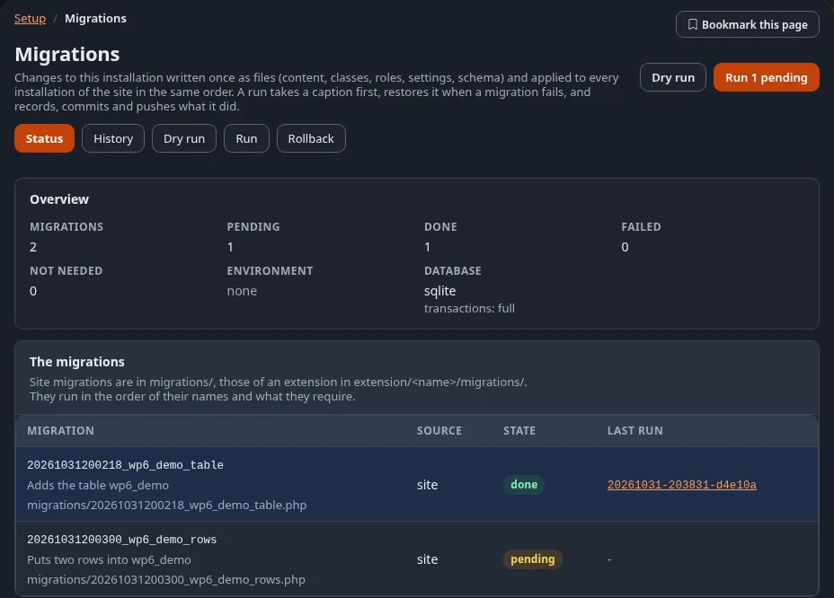
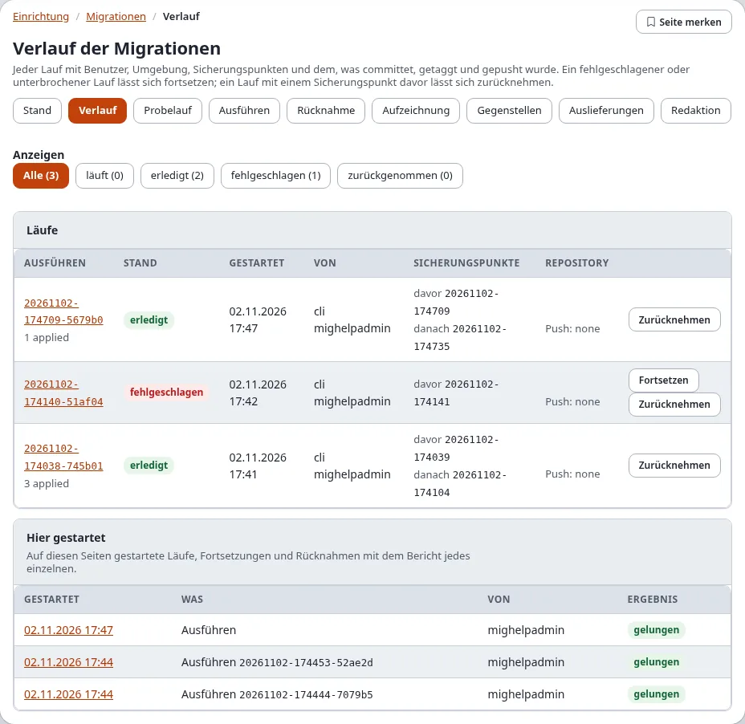
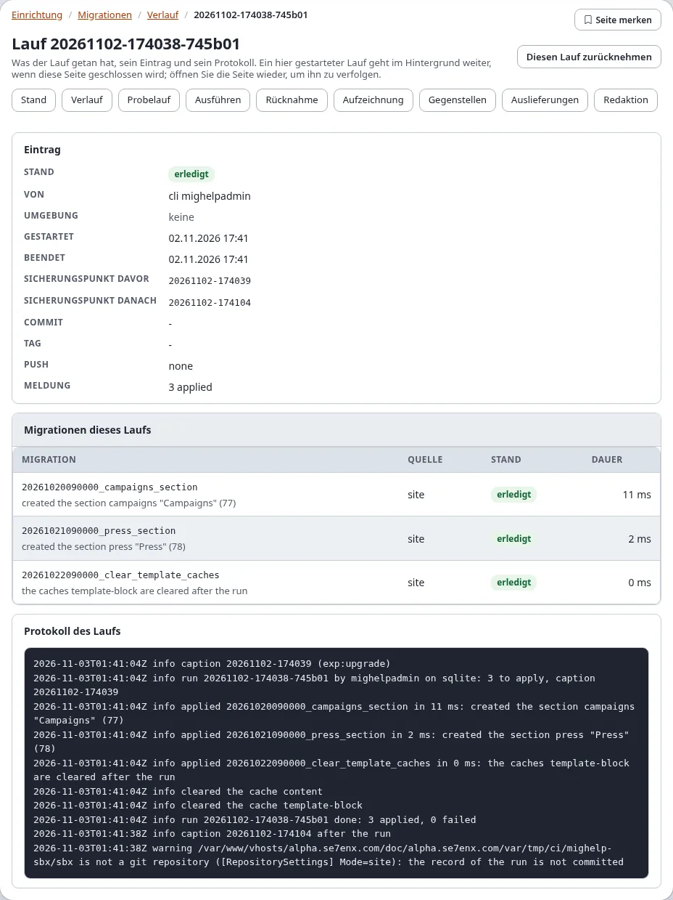
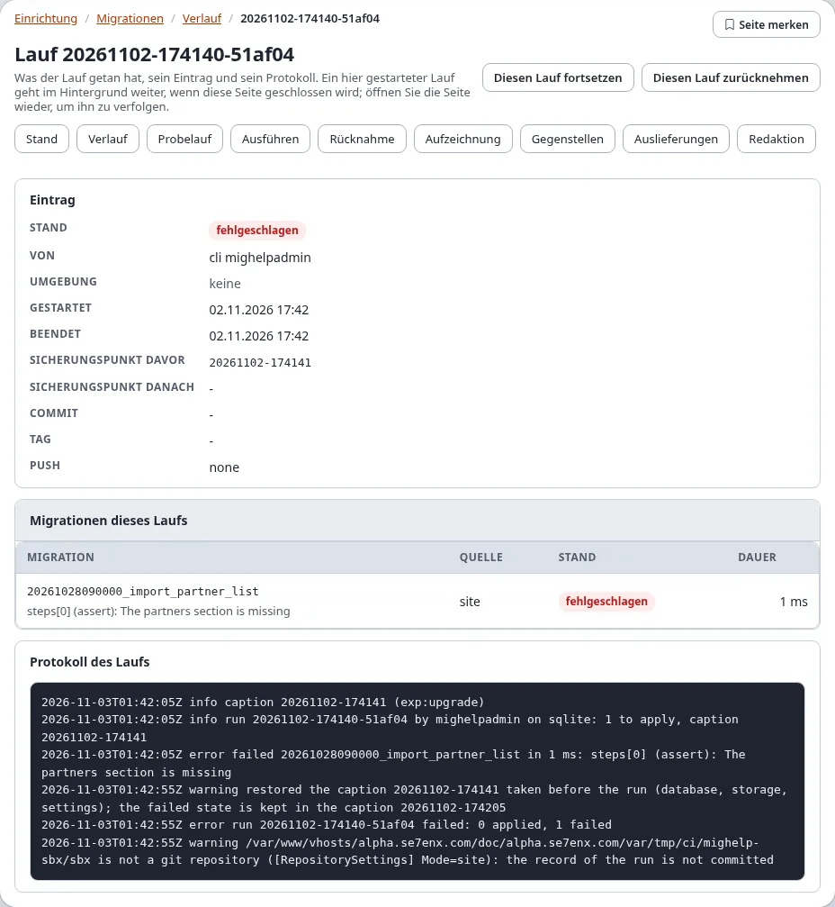
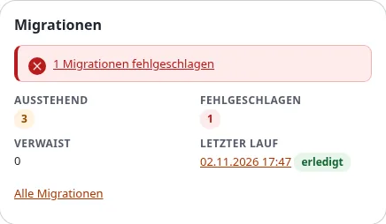

# Migrationen: Stand und Verlauf

**Setup > Migrationen** zeigt die Migrationen der Installation: was erledigt ist, was aussteht, jeden Lauf mit seinen
Sicherungspunkten und seinem Eintrag und das Protokoll jedes Laufs. Diese Seite erklärt die drei Seiten, die nur
anzeigen (Stand, Verlauf, die Seite eines Laufs), und den Dashboard-Block. Das Ausführen, der Probelauf und die
Rücknahme stehen unter [Ausführen, Probelauf und Rücknahme](ausfuehren-probelauf-und-rueckgaengig.md).

Was eine Migration ist und wie man sie schreibt, erklärt die Anleitung [Migrationen](../../anleitungen/migrationen.md).

**Wer diese Seiten sehen darf:** Benutzer mit der Richtlinie `migration/read`. In einer neuen Installation hat sie nur
die Rolle Administrator (über ihre Richtlinie für jedes Modul). Das Ansehen fragt nie nach „Identität bestätigen“.

## Inhalt

1. [Die Migrationen öffnen](#die-migrationen-öffnen)
2. [Der Stand](#der-stand)
3. [Der Verlauf](#der-verlauf)
4. [Die Seite eines Laufs](#die-seite-eines-laufs)
5. [Der Dashboard-Block](#der-dashboard-block)
6. [Wenn etwas nicht stimmt](#wenn-etwas-nicht-stimmt)
7. [Verwandte Seiten](#verwandte-seiten)

## Die Migrationen öffnen

Öffnen Sie **Setup** im oberen Menü und wählen Sie **Migrationen** in der linken Spalte (Gruppe **System**). Die
Adresse ist `/migration/status`. Die Schaltfläche **?** in der Kopfzeile öffnet diese Seite von jeder der drei Seiten
aus.

1. Wählen Sie im oberen Menü **Einrichtung** (Setup).
2. Wählen Sie in der linken Spalte **Migrationen**. Der Stand öffnet sich.
3. Wechseln Sie mit den Reitern zwischen den Seiten.

Jede Seite von Setup > Migrationen hat dieselbe Reihe von Reitern: **Stand**, **Verlauf**, **Probelauf**,
**Gegenstellen** und **Auslieferungen** und, für Benutzer mit den Richtlinien, **Ausführen** (`migration/run`),
**Rücknahme** (`migration/rollback`), **Aufzeichnung** und **Redaktion** (`migration/edit`). Ein Rundgang durch alle:
[Ein Rundgang durch Setup > Migrationen](rundgang-durch-setup-migrationen.md).

## Der Stand

Von oben:

| Teil | Was er zeigt |
|---|---|
| Die Überschrift | **Probelauf** und, wenn Migrationen ausstehen und Sie `migration/run` haben, **N ausstehende ausführen** |
| Ein laufender Lauf | **Ein Lauf ist im Gang**: was gestartet wurde (Lauf, Fortsetzung oder Rücknahme), von wem und wann, mit **Verfolgen** zu seiner Seite |
| Die Sperre | **Die Installation ist gesperrt**: ein anderer Lauf hält die Sperre, ein Upgrade oder ein Lauf auf der Konsole, mit dem Halter |
| Fehler und Warnungen | was `exp:migration:status` meldet: eine doppelt gefundene Kennung, eine fehlende Voraussetzung, eine nach dem Anwenden geänderte Datei, aufgezeichnete Migrationen ohne Datei (verwaiste), wartende Pushes |
| **Überblick** | die Zahl der Migrationen, ausstehend, erledigt, fehlgeschlagen, nicht nötig; die Umgebung; die Datenbank und wie viel einer gescheiterten Migration ihre Transaktionen rückgängig machen (`full`, `data`, `none`) |
| **Die Migrationen** | jede Migration mit Kennung, Beschreibung und Datei, ihrer Quelle (`site`, `extension:<name>`, `package:<name>`), ihrem Stand und dem Lauf, der sie angewendet hat (ein Link auf die Seite dieses Laufs). Eine nach dem Anwenden geänderte Datei meldet **Die Datei hat sich nach dem Anwenden geändert.** |
| **Die letzten Läufe** | die fünf neuesten Läufe mit Stand, Start und Benutzer; **Alle Läufe** öffnet den Verlauf |

Die Stände sind die der Konsole: **erledigt**, **ausstehend**, **nicht nötig** (nicht für diese Umgebung oder
Datenbank-Engine), **fehlgeschlagen** und **unbekannt**.

Die Upgrade-Schritte des Kernels stehen zuerst in der Liste (Quelle `kernel`); die eigenen Migrationen der Site
folgen, hier drei erledigte, eine fehlgeschlagene und zwei ausstehende, jede mit dem Lauf, der sie angewendet oder es
versucht hat:

**Den Stand einer Installation prüfen, Schritt für Schritt:**

1. Öffnen Sie den Stand. Lesen Sie **Überblick**: **Ausstehend** und **Fehlgeschlagen** sollten nach einer
   Auslieferung 0 sein.
2. Eine **fehlgeschlagene** Migration: Klicken Sie ihren letzten Lauf an und lesen Sie den Bericht
   ([Wenn eine Migration scheitert](wenn-eine-migration-scheitert.md)).
3. **Ausstehende** Migrationen: Öffnen Sie **Probelauf**, um zu sehen, was sie ändern würden, dann **Ausführen**
   ([Ausführen, Probelauf und Rücknahme](ausfuehren-probelauf-und-rueckgaengig.md)).
4. Eine Warnung wie „Die Datei hat sich nach dem Anwenden geändert.“ braucht vor dem nächsten Lauf eine Entscheidung
   ([Ausführen](ausfuehren-probelauf-und-rueckgaengig.md#ausführen)).

Gibt es die Tabellen der Migrationen noch nicht, sagt die Seite das: `./console exp:upgrade --apply` legt sie an.

Die Seite zeigt dasselbe wie `./console exp:migration:status`; im dunklen Modus sieht sie so aus:

## Der Verlauf

**Verlauf** (`/migration/history`) listet die Läufe auf, die neuesten zuerst (höchstens 200).

- **Anzeigen** filtert sie: **Alle**, **läuft**, **erledigt**, **fehlgeschlagen**, **zurückgenommen**, jeweils mit
  ihrer Zahl. Der Filter steht in der Adresse (`/migration/history/(state)/failed`), eine gefilterte Liste lässt sich
  also als Lesezeichen ablegen.
- **Läufe**: jeder Lauf mit seiner Kennung (ein Link auf seine Seite), seiner Umgebung und Meldung, seinem Stand, wann
  er gestartet wurde, wer ihn ausgeführt hat, seinen **Sicherungspunkten** (davor und danach) und der Spalte
  **Repository** (Commit, Tag und Push-Stand).
- Die Schaltflächen eines Laufs: **Fortsetzen** für einen fehlgeschlagenen oder unterbrochenen Lauf (mit
  `migration/run`, solange kein Lauf im Gang ist) und **Zurücknehmen** für einen Lauf mit Sicherungspunkt davor (mit
  `migration/rollback`). Beide führen zu [Ausführen, Probelauf und Rücknahme](ausfuehren-probelauf-und-rueckgaengig.md).
- **Hier gestartet**: die auf diesen Seiten gestarteten Läufe, Fortsetzungen und Rücknahmen, mit dem, der sie
  gestartet hat, und ihrem Ergebnis. Eine Rücknahme hat keinen eigenen Lauf und steht deshalb nur hier.

## Die Seite eines Laufs

Ein Klick auf die Kennung eines Laufs, wo immer sie in Setup > Migrationen steht, öffnet seine Seite,
`/migration/log/<run id>`.

| Teil | Was er zeigt |
|---|---|
| **Fortschritt** | bei einem in der Administration gestarteten Lauf: wer ihn wann gestartet hat, seine Phase (**Code wird geprüft und vor dem Lauf ein Sicherungspunkt angelegt**, **... läuft (n von m)**, der Sicherungspunkt nach dem Lauf, Commit, Tag und Push, oder **Der Sicherungspunkt wird wiederhergestellt**) und ein Balken der erledigten Migrationen |
| **Bericht** | wenn er beendet ist: jede Migration mit Ergebnis und Dauer und was der Lauf als Fehler ausgegeben hat |
| **Eintrag** | die Zeile des Laufs: Stand, Benutzer, Umgebung, Start und Ende, die Sicherungspunkte davor und danach, Commit, Tag, Push, Meldung |
| **Migrationen dieses Laufs** | die Migrationen, die der Lauf aufgezeichnet hat, mit Quelle, Stand und Dauer |
| **Protokoll des Laufs** | das Ende des Laufprotokolls (`migrations/runs/<run id>.log`); gezeigt werden nur die letzten 256 KB, wie `migration.ini [AdminSettings] LogBytes` es festlegt |

Ein bestandener Lauf: sein Eintrag mit den Sicherungspunkten davor und danach, die Migrationen des Laufs und das
Protokoll.

Ein gescheiterter Lauf: die gescheiterte Migration, ihre Meldung, der wiederhergestellte Sicherungspunkt und **Diesen
Lauf fortsetzen**.

Solange ein Lauf im Gang ist, verfolgt die Seite ihn: Fortschritt, Balken und Protokoll wachsen ohne Neuladen, und die
Seite lädt sich mit dem Bericht neu, wenn der Lauf beendet ist. Ohne JavaScript zeigt **Neu laden**, wie weit er ist.

Ein hier gestarteter Lauf ist ein eigener Prozess auf dem Server. Das Schließen der Seite oder das Abmelden hält ihn
nicht an: Öffnen Sie die Seite wieder (vom Dashboard, vom Stand oder vom Verlauf aus), um ihn zu verfolgen.

Die Überschrift hat **Diesen Lauf fortsetzen** (ein fehlgeschlagener oder unterbrochener Lauf, mit `migration/run`)
und **Diesen Lauf zurücknehmen** (ein Lauf mit Sicherungspunkt davor, mit `migration/rollback`).

## Der Dashboard-Block

Das Dashboard der Administration hat für Benutzer mit `migration/read` einen Block **Migrationen**. Er zeigt:

- **Ausstehend**, **Fehlgeschlagen** und **Verwaist** (aufgezeichnete Migrationen, deren Datei fehlt) als Zahlen;
- **Letzter Lauf**: wann er gestartet wurde, als Link auf seine Seite, mit seinem Stand;
- einen Hinweis, wenn Migrationen fehlgeschlagen sind, wenn ein Lauf im Gang ist (mit einem Link zum Verfolgen) oder
  wenn die Installation gesperrt ist;
- **Alle Migrationen**, einen Link zum Stand.

Benutzer ohne die Richtlinie sehen den Block nicht. Sein Platz und seine Richtlinie sind Einstellungen:
[dashboard.ini [DashboardBlock_migrations]](../../beispiele/ini-einstellungen/dashboard/DashboardBlock_migrations.md).

## Wenn etwas nicht stimmt

| Sie sehen | Was zu tun ist |
|---|---|
| **Die Tabellen der Migrationen gibt es noch nicht** | führen Sie `./console exp:upgrade --apply` auf dem Server aus |
| **Die Installation ist gesperrt** | ein anderer Lauf oder ein Upgrade ist im Gang; warten Sie darauf. Eine Sperre eines beendeten Prozesses übernimmt der nächste Lauf ([Fehlerbehebung](../../anleitungen/migrationen-fehlerbehebung.md)) |
| eine Migration ist **fehlgeschlagen** | öffnen Sie die Seite des Laufs und lesen Sie Bericht und Protokoll; korrigieren Sie die Migration und **setzen Sie den Lauf fort** |
| **Die Datei hat sich nach dem Anwenden geändert** | stellen Sie die Datei wieder her oder nehmen Sie die Änderung beim Ausführen an ([Ausführen, Probelauf und Rücknahme](ausfuehren-probelauf-und-rueckgaengig.md#ausführen)) |
| die Seite eines Laufs verfolgt ihn nicht mehr | laden Sie die Seite neu; der Lauf geht trotzdem weiter |

## Verwandte Seiten

- [Migrationen: der Einstieg](README.md), [Alle Rezepte](rezepte/README.md), [Häufige Fragen](faq.md)
- [Die Anleitung](../../anleitungen/migrationen.md), [das Tutorial](../../anleitungen/migrationen-tutorial.md),
  [PHP-Migrationen](../../anleitungen/migrationen-php.md),
  [Zurücknehmen und Sicherungspunkte](../../anleitungen/migrationen-rueckgaengig-und-captions.md),
  [Das Migrations-Repository](../../anleitungen/migrationen-repositories.md)
- [In der Administration](in-der-administration.md), [Befehle](befehle.md), [Einstellungen](einstellungen.md),
  [Richtlinien, Ansichten und Ereignisse](richtlinien-ansichten-und-ereignisse.md)
- [Das Dateiformat](../../spezifikationen/6.0/migrationsdateiformat.md),
  [Die Funktion](../../funktionen/6.0/migrationen.md)
- [Wenn eine Migration scheitert](wenn-eine-migration-scheitert.md),
  [Fehlermeldungen](../../anleitungen/migrationen-fehlerbehebung.md)
- [Migrationen oder Umzug einer Site](migrationen-oder-umzug-einer-site.md)
- [Ausführen, Probelauf und Rücknahme](ausfuehren-probelauf-und-rueckgaengig.md)
- [Migrationen in der Website-Seitenleiste](expwt-panel.md)
- [Die Ansichten des Moduls migration](../../beispiele/modulansichten/migration/README.md) und
  [seine Richtlinien](../../beispiele/richtlinien/migration.md)
