# Mit Git aktualisieren: synchron mit GitHub bleiben

Ein Update einer Site aus Git-Klonen ([Mit Git entwickeln](mit-git-entwickeln.md)) besteht immer aus zwei Schritten, in
dieser Reihenfolge:

1. **Git** bringt den **Kernel** auf den neuesten Stand: Die neuen Commits von GitHub werden in den Branch Ihrer Site
   gemergt. Das ändert die Dateien des Kernels und mit ihnen `composer.json`, die Liste der Erweiterungen und ihrer
   Versionen.
2. **Composer** bringt die **Erweiterungen** passend zur neuen `composer.json` auf den neuesten Stand: Neue
   Erweiterungen werden geklont, vorhandene Klone wechseln auf ihre neuen Release-Tags.

Beide Schritte lassen sich auf der **Kommandozeile** (Weg A) oder in der **Administration** (Weg B) ausführen. Diese
Seite beschreibt beide Wege nebeneinander mit denselben sieben Schritten, sagt, was jeder kann und was nicht, und wie
Sie sie kombinieren.

## Kommandozeile oder Administration?

| | Weg A: Kommandozeile | Weg B: Administration |
|---|---|---|
| **Für** | Entwickler und Administratoren mit einer Shell auf dem Server (SSH) | Administratoren ohne Shell oder solche, die Seiten und Schaltflächen bevorzugen |
| **Voraussetzungen** | Git, Composer und PHP auf dem Server, als der Benutzer, dem die Dateien gehören | die Erweiterungen `git_manager` und `ezupdate` aktiv, eine Rolle mit ihren Richtlinien (siehe [die Tabelle in Weg B](#weg-b-die-administration)) |
| **Kernel (Git)** | `git merge` von allem: dem neuesten **Release-Tag**, `origin/main`, einem anderen Branch oder einem einzelnen Commit | Die **Git-Verwaltung** checkt einen **Branch** aus und zieht ihn (`git pull origin <branch>`); einen Release-Tag kann sie nicht mergen |
| **Erweiterungen (Composer)** | `composer update`, von Ihnen ausgeführt | **Aktualisierungen und Pakete** führt Composer für Sie aus, im Hintergrund auf dem Server, als der Benutzer, unter dem das PHP des Webservers läuft: ein vollständiges Update (**Vorschau (Probelauf)**, dann **Wirklich ausführen**) oder die Pakete, die Sie ankreuzen (**Updates installieren**). Ausgeschaltet, bis `[UpdateSettings] AllowUpdate` eingeschaltet wird |
| **Datenbank-Update eines Release** | die SQL-Datei des Release mit dem Client Ihrer Datenbank (`mysql`, `psql`, `sqlite3`) | **DS-Editor**: SQL ausführen oder die Datei importieren, auf der Live-Datenbank |
| **Caches und Neuladen des Codes** | `php bin/php/ezcache.php --clear-all` oder `php bin/php/console exp:velocity deploy` auf einer Velocity-Site (Caches, PHP-FPM, Neustart von Velocity) | **Cache-Verwaltung**: jeder Cache und der Antwort-Cache von Velocity; Velocity neu starten kann sie nicht, was ein Code-Update auf einer Velocity-Site aber braucht |
| **Konflikte und lokale Änderungen** | Sie sehen sie und lösen sie auf (`git merge --abort`, `git stash`, ein Commit) | Die Git-Verwaltung zeigt die Ausgabe von Git; einen Konflikt auflösen oder Änderungen committen geht nur in einer Shell |
| **Automatisch, nach Zeitplan** | ja: [Automatisch aktualisieren lassen](#automatisch-aktualisieren-lassen) | nein |

**Kurz gesagt:** Weg A kann alles. Weg B deckt ein Routine-Update einer Site ab, die einem Branch folgt (`main` oder
Ihrem eigenen Branch, in den Sie Releases mergen), ohne eine Shell zu öffnen; ein Release-Tag, ein Merge-Konflikt und
der Neustart von Velocity brauchen aber weiterhin die Kommandozeile.

## Wählen Sie, wie eng Sie folgen

| Sie wollen | Folgen Sie | Geeignet für |
|---|---|---|
| jede Änderung, sobald sie gepusht ist | `main`, der Entwicklungslinie: **stündlich** oder **täglich** prüfen | Entwicklungsrechner, Staging-Sites, Menschen, die testen und beitragen |
| Änderungen gebündelt | `main`, **wöchentlich** oder **monatlich** geprüft | Sites, die sich oft ändern, aber ruhige Wochen wollen |
| nur fertige, getestete Versionen | den neuesten **Release-Tag** (`v6.0.14`, ...) | Live-Sites (Weg A) |

Release-Tags liegen auf der Historie von `main`. Sie können also mit Releases beginnen und später zu `main` wechseln,
oder umgekehrt, sobald das nächste Release aufgeholt hat.

## Die sieben Schritte

| Schritt | Was | Weg A: Kommandozeile | Weg B: Administration |
|---|---|---|---|
| 1 | Sichern, Wartungsfenster beginnen | [A1](#a1-sichern-und-das-wartungsfenster-beginnen) | [B1](#b1-sichern-und-das-wartungsfenster-beginnen) |
| 2 | Sehen, was ansteht | [A2](#a2-sehen-was-ansteht) | [B2](#b2-sehen-was-ansteht) |
| 3 | Den Kernel mit Git aktualisieren | [A3](#a3-den-kernel-mit-git-aktualisieren) | [B3](#b3-den-kernel-mit-der-git-verwaltung-aktualisieren) |
| 4 | Die Erweiterungen mit Composer aktualisieren | [A4](#a4-die-erweiterungen-mit-composer-aktualisieren) | [B4](#b4-die-erweiterungen-mit-aktualisierungen-und-pakete-aktualisieren) |
| 5 | Dateien und Datenbank prüfen, das Datenbank-Update einspielen | [A5](#a5-die-datenbank-prüfen-und-aktualisieren) | [B5](#b5-die-datenbank-prüfen-und-aktualisieren) |
| 6 | Die Caches leeren, den Code neu laden | [A6](#a6-die-caches-leeren-und-den-code-neu-laden) | [B6](#b6-die-caches-leeren) |
| 7 | Die Site prüfen, das Wartungsfenster beenden | [A7](#a7-die-site-prüfen-und-das-wartungsfenster-beenden) | [B7](#b7-die-site-prüfen-und-das-wartungsfenster-beenden) |

## Weg A: die Kommandozeile

Führen Sie jeden Befehl im Wurzelverzeichnis der Installation aus, als der Benutzer, dem die Dateien gehören (nicht
als root: Als root verlangen die Skripte in `bin/php/` die Option `--allow-root-user`). Die Bilder zeigen die echte
Ausgabe der Befehle in einer Testinstallation: ein Kernel-Klon auf dem Branch `my-site`, erstellt aus dem Release
`v6.0.13`, jede Erweiterung ein Git-Klon, aktualisiert auf `main`. Die Aufnahmen entstanden als root und zeigen
deshalb `--allow-root-user`; die zweizeilige Warnung, die root von jedem Skript bekommt, ist weggelassen.

### A1. Sichern und das Wartungsfenster beginnen

Sichern Sie die Datenbank (mit dem Dump-Werkzeug Ihrer Datenbank) und das Verzeichnis. Nehmen Sie dann die
öffentliche Site offline:

```bash
php bin/php/maintenance.php on --message="Updating, back at 06:00" --until=1h
php bin/php/maintenance.php status
```

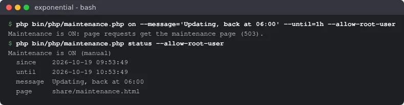

`maintenance.php` ist Teil von 6.0.15 (`main`); bei einem älteren Release überspringen Sie diesen Schritt oder
schalten die Wartung in der Administration ein ([B1](#b1-sichern-und-das-wartungsfenster-beginnen)), was
funktioniert, sobald der neue Code installiert ist.

### A2. Sehen, was ansteht

```bash
git status --short --untracked-files=no
git fetch origin --tags
git log --oneline HEAD..origin/main | head -5
git log --oneline HEAD..origin/main | wc -l
git tag -l 'v6.*' --sort=version:refname | tail -3
```

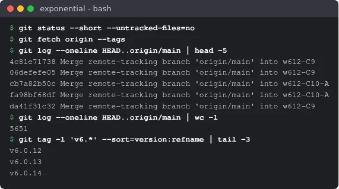

`git status` darf nichts ausgeben: Änderungen, die Sie nicht committet haben, können den Merge verhindern.
`HEAD..origin/main` listet auf, was die Entwicklungslinie bringen würde; für ein Release leistet `HEAD..v6.0.14`
dasselbe. Sortieren Sie Tags immer nach Version (nach Namen kommt `v6.0.10` vor `v6.0.8`).
`composer outdated 'se7enxweb/*'` nennt die Erweiterungen, für die es ein neueres Release gibt.

### A3. Den Kernel mit Git aktualisieren

Wenn Sie der Entwicklungslinie folgen:

```bash
git merge --no-edit origin/main
```

Wenn Sie nur Releases folgen, der neueste Release-Tag:

```bash
git merge --no-edit "$(git tag -l 'v6.*' --sort=version:refname | tail -1)"
```

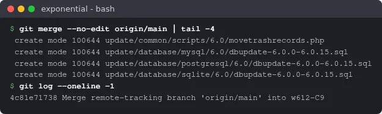

`git merge` behält Ihre eigenen Commits auf `my-site` und fügt die neuen hinzu. Wenn einer Ihrer Commits und das
Update dieselben Zeilen ändern, hält Git mit `CONFLICT` an; `git merge --abort` stellt alles wieder her.

Auf einem Klon ohne eigenen Branch (`HEAD detached at v6.0.14`) wechseln Sie stattdessen auf das neue Release:
`git switch --detach "$(git tag -l 'v6.*' --sort=version:refname | tail -1)"`.

### A4. Die Erweiterungen mit Composer aktualisieren

```bash
composer update
composer status -v
```


`composer update`, nicht `composer install`: Die `composer.json` des Kernels hat sich geändert, und Ihre Lock-Datei
(sie gehört nicht zum Repository des Kernels) muss ihr folgen. Von `v6.0.13` nach `main` kamen dabei 39 Pakete hinzu
und 11 wurden aktualisiert, jedes neue `se7enxweb/*`-Paket als Git-Klon dank der Einstellung `preferred-install` aus
[Mit Git entwickeln](mit-git-entwickeln.md#schritt-1-composer-anweisen-klone-zu-bevorzugen). Am Ende werden die Klassen-Maps neu
erzeugt.

Was Composer mit Klonen macht:

- Ein Update behält die Art bei, wie ein Paket zuerst installiert wurde: Ein Klon bleibt ein Klon, ein Archiv bleibt
  ein Archiv, auch mit `--prefer-source`. `composer reinstall <package>` macht aus einem Archiv einen Klon
  ([Mit Git entwickeln](mit-git-entwickeln.md#die-erweiterungen)).
- Es überschreibt nie Ihre Arbeit: Ein Klon mit nicht committeten Änderungen oder mit Commits auf einem Branch, den es
  nur auf Ihrem Rechner gibt, hält es mit einer Meldung an ([Wenn Composer sich weigert](mit-git-entwickeln.md#wenn-composer-sich-weigert)).
  Beheben Sie die Ursache und führen Sie `composer update` erneut aus, um abzuschließen.

### A5. Die Datenbank prüfen und aktualisieren

```bash
php bin/php/checkmanifest.php --all
ls update/database/mysql/6.0/
```

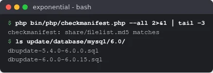

`checkmanifest.php --all` vergleicht jede Datei mit den Prüfsummen des Release; nach einem sauberen Git-Update meldet
es, dass sie übereinstimmen. Ein Release kann ein **Datenbank-Update** brauchen:
[Upgrade](../installation/11-aktualisieren.md#schritt-2-das-datenbank-update-anwenden) nennt die Datei für jedes Release und jede
Datenbank-Engine (`update/database/<engine>/6.0/...`). Spielen Sie sie einmal ein, vollständig und in der richtigen
Reihenfolge, mit dem Client Ihrer Datenbank, zum Beispiel:

```bash
mysql -u USER -p DATABASE < update/database/mysql/6.0/dbupdate-6.0.0-6.0.15.sql
```

(Die Testinstallation hat keine Datenbank, daher gibt es von diesem Schritt kein Bild.)

### A6. Die Caches leeren und den Code neu laden

```bash
php bin/php/ezcache.php --clear-all
```

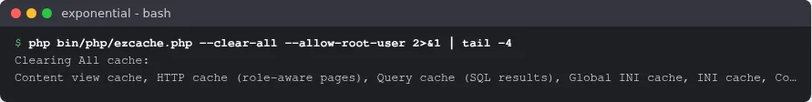

Auf einer Site, die von Exponential Velocity ausgeliefert wird, führen Sie stattdessen
`php bin/php/console exp:velocity deploy` aus: Es erzeugt die Klassen-Maps neu, leert die Caches, macht PHP-FPM den
neuen Code bekannt und startet Velocity neu, in der richtigen Reihenfolge
([Velocity-Engines](../bc/6.0/velocity-engines.md)).

### A7. Die Site prüfen und das Wartungsfenster beenden

```bash
git log --oneline ORIG_HEAD..HEAD | wc -l
php bin/php/console --version
php bin/php/maintenance.php off
```

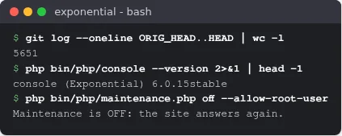

Nach einem Merge zeigt `ORIG_HEAD` auf den Stand davor: `git log --oneline ORIG_HEAD..HEAD` listet auf, was das
Update gebracht hat. Öffnen Sie die Titelseite und die Administration und lesen Sie die Logs (`var/log/error.log` oder
**Setup** > **Logdateien** > **Fehlerübersicht** in der Administration), bevor Sie die Wartung ausschalten. Um
stattdessen zurückzugehen: `git reset --hard ORIG_HEAD`, dann `composer update` (von `main` zurück auf `v6.0.13`
entfernt das die 39 hinzugekommenen Pakete und setzt 11 zurück), und stellen Sie die Datenbank aus der Sicherung
wieder her, falls ein Datenbank-Update gelaufen ist.

## Weg B: die Administration

Dieselben sieben Schritte auf den Seiten der Administration. Die Screenshots zeigen das Design **Admin 4** mit einem
Test-Administrator; Hostnamen, Serverpfade und Adressen sind durch Beispiele ersetzt. Jede Seite braucht eine
Richtlinie (`module/function`); die Rolle Administrator hat sie alle.

| Schritt | Seite | Richtlinie |
|---|---|---|
| B1 | **Setup** > **Sicherung** (`git_manager/backup`), **Setup** > **Wartung** (`setup/maintenance`) | `git_manager/backup`, `setup/administrate` |
| B2, B3 | **Setup** > **Git-Verwaltung** (`git_manager/dashboard`) | `git_manager/git_manager` (`git_manager/push` zum Pushen) |
| B4 | **Setup** > **Aktualisierungen und Pakete** (`update/dashboard`) | `update/ezupdate` zum Ansehen, Prüfen und für die Vorschau; `update/manage` zum Installieren, Einschalten der Updates und Ändern der Server |
| B5 | **Setup** > **Upgrade-Prüfung** (`setup/systemupgrade`), **Setup** > **DS-Editor** (`dse/dashboard`) | `setup/setup`, `dse/dse` |
| B6 | **Setup** > **Cache-Verwaltung** (`setup/cache`) | `setup/managecache` |
| B7 | **Setup** > **Logdateien** (`setup/logs`) | `setup/logs` |

Die Git-Verwaltung, „Aktualisierungen und Pakete“ und der DS-Editor sind Erweiterungen (`git_manager`, `ezupdate`, `sevenx_dse`); sie
erscheinen im Menü, wenn sie aktiv sind.

### B1. Sichern und das Wartungsfenster beginnen

Legen Sie eine Sicherung an: **Setup** > **Sicherung**, Typ **Sicherung von Datenbank und Dateien**. Öffnen Sie dann **Setup** >
**Wartung**. Solange die Site online ist, zeigt die Seite ein grünes Banner **Die Website ist online** und einen Plan in
drei Schritten:

1. **Nachricht für Besucher** (optional; bleibt das Feld leer, zeigt die Seite „We are working on the site and will be
   back shortly.“).
2. **Voraussichtliche Dauer**: Geben Sie die Minuten ein oder wählen Sie **15 min**, **30 min**, **1 h**, **2 h** oder
   **4 h**. Die Wartung endet nicht von selbst.
3. **Wer weiterhin Zugang hat**: die Administration unter `/admin` immer; kreuzen Sie **Meine eigene Adresse sieht die
   Website weiterhin** an, um Ihre Arbeit zu prüfen, während alle anderen die Wartungsseite erhalten.

Kreuzen Sie **Mir ist bewusst, dass die öffentliche Website für jeden oben nicht aufgeführten Besucher offline geht,
bis ich den Wartungsmodus wieder ausschalte.** an und klicken Sie auf **Website offline nehmen**. Die **Vorschau** zeigt
die Seite, die Besucher erhalten.


### B2. Sehen, was ansteht

Öffnen Sie **Setup** > **Git-Verwaltung** und klicken Sie in der Karte **Upstream (origin)** auf **Jetzt holen**. Das führt
`git fetch --prune` aus und sonst nichts. Die Karte zeigt dann das Remote, den Branch, mit dem verglichen wird,
**Voraus / zurück** (lokale Commits / zu holende Commits), die Dateien unter **Nicht committet** und
**Fehlt in dieser Installation**: die Commits, die das Update bringt, jeweils mit Autor und Link. Dateien, die Sie
geändert und nicht committet haben, können den nächsten Schritt scheitern lassen; committen Sie sie vorher in einer
Shell.


**Aktualisierungen und Pakete** > **Übersicht** > **Nach Aktualisierungen suchen** zeigt, welche Erweiterungen ein neueres Release haben;
es ändert nichts.

### B3. Den Kernel mit der Git-Verwaltung aktualisieren

Wählen Sie unter **Lokaler Branch** den Branch, auf dem die Site läuft (den hinter **HEAD** angezeigten, zum Beispiel
`main` oder `my-site`), kreuzen Sie **Autoloads neu erzeugen** an und klicken Sie auf **Auschecken**. Die Git-Verwaltung checkt
diesen Branch aus und führt `git pull origin <branch>` aus: Sie holt den gleichnamigen Branch von GitHub, mergt ihn und
erzeugt die Klassen-Maps neu. Die Ausgabe von Git wird auf der Seite angezeigt; das Badge zeigt danach **Aktuell**,
und **Voraus / zurück** zeigt `0 / 0`.

Die Git-Verwaltung folgt **Branches**. Einen Release-Tag kann sie nicht in Ihren Branch mergen; für Updates nur auf Releases
verwenden Sie [A3](#a3-den-kernel-mit-git-aktualisieren). Der **Commit-Verlauf** weiter unten listet die Historie auf, 50 Commits
pro Seite, mit einem Filter nach Autor und Datum; ein Commit lässt sich über seinen Hash auschecken (um zurückzugehen).

### B4. Die Erweiterungen mit „Aktualisierungen und Pakete“ aktualisieren

Die Seite **Aktualisierungen und Pakete** führt Composer für Sie aus: im Verzeichnis der Installation, im Hintergrund, als der Benutzer,
unter dem das PHP des Webservers läuft, mit einem Zeitlimit. Sie tut, was `composer update` in
[A4](#a4-die-erweiterungen-mit-composer-aktualisieren) tut. Das Aktualisieren steht auf **Ausgeschaltet**, bis Sie etwas anderes wählen
(`[UpdateSettings] AllowUpdate`), weil Composer `vendor/` und die Dateien jedes Pakets, das es aktualisiert, neu
schreibt.

1. **Holen als**: `auto`, `dist (archives)` oder `source (git, with history)`. Wählen Sie `source`, damit neue
   Erweiterungen als Git-Klone ankommen; bereits installierte Pakete behalten die Art, wie sie installiert wurden.
2. **Vorschau (Probelauf)** führt `composer update --dry-run` aus und zeigt, was sich ändern würde. Sie öffnet die Seite des
   Laufs.
3. Um etwas zu ändern, muss das Aktualisieren eingeschaltet sein: **Updates einschalten** (schreibt
   `AllowUpdate=enabled` in `settings/override/ezupdate.ini.append.php`).
4. Ein **vollständiges Update**, das der neuen `composer.json` des Kernels folgt: Kreuzen Sie auf der Seite des
   Probelaufs (bei eingeschaltetem Aktualisieren bietet sie neben **Erneut ausführen** auch **Wirklich ausführen** an) **Eine Sicherung von
   Dateien und Datenbank ist vorhanden** an und klicken Sie auf **Wirklich ausführen**. **Updates installieren** in der Übersicht
   aktualisiert dagegen nur die Pakete, die Sie nach **Nach Aktualisierungen suchen** angekreuzt haben.
5. Die Seite verfolgt die Ausgabe von Composer während des Laufs. Danach werden die Klassen-Maps neu erzeugt und die
   INI-, Template- und Inhalts-Caches geleert. Ein Hinweis meldet *The installation is up to date!* oder was sich
   geändert hat. Schalten Sie das Aktualisieren wieder aus.


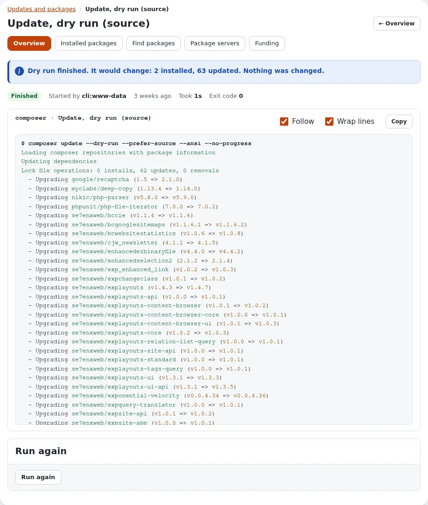

Die anderen Reiter helfen Ihnen beim Prüfen vorher und nachher:

- **Installierte Pakete** stellt nebeneinander, was `composer.json` verlangt, was `composer.lock` aufgelöst hat, was auf
  der Festplatte liegt und welche Erweiterungen eingeschaltet sind; **Braucht Aufmerksamkeit** zeigt, was nicht übereinstimmt,
  **Git-Klone**, welche Pakete Klone sind.
- **Pakete finden** durchsucht packagist.org und markiert, was installiert ist.
- **Paketserver** listet die Composer-Server (packagist.org lässt sich ausschalten) und die `.ezpkg`-Paketserver auf.
- **Förderung** zeigt, wer hinter den installierten Paketen steht und wie Sie sie unterstützen können.

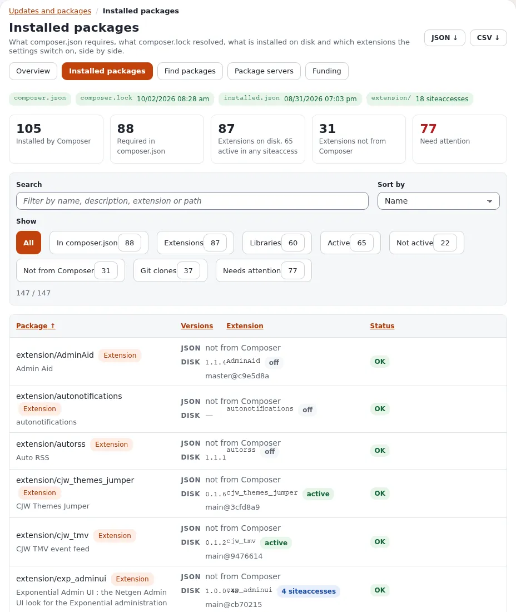


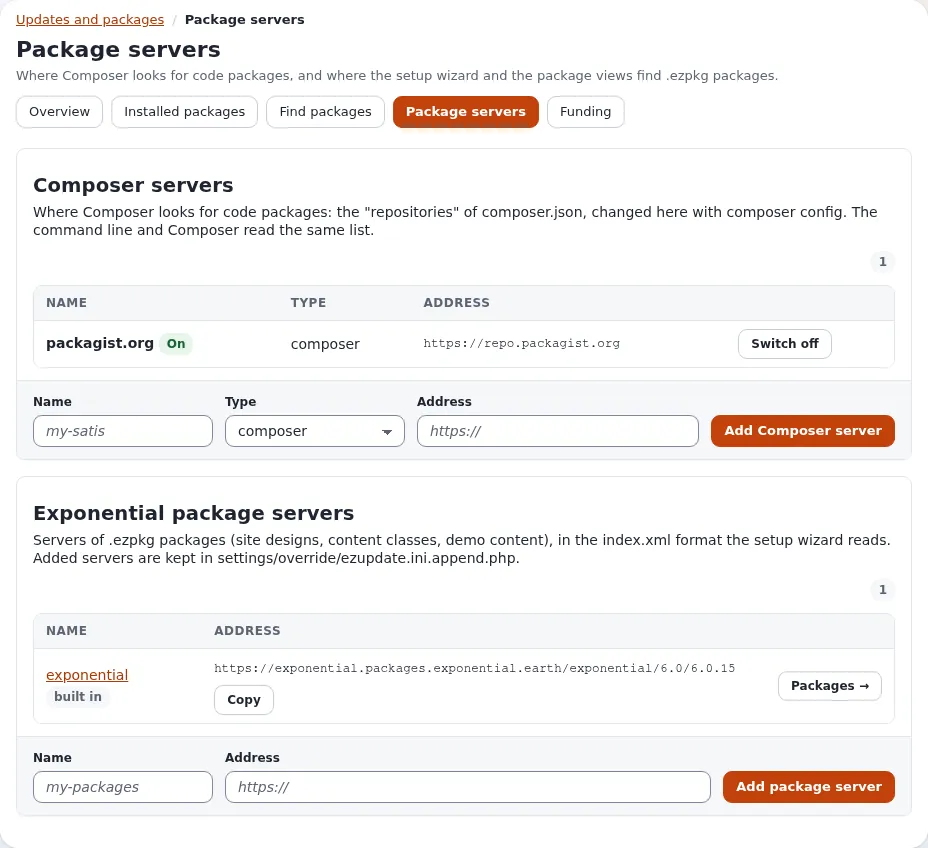


### B5. Die Datenbank prüfen und aktualisieren

**Setup** > **Upgrade-Prüfung** hat zwei Prüfungen; beide lesen nur. **Überprüfe Dateikonsistenz** vergleicht jede Datei
mit den Prüfsummen des Release (nach einem sauberen Git-Update stimmt jede Datei überein). **Überprüfe
Datenbankkonsistenz** vergleicht die Tabellen mit dem Schema des neuen Codes und zeigt das SQL, das die Datenbank
angleichen würde; **SQL herunterladen** speichert es.

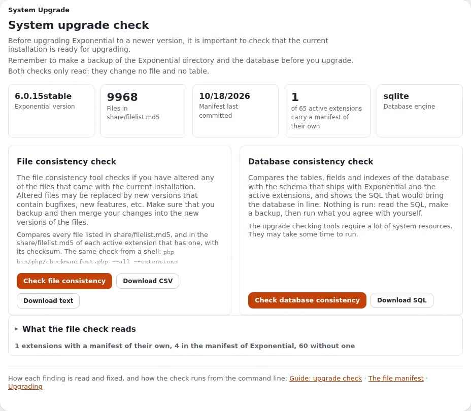

Ein Release kann ein **Datenbank-Update** brauchen: [Upgrade](../installation/11-aktualisieren.md#schritt-2-das-datenbank-update-anwenden)
nennt die Datei. Ohne Shell öffnet **Setup** > **DS-Editor** die Datenbank der Site in AdminNeo, nachdem Sie eine
Warnseite bestätigt haben (**Ich habe eine vollständige Sicherung erstellt und übernehme die volle Verantwortung.**, **Weiter zur
Datenbank**); dort können Sie SQL ausführen oder die Datei des Release importieren. Das wirkt auf die Live-Daten, an
allen Prüfungen der Administration vorbei. Führen Sie danach **Überprüfe Datenbankkonsistenz** erneut aus.

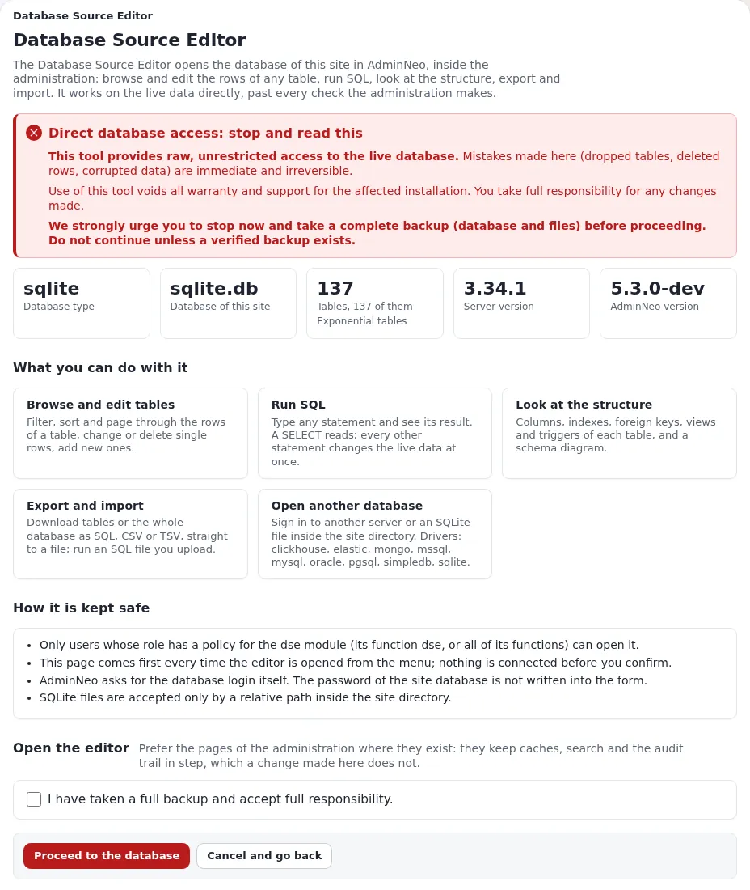

### B6. Die Caches leeren

**Setup** > **Cache-Verwaltung**: **Alle Caches leeren …** und bestätigen. Auf einer Site, die von Exponential Velocity
ausgeliefert wird, außerdem **Antwort-Cache von Velocity leeren** (Gruppe **Seiten, Abfragen und der Server**). Die
Administration kann Velocity nicht neu starten: Nach einem Update, das PHP-Code ändert, behalten die Worker von
Velocity die alten Klassen, bis `php bin/php/console exp:velocity restart` (oder `exp:velocity deploy`) auf der
Kommandozeile läuft; die Seite weist an den entscheidenden Stellen darauf hin. Eine Site, die von Apache oder nginx mit
PHP-FPM ausgeliefert wird, übernimmt den neuen Code normalerweise von selbst (OPcache prüft die Dateien erneut).

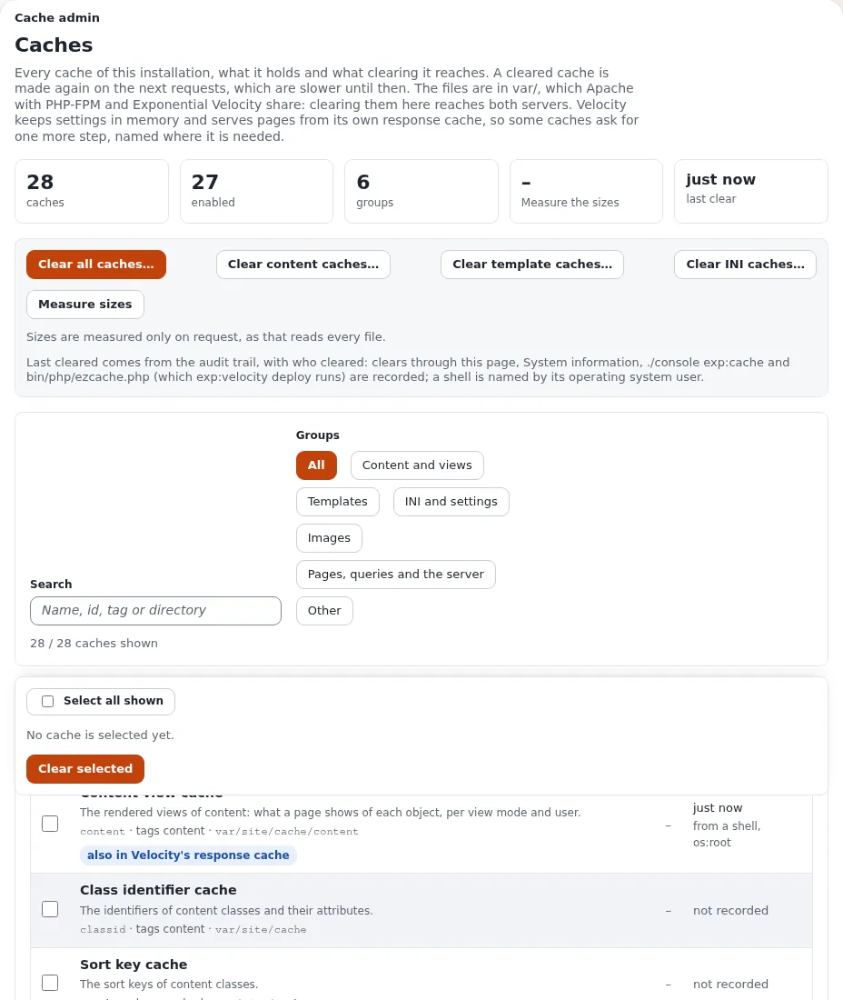

### B7. Die Site prüfen und das Wartungsfenster beenden

Öffnen Sie die Titelseite und einige typische Seiten (mit angekreuztem **Meine eigene Adresse sieht die Website
weiterhin** sehen Sie die Site, alle anderen die Wartungsseite) sowie ein Objekt in der Administration. Dann
**Setup** > **Logdateien**: **Fehlerübersicht** listet die verschiedenen Fehler und Warnungen der letzten 24 Stunden
auf, die häufigsten zuerst; **Zustand der Logs** zeigt die am schnellsten wachsenden Logs und die Dateien, die der
Webserver nicht schreiben kann. Entscheidend sind die Fehler, die seit dem Update neu sind.

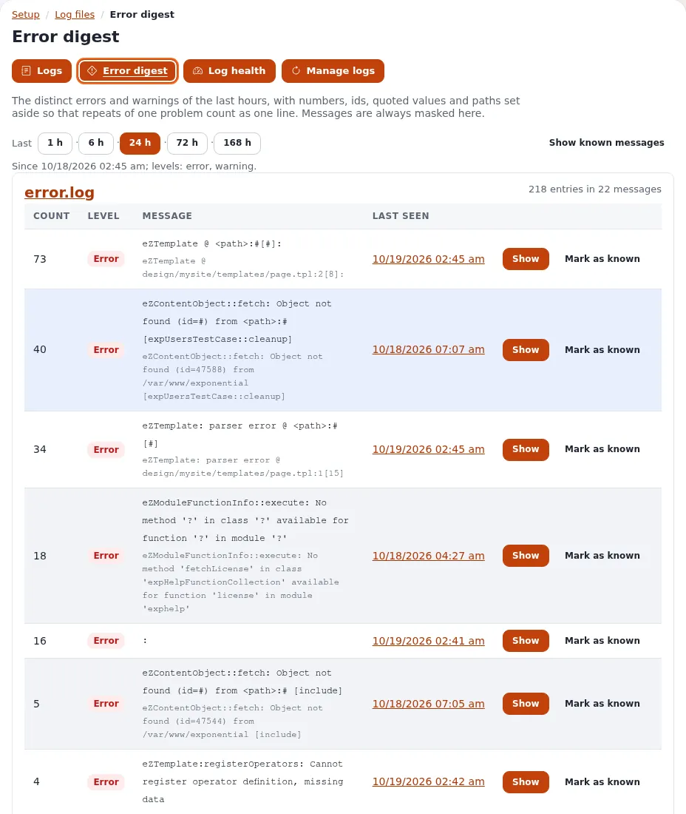

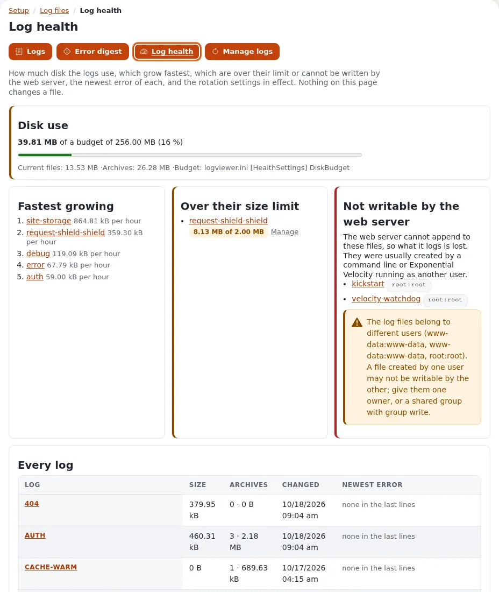

Erst wenn alles in Ordnung ist: **Setup** > **Wartung** > **Website wieder online bringen**. Wenn etwas nicht in
Ordnung ist, gehen Sie zuerst zurück: Checken Sie in der Git-Verwaltung im **Commit-Verlauf** den Commit aus, auf dem die Site
vorher lief, führen Sie das vollständige Update in „Aktualisierungen und Pakete“ erneut aus und stellen Sie die Datenbank aus der
Sicherung wieder her, falls ein Datenbank-Update gelaufen ist.

**Checkliste**

- [ ] Sicherung angelegt (**Setup** > **Sicherung**)
- [ ] Wartung eingeschaltet (**Setup** > **Wartung** > **Website offline nehmen**)
- [ ] Kernel aktualisiert (**Git-Verwaltung**: **Jetzt holen**, **Auschecken** des Branches der Site mit **Autoloads neu erzeugen**; Badge **Aktuell**)
- [ ] Erweiterungen aktualisiert (**Aktualisierungen und Pakete**: **Vorschau (Probelauf)**, **Wirklich ausführen**; Aktualisieren wieder ausgeschaltet)
- [ ] **Upgrade-Prüfung**: Dateien und Datenbank konsistent; das Datenbank-Update des Release eingespielt
- [ ] Caches geleert (**Cache-Verwaltung** > **Alle Caches leeren …**; Antwort-Cache von Velocity und ein Neustart von Velocity aus einer Shell)
- [ ] Titelseite, einige Seiten und die Administration funktionieren
- [ ] **Logdateien** > **Fehlerübersicht**: keine neuen Fehler
- [ ] Wartung ausgeschaltet (**Website wieder online bringen**)

## Die beiden Wege kombinieren

Beide Wege arbeiten auf denselben Dateien und lassen sich daher kombinieren, zum Beispiel die Git-Verwaltung für den Kernel und
Composer auf der Kommandozeile für die Erweiterungen. Die Regeln:

1. **Immer in der Reihenfolge der Schritte: zuerst Git, dann Composer, dann die Datenbank, dann die Caches.** Composer
   liest die `composer.json`, die der Kernel gerade hat; läuft es, bevor der Kernel aktualisiert wurde, aktualisiert es
   auf die alte Liste.
2. **Immer nur ein Composer zur Zeit.** Starten Sie `composer update` nicht auf der Kommandozeile, während ein Lauf von
   „Aktualisierungen und Pakete“ noch läuft (die Übersicht zeigt ihn unter **Letzte Läufe**), und umgekehrt.
3. **Derselbe Benutzer.** „Aktualisierungen und Pakete“ führt Composer als Benutzer des Webservers aus; führen Sie Git und
   Composer auf der Kommandozeile als derselbe Benutzer aus (`sudo -u www-data composer update`, mit dem Benutzer Ihres
   Webservers), damit die Dateien nicht am Ende zwei verschiedenen Benutzern gehören, sodass der Webserver sie nicht
   mehr überschreiben kann.
4. **Starten Sie Velocity auf der Kommandozeile neu**, nachdem einer der beiden Wege PHP-Code auf einer Velocity-Site
   geändert hat.

Sichere Kombinationen:

| Kernel | Erweiterungen | Hinweise |
|---|---|---|
| Git-Verwaltung (B3) | `composer update` auf der Kommandozeile (A4) | Composer erst ausführen, wenn das Auschecken in der Git-Verwaltung fertig ist; dann `ezcache.php` oder `exp:velocity deploy` (A6) |
| `git merge` auf der Kommandozeile (A3) | Aktualisierungen und Pakete (B4) | So übernehmen Sie einen **Release-Tag** und aktualisieren die Erweiterungen trotzdem in der Administration |
| Beliebig | Beliebig | Wartung, Upgrade-Prüfung, Datenbank-Update und Caches lassen sich auf beiden Wegen erledigen |

## Automatisch aktualisieren lassen

Wenn Sie das Update einige Male von Hand ausgeführt haben und ihm vertrauen, kann ein kleines Skript es nach Ihrem
Zeitplan erledigen. Testen Sie es zuerst von Hand auf einer Staging-Kopie und lassen Sie die Live-Site auf Releases. Ein
automatisches Update führt nie Datenbank-Updates aus, und es hält an, statt zu raten, wenn etwas einen Menschen
braucht.

Speichern Sie Folgendes als `/usr/local/bin/exp-update` und machen Sie es ausführbar
(`chmod +x /usr/local/bin/exp-update`):

```sh
#!/bin/sh
# exp-update: bring an Exponential installation made of Git clones up to date.
#   exp-update release   the newest release tag of the 6.x line (v6.*)
#   exp-update main      the development line, origin/main
# Stops without changing anything when the kernel has uncommitted changes or the merge needs a hand.
set -eu
SITE=${EXP_SITE:-/var/www/exponential}
MODE=${1:-release}
cd "$SITE"
if [ -n "$(git status --porcelain --untracked-files=no)" ]; then
    echo "exp-update: the kernel has uncommitted changes; commit or stash them first" >&2
    exit 1
fi
git fetch --quiet origin --tags
if [ "$MODE" = main ]; then
    TARGET=origin/main
else
    TARGET=$(git tag -l 'v6.*' --sort=version:refname | tail -1)
fi
if git merge-base --is-ancestor "$TARGET" HEAD; then
    echo "exp-update: already up to date with $TARGET"
    exit 0
fi
if ! git merge --no-edit "$TARGET"; then
    git merge --abort
    echo "exp-update: merging $TARGET needs a hand; nothing was changed" >&2
    exit 1
fi
composer update --no-interaction --no-progress
php bin/php/ezcache.php --clear-all
echo "exp-update: now at $(git describe --tags --always)"
```

Setzen Sie `EXP_SITE` auf das Verzeichnis Ihrer Installation. Was es tut, wie getestet:

| Situation | Was `exp-update` tut |
|---|---|
| nichts Neues | gibt `already up to date with v6.0.14` (oder `origin/main`) aus und hält an |
| etwas Neues | mergt es, führt `composer update` aus und leert die Caches, gibt dann `now at ...` aus |
| der Kernel hat nicht committete Änderungen | ändert nichts und beendet sich mit einem Fehler |
| ein Merge-Konflikt mit Ihren eigenen Commits | bricht den Merge ab, ändert nichts und beendet sich mit einem Fehler |
| Composer weigert sich bei einer Erweiterung (lokale Änderungen, nicht gepushte Commits) | hält mit der Meldung von Composer an; führen Sie `composer update` von Hand aus, sobald die Ursache behoben ist |

Auf einer Site, die von Velocity ausgeliefert wird, ersetzen Sie die Zeile mit `ezcache.php` durch
`php bin/php/console exp:velocity deploy`.

### Mit cron

Bearbeiten Sie die Crontab des Benutzers, dem die Dateien gehören (`crontab -e`), und fügen Sie **eine** dieser Zeilen
hinzu:

```text
# every hour, the development line
5 * * * *   EXP_SITE=/var/www/exponential /usr/local/bin/exp-update main >> $HOME/exp-update.log 2>&1
# every day at 04:15, the development line
15 4 * * *  EXP_SITE=/var/www/exponential /usr/local/bin/exp-update main >> $HOME/exp-update.log 2>&1
# every Monday at 04:15, the development line
15 4 * * 1  EXP_SITE=/var/www/exponential /usr/local/bin/exp-update main >> $HOME/exp-update.log 2>&1
# on the first of every month at 04:15, the development line
15 4 1 * *  EXP_SITE=/var/www/exponential /usr/local/bin/exp-update main >> $HOME/exp-update.log 2>&1
# every day at 04:15, but only when a new release has been published
15 4 * * *  EXP_SITE=/var/www/exponential /usr/local/bin/exp-update release >> $HOME/exp-update.log 2>&1
```

Eine tägliche Prüfung im Modus `release` aktualisiert nur an dem Tag, an dem ein neues Release erscheint; an allen
anderen Tagen gibt sie `already up to date` aus.

### Mit einem systemd-Timer

Zwei Dateien in `/etc/systemd/system/`. `exp-update.service`:

```ini
[Unit]
Description=Update the Exponential installation from GitHub
Wants=network-online.target
After=network-online.target

[Service]
Type=oneshot
User=www-data
Environment=EXP_SITE=/var/www/exponential
ExecStart=/usr/local/bin/exp-update release
```

und `exp-update.timer`:

```ini
[Unit]
Description=Update the Exponential installation from GitHub, daily

[Timer]
OnCalendar=daily
RandomizedDelaySec=30min
Persistent=true

[Install]
WantedBy=timers.target
```

Tragen Sie bei `User=` den Benutzer ein, dem Ihre Dateien gehören, und bei `ExecStart=` `main`, um der
Entwicklungslinie zu folgen. `OnCalendar=` akzeptiert `hourly`, `daily`, `weekly` (montags), `monthly` (am Ersten des
Monats) oder eine Zeitangabe wie `*-*-* 04:15:00`; `systemd-analyze calendar weekly` zeigt, wann er laufen würde.
Dann:

```bash
systemctl daemon-reload
systemctl enable --now exp-update.timer
systemctl list-timers exp-update.timer
journalctl -u exp-update.service
```

Die letzten beiden Befehle zeigen, wann er das nächste Mal läuft und was er beim letzten Mal gemeldet hat.

## Wie es weitergeht

- [Mit Git entwickeln](mit-git-entwickeln.md): als Klone installieren, auf einem Branch arbeiten, Korrekturen zurückschicken.
- [Erweiterungen zurückgeben](erweiterungen-zurueckgeben.md): Ihre eigenen Erweiterungen veröffentlichen, damit alle sie nutzen können, und was die GPL verlangt, wenn Sie eine weitergeben.
- [Upgrade](../installation/11-aktualisieren.md): die Schritte für Datenbank und Einstellungen bei jedem Release.
- [Die Upgrade-Prüfung](../anleitungen/upgrade-pruefung.md) und [git_manager](../funktionen/6.0/erweiterungen/git_manager.md).
- Das Projekt auf GitHub: [se7enxweb/exponential](https://github.com/se7enxweb/exponential) und seine
  [Releases](https://github.com/se7enxweb/exponential/releases).

<!-- exp-partner-block:start -->
**Werden Sie Exponential-Partner.** Partner teilen ihre Informationen, stellen Mittel bereit, geben Beiträge zurück
und entwickeln die Produkte mit uns, und so wächst Exponential. Eine Partner-Website und ein Dashboard sind für Mitte
2027 geplant: Werden Sie noch heute Partner, damit wir schneller wachsen und neue Funktionen früher liefern. Beginnen
Sie mit [Partner: hier beginnen](partner/partner-hier-beginnen.md) und
[Wie Sie sich bewerben](partner/wie-sie-sich-bewerben.md).
<!-- exp-partner-block:end -->
