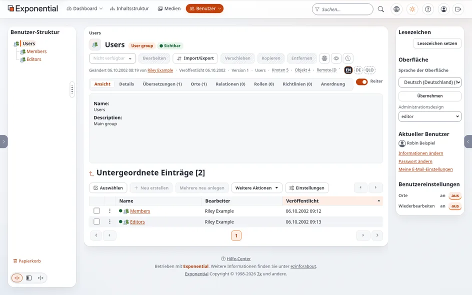
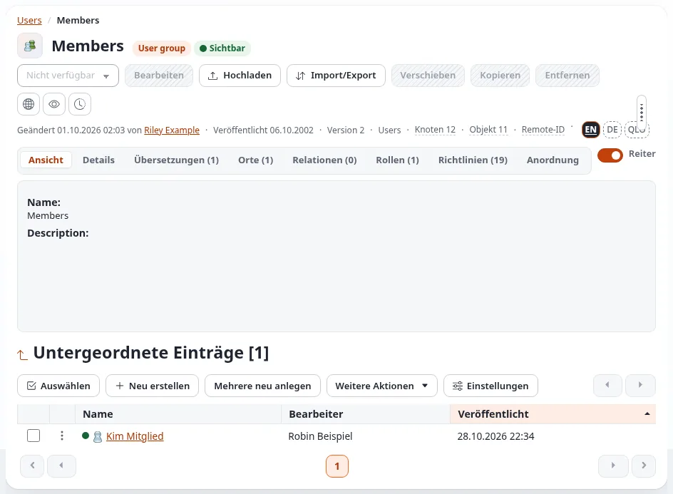
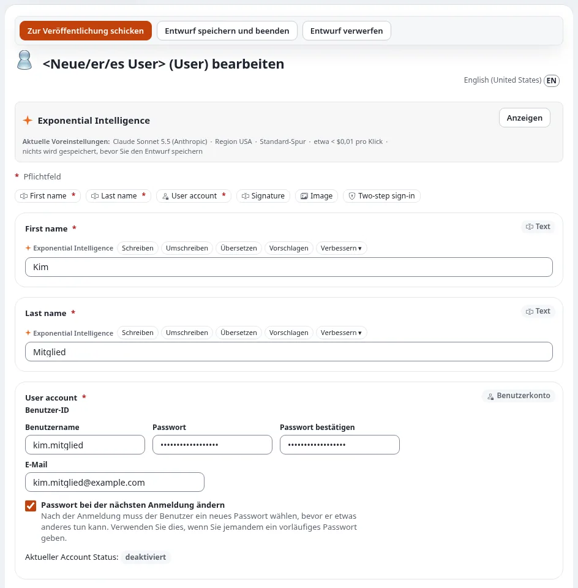
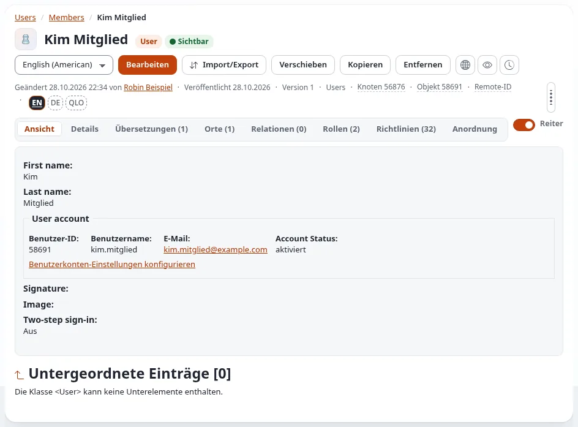
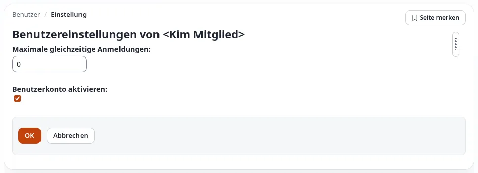
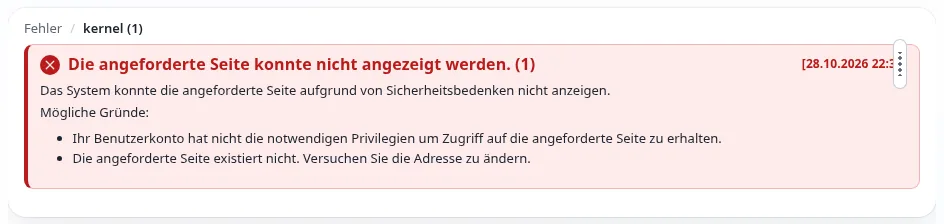

# Mitglieder verwalten

**Mitglieder** sind die Personen mit einem Konto auf der öffentlichen Website: Sie registrieren sich, melden sich an,
um geschützte Seiten zu lesen, schreiben Kommentare oder beteiligen sich an den Foren. Um diese Konten kümmern sich
die Redakteure. Die Rolle **Member management**, die jedes Konto in der Gruppe Editors hat, erlaubt einem Redakteur
alles, was das Konto eines Mitglieds braucht, beschränkt auf die Gruppe **Members**:

- ein Mitglied oder eine Gruppe von Mitgliedern innerhalb von Members anlegen;
- ein Mitglied bearbeiten: Name, E-Mail-Adresse, Benutzername, Passwort;
- das Konto eines Mitglieds aktivieren und deaktivieren;
- ein Mitglied in eine andere Gruppe innerhalb von Members verschieben;
- ein Mitglied entfernen;
- die Versionen eines Mitgliedskontos lesen.

Die Konten von **Administratoren** und anderen **Redakteuren** bleiben außer Reichweite, ebenso die Rollen: Ein
Redakteur weist nie eine Rolle zu und ändert keine. Jede Aktion und jeder abgewiesene Versuch steht im
[Benutzer-Auditprotokoll](das-benutzer-auditprotokoll.md).

## Die Mitglieder finden

Klicken Sie im oberen Menü auf **Benutzer**. Ein Redakteur sieht die Gruppen **Members** und **Editors** (diese nur,
um das Konto einer neuen Kollegin zu beantragen); die übrigen Gruppen der Installation werden nicht angezeigt.

Klicken Sie auf **Members**. Die Gruppe listet ihre Mitglieder unter **Untergeordnete Einträge**; **Auswählen**, die
Einstellungen der Tabelle und die Suche in der Kopfleiste funktionieren wie bei jeder anderen Liste.

## Ein Mitglied anlegen

1. Klicken Sie in **Members** (oder einer Gruppe darin) auf **Neu erstellen** und wählen Sie **User**.
2. Füllen Sie **First name**, **Last name** und unter **User account** **Benutzername**, **E-Mail**, **Passwort** und
   **Passwort bestätigen** aus. Lassen Sie **Passwort bei der nächsten Anmeldung ändern** angekreuzt, wenn Sie dem
   Mitglied ein vorläufiges Passwort geben: Es wählt dann bei der ersten Anmeldung sein eigenes.
3. Klicken Sie auf **Zur Veröffentlichung schicken**. Fragt die Website **Bestätigen Sie, dass Sie es sind**, geben
   Sie Ihr eigenes Passwort ein und klicken Sie auf **Bestätigen**
   ([Identität bestätigen](../anleitungen/identitaet-bestaetigen.md)).

Geben Sie das vorläufige Passwort auf einem anderen Weg weiter als die E-Mail mit dem Benutzernamen, wie in
[Konten für Redakteure und Administratoren einrichten](konten-fuer-redakteure-und-administratoren-einrichten.md#8-die-anmeldung-übergeben)
beschrieben. Ein Mitglied, das sein Passwort vergessen hat, kann jederzeit mit **Passwort vergessen?** auf der
Anmeldeseite ein neues setzen.

## Ein Mitglied bearbeiten

Öffnen Sie das Mitglied und klicken Sie auf **Bearbeiten**. Sie können Namen, E-Mail-Adresse, Benutzernamen und
Passwort ändern und **Passwort bei der nächsten Anmeldung ändern** ankreuzen. Veröffentlichen Sie wie oben.

## Ein Mitglied aktivieren oder deaktivieren

1. Öffnen Sie das Mitglied und klicken Sie unter **User account** auf **Benutzerkonten-Einstellungen konfigurieren**.
2. Kreuzen Sie **Benutzerkonto aktivieren** an oder entfernen Sie das Kreuz. **Maximale gleichzeitige Anmeldungen**
   begrenzt, wie viele Sitzungen das Mitglied gleichzeitig haben darf (`0` heißt: keine Grenze).
3. Klicken Sie auf **OK**.

Ein deaktiviertes Mitglied kann sich nicht anmelden; alles, was es geschrieben hat, bleibt. Deaktivieren Sie lieber,
statt zu entfernen, wenn Sie unsicher sind.

## Ein Mitglied verschieben oder entfernen

- **Verschieben**: Öffnen Sie das Mitglied, klicken Sie auf **Verschieben** und wählen Sie eine andere Gruppe
  innerhalb von Members. Eine Gruppe außerhalb von Members (etwa Editors oder Administrator users) wird abgewiesen.
- **Entfernen**: Öffnen Sie das Mitglied, klicken Sie auf **Entfernen** und bestätigen Sie. Prüfen Sie vorher im
  Reiter **Relationen**, ob Inhalte auf das Konto verweisen; im Zweifel deaktivieren Sie es stattdessen.

## Was abgewiesen wird, und warum

Ein Redakteur kann das Konto eines Administrators oder eines anderen Redakteurs nicht öffnen, bearbeiten, verschieben,
deaktivieren oder entfernen, kein Mitglied nach Editors oder Administrator users verschieben und die Gruppe Members
selbst nicht umbenennen, verschieben oder entfernen. Ein solcher Versuch endet auf einer Fehlerseite:

Das ist gewollt. Soll ein Mitglied Redakteur werden: Fragen Sie einen Administrator, oder legen Sie ein neues Konto in
Editors an, das ein Administrator dann freigibt
([Neue Redakteurskonten freigeben](../anleitungen/neue-redakteurskonten-freigeben.md)).

## Alles wird aufgezeichnet

Die Website zeichnet jede dieser Aktionen auf: wer sie ausgeführt hat, wann, über welche Oberfläche und was sich
geändert hat (die E-Mail-Adresse als Hash, nie ein Passwort), und ebenso jeden abgewiesenen Versuch. Administratoren
lesen das im [Benutzer-Auditprotokoll](das-benutzer-auditprotokoll.md) und im Audit-Protokoll. Ändern Sie nur Konten,
um deren Änderung Sie gebeten wurden.

**Datenschutz:** Mitgliedskonten enthalten personenbezogene Daten. Ändern Sie nur, worum das Mitglied oder Ihre
Organisation gebeten hat, halten Sie Passwörter aus E-Mails heraus und entfernen Sie die Konten von Mitgliedern, die
ihre Löschung verlangt haben ([Datenexport und Löschung](kunden/handel/datenexport-und-loeschung.md)).

## Für Administratoren

Die Rolle *Member management* entsteht aus `settings/membermanagement.ini`: welche Gruppen welche anderen Gruppen
verwalten, welche Gruppen geschützt sind (standardmäßig Administrator users und Editors) und welche Berechtigungen ein
Verwalter erhält. Auf einer bestehenden Installation zeigt `php bin/php/addmembermanagement.php --dry-run`, was er
hinzufügen würde. Einzelheiten, und wie eine andere Gruppe Mitglieder verwalten kann (etwa ein Support-Team):
[Mitgliederverwaltung](../bc/6.0/mitgliederverwaltung.md).

## Verwandte Seiten

- [Was die Redakteursrolle erlaubt](was-die-redakteursrolle-erlaubt.md)
- [Konten für Redakteure und Administratoren einrichten](konten-fuer-redakteure-und-administratoren-einrichten.md)
- [Das Benutzer-Auditprotokoll](das-benutzer-auditprotokoll.md)
- [Wie richte ich einen Bereich nur für Mitglieder ein?](handbuch/wie-richte-ich-einen-bereich-nur-fuer-mitglieder-ein.md)
- [Wie deaktiviere oder entsperre ich ein Benutzerkonto?](handbuch/wie-deaktiviere-oder-entsperre-ich-ein-benutzerkonto.md)
- [Freie Dokumentation](freie-dokumentation.md): Diese Seite darf unter der GNU FDL 1.3 frei kopiert, übersetzt und verbessert werden.

<!-- exp-partner-block:start -->
**Werden Sie Exponential-Partner.** Partner teilen ihre Informationen, stellen Mittel bereit, geben Beiträge zurück
und entwickeln die Produkte mit uns, und so wächst Exponential. Eine Partner-Website und ein Dashboard sind für Mitte
2027 geplant: Werden Sie noch heute Partner, damit wir schneller wachsen und neue Funktionen früher liefern. Beginnen
Sie mit [Partner: hier beginnen](partner/partner-hier-beginnen.md) und
[Wie Sie sich bewerben](partner/wie-sie-sich-bewerben.md).
<!-- exp-partner-block:end -->
