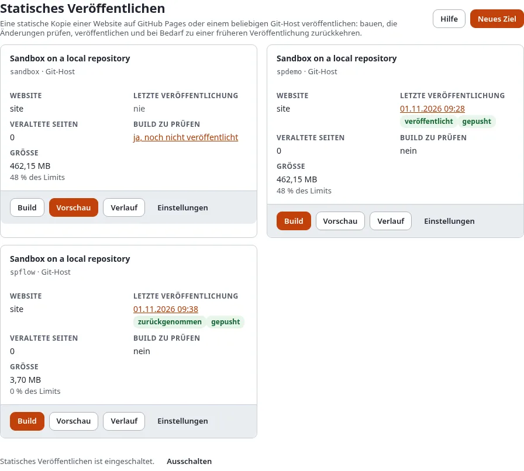

# Neu in 6.0.15: statisches Veröffentlichen

Exponential 6.0.15 kann Ihre Website als **statische Kopie** veröffentlichen: einfache HTML-Seiten und Dateien, die
GitHub Pages kostenlos hostet oder die jeder andere Git-Host und jeder einfache Webserver ausliefern kann. Ihre
Redaktion arbeitet weiter in Exponential; die öffentliche Website braucht kein PHP, keine Datenbank und keinen Server
von Ihnen.

## Was Sie am Ende haben

Eine Vorstellung davon, was statisches Veröffentlichen bringt und wo Sie anfangen.

## Was es bringt

- **Kostenloses Hosting** auf GitHub Pages, unter `https://<sie>.github.io/<website>/` oder Ihrer eigenen Domain mit
  kostenlosem HTTPS.
- **Nichts anzugreifen** auf der öffentlichen Seite: keine Anmeldung, keine Datenbank, keine PHP-Version, die gepflegt
  werden muss.
- **Schnelle Seiten** aus dem Netz von GitHub.
- **Ein Assistent** unter Setup > Statisches Veröffentlichen, der das Ziel und mit einem Token auch das Repository und
  GitHub Pages einrichtet.
- **Prüfen vor dem Veröffentlichen**: was sich ändert, die Größe gegenüber den Grenzen, eine Vorschau der Kopie.
- **Jede Veröffentlichung bleibt**: je ein Commit und ein Tag, und Zurücknehmen in einem Schritt.
- **Veröffentlichen von selbst**, wenn Inhalte veröffentlicht werden oder nach Zeitplan, mit E-Mail und Webhook.
- **Suche, Formulare und Weiterleitungen**, die auf einem statischen Host weiter funktionieren.
- **Für Entwickler**: die Befehle `exp:static:*`, ein GitHub-Actions-Workflow und das Starter-Repository
  [exponential-static-site-starter](https://github.com/se7enxweb/exponential-static-site-starter).

Ansehen: die Exponential-Demo-Website als statische Kopie unter
[https://se7enxweb.github.io/exponential-demo-site-static/](https://se7enxweb.github.io/exponential-demo-site-static/) (in Kürze).

## Wo Sie anfangen

| Sie möchten | Lesen Sie |
|---|---|
| Ihre Website jetzt kostenlos online stellen | [In 15 Minuten eine kostenlose Website](statisches-veroeffentlichen/in-15-minuten-eine-kostenlose-website.md) |
| Erst wissen, was es ist | [Was statisches Veröffentlichen ist](statisches-veroeffentlichen/was-statisches-veroeffentlichen-ist.md) |
| Entscheiden, ob es passt | [Passt statisch zu meiner Website?](statisches-veroeffentlichen/passt-statisch-zu-meiner-website.md) |
| Das ganze Handbuch lesen | [Statisches Veröffentlichen](statisches-veroeffentlichen/README.md) |
| Es auf der Kommandozeile einrichten | [Statische Websites auf GitHub Pages hosten](../anleitungen/statische-websites-auf-github-pages-hosten.md) |
| Jede Einstellung und jeden Befehl kennen | [Die Funktionsseite](../funktionen/6.0/statisches-veroeffentlichen.md) |

## Aktualisieren

Nichts ändert sich, bis Sie es einschalten: Statisches Veröffentlichen ist standardmäßig aus. Das Upgrade legt seine
zwei Tabellen an. Einzelheiten: [Statisches Veröffentlichen und Kompatibilität](../bc/6.0/statisches-veroeffentlichen.md).

## Nächster Schritt

[In 15 Minuten eine kostenlose Website](statisches-veroeffentlichen/in-15-minuten-eine-kostenlose-website.md).
