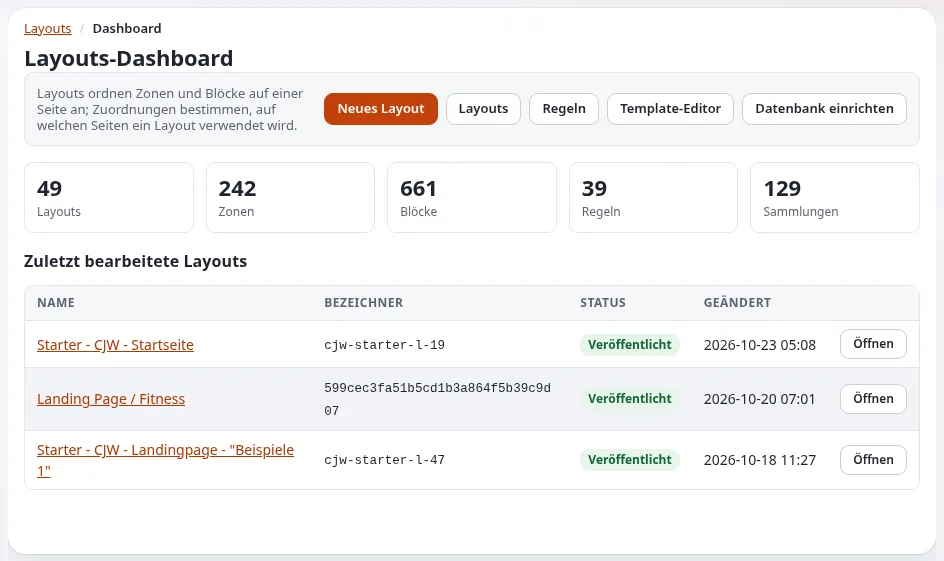
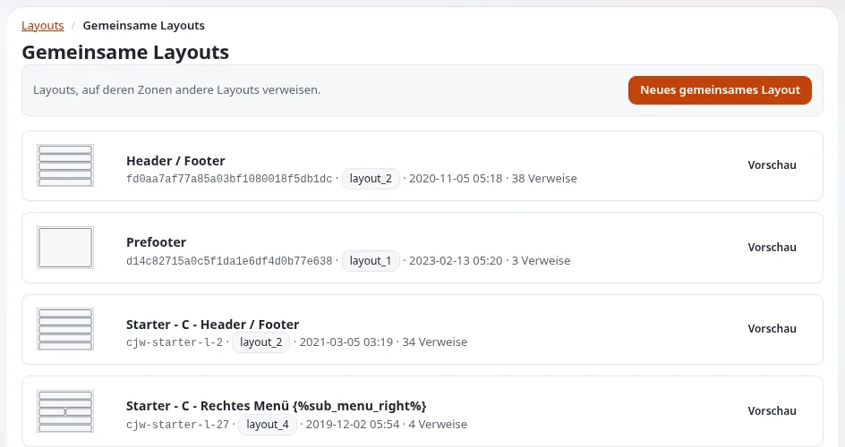
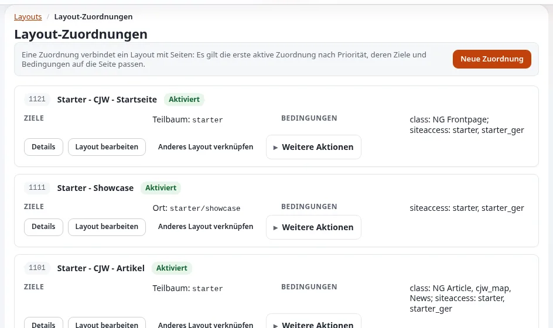

# Demo-Skript: Exponential Layouts

Diese Seite ist für Creator, die den Seitenbaukasten von Exponential zeigen. Exponential Layouts bringt "the Netgen
Layouts concept to the Exponential kernel" (`README.md`, zitiert in
[Marken- und Namensregeln](../geschaeft/marken-und-namensregeln.md#andere-unternehmen-und-produkte)); nennen Sie Netgen, wenn
Sie es zeigen. Das Skript dauert etwa acht Minuten und arbeitet mit einer Kopie eines Layouts, sodass sich auf Ihrer
Demo-Website nichts ändert, solange Sie nicht veröffentlichen. Jeder Klick stammt aus [Der Layout-Editor](../layout-editor.md)
und [In der Praxis: der Layout-Editor](../rundgang-durch-die-administration.md#in-der-praxis-der-layout-editor).

Melden Sie sich mit einem Konto an, dessen Rolle mit Layouts arbeiten darf: Der Tab **Layouts** wird nur solchen Rollen
angezeigt. Der aktuelle Editor gehört zur Entwicklungslinie 6.0.15; sagen Sie, welche Version Sie zeigen.

## Inhalt

1. [Die Wörter, die Sie verwenden werden](#die-wörter-die-sie-verwenden-werden)
2. [Teil 1: das Dashboard und ein neues Layout (1 Minute 30)](#teil-1-das-dashboard-und-ein-neues-layout-1-minute-30)
3. [Teil 2: Blöcke (3 Minuten)](#teil-2-blöcke-3-minuten)
4. [Teil 3: gemeinsame Layouts und verknüpfte Zonen (1 Minute 30)](#teil-3-gemeinsame-layouts-und-verknüpfte-zonen-1-minute-30)
5. [Teil 4: veröffentlichen oder verwerfen, und Zuordnungen (2 Minuten)](#teil-4-veröffentlichen-oder-verwerfen-und-zuordnungen-2-minuten)
6. [Was Sie nicht behaupten sollten](#was-sie-nicht-behaupten-sollten)

## Die Wörter, die Sie verwenden werden

| Wort | Bedeutung, wie die Hilfe sie festlegt |
|---|---|
| Layout | Der Plan einer Seite |
| Zone | Ein Bereich des Layouts, etwa *header*, *main* oder *footer*; der Layout-Typ entscheidet, welche Zonen es gibt |
| Block | Ein Teil innerhalb einer Zone: ein Titel, formatierter Text, ein Bild, eine Liste, eine Galerie ... |
| Zuordnung (Regel) | Entscheidet, auf welchen Seiten ein Layout verwendet wird |
| Gemeinsames Layout | Enthält Blöcke, die viele Seiten verwenden, etwa Kopf- und Fußzeile; andere Layouts verknüpfen sich damit |

Quelle: [Layouts, Zonen und Blöcke](../layout-editor.md#layouts-zonen-und-blöcke).

## Teil 1: das Dashboard und ein neues Layout (1 Minute 30)

1. Öffnen Sie den Tab **Layouts**. Sagen Sie: „Das **Layouts-Dashboard** zeigt die Zahl der Layouts, Zonen, Blöcke und
   Zuordnungen sowie die zuletzt geänderten Layouts.“
2. Klicken Sie auf **Neues Layout**, wählen Sie einen **Layout-Typ** (zum Beispiel *2 columns*), geben Sie einen
   **Name** ein und klicken Sie auf **Layout anlegen**. Sagen Sie: „Der Editor öffnet sich mit den leeren Zonen dieses
   Typs.“
3. Zeigen Sie auf die vier Bereiche: Name und Schaltflächen oben, **Block hinzufügen** links, die Zonen in der Mitte, die
   Eigenschaften rechts (*Select a block to access its properties.*).



## Teil 2: Blöcke (3 Minuten)

1. Klicken Sie auf **Block hinzufügen** (die Plus-Schaltfläche). Zeigen Sie die Gruppen: **Basic**, **Components**,
   **Listing**, **Gallery**, **Containers**, **Placeholders**.
2. Ziehen Sie einen Block **Title** in eine Zone. Klicken Sie ihn an: Er wird blau umrandet, und seine Einstellungen
   erscheinen in zwei Tabs.
3. Tippen Sie unter **Inhalt** einen Titel. Sagen Sie: „Änderungen erscheinen sofort im Block.“
4. Öffnen Sie **Design**. Sagen Sie: „Wie der Block aussieht: zum Beispiel der Ansichtstyp und der Stil.“
5. Öffnen Sie das Menü mit den drei Punkten am Block und wählen Sie **Duplicate block**.
6. Ziehen Sie die Kopie an ihrer Kopfleiste in eine andere Zone. Dann **Block löschen** bei ihr.

## Teil 3: gemeinsame Layouts und verknüpfte Zonen (1 Minute 30)

Wechseln Sie zu einem vorhandenen Layout, das eine verknüpfte Zone hat (**Layouts**, **Öffnen**).

1. Zeigen Sie auf eine Zone mit rotem gestricheltem Rahmen und schraffierten Blöcken. Sagen Sie: „Diese Zone ist mit
   einer Zone eines gemeinsamen Layouts verknüpft. Kopf- und Fußzeile gibt es nur einmal, und viele Layouts verknüpfen
   sich damit, statt sie zu kopieren.“
2. Sagen Sie: „Verknüpfte Blöcke lassen sich hier nicht ändern; Sie ändern sie, indem Sie das gemeinsame Layout selbst
   öffnen.“
3. Klicken Sie unten links auf **Link zone with shared layout zone**. Zeigen Sie Schritt 1 (**Link zone** bei jeder
   Zone) und sagen Sie, wonach Schritt 2 fragt: nach dem gemeinsamen Layout und seiner Zone. Klicken Sie auf **Back**.



## Teil 4: veröffentlichen oder verwerfen, und Zuordnungen (2 Minuten)

1. Öffnen Sie oben das Menü mit den drei Punkten und zeigen Sie **Veröffentlichen und weiter bearbeiten** und
   **Entwurf speichern und schließen**.
2. Klicken Sie auf **Verwerfen** und bestätigen Sie im Dialog **Discard changes**. Sagen Sie: „Ich habe an einem Entwurf
   gearbeitet; das veröffentlichte Layout ist genau so, wie es war.“
3. Öffnen Sie im Dashboard **Regeln**. Zeigen Sie bei einer Zuordnung auf **Ziele** und **Bedingungen**. Sagen Sie:
   „Es gewinnt die erste aktivierte Zuordnung nach Priorität, deren Ziele und Bedingungen zu einer Seite passen.“
   ([Welche Seiten ein Layout verwenden](../layout-editor.md#welche-seiten-ein-layout-verwenden))

Wenn Sie vor der Kamera veröffentlichen und der Editor fragt, ob Caches geleert werden sollen, wählen Sie
**Caches leeren**, damit die Änderung erscheint.



## Was Sie nicht behaupten sollten

| Sagen Sie nicht | Sagen Sie stattdessen |
|---|---|
| „Jedes Exponential-Produkt hat diesen Editor.“ | „Exponential Platform DXP liefert keinen Layout-Editor.“ ([Die Produktfamilie kennen](../fuersprecher/die-produktfamilie-kennen.md#häufige-verwechslungen)) |
| „Das ist Netgen Layouts.“ | „Es bringt das Konzept von Netgen Layouts in den Kernel von Exponential.“ |
| „Netgen hat das für Exponential gemacht.“ | Nennen Sie nur das Konzept; die Quellen sagen nicht, dass Netgen die Portierung gebaut hat |
| „Jeder kann jede Seite ändern.“ | „Rollen entscheiden, wer den Tab Layouts sieht; Zuordnungen bestimmen ganze Teile der Website.“ |

```text
BESCHREIBUNGSBLOCK
Zeigt Exponential Layouts in Exponential <Version>, auf meiner eigenen Testinstallation.
Exponential Layouts bringt das Konzept von Netgen Layouts in den Kernel von Exponential.
Der Layout-Editor: <Link zu „Der Layout-Editor“>
Rundgang mit Screenshots: <Link zu „Ein Rundgang durch die Administration, In der Praxis: der Layout-Editor“>
```

## Verwandte Seiten

- [Der Layout-Editor](../layout-editor.md)
- [Gesprächspunkte: Exponential Layouts](../fuersprecher/gespraechspunkte-exponential-layouts.md)
- [Demo-Skript: Rundgang für Redakteure](demo-skript-rundgang-fuer-redakteure.md)
- [Freie Dokumentation](../freie-dokumentation.md): Diese Seite darf unter der GNU FDL 1.3 frei kopiert, übersetzt und verbessert werden.

<!-- exp-partner-block:start -->
**Werden Sie Exponential-Partner.** Partner teilen ihre Informationen, stellen Mittel bereit, geben Beiträge zurück
und entwickeln die Produkte mit uns, und so wächst Exponential. Eine Partner-Website und ein Dashboard sind für Mitte
2027 geplant: Werden Sie noch heute Partner, damit wir schneller wachsen und neue Funktionen früher liefern. Beginnen
Sie mit [Partner: hier beginnen](../partner/partner-hier-beginnen.md) und
[Wie Sie sich bewerben](../partner/wie-sie-sich-bewerben.md).
<!-- exp-partner-block:end -->
