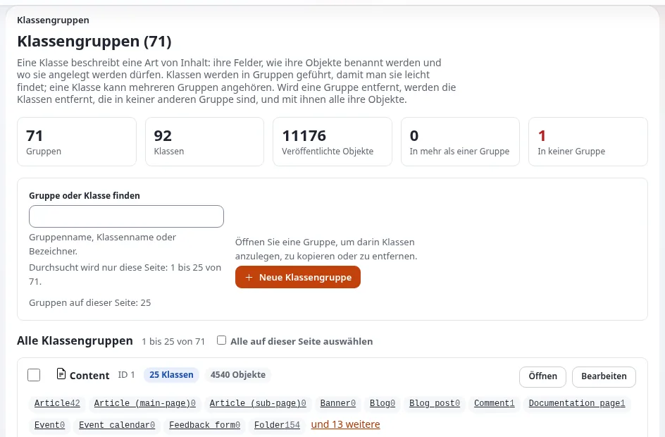
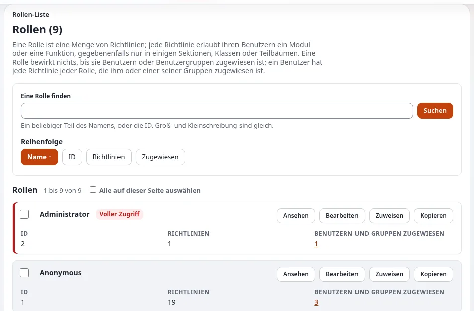
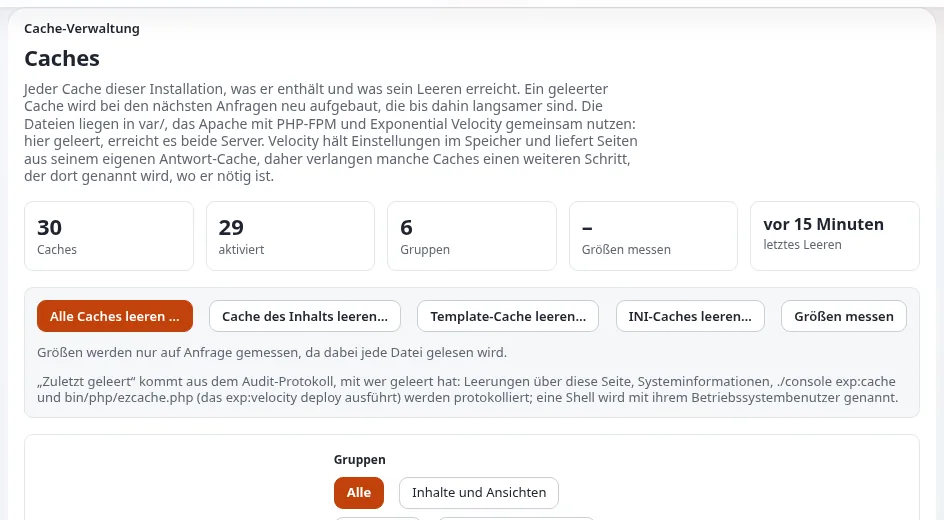
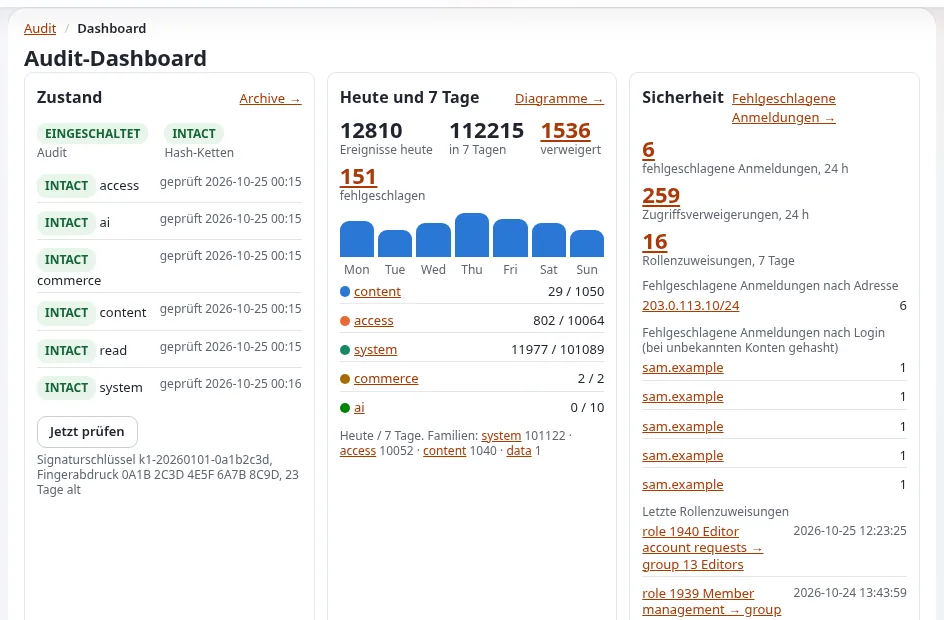

# Demo-Skript: Rundgang für Administratoren

Diese Seite ist für Creator, deren Publikum Websites betreibt: Administratoren, Hoster, Entwickler und IT-Leiter. Die
Bildschirme des Administrators zeigen mehr als die des Redakteurs, und mehrere davon können Daten zeigen, die Sie nicht
veröffentlichen dürfen; dieses Skript nennt daher diese Bildschirme und sagt, wie Sie sie filmen. Es folgt den Teilen 3,
7 und 8 der [45-minütigen Vorverkaufsdemo](../geschaeft/demo-drehbuecher.md#die-45-minuten-demo) und dauert etwa zehn Minuten.

Melden Sie sich als Administrator einer Demo-Installation an, die nur erfundene Inhalte und erfundene Konten enthält
([Eine Demo-Installation einrichten](eine-demo-installation-einrichten.md)). Die Menünamen unten sind die des Designs admin4
der Entwicklungslinie 6.0.15; sagen Sie, welche Version Sie zeigen.

## Inhalt

1. [Teil 1: das Inhaltsmodell (2 Minuten)](#teil-1-das-inhaltsmodell-2-minuten)
2. [Teil 2: Benutzer, Rollen und Sprachen (2 Minuten)](#teil-2-benutzer-rollen-und-sprachen-2-minuten)
3. [Teil 3: Betrieb (3 Minuten)](#teil-3-betrieb-3-minuten)
4. [Teil 4: Sicherheit (3 Minuten)](#teil-4-sicherheit-3-minuten)
5. [Bildschirme, die Sorgfalt brauchen](#bildschirme-die-sorgfalt-brauchen)

## Teil 1: das Inhaltsmodell (2 Minuten)

1. Öffnen Sie **Setup > Klassen**, öffnen Sie die Klasse *Ordner* und zeigen Sie auf ihre Attribute.
2. Gehen Sie zurück zum Bearbeitungsformular eines Ordners und zeigen Sie, dass jedes Attribut eine Karte ist.
3. Sagen Sie: „Inhaltstypen werden hier festgelegt, nicht im Code. Ein Artikel, ein Produkt, eine Veranstaltung: Jeder
   bekommt genau die Felder, die er braucht.“ Die README nennt das Inhaltsmodell die bemerkenswerteste Eigenschaft von
   Exponential: "its fully customizable and extendable content model."
4. Ändern Sie vor der Kamera keine Klasse. Quelle: [Das Inhaltsmodell und das Bearbeiten von Inhalten](../../anleitungen/inhaltsmodell-und-bearbeitung.md).

## Teil 2: Benutzer, Rollen und Sprachen (2 Minuten)

1. **Benutzer > Rollen und Richtlinien**: Öffnen Sie die Rolle *Editor*. Sagen Sie: „Was jede Gruppe tun darf, ist eine
   Menge von Richtlinien.“ Quelle: [Rollen und Richtlinien](../../anleitungen/rollen-und-richtlinien.md).
2. Zeigen Sie auf die Richtlinie, die die Hilfe öffnet: „Die Hilfe ist für Redakteure auf einer neuen Installation über
   die Richtlinie `exphelp/read` lesbar.“ ([Das Hilfesystem](../../funktionen/6.0/hilfesystem.md#wer-sie-lesen-darf))
3. **Setup > Sprachen**: Zeigen Sie die Inhaltssprachen. Nennen Sie die dokumentierten Zahlen mit ihrer Quelle:
   268 Locale-Dateien können als Inhaltssprachen verwendet werden; es gibt 38 Übersetzungen der Administration, dreiundzwanzig
   davon vollständig (23. Oktober 2026) ([Sprachen in Exponential](../../sprachen.md)).

## Teil 3: Betrieb (3 Minuten)

1. **Setup > Logdateien**: der Navigator und eine Suche. Sagen Sie: „Datenschutz zuerst: E-Mail-Adressen, IP-Adressen,
   Passwörter, Tokens, Schlüssel und Sitzungs-IDs werden in dieser Ansicht maskiert.“ Klicken Sie vor der Kamera nie auf
   **Unmaskiert zeigen**, und lesen Sie trotzdem jede Zeile, die Sie zeigen ([Log-Viewer](../../funktionen/6.0/log-betrachter.md)).
2. **Setup > Upgrade-Prüfung**: „Vor einem Upgrade vergleicht dies jede Datei mit dem Release.“
   ([Die Upgrade-Prüfung](../../anleitungen/upgrade-pruefung.md))
3. **Setup > Caches**: Zeigen Sie auf die Schaltflächen; sagen Sie, wozu das Leeren eines Caches dient. Leeren Sie
   nichts auf einer Website, die andere nutzen. ([Caches](../../anleitungen/caches.md))
4. **Setup > Systeminformationen**: Zeigen Sie nur den oberen Teil. Machen Sie Pfade, Hostnamen und Angaben zur
   Datenbank unkenntlich ([Systeminformationen](../../anleitungen/systeminformationen.md)).
5. Optional: **Setup > Wartung** ([Wartungsmodus](../../anleitungen/wartungsmodus.md)).

## Teil 4: Sicherheit (3 Minuten)

1. Öffnen Sie den Tab **Audit** (`/audit/dashboard`), dann **Konsole**. Sagen Sie: „Meine Anmeldung ist bereits
   festgehalten. Jeder Eintrag trägt den Hash des vorherigen, sodass eine Änderung am Protokoll auffällt.“
   ([Das Prüfprotokoll](../../funktionen/6.0/pruefprotokoll.md))
2. In einem Terminal, außerhalb des geteilten Bildschirms, wenn es einen Prompt zeigt, der Sie stört:
   `./console exp:audit verify --allow-root-user`.
3. Öffnen Sie `/user2fa/setup` mit dem Demo-Konto: Zeigen Sie die Wahl zwischen einer Authenticator-App und einem Code per
   E-Mail. **Schließen Sie die Einrichtung nicht vor der Kamera ab**: Der QR-Code und das Geheimnis sind der zweite
   Faktor ([Zweistufige Anmeldung](../../anleitungen/zwei-faktor-anmeldung.md)).
4. Öffnen Sie in der Hilfe [Content Security Policy](../../funktionen/6.0/content-security-policy.md) und sagen Sie:
   „Standardmäßig ist sie in der Administration auf report-only und auf den Websites aus; die Seite erklärt, wie man sie
   erzwingt.“
5. Schließen Sie mit der [Checkliste der Sicherheitshärtung](../sicherheitshaertung.md#checkliste).

Sagen Sie nichts wie „es ist sicher“ oder „es hatte nie eine Sicherheitslücke“. Sagen Sie: „Hier sind der Prozess und
die Checkliste; Sicherheitslücken werden vertraulich an die Adresse in `SECURITY.md` gemeldet.“

## Bildschirme, die Sorgfalt brauchen

| Bildschirm | Was er zeigen kann | Wie Sie ihn filmen |
|---|---|---|
| Setup > Systeminformationen | Pfade, Hostnamen, Angaben zur Datenbank, Versionen | Den oberen Teil zeigen; den Rest unkenntlich machen |
| Setup > Logdateien | IP-Adressen, Benutzernamen, Pfade (die Maskierung hilft, aber prüfen Sie) | Eine frische Demo-Installation; vor der Aufnahme lesen |
| Audit-Konsole | Kontonamen, IP-Adressen von Anmeldungen | Erfundene Konten; Adressen unkenntlich machen |
| Benutzer | Namen und E-Mail-Adressen | Nur erfundene Benutzer |
| Einrichtung der zweistufigen Anmeldung | Der QR-Code und das Geheimnis | Nie vor der Kamera abschließen |
| Einstellungsdateien, `settings/override/` | Zugangsdaten zur Datenbank, Schlüssel | Nie vor der Kamera öffnen; stattdessen die Dokumentation zeigen |
| Fehlerseiten | Pfade und Referenzen | Zuerst lesen; die Referenz zeigen, den Rest unkenntlich machen |

Mehr: [Geheimnisse vom Bildschirm fernhalten](geheimnisse-vom-bildschirm-fernhalten.md), [Privatsphäre vor der Kamera](privatsphaere-vor-der-kamera.md).

## Verwandte Seiten

- [Sicherheitshärtung](../sicherheitshaertung.md)
- [Gesprächspunkte für Administratoren](../fuersprecher/gespraechspunkte-fuer-administratoren.md)
- [Demo-Skript: Velocity](demo-skript-velocity.md)
- [Freie Dokumentation](../freie-dokumentation.md): Diese Seite darf unter der GNU FDL 1.3 frei kopiert, übersetzt und verbessert werden.

<!-- exp-partner-block:start -->
**Werden Sie Exponential-Partner.** Partner teilen ihre Informationen, stellen Mittel bereit, geben Beiträge zurück
und entwickeln die Produkte mit uns, und so wächst Exponential. Eine Partner-Website und ein Dashboard sind für Mitte
2027 geplant: Werden Sie noch heute Partner, damit wir schneller wachsen und neue Funktionen früher liefern. Beginnen
Sie mit [Partner: hier beginnen](../partner/partner-hier-beginnen.md) und
[Wie Sie sich bewerben](../partner/wie-sie-sich-bewerben.md).
<!-- exp-partner-block:end -->
