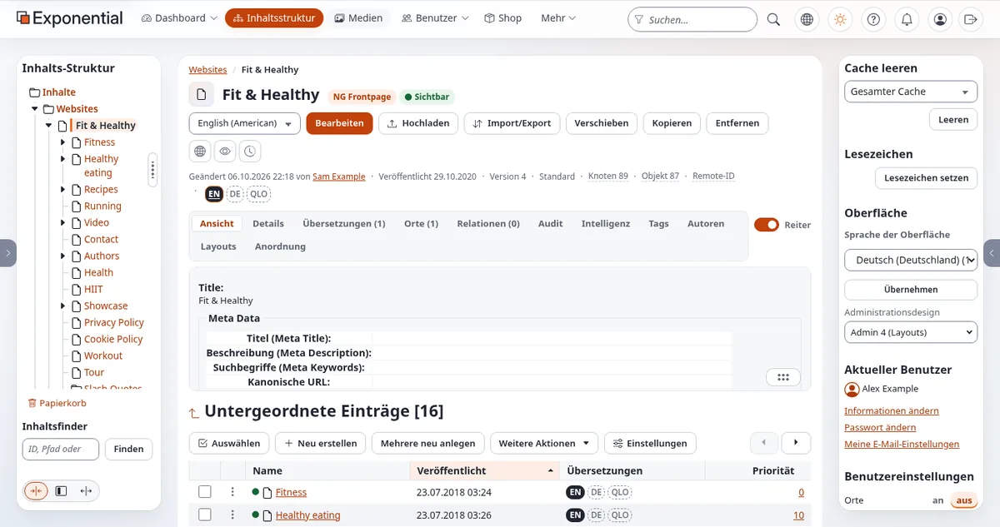
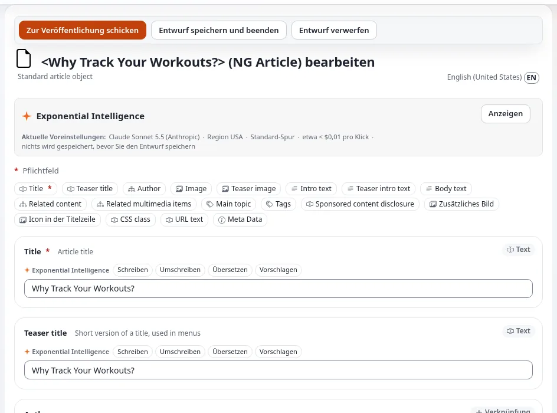
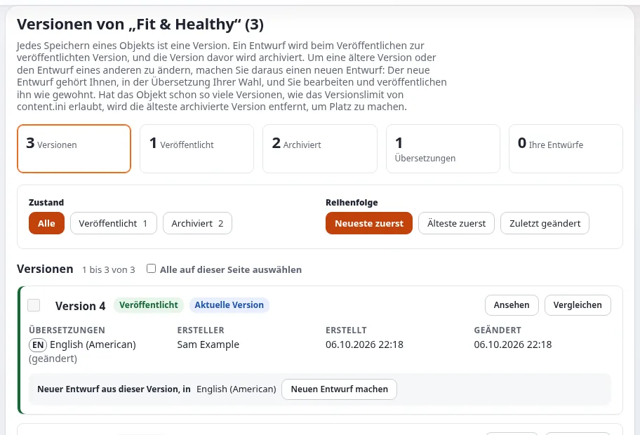
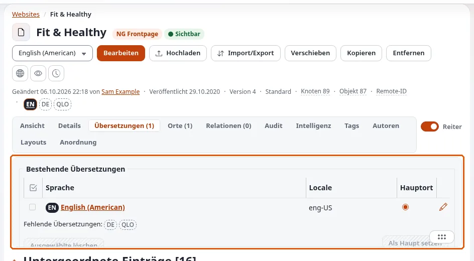

# Demo-Skript: Rundgang für Redakteure

Diese Seite ist für Creator, die ein Video für Redakteure machen: Menschen, die jeden Tag in Exponential schreiben und
veröffentlichen werden. Das Skript folgt den acht Schritten von [In der Praxis: einen Ordner bearbeiten](../rundgang-durch-die-administration.md#in-der-praxis-einen-ordner-bearbeiten)
und ergänzt die Sprachen. Es dauert etwa zehn Minuten. Melden Sie sich mit einem Konto **Demo-Redakteur** mit erfundenen
Angaben an, damit die Zuschauer sehen, was ein Redakteur sieht, und nicht, was ein Administrator sieht.

Bereiten Sie die Installation vorher vor ([Eine Demo-Installation einrichten](eine-demo-installation-einrichten.md)): ein
Ordner mit erfundenen Objekten, eine zweite Inhaltssprache und keine Entwürfe, die von einer früheren Aufnahme übrig sind.

## Inhalt

1. [Teil 1: sich zurechtfinden (2 Minuten)](#teil-1-sich-zurechtfinden-2-minuten)
2. [Teil 2: einen Ordner bearbeiten (4 Minuten)](#teil-2-einen-ordner-bearbeiten-4-minuten)
3. [Teil 3: Versionen (1 Minute 30)](#teil-3-versionen-1-minute-30)
4. [Teil 4: Sprachen und Rechts-nach-links (2 Minuten 30)](#teil-4-sprachen-und-rechts-nach-links-2-minuten-30)
5. [Sich vor der Kamera fangen](#sich-vor-der-kamera-fangen)

## Teil 1: sich zurechtfinden (2 Minuten)

| Klick | Sagen Sie | Quelle |
|---|---|---|
| Auf die Tabs zeigen | „Ein Redakteur sieht vielleicht nur **Dashboard**, **Inhaltsstruktur** und **Medien**; Administratoren sehen mehr.“ | [Ein Rundgang durch die Administration](../rundgang-durch-die-administration.md) |
| `/` drücken | „Mit der Schrägstrich-Taste springen Sie von überall in die Suche.“ | [Tastenkürzel](../tastenkuerzel.md#überall-in-der-administration) |
| `Esc`, dann die Sonnen-Schaltfläche | „Hell, dunkel oder der Modus Ihres Rechners; das wird für Ihr Konto gespeichert.“ | [Die Kopfzeile](../rundgang-durch-die-administration.md#die-kopfzeile) |
| Einen Ordner im Baum öffnen | „Ein Klick auf das Dreieck öffnet einen Ordner, ein Klick auf den Namen öffnet das Objekt.“ | [Die linke Spalte](../rundgang-durch-die-administration.md#die-linke-spalte) |
| Auf der Seite des Objekts auf die Schaltflächen zeigen | „**Bearbeiten**, **Verschieben**, **Kopieren**, **Entfernen** und drei runde Schaltflächen: **Auf der Website ansehen**, **Vorschau** und **Versionen verwalten**.“ | [Die Seite eines Objekts](../rundgang-durch-die-administration.md#die-seite-eines-objekts) |

## Teil 2: einen Ordner bearbeiten (4 Minuten)

1. Klicken Sie neben der Sprachliste auf **Bearbeiten**. Sagen Sie: „Das Formular öffnet sich mit einem neuen Entwurf,
   einer Kopie der veröffentlichten Version.“
2. Zeigen Sie auf die Schaltflächen oben: **Zur Veröffentlichung schicken**, **Entwurf speichern und beenden**,
   **Entwurf verwerfen**.
3. Zeigen Sie auf die **Feldleiste**: „Eine Schaltfläche pro Feld springt zu seiner Karte; ein roter Stern kennzeichnet
   ein Pflichtfeld.“
4. Tippen Sie in **Description**. Zeigen Sie auf die Werkzeugleiste und den Schalter **Editor** unter dem Feld. Sagen
   Sie, was Ihre Installation zeigt, zum Beispiel: „Der Schalter **Editor** wechselt den Editor dieses Felds; beim
   Wechseln bleibt erhalten, was ich getippt habe.“ Die Voreinstellungen unterscheiden sich: Eine frische Installation
   behält TinyMCE 3.5.12 als Standard, mit TinyMCE 8 als zuschaltbarer Engine ([Der Online-Editor auf TinyMCE 8](../../funktionen/6.0/online-editor-tinymce8.md)),
   während der Vorführserver im [Rundgang](../rundgang-durch-die-administration.md) TinyMCE 8 mit Tiptap als Alternative verwendet.
5. Klicken Sie auf **Entwurf speichern und beenden**. Sagen Sie: „Der Entwurf wartet unter **Meine Entwürfe**; nur ich
   sehe ihn. Das Formular speichert außerdem alle paar Minuten von selbst.“
6. Öffnen Sie im Dashboard **Meine Entwürfe** und klicken Sie beim Entwurf auf **Bearbeiten**.
7. Klicken Sie in der linken Spalte des Formulars auf **Vorschau**; zeigen Sie die Breiten für Telefon und Tablet;
   klicken Sie auf **Zurück zur Bearbeitung**.
8. Klicken Sie auf **Zur Veröffentlichung schicken**. Sagen Sie: „Der Entwurf wird zur veröffentlichten Version, und die
   vorherige bleibt erhalten.“

Erwähnen Sie eine Freigabe nur so, wie sie dokumentiert ist: „Wenn eine Website eine Freigabe verwendet, wartet die
Version unter **Meine Warteliste**.“

## Teil 3: Versionen (1 Minute 30)

1. Klicken Sie auf **Versionen verwalten** (die runde Schaltfläche mit einer Uhr).
2. Klicken Sie zwischen den beiden neuesten Versionen auf **Vergleichen**. Sagen Sie: „Ich sehe genau, was sich geändert
   hat.“
3. Zeigen Sie auf **Neuen Entwurf machen**: „Zurückgehen heißt, einen Entwurf aus einer älteren Version zu beginnen und
   ihn zu veröffentlichen.“ ([Zu einer früheren Version zurückkehren](../veroeffentlichen-und-versionen.md#zu-einer-früheren-version-zurückkehren))

## Teil 4: Sprachen und Rechts-nach-links (2 Minuten 30)

1. Zeigen Sie bei einem Objekt auf die Sprachabzeichen: „Ein gefülltes Abzeichen gibt es schon; ein gestricheltes noch
   nicht.“
2. Klicken Sie auf das gestrichelte Abzeichen, wählen Sie unter **Übersetzung basiert auf** die vorhandene Übersetzung,
   übersetzen Sie den Namen und veröffentlichen Sie. Sagen Sie: „Jede Übersetzung wird für sich veröffentlicht.“
   ([Ein Objekt übersetzen](../sprachen.md#ein-objekt-übersetzen))
3. Verlassen Sie das Bearbeitungsformular. Wählen Sie in der rechten Spalte unter **Oberfläche** Arabisch oder Hebräisch
   und klicken Sie auf **Anwenden**. Sagen Sie: „Die Administration dreht sich um: Die Seitenspalten tauschen die Plätze,
   und der Text beginnt rechts.“ ([Rechts nach links](../../funktionen/6.0/rechts-nach-links.md))
4. Schalten Sie zurück auf Englisch.

Wenn Sie Zahlen nennen, verwenden Sie die dokumentierten mit ihrer Quelle: 268 Locale-Dateien, die als Inhaltssprachen
verwendet werden können, Übersetzungen der Administration (die aktuellen Gesamtzahlen stehen am Anfang der Seite [Sprachen in Exponential](../../sprachen.md))
([Sprachen in Exponential](../../sprachen.md)).

## Sich vor der Kamera fangen

| Was passiert | Was Sie sagen und tun |
|---|---|
| *Möglicher Bearbeitungs-Konflikt* | „Ein Entwurf aus einer früheren Aufnahme.“ Öffnen Sie **Versionen verwalten**, verwerfen Sie ihn; schneiden Sie die Stelle heraus |
| Kein Kasten **Oberfläche** | Sie sind noch im Bearbeitungsformular; verlassen Sie es zuerst |
| Eine Sprache zeigt englische Texte | „Diese Übersetzung der Administration ist nicht vollständig.“ |
| Eine Fehlerseite | Halten Sie die Aufnahme an, lesen Sie die Seite, bevor Sie sie zeigen (sie kann Pfade enthalten), und machen Sie weiter |

Mehr: [Demo-Drehbücher, Was schiefgehen kann](../geschaeft/demo-drehbuecher.md#was-schiefgehen-kann-und-wie-sie-die-lage-retten).

## Verwandte Seiten

- [Ein Rundgang durch die Administration](../rundgang-durch-die-administration.md)
- [Inhalte erstellen und bearbeiten](../inhalte-bearbeiten.md)
- [Demo-Skript: Exponential Layouts](demo-skript-exponential-layouts.md)
- [Leitfaden für Video-Rundgänge](leitfaden-fuer-video-rundgaenge.md)
- [Freie Dokumentation](../freie-dokumentation.md): Diese Seite darf unter der GNU FDL 1.3 frei kopiert, übersetzt und verbessert werden.

<!-- exp-partner-block:start -->
**Werden Sie Exponential-Partner.** Partner teilen ihre Informationen, stellen Mittel bereit, geben Beiträge zurück
und entwickeln die Produkte mit uns, und so wächst Exponential. Eine Partner-Website und ein Dashboard sind für Mitte
2027 geplant: Werden Sie noch heute Partner, damit wir schneller wachsen und neue Funktionen früher liefern. Beginnen
Sie mit [Partner: hier beginnen](../partner/partner-hier-beginnen.md) und
[Wie Sie sich bewerben](../partner/wie-sie-sich-bewerben.md).
<!-- exp-partner-block:end -->
