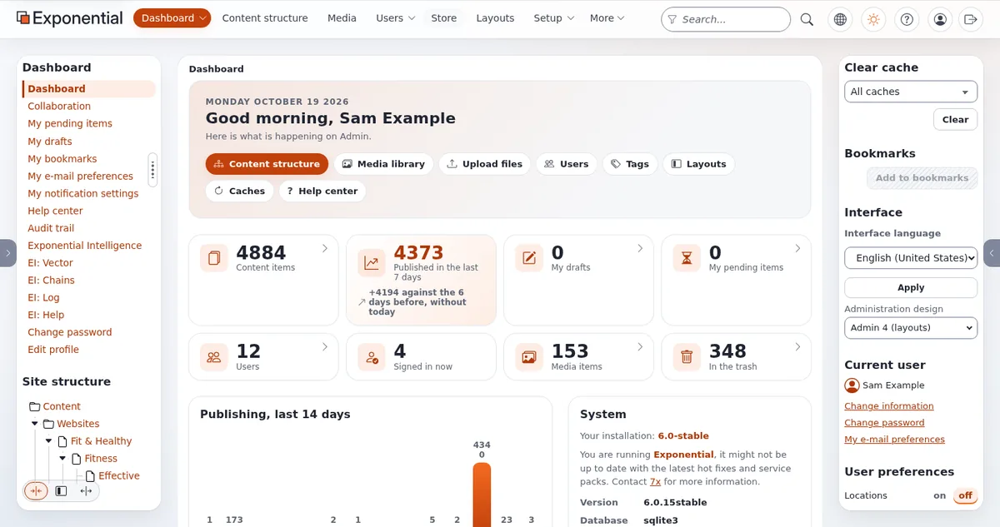

# Demo-Skript: Überblick in fünf Minuten

Diese Seite ist für Creator, die ein kurzes Video „Was ist Exponential“ oder einen fünfminütigen Abschnitt in einem
Stream machen wollen. Sie passt das fünfminütige Vorverkaufsskript aus den [Demo-Drehbüchern](../geschaeft/demo-drehbuecher.md#die-5-minuten-demo)
an ein Publikum an, das Sie nicht kennen. Jeder Klickname stammt aus [Ein Rundgang durch die Administration](../rundgang-durch-die-administration.md)
und [Der Layout-Editor](../layout-editor.md); jeder Satz, den Sie sagen, hat eine Quelle in der Tabelle am Ende.

Bevor Sie beginnen: eine Demo-Installation mit erfundenen Inhalten, angemeldet als Demo-Redakteur oder Administrator
([Eine Demo-Installation einrichten](eine-demo-installation-einrichten.md)).

## Inhalt

1. [Ziel und Publikum](#ziel-und-publikum)
2. [Das Skript](#das-skript)
3. [Was Sie nicht sagen sollten](#was-sie-nicht-sagen-sollten)
4. [Quellen für die Beschreibung](#quellen-für-die-beschreibung)

## Ziel und Publikum

**Ziel:** Der Zuschauer sieht, dass Redakteure in Entwürfen arbeiten, eine Seite sehen, bevor sie online geht, Seiten
selbst anordnen können und Hilfe im Produkt finden. **Publikum:** Menschen, die Exponential noch nie gesehen haben.
**Version:** Nennen Sie sie bei 0:00. Das Design admin4 und der aktuelle Layout-Editor gehören zur Entwicklungslinie 6.0.15.

## Das Skript

| Zeit | Auf dem Bildschirm | Klick | Sagen Sie |
|---|---|---|---|
| 0:00 | Ihr Gesicht oder eine Titelkarte | | Zeile zur Offenlegung, dann: „Das ist Exponential, ein freies Open-Source-Content-Management-System, geschrieben in PHP. Ich zeige <Version> auf meiner eigenen Testinstallation.“ |
| 0:15 | Das Dashboard | | „Nach der Anmeldung landen Sie im Dashboard: Schnellaktionen, Zahlen zu den Inhalten, Veröffentlichungen der letzten 14 Tage und Ihre eigenen Entwürfe und wartenden Elemente.“ |
| 0:45 | Der Baum in der linken Spalte | Einen Ordner öffnen | „Alles ist ein Objekt in einem Baum, wie Ordner auf einem Computer.“ |
| 1:00 | Die Seite des Ordners | **Bearbeiten** | „Jede Bearbeitung beginnt einen Entwurf. Die Website zeigt weiter die veröffentlichte Version, bis ich veröffentliche.“ |
| 1:20 | Das Bearbeitungsformular | **Short name** ändern; auf **Vorschau** klicken | „Vor dem Veröffentlichen kann ich die Seite sehen.“ |
| 1:40 | Die Vorschau | Die Schaltfläche für die Telefonbreite | „In der Breite von Telefon, Tablet und Desktop.“ |
| 2:00 | Die Vorschau | **Zurück zur Bearbeitung**, **Zur Veröffentlichung schicken** | „Beim Veröffentlichen bleibt die frühere Version erhalten, sodass ich immer zurückgehen kann.“ |
| 2:30 | Der Tab **Layouts** | **Layouts**, **Open** bei einem Layout | „Seiten, die mit Exponential Layouts gebaut sind, werden hier angeordnet: Zonen und Blöcke darin.“ |
| 3:05 | Der Layout-Editor | Auf einen Block klicken | „Seine Einstellungen stehen rechts, in zwei Tabs: **Content**, was er zeigt, und **Design**, wie er aussieht.“ |
| 3:35 | Der Layout-Editor | **Discard**, bestätigen | „Ich habe an einem Entwurf des Layouts gearbeitet. Wenn ich ihn verwerfe, bleibt die veröffentlichte Seite, wie sie war.“ |
| 4:05 | Eine beliebige Seite | Die Schaltfläche **Hilfe** in der Kopfzeile | „Die Hilfe ist eingebaut: Diese Schaltfläche öffnet die Seite, die zu dem Bildschirm gehört, auf dem ich bin.“ |
| 4:35 | Titelkarte | | „Es ist freie Software unter der GNU GPL, und Sie können es selbst hosten. Die Links zu allem, was ich gezeigt habe, stehen unten.“ |



Proben Sie es einmal mit einem Timer. Wenn Sie zu lang werden, kürzen Sie den Teil zu den Layouts, nicht die Offenlegung.

## Was Sie nicht sagen sollten

| Verlockender Satz | Warum nicht | Sagen Sie stattdessen |
|---|---|---|
| „Tausende Websites laufen damit.“ | Die Quellen zählen keine Installationen | Lassen Sie es weg |
| „Es ist das schnellste CMS.“ | Kein veröffentlichter Vergleich | Lassen Sie es weg oder verwenden Sie das Velocity-Skript mit seinen Quellen |
| „Es ist der Nachfolger von eZ Publish, empfohlen von Ibexa.“ | Nicht mit eZ Systems oder Ibexa verbunden | „Es führt die Codebasis von eZ Publish weiter, einem Produkt, das sein Hersteller nach fast 18 Jahren einstellte.“ |
| „6.0.15 erscheint nächsten Monat.“ | In Entwicklung, kein Datum | „6.0.15 ist in Entwicklung.“ |
| „Die KI veröffentlicht für Sie.“ | Sie schreibt nur Entwürfe | Siehe das [Skript zu Exponential Intelligence](demo-skript-exponential-intelligence.md) |

Mehr: [Aussagen, die Sie nicht machen dürfen](../fuersprecher/aussagen-die-sie-nicht-machen-duerfen.md).

## Quellen für die Beschreibung

| Was Sie gesagt haben | Quelle |
|---|---|
| Frei und Open Source, PHP, GNU GPL | [Wer ist 7x?, Open-Source-Lizenzen](../wer-ist-7x.md#open-source-lizenzen) |
| Inhalt des Dashboards | [Ein Rundgang durch die Administration, Das Dashboard](../rundgang-durch-die-administration.md#das-dashboard) |
| Entwürfe, Vorschau, Veröffentlichen, Versionen | [In der Praxis: einen Ordner bearbeiten](../rundgang-durch-die-administration.md#in-der-praxis-einen-ordner-bearbeiten) |
| Layouts, Zonen, Blöcke, die Tabs Content und Design | [In der Praxis: der Layout-Editor](../rundgang-durch-die-administration.md#in-der-praxis-der-layout-editor) |
| Die Schaltfläche Hilfe öffnet die Seite zum Bildschirm | [Das Hilfesystem](../../../eng-us/features/6.0/help-system.md) |
| Die Geschichte in einem Satz | [Wer ist 7x?, Kurz gesagt](../wer-ist-7x.md#kurz-gesagt) |

```text
BESCHREIBUNGSBLOCK
Zeigt Exponential <Version> auf meiner eigenen Testinstallation, mit erfundenen Inhalten.
<Zeile zur Offenlegung>

Erste Schritte: <Link zu „Erste Schritte“>
Rundgang durch die Administration: <Link zu „Ein Rundgang durch die Administration“>
Der Layout-Editor: <Link zu „Der Layout-Editor“>
Exponential ist freie Software unter der GNU GPL. Website des Projekts: https://exponential.earth/
```

## Verwandte Seiten

- [Demo-Skript: Rundgang für Redakteure](demo-skript-rundgang-fuer-redakteure.md)
- [Demo-Drehbücher](../geschaeft/demo-drehbuecher.md)
- [Kurzvideos](kurzvideos.md)
- [Freie Dokumentation](../freie-dokumentation.md): Diese Seite darf unter der GNU FDL 1.3 frei kopiert, übersetzt und verbessert werden.

<!-- exp-partner-block:start -->
**Werden Sie Exponential-Partner.** Partner teilen ihre Informationen, stellen Mittel bereit, geben Beiträge zurück
und entwickeln die Produkte gemeinsam mit uns weiter, und so wächst Exponential. Eine Partner-Website und ein
Dashboard sind für Mitte 2027 geplant: Werden Sie bitte schon heute Partner, damit wir schneller wachsen und neue
Funktionen früher liefern können. Beginnen Sie mit [Partner: hier beginnen](../partner/partner-hier-beginnen.md) und
[Wie Sie sich bewerben](../partner/wie-sie-sich-bewerben.md).
<!-- exp-partner-block:end -->
