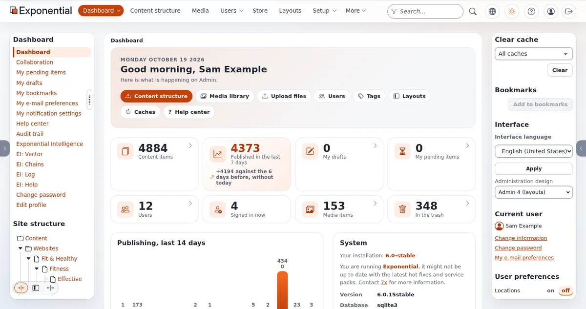
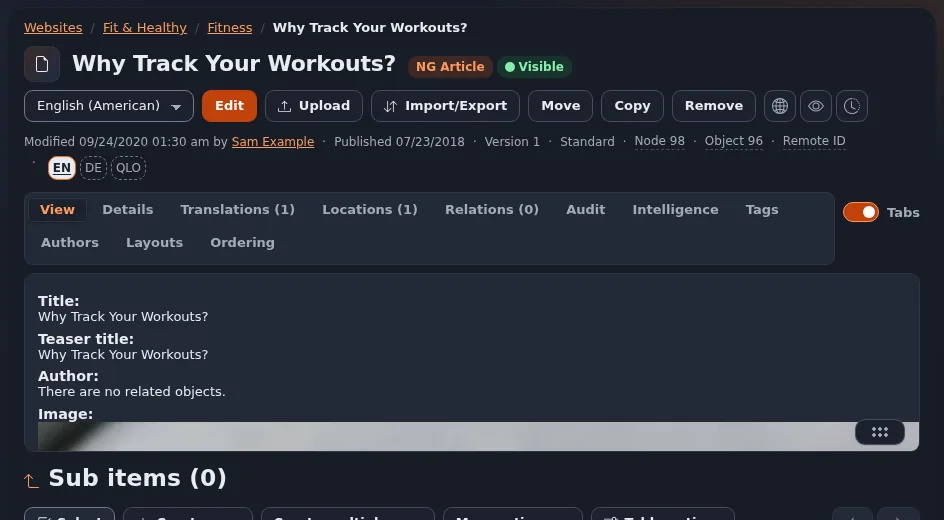

# Eigene Bildschirmfotos aufnehmen

Diese Seite ist für Reporter, Bildredakteure und Creator, die Bilder wollen, die sonst niemand hat. Am sichersten ist
es, Exponential selbst zu betreiben: Sie bestimmen die Inhalte, die Version und die Daten auf dem Bildschirm.

## Inhalt

1. [Eine Installation besorgen](#eine-installation-besorgen)
2. [Die Inhalte vorbereiten](#die-inhalte-vorbereiten)
3. [Bildschirme, die sich lohnen](#bildschirme-die-sich-lohnen)
4. [Einstellungen für gute Bilder](#einstellungen-für-gute-bilder)
5. [Prüfungen vor der Veröffentlichung](#prüfungen-vor-der-veröffentlichung)
6. [Bildunterschriften](#bildunterschriften)

## Eine Installation besorgen

Die Dokumentation beschreibt eine vollständige Installation mit einem Befehl, mit SQLite, sodass kein Datenbankserver
nötig ist ([Exponential mit einem Befehl installieren](../../funktionen/6.0/installation-mit-einem-befehl.md)):

```bash
./console exp:install
```

Führen Sie ihn in einer Kopie des Codes aus, die Sie so bekommen haben, wie
[Den Code beschaffen](../../installation/03-den-code-beschaffen.md) es beschreibt.

Die Seite nennt die Voraussetzungen und Optionen; [Eine Demo-Installation einrichten](eine-demo-installation-einrichten.md)
führt Creator Schritt für Schritt hindurch. Notieren Sie die installierte Version (`git describe --tags`): Ihre
Bildunterschriften werden sie brauchen.

Machen Sie keine Bildschirmfotos von der Live-Website oder der Administration anderer ohne deren Erlaubnis.

## Die Inhalte vorbereiten

- Verwenden Sie die Demoinhalte des Installationsprogramms oder schreiben Sie eigene, neutrale Inhalte.
- Legen Sie ein Test-Redakteurskonto mit einem offensichtlich erfundenen Namen an, zum Beispiel „Demo Editor“, und mit
  einer Adresse unter einer für Beispiele reservierten Domain wie `example.com`.
- Ändern Sie zuerst das Standardpasswort des Administrators ([Das Administratorpasswort ändern](../administratorpasswort-aendern.md)).

## Bildschirme, die sich lohnen

| Thema | Bildschirm | Hilfeseite, die den Weg zeigt |
|---|---|---|
| Bearbeiten | Das Bearbeitungsformular eines Artikels; die Versionsliste | [Inhalte bearbeiten](../inhalte-bearbeiten.md), [Veröffentlichen und Versionen](../veroeffentlichen-und-versionen.md) |
| Die Administration | Das Dashboard von admin4, hell und dunkel | [Der Rundgang durch die Administration](../rundgang-durch-die-administration.md) |
| Seitenbau | Der Layout-Editor, während ein Block hinzugefügt wird | [Der Layout-Editor](../layout-editor.md) |
| Medien | Upload mehrerer Dateien | [Medien und Uploads](../medien-und-uploads.md) |
| Suche | Die Suchseite mit Ergebnissen | [Suchen](../suchen.md) |
| Sicherheit | Die Einrichtung der zweistufigen Anmeldung | [Konten und Anmeldung](../konten-und-anmeldung.md) |
| Sprachen | Eine Sprache, die von rechts nach links geschrieben wird, in der Administration | [Von rechts nach links](../../funktionen/6.0/rechts-nach-links.md) |
| Hilfe | Das Hilfe-Dashboard und eine Hilfeseite | [Thema: das Hilfesystem](thema-das-hilfesystem.md) |
| Exponential Intelligence | Ein Vorschlag für einen Entwurf im Editor (nur, nachdem Sie selbst einen Anbieter eingerichtet haben) | [Exponential Intelligence](../../funktionen/6.0/erweiterungen/expai.md) |



## Einstellungen für gute Bilder

- **Fenstergröße**: eine gängige Desktopbreite wie 1440 Pixel und eine Telefonbreite wie 375 Pixel für responsive
  Aufnahmen. Browserzoom auf 100 Prozent, sofern Sie nicht gerade den Zoom zeigen wollen.
- **Design**: admin4 hat ein helles und ein dunkles Design; zeigen Sie beide, wenn es im Beitrag um die Oberfläche geht.
- **Format**: PNG zum Bearbeiten; WebP oder JPEG zur Veröffentlichung, in der Größe, die Ihre Seite braucht.
- **Keine Browser-Unordnung**: Blenden Sie Lesezeichen und Erweiterungen aus; schneiden Sie die Adressleiste ab, sofern
  sie nicht nur eine Demoadresse zeigt.



## Prüfungen vor der Veröffentlichung

- [ ] Keine personenbezogenen Daten, keine Passwörter, keine Token, keine privaten Hostnamen ([Geheimnisse vom Bildschirm fernhalten](geheimnisse-vom-bildschirm-fernhalten.md)).
- [ ] Das Standardpasswort des Administrators ist nicht das, das Sie verwendet haben.
- [ ] Der Bildschirm zeigt, was die Bildunterschrift sagt, in der Version, die die Bildunterschrift nennt.
- [ ] Nichts Unveröffentlichtes wird als veröffentlicht dargestellt: Ein Bildschirmfoto aus einem Entwicklungsstand zeigt
      Arbeit an 6.0.15, die „in Entwicklung“ ist ([Über 6.0.15 berichten, solange es in Entwicklung ist](ueber-6-0-15-in-entwicklung-berichten.md)).

## Bildunterschriften

```text
"The admin4 dashboard of Exponential in dark mode (development version of 6.0.15, demo content,
 screenshot by <outlet>, <date>)."
"Adding a block in the Exponential Layouts editor (Exponential <version>, demo installation)."
```

## Verwandte Seiten

- [Bildschirmfotos: was Sie verwenden dürfen](bildschirmfotos-was-sie-verwenden-duerfen.md)
- [Eine Demo-Installation einrichten](eine-demo-installation-einrichten.md)
- [Datenschutz vor der Kamera](privatsphaere-vor-der-kamera.md)
- [Freie Dokumentation](../freie-dokumentation.md): Diese Seite darf unter der GNU FDL 1.3 frei kopiert, übersetzt und verbessert werden.

<!-- exp-partner-block:start -->
**Werden Sie Exponential-Partner.** Partner teilen ihre Informationen, stellen Mittel bereit, geben Beiträge zurück
und entwickeln die Produkte mit uns, und so wächst Exponential. Eine Partner-Website und ein Dashboard sind für Mitte
2027 geplant: Werden Sie noch heute Partner, damit wir schneller wachsen und neue Funktionen früher liefern. Beginnen
Sie mit [Partner: hier beginnen](../partner/partner-hier-beginnen.md) und
[Wie Sie sich bewerben](../partner/wie-sie-sich-bewerben.md).
<!-- exp-partner-block:end -->
