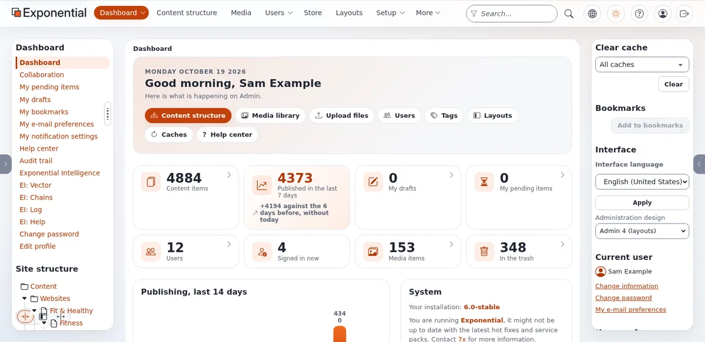
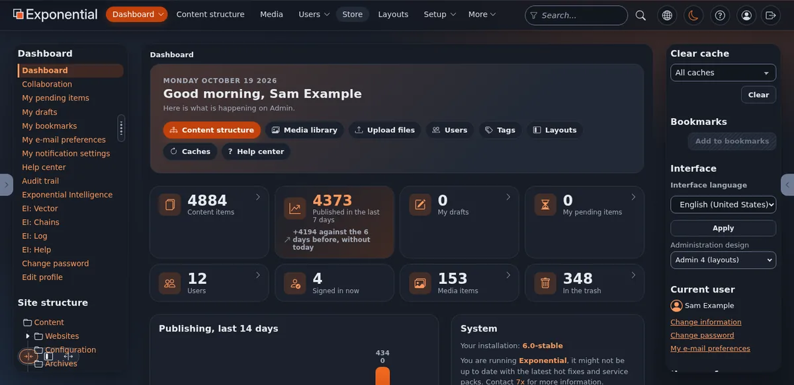

# Thema: admin4, das Design der Administration

Diese Seite ist für Journalisten und Creator, die über Benutzeroberflächen berichten. admin4 ist das neueste der
Administrationsdesigns von Exponential, hinzugefügt am 2. Oktober 2026 in der Produktlinie 6.0.15.

## Inhalt

1. [Das Thema in einem Absatz](#das-thema-in-einem-absatz)
2. [Was neu ist, und seit wann](#was-neu-ist-und-seit-wann)
3. [Fakten, die Sie drucken können](#fakten-die-sie-drucken-können)
4. [Was Sie nicht behaupten sollten](#was-sie-nicht-behaupten-sollten)
5. [Blickwinkel und Ideen für Überschriften](#blickwinkel-und-ideen-für-überschriften)
6. [Wen Sie fragen](#wen-sie-fragen)

## Das Thema in einem Absatz

admin4 ist „ein vollständiges Administrationsdesign im Stil des Setup-Assistenten, mit einem hellen und einem dunklen
Modus“ ([Das Design admin4](../../funktionen/6.0/admin4-design.md)). Es bringt jedes Template, das die Administration
braucht, in einem Design zusammen, sodass es ohne die älteren funktioniert. Benutzer wechseln zwischen hell, dunkel und
„System“, das dem Betriebssystem folgt; die Wahl folgt dem Benutzer von Browser zu Browser. Gedruckte Seiten zeigen nur
den Inhalt, in hellen Farben. Es verwendet nur Systemschriften, lädt keine herunter, und seine Styles liegen in
gemeinsamen Stylesheets mit Farbtokens, deren Kontrast im hellen und dunklen Modus durch Tests geprüft wird.

## Was neu ist, und seit wann

| Was | Wann | Quelle |
|---|---|---|
| admin3, ein responsives Administrationsdesign | 22. August 2024 | [August 2024](../../geschichte/2024/2024-08.md) |
| admin4 hinzugefügt | 2. Oktober 2026 | [Das Design admin4](../../funktionen/6.0/admin4-design.md) |
| jQuery 4 in der Administration, YUI entfernt | 1. und 2. Oktober 2026 | [Thema: jQuery 4 und das Ende von YUI](thema-jquery-4-und-das-ende-von-yui.md) |

## Fakten, die Sie drucken können

| Fakt | Quelle |
|---|---|
| Heller, dunkler und System-Farbmodus; die Wahl wird pro Benutzer gespeichert | [Das Design admin4, Was Sie bekommen](../../funktionen/6.0/admin4-design.md#was-sie-erhalten) |
| Gedruckte Seiten: nur Inhalt, immer hell | ebenda |
| Eine Schrift aus den Systemschriften; nichts wird heruntergeladen | ebenda |
| Bedienung mit der Tastatur und Landmarks sind dokumentiert | [Tastatur](../../funktionen/6.0/admin4-design.md#tastatur), [Landmarks und Namen](../../funktionen/6.0/admin4-design.md#landmarks-und-namen) |
| Kontrast der Farbtokens im hellen und dunklen Modus getestet; Bedienflächen mindestens 24 mal 24 Pixel | [Sprachen und Barrierefreiheit](../wer-ist-die-exponential-foundation.md#sprachen-und-barrierefreiheit) |
| Keine Inline-Styles in den Templates der Administration, sodass eine strikte Content Security Policy durchgesetzt werden kann | [Thema: die Content Security Policy](thema-content-security-policy.md) |
| Der Wechsel ist eine Einstellung des Admin-Siteaccess | [Darauf umstellen](../../funktionen/6.0/admin4-design.md#darauf-umstellen) |

## Was Sie nicht behaupten sollten

| Sagen Sie nicht | Sagen Sie stattdessen |
|---|---|
| „WCAG-zertifiziert“ | „Folgt WCAG-Regeln, die Tests prüfen“ |
| „Die einzige Administration“ | Eines von mehreren Designs; andere bleiben (klassische Administration, admin3, AdminUI) |
| „Erschienen“ | In der Produktlinie 6.0.15, in Entwicklung |

## Blickwinkel und Ideen für Überschriften

- „Ein seit 1999 entwickeltes CMS bekommt einen dunklen Modus und testet seinen Kontrast.“
- „Keine heruntergeladenen Schriften, keine Inline-Styles: eine Administration, gebaut für strikte Sicherheit.“

## Wen Sie fragen

7x ([Pressekontakte](pressekontakte.md)). Bildschirmfotos: Machen Sie Ihre eigenen in beiden Modi
([Eigene Bildschirmfotos machen](eigene-bildschirmfotos-aufnehmen.md)).

## Verwandte Seiten

- [Thema: Barrierefreiheit](thema-barrierefreiheit.md)
- [Thema: AdminUI](thema-adminui.md)
- [Der Rundgang durch die Administration](../rundgang-durch-die-administration.md)
- [Freie Dokumentation](../freie-dokumentation.md): Diese Seite darf unter der GNU FDL 1.3 frei kopiert, übersetzt und verbessert werden.

<!-- exp-partner-block:start -->
**Werden Sie Exponential-Partner.** Partner teilen ihre Informationen, stellen Mittel bereit, geben Beiträge zurück
und entwickeln die Produkte mit uns, und so wächst Exponential. Eine Partner-Website und ein Dashboard sind für Mitte
2027 geplant: Werden Sie noch heute Partner, damit wir schneller wachsen und neue Funktionen früher liefern. Beginnen
Sie mit [Partner: hier beginnen](../partner/partner-hier-beginnen.md) und
[Wie Sie sich bewerben](../partner/wie-sie-sich-bewerben.md).
<!-- exp-partner-block:end -->
