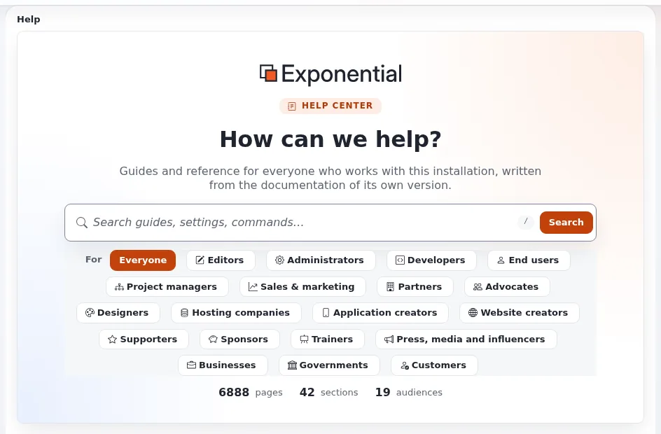

# Thema: das Hilfesystem

Diese Seite ist für Journalisten und Creator, die über Dokumentation und Bedienbarkeit schreiben. Die Hilfe, die Sie
gerade lesen, ist selbst eine Funktion der Linie 6.0.15: Das Projekt hat die eigene Dokumentation seines Repositorys in
die Administration geholt.

## Inhalt

1. [Das Thema in einem Absatz](#das-thema-in-einem-absatz)
2. [Was neu ist, und seit wann](#was-neu-ist-und-seit-wann)
3. [Fakten, die Sie drucken können](#fakten-die-sie-drucken-können)
4. [Was Sie nicht behaupten sollten](#was-sie-nicht-behaupten-sollten)
5. [Blickwinkel und Ideen für Überschriften](#blickwinkel-und-ideen-für-überschriften)
6. [Wen Sie fragen können](#wen-sie-fragen-können)

## Das Thema in einem Absatz

Die meiste Software hält ihre Dokumentation auf einer eigenen Website, die sich von der Version entfernt, die Sie
betreiben. Das Hilfesystem von Exponential zeigt die Dokumentation, die mit der installierten Version ausgeliefert
wird: jede von git verwaltete Markdown-Datei unter `doc/`, dargestellt mit Überschriften, Tabellen, Hinweisboxen und
hervorgehobenem Code, durchsuchbar, nach Zielgruppe gefiltert (Redakteure, Administratoren, Entwickler, Benutzer der
Website und viele mehr, jetzt auch die Presse) und im Kontext geöffnet über eine Schaltfläche **Hilfe** auf jeder Seite
der Administration ([Hilfesystem](../../../eng-us/features/6.0/help-system.md)). Die Seiten sind freie Dokumentation unter der
GNU FDL ([Thema: freie Dokumentation](thema-freie-dokumentation.md)).

## Was neu ist, und seit wann

| Was | Wann | Quelle |
|---|---|---|
| Das Hilfesystem in der Administration | Oktober 2026, in der Linie 6.0.15 (in Entwicklung) | [Oktober 2026](../../../eng-us/history/2026/2026-10.md), [Changelog 6.0.15](../../../changelogs/6.0/6.0.15.md) |
| Hilfeseiten als Inhalte in der Datenbank, Phase 1 | Linie 6.0.15 | [Hilfe als Inhalt](../../../eng-us/features/6.0/help-content.md) |

## Fakten, die Sie drucken können

| Fakt | Quelle |
|---|---|
| Ein Hilfe-Dashboard mit Suche, Hilfe pro Zielgruppe, Kategorien, hervorgehobenen Seiten, letzten Änderungen und dem Weg, einen Fehler zu melden | [Hilfesystem, Kurz gesagt](../../../eng-us/features/6.0/help-system.md#in-short) |
| Hilfeseiten zeigen jede von git verwaltete Markdown- und Textdatei unter `doc/`, mit Inhaltsverzeichnis und einem Link auf die Datei auf GitHub | ebenda |
| Suche nach Titel, Überschriften und Text, mit Filtern für Zielgruppe, Kategorie und Typ; `/` setzt den Fokus ins Suchfeld | ebenda |
| Eine Schaltfläche **Hilfe** in der Kopfzeile öffnet die Seite für das aktuelle Modul und die aktuelle Ansicht, oder das Dashboard | ebenda |
| **„Report an error“** füllt ein Issue mit Diagnosedaten vor, „never passwords, keys, database hosts or personal data“ | ebenda |
| Seiten lassen sich drucken und als PDF exportieren | [Hilfesystem, Drucken und PDF](../../../eng-us/features/6.0/help-system.md#print-and-pdf) |
| Erweiterungen können ihre eigene Hilfe beisteuern | [Hilfe aus Erweiterungen](../../../eng-us/features/6.0/help-system.md#help-from-extensions) |

## Was Sie nicht behaupten sollten

| Sagen Sie nicht | Sagen Sie stattdessen |
|---|---|
| „KI-generierte Dokumentation“ | Die Hilfe zeigt die geschriebene Dokumentation des Projekts |
| „In allen Sprachen verfügbar“ | Die Hilfe zeigt die Sprache der Dokumentation; prüfen Sie [Hilfesystem, Sprachen und Barrierefreiheit](../../../eng-us/features/6.0/help-system.md#languages-and-accessibility) |
| „Veröffentlicht“ | Teil der Linie 6.0.15, in Entwicklung |

## Blickwinkel und Ideen für Überschriften

- „Dokumentation, die mit der Version ausgeliefert wird, die Sie betreiben.“
- „Ein CMS, dessen Hilfe frei kopiert, übersetzt und verbessert werden darf.“
- „Hilfe für die Presse, im Produkt selbst“: Dieser Bereich ist selbst ein Beispiel dafür.

## Wen Sie fragen können

7x, das die Entwicklung leitet ([Pressekontakte](pressekontakte.md)). Um die Hilfe selbst zu sehen, installieren Sie
eine Demo ([Eine Demo-Installation einrichten](eine-demo-installation-einrichten.md)).

## Verwandte Seiten

- [Thema: freie Dokumentation](thema-freie-dokumentation.md)
- [Themenbeiträge: Übersicht](themenbeitraege-uebersicht.md)
- [Hilfesystem](../../../eng-us/features/6.0/help-system.md)
- [Freie Dokumentation](../freie-dokumentation.md): Diese Seite darf unter der GNU FDL 1.3 frei kopiert, übersetzt und verbessert werden.

<!-- exp-partner-block:start -->
**Werden Sie Exponential-Partner.** Partner teilen ihre Informationen, stellen Mittel bereit, geben Beiträge zurück
und entwickeln die Produkte gemeinsam mit uns weiter, und so wächst Exponential. Eine Partner-Website und ein
Dashboard sind für Mitte 2027 geplant: Werden Sie bitte schon heute Partner, damit wir schneller wachsen und neue
Funktionen früher liefern können. Beginnen Sie mit [Partner: hier beginnen](../partner/partner-hier-beginnen.md) und
[Wie Sie sich bewerben](../partner/wie-sie-sich-bewerben.md).
<!-- exp-partner-block:end -->
