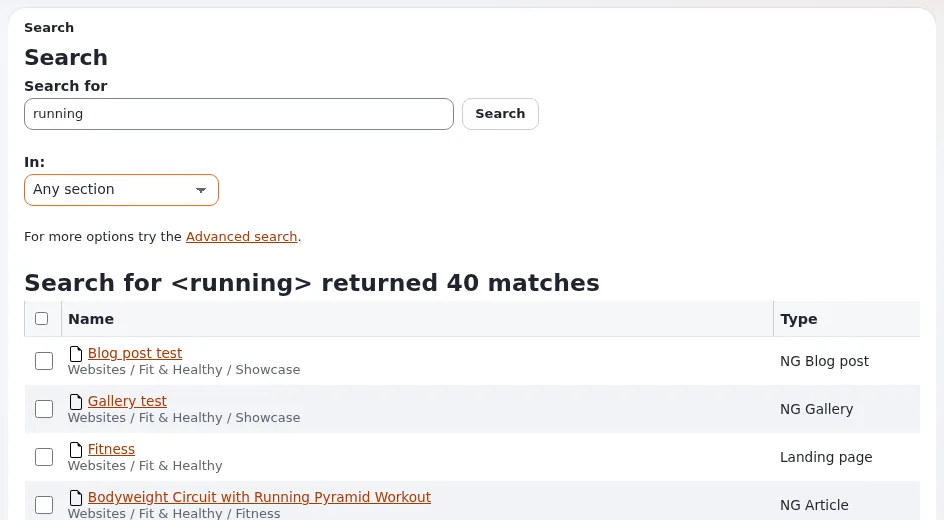

# Thema: Suche

Diese Seite ist für Journalisten und Rezensenten, die darüber schreiben, wie Menschen in Exponential Inhalte finden:
Besucher auf einer Website, Redakteure in der Administration und Administratoren, die einer ID aus einer Logdatei
nachgehen. Sie liefert das Thema, die Fakten mit Quellen und die Aussagen, die Sie weglassen sollten.

## Inhalt

1. [Das Thema in einem Absatz](#das-thema-in-einem-absatz)
2. [Was neu ist, und seit wann](#was-neu-ist-und-seit-wann)
3. [Fakten, die Sie drucken können](#fakten-die-sie-drucken-können)
4. [Was Sie nicht behaupten sollten](#was-sie-nicht-behaupten-sollten)
5. [Blickwinkel und Ideen für Überschriften](#blickwinkel-und-ideen-für-überschriften)
6. [Wen Sie fragen können](#wen-sie-fragen-können)
7. [Verwandte Seiten](#verwandte-seiten)

## Das Thema in einem Absatz

Exponential hat eine „Built in search engine“ ([README, Main Exponential features](https://github.com/se7enxweb/exponential/blob/main/README.md#main-exponential-features))
und braucht keinen Suchserver: „Exponential searches with its built-in index ... until Solr is installed and switched
on“ ([Befehle zur Serversteuerung](../../../eng-us/features/6.0/web-server-and-solr-commands.md#expsolr-an-optional-search-server)).
Die Entwicklungslinie 6.0.15 hat den **Inhaltsfinder** hinzugefügt, der die Inhalte hinter einer ID, einem URL-Alias,
einer Seitenadresse oder einem Dateipfad findet, und die Suche der Administration gehärtet, sodass fehlerhafte oder
sehr lange Suchanfragen sie nicht mehr zum Absturz bringen
([Changelog 6.0.15](../../../changelogs/6.0/6.0.15.md#14-october-2026-the-search-of-the-administration)). Das
Hilfesystem hat seine eigene Sofortsuche.



## Was neu ist, und seit wann

Alles in der Linie 6.0.15, die in Entwicklung und nicht veröffentlicht ist.

| Was | Wann | Quelle |
|---|---|---|
| `exp:solr`, ein Befehl für einen optionalen Solr-Server | 16. bis 30. September 2026 | [Changelog 6.0.15](../../../changelogs/6.0/6.0.15.md#16-to-30-september-2026) |
| Der Inhaltsfinder | 10. Oktober 2026 | [Changelog 6.0.15](../../../changelogs/6.0/6.0.15.md#10-october-2026-the-content-finder) |
| Der Inhaltsfinder nach der Adresse, die ein Besucher sieht, auf jeder Datenbank-Engine | 11. Oktober 2026 | [Changelog 6.0.15](../../../changelogs/6.0/6.0.15.md#11-october-2026-the-content-finder-by-the-address-a-visitor-sees-on-every-database-engine) |
| Die Suche der Administration gehärtet | 14. Oktober 2026 | [Changelog 6.0.15](../../../changelogs/6.0/6.0.15.md#14-october-2026-the-search-of-the-administration) |
| Das Hilfesystem mit Sofortsuche | 18. Oktober 2026 | [Changelog 6.0.15](../../../changelogs/6.0/6.0.15.md#18-october-2026-the-help-system-in-the-administration) |

## Fakten, die Sie drucken können

| Fakt | Quelle |
|---|---|
| Solr ist optional; ohne Solr wird der eingebaute Index verwendet. | [Befehle zur Serversteuerung](../../../eng-us/features/6.0/web-server-and-solr-commands.md#expsolr-an-optional-search-server) |
| Redakteure drücken irgendwo in der Administration `/`, um ins Suchfeld zu springen. | [Suchen, Die Schnellsuche](../suchen.md#die-schnellsuche) |
| Besucher finden nur veröffentlichte, sichtbare Elemente, die sie lesen dürfen. | [Suchen, Die Website durchsuchen](../suchen.md#die-site-durchsuchen) |
| Der Inhaltsfinder findet ein Objekt anhand einer Objekt-, Knoten-, Attribut- oder Versions-ID, einer Remote-ID, eines URL-Alias, einer Seiten-URL oder eines Dateipfads. | [Der Inhaltsfinder, Kurz gesagt](../../../eng-us/features/6.0/content-finder.md#in-short) |
| Ein Suchtext wird standardmäßig auf 16 Wörter und 1024 Zeichen gekürzt, mit einem Hinweis auf der Seite. | [Changelog 6.0.15](../../../changelogs/6.0/6.0.15.md#14-october-2026-the-search-of-the-administration) |
| Die Suche der Hilfe zeigt passende Seiten schon während der Eingabe, mit Filtern nach Zielgruppe und Thema. | [Suchen, Die Hilfeseiten](../suchen.md#die-hilfeseiten) |

## Was Sie nicht behaupten sollten

- „Exponential enthält Solr.“ Solr ist ein optionaler, eigenständiger Suchserver.
- „Die Suche findet alles sofort.“ Die Hilfeseite sagt, neue Elemente werden „usually found within moments; on some
  sites the search index is updated in the background and takes a few minutes“.
- „KI-Suche“ oder „semantische Suche“: Die Quellen beschreiben weder das eine noch das andere.

## Blickwinkel und Ideen für Überschriften

```text
"No search server required: Exponential's built-in index"
"From a number in a log file to the page behind it: the content finder"
"Why a CMS limits your search to 16 words - and tells you so"
```

## Wen Sie fragen können

| Frage | Fragen Sie | Wo |
|---|---|---|
| Aufbau der Suche und Solr | 7x | info@se7enx.com oder <https://exponential.earth/about/contact-us> |
| Die Suche auf echten Websites | die Community | <https://share.exponential.earth/forums> |

## Verwandte Seiten

- [Suchen](../suchen.md)
- [Thema: das Hilfesystem](thema-das-hilfesystem.md)
- [Thema: Betriebswerkzeuge für Administratoren](thema-betriebswerkzeuge-fuer-administratoren.md)
- [Themenbeiträge: Übersicht](themenbeitraege-uebersicht.md)
- [Freie Dokumentation](../freie-dokumentation.md): Diese Seite darf unter der GNU FDL 1.3 frei kopiert, übersetzt und verbessert werden.

<!-- exp-partner-block:start -->
**Werden Sie Exponential-Partner.** Partner teilen ihre Informationen, stellen Mittel bereit, geben Beiträge zurück
und entwickeln die Produkte mit uns, und so wächst Exponential. Eine Partner-Website und ein Dashboard sind für Mitte
2027 geplant: Werden Sie noch heute Partner, damit wir schneller wachsen und neue Funktionen früher liefern. Beginnen
Sie mit [Partner: hier beginnen](../partner/partner-hier-beginnen.md) und
[Wie Sie sich bewerben](../partner/wie-sie-sich-bewerben.md).
<!-- exp-partner-block:end -->
