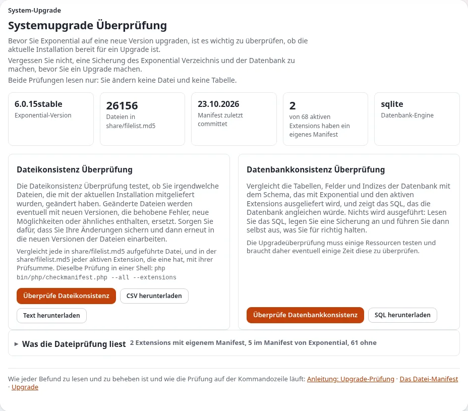

# Updates für eine Person

Diese Seite ist für Privatpersonen, die ihre eigene Website betreiben und sie aktuell halten müssen. Updates
schließen Sicherheitslücken und beheben Fehler; eine Website, die nie aktualisiert wird, wird zum Risiko für Sie und
Ihre Besucher ([Wie Updates funktionieren](../../kunden/gesund-halten/wie-updates-funktionieren.md)).

## Inhalt

1. [Was ein Update umfasst](#was-ein-update-umfasst)
2. [Wo Sie von neuen Versionen erfahren](#wo-sie-von-neuen-versionen-erfahren)
3. [Sicherheitskorrekturen zuerst](#sicherheitskorrekturen-zuerst)
4. [Das Update Schritt für Schritt](#das-update-schritt-für-schritt)
5. [Werkzeuge in der Administration](#werkzeuge-in-der-administration)
6. [PHP und das Betriebssystem](#php-und-das-betriebssystem)
7. [Wenn etwas schiefgeht](#wenn-etwas-schiefgeht)

## Was ein Update umfasst

| Teil | Aktualisiert durch |
|---|---|
| Exponential selbst und seine Erweiterungen | Composer oder Git, von Ihnen ausgeführt ([Updates und Upgrades](../../ersteller/website-ersteller/updates-und-aktualisierungen.md)) |
| Ihr eigenes Design und Ihre Einstellungen | Von Updates nicht berührt, wenn sie in Ihrer eigenen Erweiterung und in `settings/override` liegen |
| PHP | Ihr Hoster, oder Sie auf Ihrem eigenen Server |
| Das Betriebssystem | Ihr Hoster, oder Sie auf Ihrem eigenen Server |

Veröffentlichte Versionen ändern sich nie; eine Korrektur kommt immer als nächste Version
([Die Support-Zusage](../../wer-ist-die-exponential-foundation.md#die-zusage-zur-unterstützung)).

## Wo Sie von neuen Versionen erfahren

- Die GitHub-Releases des Projekts und die Changelogs ([Versionslinie und Support](../../kunden/gesund-halten/release-linie-und-support.md)).
- **Setup > Upgrade-Prüfung** in der Administration vergleicht Ihre Dateien und Ihre Datenbank mit der Version; sie
  liest nur ([Die Upgrade-Prüfung](../../../anleitungen/upgrade-pruefung.md)).
- Wenn Sie das Repository auf GitHub beobachten, erhalten Sie pro Version eine E-Mail.

## Sicherheitskorrekturen zuerst

Eine Version, die ein Sicherheitsproblem behebt, wird innerhalb weniger Tage eingespielt. Funktionsversionen können
auf ein ruhiges Wochenende warten. Wenn Sie eine Sicherheitskorrektur nicht bald einspielen können, erwägen Sie den
Wartungsmodus oder schalten Sie die betroffene Funktion ab, bis Sie es können
([Sicherheitsgrundlagen](../../kunden/gesund-halten/sicherheitsgrundlagen.md)).

## Das Update Schritt für Schritt

1. **Lesen** Sie die Versionshinweise: Ist vorher oder nachher etwas zu tun?
2. **Sichern** Sie Datenbank und Dateien ([Sicherungen für eine Person](sicherungen-fuer-eine-person.md)).
3. **Wartungsmodus ein** ([Wartungsmodus](../../ersteller/website-ersteller/wartungsmodus.md)).
4. **Aktualisieren** Sie den Code mit Composer oder Git ([Mit Git aktualisieren](../../mit-git-aktualisieren.md),
   [Aktualisieren](../../../anleitungen/aktualisieren.md)).
5. **Leeren Sie die Caches** und führen Sie, wenn die Hinweise es verlangen, die Update-Skripte aus.
6. **Prüfen Sie**: Startseite, eine tief liegende Seite, Anmeldung, einen Test bearbeiten und veröffentlichen, ein
   Formular.
7. **Wartungsmodus aus.** Behalten Sie die Sicherung von vor dem Update, bis die Website eine Weile normal gelaufen
   ist.

Unter Velocity folgen Sie dessen Deploy-Schritt, damit die laufenden Worker den neuen Code laden
([Velocity ist Teil von Exponential 6.0.15](../../velocity-ist-teil-von-exponential-6-0-15.md)).

## Werkzeuge in der Administration

Für Menschen ohne Shell oder die den Browser bevorzugen:

| Werkzeug | Was es tut | Seite |
|---|---|---|
| Upgrade-Prüfung | Vergleicht Dateien und Datenbank mit der Version; ändert nichts | [Die Upgrade-Prüfung](../../../anleitungen/upgrade-pruefung.md) |
| `ezupdate` | Aktualisiert aus der Administration | [Automatisierte Updates mit ezupdate](../../hosting/betrieb/automatische-updates-mit-ezupdate.md) |
| `git_manager` | Git-Dashboard (Pull, Branches wechseln) und der Sicherungsmanager | [git_manager](../../../funktionen/6.0/erweiterungen/git_manager.md) |

## PHP und das Betriebssystem

- Exponential 6.0.15 läuft ab PHP 8.0; 8.5 ist die neueste getestete Version
  ([Anforderungen auf einen Blick](../../hosting/grundlagen/anforderungen-auf-einen-blick.md)).
- Wenn Ihr Hoster das Ende einer PHP-Version ankündigt, testen Sie Ihre Website zuerst mit der neueren (auf einer
  Kopie oder über die PHP-Umschaltung pro Website beim Hoster)
  ([PHP-Versionen und Erweiterungen](../../hosting/grundlagen/php-versionen-und-erweiterungen.md)).
- Auf Ihrem eigenen Server spielen Sie Sicherheitsupdates des Betriebssystems ein, sobald sie erscheinen.

## Wenn etwas schiefgeht

1. Bleiben Sie ruhig; die Website ist im Wartungsmodus, und nichts ist verloren.
2. Notieren Sie den Fehler und seine Referenz ([Einen Fehler über seine Referenz finden](../../../anleitungen/fehler-anhand-der-referenz-finden.md)).
3. Leeren Sie die Caches noch einmal.
4. Wenn es weiterhin scheitert, kehren Sie zur vorherigen Version zurück: Stellen Sie den Code und die Sicherung von
   vor dem Update wieder her.
5. Bitten Sie mit der Fehlermeldung um Hilfe ([Wenn etwas schiefgeht](../../wenn-etwas-schiefgeht.md),
   [Wann Sie sich Hilfe holen sollten](wann-sie-sich-hilfe-holen-sollten.md)).

## Verwandte Seiten

- [Allein betreiben](README.md)
- [Updates und Upgrades](../../ersteller/website-ersteller/updates-und-aktualisierungen.md)
- [Checkliste für den Upgrade-Tag](../../kunden/gesund-halten/checkliste-upgrade-tag.md)
- [Monatliche Pflegecheckliste](../checklisten/monatliche-pflegecheckliste.md)
- [Freie Dokumentation](../../freie-dokumentation.md): Diese Seite darf unter der GNU FDL 1.3 frei kopiert, übersetzt und verbessert werden.

<!-- exp-partner-block:start -->
**Werden Sie Exponential-Partner.** Partner teilen ihre Informationen, stellen Mittel bereit, geben Beiträge zurück
und entwickeln die Produkte mit uns, und so wächst Exponential. Eine Partner-Website und ein Dashboard sind für Mitte
2027 geplant: Werden Sie noch heute Partner, damit wir schneller wachsen und neue Funktionen früher liefern. Beginnen
Sie mit [Partner: hier beginnen](../../partner/partner-hier-beginnen.md) und
[Wie Sie sich bewerben](../../partner/wie-sie-sich-bewerben.md).
<!-- exp-partner-block:end -->
